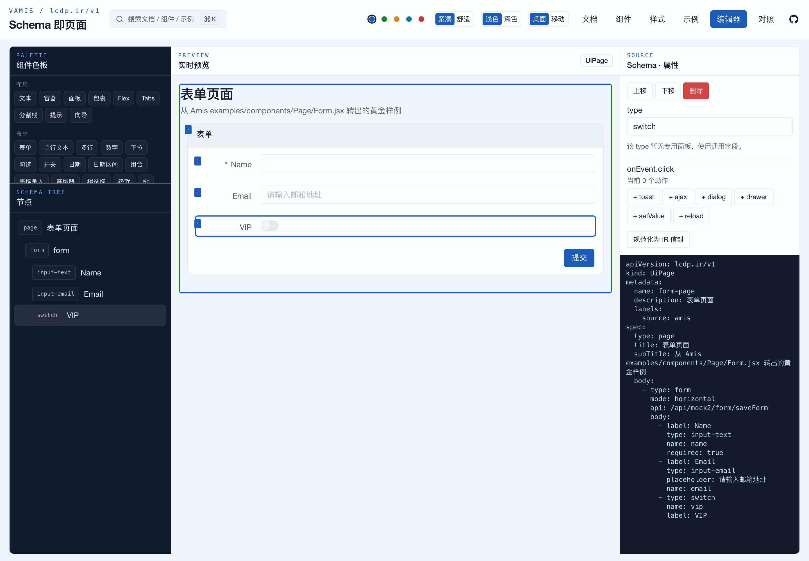
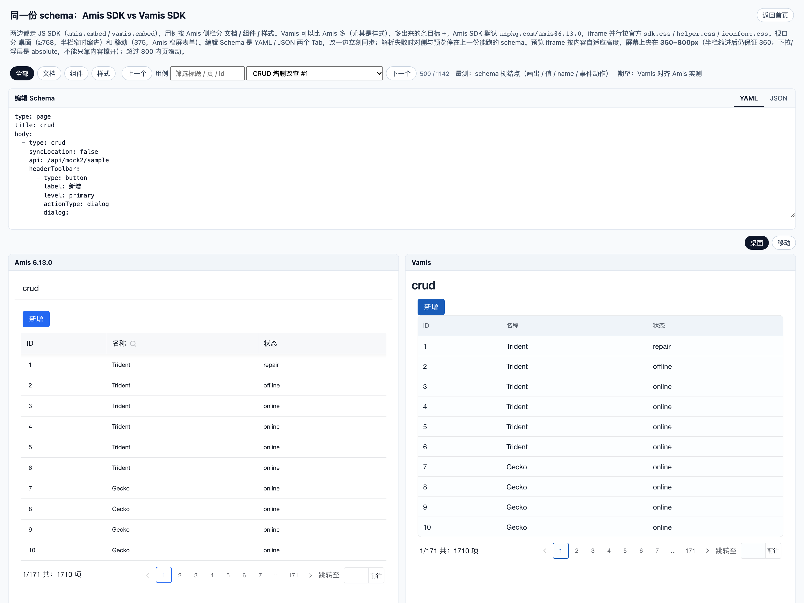

# Vamis

**Amis schemas, natively on Vue 3.**

Vamis is an **Amis-compatible** JSON/YAML low-code runtime, reimplemented in Vue 3 with shadcn-vue. Keep your Amis schemas; drop the React runtime. Authoring is YAML or JSON, with an optional LCDP IR envelope (`apiVersion: lcdp.ir/v1`). Use `VamisRoot` in Vue, or `vamis.embed` on any HTML page.

[](LICENSE)
[](CONTEXT.md)
[](docs/superpowers/specs/2026-10-20-amis-sync-status.md)
[](package.json)
[](https://vuejs.org/)

[Live demo](https://maxid.github.io/vamis/) · [Component docs](https://maxid.github.io/vamis/components) · [Amis side-by-side](https://maxid.github.io/vamis/sdk/compare.html) · [中文](README.md)



> [!WARNING]
> **Early alpha. Unofficial project, not affiliated with Baidu.** 184/189 Amis component types are registered, but average semantic parity across the 155 sidebar components is **59%**. Use it for evaluation and feedback, not for critical production yet.

## Why Vamis

- **Schemas are the asset; the runtime can change.** Field names and semantics follow Amis; the same schema renders side by side in Amis and Vamis for node-level comparison.
- **Native Vue 3, not an iframe or a React shell.** Renderers, data scope, actions and formula evaluation all run in Vue; Vue components and Pinia devtools stay usable.
- **YAML and JSON are equal authoring formats.** `parseSchemaText` detects the format; raw widget trees or IR envelopes both work.
- **shadcn-vue / Tailwind design language.** No `cxd-` prefix or theme SCSS; tokens and helpers are transcribed.
- **Two embedding entries.** Vue `VamisRoot` and `vamis.embed` for any HTML page share one kernel — no `amisRequire`.



## What works today

| Area | Status | Notes |
|------|--------|-------|
| Form / FormItem | In progress 80% / 90% | layout, validation, linkage, submit, `static`, 375 mobile |
| CRUD / Table / Table2 | 65% / 55% / 70% | query, pagination, bulk actions, dialog editing; column semantics still landing |
| Date / pickers | 92% | desktop calendar + mobile wheel, `minDate` / `maxDate` |
| Data display | 56% avg | Card, List, Image, Calendar, Table View, … |
| Feedback / navigation | 89% / 84% avg | Dialog, Drawer, Toast, Tabs, Collapse, Nav |
| JS SDK | 90% | `vamis.embed`, `updateSchema`, `updateProps`, `doAction` |
| Visual editor | Skeleton | tree / canvas / properties / YAML; no plugin marketplace |
| Styles | Partial | helpers, CSS variables, dark mode; color palette still WIP |

Every component docs page shows its real implementation progress. "Registered" does not mean "semantically complete". See [CONTEXT.md](CONTEXT.md) and the [component TODO](docs/superpowers/specs/2026-10-20-vamis-component-todo.md) (both in Chinese).

## Quick start

Currently run from source (npm packages are being prepared). Requires Node 20+ and pnpm.

```bash
pnpm install
pnpm dev        # docs / components / examples / editor, http://127.0.0.1:5173
```

### Vue

```ts
import { createApp } from 'vue'
import { createPinia } from 'pinia'
import { VamisRoot } from 'vamis'
import '@vamis/ui/styles.css'
import 'vamis'

const app = createApp({
  components: { VamisRoot },
  setup() {
    const schema = {
      type: 'page',
      title: 'Hello',
      body: [
        {
          type: 'form',
          api: '/api/mock2/form/saveForm',
          body: [{ type: 'input-text', name: 'name', label: 'Name', required: true }],
        },
      ],
    }
    return { schema }
  },
  template: '<VamisRoot :schema="schema" />',
})
app.use(createPinia())
app.mount('#app')
```

Pinia is required — the internal state hub uses it (no MST).

### Any HTML page (JS SDK)

```html
<link rel="stylesheet" href="./sdk.css" />
<div id="root"></div>
<script src="./sdk.js"></script>
<script>
  vamis.embed('#root', {
    type: 'page',
    title: 'Form page',
    body: {
      type: 'form',
      body: [{ type: 'input-text', name: 'name', label: 'Name' }],
    },
  })
</script>
```

Build the SDK with `pnpm sdk:build` → `packages/vamis-sdk/dist/`.

### YAML / JSON / IR

```yaml
type: page
title: New user
body:
  - type: form
    api: /api/mock2/form/saveForm
    body:
      - type: input-text
        name: name
        label: Name
        required: true
      - type: select
        name: role
        label: Role
        options:
          - label: Admin
            value: admin
          - label: Editor
            value: editor
```

```ts
import { parseSchemaText } from 'vamis'
const schema = parseSchemaText(text) // JSON if it starts with { or [, YAML otherwise
```

IR envelopes are accepted too:

```yaml
apiVersion: lcdp.ir/v1
kind: UiPage
metadata:
  name: form-page
spec:
  type: page
  title: Form page
  body: []
```

Unknown `type` / unimplemented `kind` renders a placeholder instead of crashing.

## How parity is verified

Playwright mounts the same schema with `amis.embed` and `vamis.embed` side by side, then compares schema-tree nodes — rendered or not, runtime `value`, `getComponentByName`, and action results — rather than whole-page screenshots. There are currently **1,142 comparison cases**; P0 diffs are zero, with 30 non-P0 diffs left in the last full run. The same harness also checks box model and 375px mobile behavior.

Progress is public: docs pages show implementation percentages, and every task updates `CONTEXT.md`.

## Status (2026-11-10)

- Amis type names covered: **184 / 189 (97.4%)**; 3 types and 2 aliases remain.
- 155 sidebar components: **2 complete** (`container`, `toast`), 153 in progress, **59% average** semantic parity.
- Kernel D1–D5 P0 landed; D6 path values, D7 renderer API leftovers and D8 diagnostics are still missing.
- Tests: formula 185 + core 620 + sdk 75 = **880 passing**.
- Upstream Amis has had no new commits since 2026-03-18; Vamis tracks 6.13.0.

## Development

| Route | What |
|-------|------|
| `/` | Docs home |
| `/components` | Component docs with live YAML/JSON preview |
| `/style` | Style / CSS variables / helpers |
| `/examples` | Examples: tree + preview + schema |
| `/editor` | Editor skeleton |
| `/sdk/compare.html` | Amis vs Vamis side-by-side |
| `/sdk/embed-case.html` | Single-engine embed page |

```bash
pnpm test        # formula + core + sdk
pnpm typecheck   # vue-tsc (existing errors remain)
pnpm sdk:build   # build packages/vamis-sdk/dist/sdk.js
pnpm build       # SDK + playground production build
pnpm compare     # Playwright parity run; --page <type> / --mobile
```

`pnpm build` writes a fully static site (one `index.html` per route); the GitHub Pages workflow is in [.github/workflows/pages.yml](.github/workflows/pages.yml).

## Packages

```
packages/vamis-core     factory, IR, formula wrapper, Pinia hub, SchemaRenderer
packages/vamis-formula  expression engine (ported from amis-formula 6.13.0, MIT)
packages/vamis-ui       shadcn-vue primitives and theme tokens
packages/vamis          renderer registry
packages/vamis-editor   visual editor (tree / preview / properties / schema)
packages/vamis-sdk      JS SDK (sdk.js + vamis.embed)
playground              docs / components / styles / examples / editor (Vite, port 5173)
website                 Markdown source for docs (optional VitePress export)
```

## Contributing

- Real Amis schemas that break, render incorrectly, or fail on mobile: open an issue with a redacted schema and expected behavior.
- Components, docs, styles, English translations: PRs welcome. Read [CONTRIBUTING.md](CONTRIBUTING.md) first.
- Plans: [ROADMAP.md](ROADMAP.md) (milestones) and [CONTEXT.md](CONTEXT.md) (source of truth, Chinese).
- Changes: [CHANGELOG.md](CHANGELOG.md); security reports: [SECURITY.md](SECURITY.md).

## License

Apache-2.0. `@vamis/formula` is MIT, ported from `amis-formula@6.13.0`; UI primitives come from shadcn-vue (MIT). Amis concept and schema compatibility follow Apache-2.0; see [NOTICE](NOTICE).

**Unofficial project, not affiliated with Baidu.** Do not copy Amis source, logos, or documentation into this repository.
