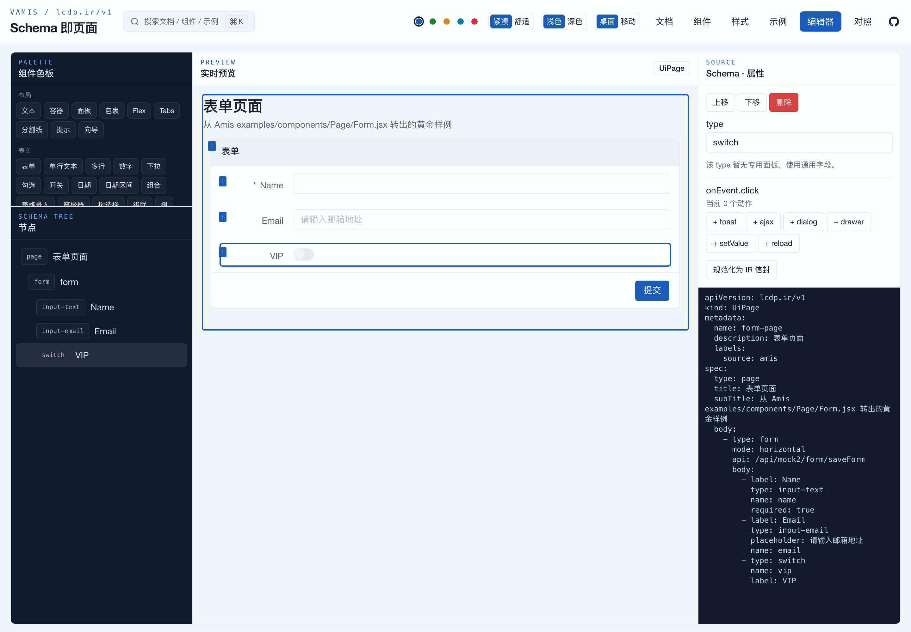
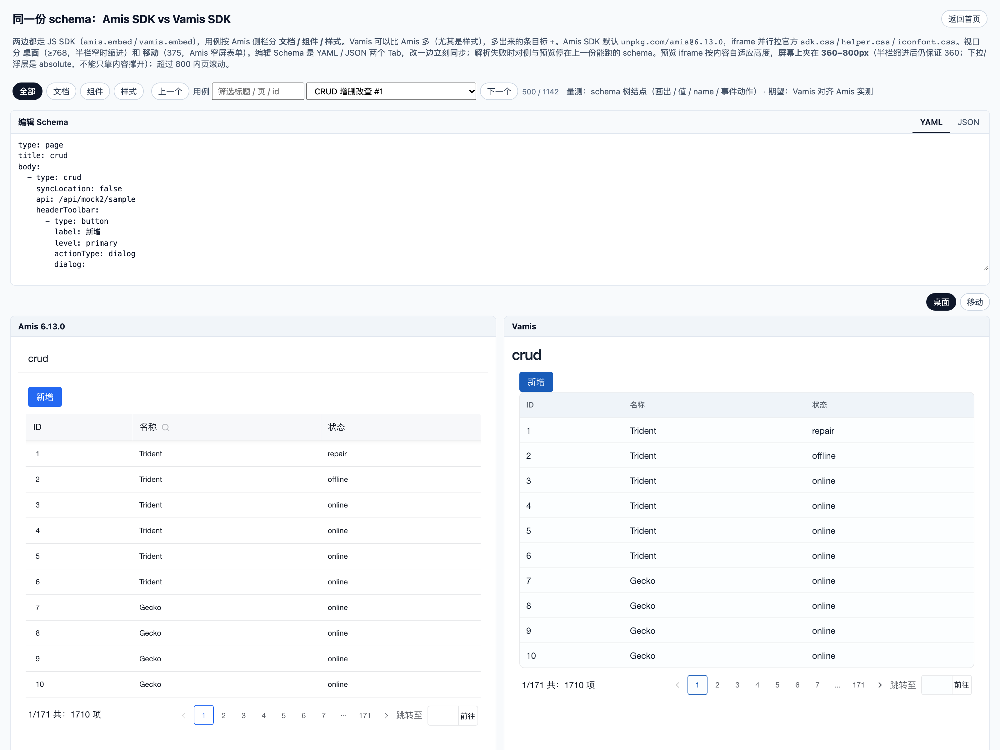

# Vamis

**Amis 的 Schema，原生跑在 Vue 3 上。**

Vamis 是用 Vue 3 + shadcn-vue 重实现的 **Amis 兼容** JSON/YAML 低代码运行时：同一份 Amis schema，不再套 React。作者态支持 **YAML** 与 **JSON**，信封对齐 **LCDP IR**（`apiVersion: lcdp.ir/v1`）；Vue 用 `VamisRoot`，任意 HTML 用 `vamis.embed`。

[](LICENSE)
[](CONTEXT.md)
[](docs/superpowers/specs/2026-10-20-amis-sync-status.md)
[](package.json)
[](https://vuejs.org/)

[在线 Demo](https://maxid.github.io/vamis/) · [组件文档](https://maxid.github.io/vamis/components) · [与 Amis 并排对照](https://maxid.github.io/vamis/sdk/compare.html) · [English](README.en.md)



> [!WARNING]
> **早期 alpha，非百度官方项目，与百度无关联。** 184 / 189 个 Amis type 名称已注册，侧栏组件语义平均 **59%**；适合评估、试用和参与共建，不建议直接用于关键生产。

## 为什么是 Vamis

- **Schema 是资产，运行时可以换。** 字段名与 Amis 语义不改写；同一份 schema 可以在 Amis 与 Vamis 里并排渲染、逐结点对照。
- **原生 Vue 3，不是 iframe / React 壳。** 渲染器、数据域、动作、公式都在 Vue 里；可复用 Vue 组件和 Pinia 调试链路。
- **YAML 与 JSON 平权。** `parseSchemaText` 自动识别；裸 widget 或 IR 信封都能进运行时。
- **shadcn-vue / Tailwind 设计语言。** 不搬 `cxd-` 前缀和主题 SCSS，按 token + helper 转写。
- **两条嵌入入口。** Vue `VamisRoot` 与任意 HTML `vamis.embed`，同一套内核，不搬 `amisRequire`。



## 现在能做什么

| 能力 | 状态 | 说明 |
|------|------|------|
| 表单 / FormItem | 进行中 80% / 90% | 布局、校验、联动、提交、`static`、375 窄屏 |
| CRUD / Table / Table2 | 65% / 55% / 70% | 查询、分页、批量、弹窗编辑；列语义仍在补 |
| 日期 / 选择器 | 92% | 桌面月历 + 移动端滚轮、`minDate` / `maxDate` |
| 数据展示 | 56%（均） | Card / List / Image / Calendar / Table View 等 |
| 反馈 / 导航 | 89% / 84%（均） | Dialog、Drawer、Toast、Tabs、Collapse、Nav |
| JS SDK | 90% | `vamis.embed`、`updateSchema`、`updateProps`、`doAction` |
| 可视化编辑器 | 骨架 | 组件树 / 画布 / 属性 / YAML，无插件市场 |
| 样式 | 部分 | 辅助类、CSS 变量、深色；色盘表仍在补 |

每个组件文档页标题下都标了真实进度；`已注册 ≠ 语义完成`。完整状态见 [CONTEXT.md](CONTEXT.md) 与 [组件 P0 TODO](docs/superpowers/specs/2026-10-20-vamis-component-todo.md)。

## 快速开始

当前从源码运行（npm 包发布准备中）。需要 Node 20+ 与 pnpm。

```bash
pnpm install
pnpm dev        # 文档 / 组件 / 示例 / 编辑器，http://127.0.0.1:5173
```

### Vue

```ts
import { createApp } from 'vue'
import { createPinia } from 'pinia'
import { VamisRoot } from 'vamis'
import '@vamis/ui/styles.css'
import 'vamis'

const app = createApp({
  components: { VamisRoot },
  setup() {
    const schema = {
      type: 'page',
      title: 'Hello',
      body: [
        {
          type: 'form',
          api: '/api/mock2/form/saveForm',
          body: [{ type: 'input-text', name: 'name', label: '名称', required: true }],
        },
      ],
    }
    return { schema }
  },
  template: '<VamisRoot :schema="schema" />',
})
app.use(createPinia())
app.mount('#app')
```

必须挂 Pinia：内部状态 hub 用它，不引入 MST。

### 任意 HTML（JS SDK）

```html
<link rel="stylesheet" href="./sdk.css" />
<div id="root"></div>
<script src="./sdk.js"></script>
<script>
  vamis.embed('#root', {
    type: 'page',
    title: '表单页面',
    body: {
      type: 'form',
      body: [{ type: 'input-text', name: 'name', label: '名称' }],
    },
  })
</script>
```

构建 SDK：`pnpm sdk:build` → `packages/vamis-sdk/dist/`（`sdk.js` + `sdk.esm.js` + chunks + `sdk.css`）。

### YAML / JSON / IR

```yaml
type: page
title: 新建用户
body:
  - type: form
    api: /api/mock2/form/saveForm
    body:
      - type: input-text
        name: name
        label: 名称
        required: true
      - type: select
        name: role
        label: 角色
        options:
          - label: 管理员
            value: admin
          - label: 编辑
            value: editor
```

```ts
import { parseSchemaText } from 'vamis'
const schema = parseSchemaText(text) // 以 { / [ 开头走 JSON，否则 YAML
```

也可以直接喂 IR 信封：

```yaml
apiVersion: lcdp.ir/v1
kind: UiPage          # Vamis 扩展；LCDP IR 已有 TableDef / FormDef / PageDef…
metadata:
  name: form-page
spec:
  type: page          # 仍是 Amis 兼容的 widget 树
  title: 表单页面
  body: []
```

未知 `type` / 未实现的 `kind` 显示占位，不崩。

<details>
<summary>作者态与 IR 的更多细节</summary>

- 裸 widget 或 IR 信封都可以；`jsonToIr()` 把裸树包成 `kind: UiPage`。
- 运行时 `VamisRoot` 先 normalize 成 IR，再 `compileIrToWidget()` 得到 widget 树。
- 未知 `type` / 未实现的 `kind` 显示占位，不崩。

与 LCDP IR 的对接点：

| 点 | 做法 |
|----|------|
| 信封 | 同 `apiVersion` / `kind` / `metadata` / `spec` |
| `UiPage` | Vamis 扩展 kind，承载 widget 树；将来可挂到 `PageDef.spec.schema` 或 `pageKind: SCHEMA` |
| `FormDef` / `TableDef` | 已能编译成 form / crud 预览 |
| 存储 | 不实现 `lcdp_ir_def`；宿主把 `UiPage` 注册成 `LcdpIrKind` 即可收纳 |

黄金样例（`playground/src/examples/`，共 14 个 YAML）：`form-page.yaml`（从 Amis `examples/components/Page/Form.jsx` 转出）、`amis-form.json`（原始 JSON）、`crud-page.yaml`（查询表 + 表格 + 弹窗编辑）。

</details>

## 和 Amis 的关系

- **不是 fork，不复制 Amis 源码。** Amis 是 Apache-2.0，Vamis 只做 schema 语义兼容；公式引擎从 MIT 的 `amis-formula@6.13.0` 移植，署名见 [NOTICE](NOTICE)。
- **不是"像素复制"。** 对齐的是盒模型、密度、交互和语义；UI 用 shadcn-vue / Tailwind 重新实现。
- **对照是工程，不是感觉。** Playwright 用同一份 schema 在 Amis 与 Vamis 两边挂 iframe，按 schema 树结点比较渲染、`value`、`getComponentByName`、动作结果；当前 1142 条用例，P0 差异归零，最近一次全量 878 过 / 30 条非 P0 差异。
- **进度公开。** 文档页显示实现进度，任务收工必须回写 `CONTEXT.md`；上游对齐 6.13.0。

type 覆盖复算：`pnpm status -- --amis ../amis`。

## 项目状态（2026-11-10）

- amis type 名称覆盖 **184 / 189（97.4%）**，剩 3 个 type 与 2 个别名。
- 侧栏 155 个组件：已完成 **2**（`container` / `toast`），进行中 153，平均 **59%**。
- kernel D1–D5 P0 已落地；D6 表单路径值、D7 渲染器 API 余项、D8 诊断仍缺。
- 测试：formula 185 + core 620 + sdk 75 = **880**，全部通过。
- Amis 上游自 2026-03-18 无新提交，仍对齐 6.13.0。

## 开发

| 路由 | 做什么 |
|------|--------|
| `/` | 文档首页（开始 / 概念 / 类型 / 扩展） |
| `/components` | 组件文档（侧栏对齐 Amis，YAML / JSON 实时预览） |
| `/style` | 样式（CSS 变量 / 辅助类目录） |
| `/examples` | 示例：分类树 + 预览 + Schema |
| `/editor` | 编辑器骨架：左树 / 中预览 / 右属性 + Schema |
| `/sdk/compare.html` | Amis / Vamis SDK 对照。`?case=<id>&vp=mobile` 定位用例 |
| `/sdk/embed-case.html` | 单引擎真机页 |

```bash
pnpm test        # formula + core + sdk
pnpm typecheck   # vue-tsc（仓内仍有既有报错）
pnpm sdk:build   # 打 packages/vamis-sdk/dist/sdk.js
pnpm build       # SDK + playground 生产构建
pnpm compare     # Amis / Vamis Playwright 对照；--page <type> / --mobile
```

`pnpm build` 产出全静态目录，每个文档/组件路由都有 `index.html`；GitHub Pages 工作流见 [.github/workflows/pages.yml](.github/workflows/pages.yml)。本地按 Pages 路径预览：

```bash
VITE_BASE=/vamis/ pnpm build
VITE_BASE=/vamis/ pnpm preview   # http://127.0.0.1:4173/vamis/
```

## 包结构

```
packages/vamis-core     工厂、IR、公式封装、Pinia hub、SchemaRenderer
packages/vamis-formula  表达式 / 过滤器 / 内置函数（amis-formula 6.13.0 MIT）
packages/vamis-ui       shadcn-vue 原语与主题 token
packages/vamis          渲染器注册表（register.ts + extras/*.ts）
packages/vamis-editor   可视化编辑器（树 / 预览 / 属性 / Schema）
packages/vamis-sdk      JS SDK（sdk.js + vamis.embed）
playground              文档 / 组件 / 样式 / 示例 / 编辑器（同一 Vite，5173）
website                 文档 Markdown 真源（可选 VitePress 静态导出）
docs/superpowers/       specs / plans
docs/marketing/         发布材料（首发文案 / 检查清单 / 截图）
```

## 文档

- [快速开始](website/src/start/getting-started.md)
- [JS SDK](website/src/start/sdk.md)（[spec](docs/superpowers/specs/2026-10-21-vamis-js-sdk.md)）
- [运行时与 IR 设计](docs/superpowers/specs/2026-10-20-vamis-vue3-runtime-design.md)
- [运行时语义](docs/superpowers/specs/2026-10-20-vamis-runtime-semantics-design.md)（D1–D12）
- [组件 P0 TODO](docs/superpowers/specs/2026-10-20-vamis-component-todo.md)
- [Amis 同步状态](docs/superpowers/specs/2026-10-20-amis-sync-status.md)
- [主题 / 样式](docs/superpowers/specs/2026-10-21-vamis-theme-shadcn.md)
- [在线文档](docs/superpowers/specs/2026-10-21-vamis-online-docs.md)

## 参与

- 真实 Amis schema 跑不通、渲染不对、移动端有问题：开 issue，贴脱敏 schema 和期望。
- 组件 / 文档 / 样式 / 英文翻译：欢迎 PR；先看 [CONTRIBUTING.md](CONTRIBUTING.md) 与 [AGENTS.md](AGENTS.md) 的命令和约定。
- 路线：[ROADMAP.md](ROADMAP.md)（阶段目标）与 [CONTEXT.md](CONTEXT.md)（进度真源）。
- 变更记录：[CHANGELOG.md](CHANGELOG.md)；安全问题见 [SECURITY.md](SECURITY.md)。

## 许可

Apache-2.0；公式层 `@vamis/formula` 为 MIT（来自 `amis-formula@6.13.0`），UI 原语来自 shadcn-vue（MIT）。Amis 概念与 schema 兼容性遵循 Apache-2.0，见 [NOTICE](NOTICE)。

**非百度官方项目，与百度无关联。** 不要在本仓库复制 Amis 源码、logo 或文档原文。
