# 组件分 type 依赖图

由 `scripts/component-priority.mjs` 生成，不要手改。箭头 `A --> B` = 先做 A。
TODO 里的拓扑图只画**主干**。这里每个 type 一张 **开工前置闭包**：自身 + 全部祖先，边是诱导子图（祖先之间的依赖也画）。
只画直接依赖不够：Action 研发时会把 `tooltip-wrapper` 当成一个点，在按钮里再造一套浮层。这张图里的节点全部做完才能开工。

[← 组件 P0 TODO](./2026-10-20-vamis-component-todo.md)

## 目录

- [#2 `badge`](#badge)
- [#3 `tpl`](#tpl)
- [#4 `tooltip-wrapper`](#tooltip-wrapper)
- [#5 `remark`](#remark)
- [#6 `FormItem`](#formitem)
- [#7 `toast`](#toast)
- [#8 `action`](#action)
- [#9 `container`](#container)
- [#10 `Options`](#options)
- [#11 `input-text`](#input-text)
- [#12 `spinner`](#spinner)
- [#13 `select`](#select)
- [#14 `checkbox`](#checkbox)
- [#15 `input-date`](#input-date)
- [#17 `popOver`](#popover)
- [#18 `panel`](#panel)
- [#19 `input-file`](#input-file)
- [#20 `input-number`](#input-number)
- [#21 `radio`](#radio)
- [#22 `switch`](#switch)
- [#23 `hidden`](#hidden)
- [#24 `input-image`](#input-image)
- [#25 `textarea`](#textarea)
- [#26 `static`](#static)
- [#27 `form`](#form)
- [#29 `input-date-range`](#input-date-range)
- [#30 `link`](#link)
- [#31 `service`](#service)
- [#32 `each`](#each)
- [#33 `list`](#list)
- [#35 `tabs`](#tabs)
- [#36 `pagination`](#pagination)
- [#37 `table`](#table)
- [#38 `avatar`](#avatar)
- [#39 `card`](#card)
- [#40 `button`](#button)
- [#41 `button-group`](#button-group)
- [#42 `transfer`](#transfer)
- [#43 `picker`](#picker)
- [#44 `dialog`](#dialog)
- [#45 `drawer`](#drawer)
- [#49 `status`](#status)
- [#50 `flex`](#flex)
- [#51 `grid`](#grid)
- [#52 `nav`](#nav)
- [#53 `cards`](#cards)
- [#54 `input-datetime`](#input-datetime)
- [#55 `input-month`](#input-month)
- [#56 `input-quarter`](#input-quarter)
- [#57 `radios`](#radios)
- [#58 `input-time`](#input-time)
- [#59 `input-tree`](#input-tree)
- [#60 `input-year`](#input-year)
- [#61 `input-kv`](#input-kv)
- [#62 `json-schema`](#json-schema)
- [#63 `tabs-transfer`](#tabs-transfer)
- [#64 `crud`](#crud)
- [#65 `page`](#page)
- [#88 `images`](#images)
- [#89 `table-view`](#table-view)
- [#90 `steps`](#steps)
- [#91 `property`](#property)
- [#92 `breadcrumb`](#breadcrumb)
- [#93 `anchor-nav`](#anchor-nav)
- [#94 `grid-nav`](#grid-nav)
- [#95 `collapse`](#collapse)
- [#96 `grid-2d`](#grid-2d)
- [#97 `hbox`](#hbox)
- [#98 `wrapper`](#wrapper)
- [#99 `switch-container`](#switch-container)
- [#100 `button-toolbar`](#button-toolbar)
- [#101 `carousel`](#carousel)
- [#102 `search-box`](#search-box)
- [#103 `alert`](#alert)
- [#104 `tasks`](#tasks)
- [#105 `timeline`](#timeline)
- [#106 `control`](#control)
- [#107 `input-color`](#input-color)
- [#108 `input-formula`](#input-formula)
- [#109 `diff-editor`](#diff-editor)
- [#110 `editor`](#editor)
- [#111 `input-rating`](#input-rating)
- [#112 `input-range`](#input-range)
- [#113 `input-rich-text`](#input-rich-text)
- [#114 `input-signature`](#input-signature)
- [#115 `fieldset`](#fieldset)
- [#116 `group`](#group)
- [#117 `pagination-wrapper`](#pagination-wrapper)
- [#118 `portlet`](#portlet)
- [#119 `checkboxes`](#checkboxes)
- [#120 `input-excel`](#input-excel)
- [#121 `matrix-checkboxes`](#matrix-checkboxes)
- [#122 `table2`](#table2)
- [#123 `dropdown-button`](#dropdown-button)
- [#124 `button-group-select`](#button-group-select)
- [#125 `calendar`](#calendar)
- [#126 `input-group`](#input-group)
- [#127 `location-picker`](#location-picker)
- [#128 `uuid`](#uuid)
- [#129 `input-password`](#input-password)
- [#130 `input-repeat`](#input-repeat)
- [#131 `input-verification-code`](#input-verification-code)
- [#132 `chained-select`](#chained-select)
- [#133 `input-city`](#input-city)
- [#134 `condition-builder`](#condition-builder)
- [#135 `input-datetime-range`](#input-datetime-range)
- [#136 `input-month-range`](#input-month-range)
- [#137 `nested-select`](#nested-select)
- [#138 `input-quarter-range`](#input-quarter-range)
- [#139 `chart-radios`](#chart-radios)
- [#140 `input-tag`](#input-tag)
- [#141 `input-time-range`](#input-time-range)
- [#142 `tree-select`](#tree-select)
- [#143 `input-year-range`](#input-year-range)
- [#144 `list-select`](#list-select)
- [#145 `input-kvs`](#input-kvs)
- [#146 `input-array`](#input-array)
- [#147 `combo`](#combo)
- [#148 `input-sub-form`](#input-sub-form)
- [#149 `input-table`](#input-table)
- [#150 `json-schema-editor`](#json-schema-editor)
- [#151 `wizard`](#wizard)
- [#152 `transfer-picker`](#transfer-picker)
- [#153 `tabs-transfer-picker`](#tabs-transfer-picker)
- [#154 `app`](#app)

## 无组件依赖（叶子，29）

- #1 `icon`
- #16 `image`
- #28 `mapping`
- #34 `tag`
- #46 `formula`
- #47 `chart`
- #48 `progress`
- #66 `divider`
- #67 `custom`
- #68 `code`
- #69 `color`
- #70 `date`
- #71 `html`
- #72 `iframe`
- #73 `json`
- #74 `log`
- #75 `number`
- #76 `markdown`
- #77 `office-viewer`
- #78 `pdf-viewer`
- #79 `qrcode`
- #80 `barcode`
- #81 `sparkline`
- #82 `video`
- #83 `shape`
- #84 `slider`
- #85 `audio`
- #86 `web-component`
- #87 `amis`

## badge

#2 · H=1 · 前置 1 · 直接依赖 1 · 被依赖 7 · 80% 进行中

直接依赖：`icon`


解锁：#3 `tpl`、#8 `action`、#30 `link`、#37 `table`、#38 `avatar`、#52 `nav`、#122 `table2`

## tpl

#3 · H=2 · 前置 2 · 直接依赖 1 · 被依赖 29 · 92% 进行中

直接依赖：`badge`

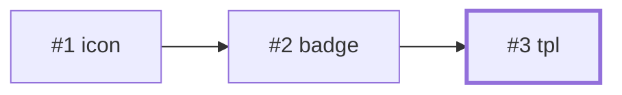

解锁：#4 `tooltip-wrapper`、#5 `remark`、#7 `toast`、#8 `action`、#9 `container`、#12 `spinner`、#17 `popOver`、#18 `panel`、#26 `static`、#31 `service`、#32 `each`、#33 `list`、#35 `tabs`、#37 `table`、#39 `card`、#44 `dialog`、#45 `drawer`、#52 `nav`、#64 `crud`、#65 `page`、#89 `table-view`、#90 `steps`、#91 `property`、#94 `grid-nav`、#95 `collapse`、#101 `carousel`、#105 `timeline`、#122 `table2`、#125 `calendar`

## tooltip-wrapper

#4 · H=3 · 前置 3 · 直接依赖 1 · 被依赖 3 · 92% 进行中

直接依赖：`tpl`

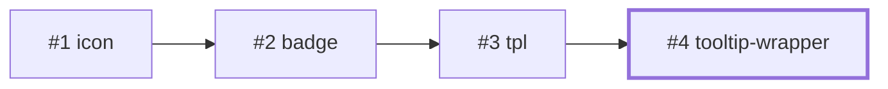

解锁：#5 `remark`、#8 `action`、#123 `dropdown-button`

## remark

#5 · H=4 · 前置 4 · 直接依赖 3 · 被依赖 2 · 70% 进行中

直接依赖：`tooltip-wrapper`、`icon`、`tpl`

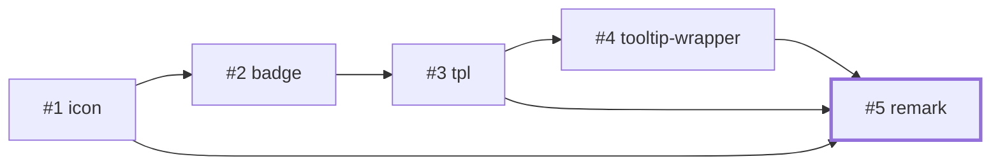

解锁：#6 `FormItem`、#65 `page`

## FormItem

#6 · H=5 · 前置 5 · 直接依赖 1 · 被依赖 38 · 82% 进行中

直接依赖：`remark`

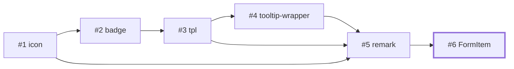

解锁：#10 `Options`、#11 `input-text`、#13 `select`、#14 `checkbox`、#15 `input-date`、#19 `input-file`、#20 `input-number`、#21 `radio`、#22 `switch`、#23 `hidden`、#24 `input-image`、#25 `textarea`、#26 `static`、#27 `form`、#29 `input-date-range`、#59 `input-tree`、#61 `input-kv`、#62 `json-schema`、#106 `control`、#107 `input-color`、#108 `input-formula`、#109 `diff-editor`、#110 `editor`、#111 `input-rating`、#112 `input-range`、#113 `input-rich-text`、#114 `input-signature`、#115 `fieldset`、#116 `group`、#119 `checkboxes`、#120 `input-excel`、#124 `button-group-select`、#127 `location-picker`、#128 `uuid`、#130 `input-repeat`、#131 `input-verification-code`、#133 `input-city`、#134 `condition-builder`

## toast

#7 · H=3 · 前置 3 · 直接依赖 2 · 被依赖 1 · 90% 进行中

直接依赖：`icon`、`tpl`

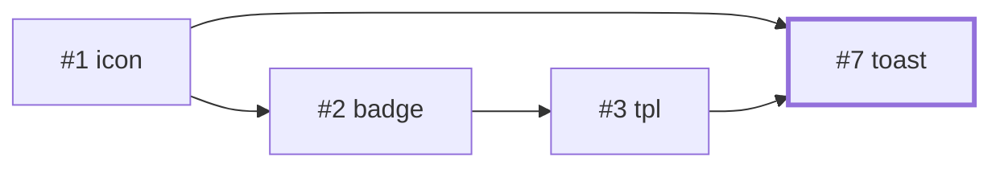

解锁：#8 `action`

## action

#8 · H=4 · 前置 5 · 直接依赖 5 · 被依赖 33 · 95% 进行中

直接依赖：`icon`、`tpl`、`tooltip-wrapper`、`badge`、`toast`

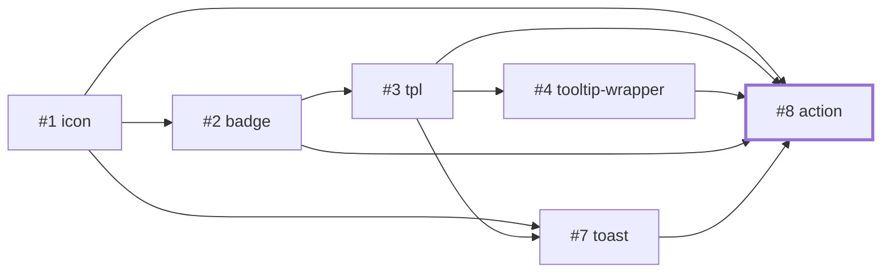

解锁：#11 `input-text`、#18 `panel`、#27 `form`、#31 `service`、#33 `list`、#35 `tabs`、#36 `pagination`、#37 `table`、#39 `card`、#40 `button`、#41 `button-group`、#44 `dialog`、#45 `drawer`、#52 `nav`、#61 `input-kv`、#64 `crud`、#65 `page`、#100 `button-toolbar`、#101 `carousel`、#102 `search-box`、#103 `alert`、#104 `tasks`、#118 `portlet`、#122 `table2`、#123 `dropdown-button`、#134 `condition-builder`、#145 `input-kvs`、#146 `input-array`、#147 `combo`、#148 `input-sub-form`、#149 `input-table`、#150 `json-schema-editor`、#151 `wizard`

## container

#9 · H=3 · 前置 3 · 直接依赖 1 · 被依赖 23 · 100% 已完成

直接依赖：`tpl`

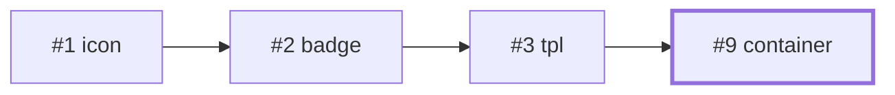

解锁：#18 `panel`、#27 `form`、#31 `service`、#35 `tabs`、#44 `dialog`、#45 `drawer`、#50 `flex`、#51 `grid`、#65 `page`、#95 `collapse`、#96 `grid-2d`、#97 `hbox`、#98 `wrapper`、#99 `switch-container`、#100 `button-toolbar`、#115 `fieldset`、#116 `group`、#117 `pagination-wrapper`、#118 `portlet`、#126 `input-group`、#146 `input-array`、#147 `combo`、#148 `input-sub-form`

## Options

#10 · H=6 · 前置 6 · 直接依赖 1 · 被依赖 9 · 75% 进行中

直接依赖：`FormItem`


解锁：#11 `input-text`、#13 `select`、#27 `form`、#42 `transfer`、#57 `radios`、#59 `input-tree`、#119 `checkboxes`、#124 `button-group-select`、#134 `condition-builder`

## input-text

#11 · H=7 · 前置 9 · 直接依赖 3 · 被依赖 12 · 82% 进行中

直接依赖：`FormItem`、`Options`、`action`

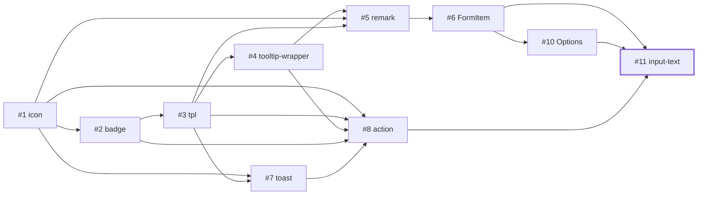

解锁：#27 `form`、#61 `input-kv`、#62 `json-schema`、#126 `input-group`、#127 `location-picker`、#128 `uuid`、#129 `input-password`、#130 `input-repeat`、#131 `input-verification-code`、#134 `condition-builder`、#146 `input-array`、#149 `input-table`

## spinner

#12 · H=3 · 前置 3 · 直接依赖 1 · 被依赖 7 · 80% 进行中

直接依赖：`tpl`

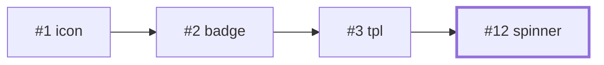

解锁：#13 `select`、#27 `form`、#31 `service`、#44 `dialog`、#45 `drawer`、#64 `crud`、#65 `page`

## select

#13 · H=7 · 前置 8 · 直接依赖 3 · 被依赖 11 · 60% 进行中

直接依赖：`FormItem`、`Options`、`spinner`

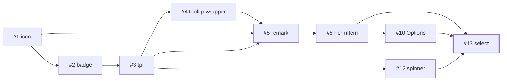

解锁：#27 `form`、#43 `picker`、#62 `json-schema`、#132 `chained-select`、#133 `input-city`、#134 `condition-builder`、#137 `nested-select`、#140 `input-tag`、#142 `tree-select`、#144 `list-select`、#149 `input-table`

## checkbox

#14 · H=6 · 前置 6 · 直接依赖 1 · 被依赖 8 · 85% 进行中

直接依赖：`FormItem`

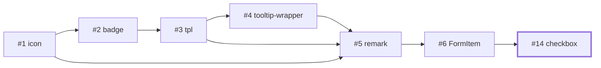

解锁：#27 `form`、#42 `transfer`、#59 `input-tree`、#62 `json-schema`、#119 `checkboxes`、#121 `matrix-checkboxes`、#122 `table2`、#149 `input-table`

## input-date

#15 · H=6 · 前置 6 · 直接依赖 1 · 被依赖 8 · 88% 进行中

直接依赖：`FormItem`

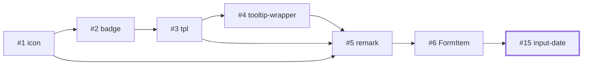

解锁：#27 `form`、#29 `input-date-range`、#54 `input-datetime`、#55 `input-month`、#56 `input-quarter`、#58 `input-time`、#60 `input-year`、#125 `calendar`

## popOver

#17 · H=3 · 前置 3 · 直接依赖 1 · 被依赖 5 · 80% 进行中

直接依赖：`tpl`

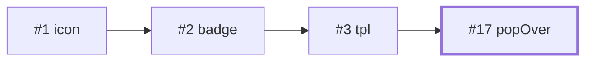

解锁：#26 `static`、#33 `list`、#37 `table`、#53 `cards`、#122 `table2`

## panel

#18 · H=5 · 前置 7 · 直接依赖 3 · 被依赖 3 · 90% 进行中

直接依赖：`container`、`action`、`tpl`

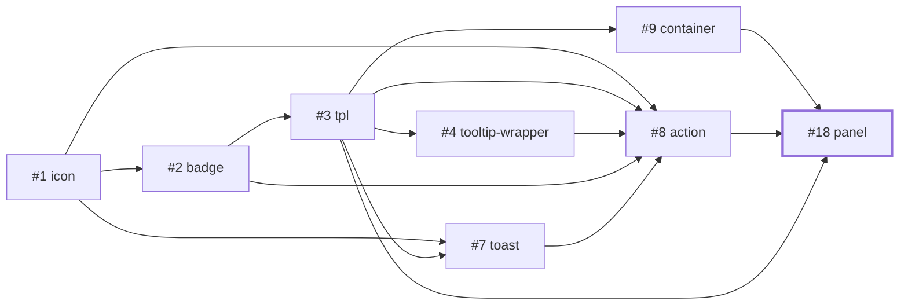

解锁：#27 `form`、#65 `page`、#151 `wizard`

## input-file

#19 · H=6 · 前置 6 · 直接依赖 1 · 被依赖 2 · 40% 进行中

直接依赖：`FormItem`

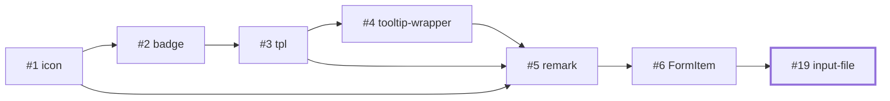

解锁：#27 `form`、#120 `input-excel`

## input-number

#20 · H=6 · 前置 6 · 直接依赖 1 · 被依赖 2 · 55% 进行中

直接依赖：`FormItem`

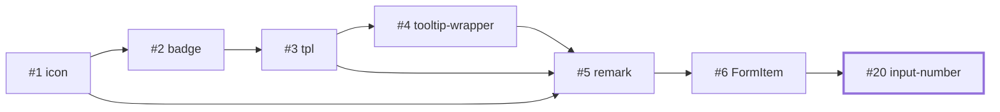

解锁：#27 `form`、#62 `json-schema`

## radio

#21 · H=6 · 前置 6 · 直接依赖 1 · 被依赖 2 · 60% 进行中

直接依赖：`FormItem`

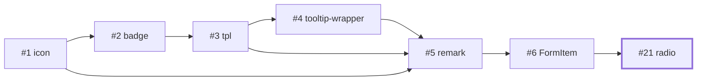

解锁：#27 `form`、#57 `radios`

## switch

#22 · H=6 · 前置 6 · 直接依赖 1 · 被依赖 2 · 65% 进行中

直接依赖：`FormItem`

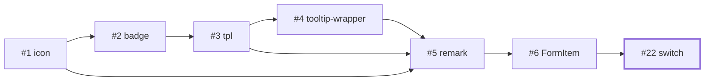

解锁：#27 `form`、#62 `json-schema`

## hidden

#23 · H=6 · 前置 6 · 直接依赖 1 · 被依赖 1 · 70% 进行中

直接依赖：`FormItem`

```mermaid
flowchart LR
  t_icon["#1 icon"]
  t_badge["#2 badge"]
  t_tpl["#3 tpl"]
  t_tooltip_wrapper["#4 tooltip-wrapper"]
  t_remark["#5 remark"]
  t_FormItem["#6 FormItem"]
  t_hidden["#23 hidden"]
  t_icon --> t_badge
  t_badge --> t_tpl
  t_tpl --> t_tooltip_wrapper
  t_tooltip_wrapper --> t_remark
  t_icon --> t_remark
  t_tpl --> t_remark
  t_remark --> t_FormItem
  t_FormItem --> t_hidden
  classDef self stroke-width:3px
  class t_hidden self
```

解锁：#27 `form`

## input-image

#24 · H=6 · 前置 7 · 直接依赖 2 · 被依赖 1 · 40% 进行中

直接依赖：`FormItem`、`image`

```mermaid
flowchart LR
  t_icon["#1 icon"]
  t_badge["#2 badge"]
  t_tpl["#3 tpl"]
  t_tooltip_wrapper["#4 tooltip-wrapper"]
  t_remark["#5 remark"]
  t_FormItem["#6 FormItem"]
  t_image["#16 image"]
  t_input_image["#24 input-image"]
  t_icon --> t_badge
  t_badge --> t_tpl
  t_tpl --> t_tooltip_wrapper
  t_tooltip_wrapper --> t_remark
  t_icon --> t_remark
  t_tpl --> t_remark
  t_remark --> t_FormItem
  t_FormItem --> t_input_image
  t_image --> t_input_image
  classDef self stroke-width:3px
  class t_input_image self
```

解锁：#27 `form`

## textarea

#25 · H=6 · 前置 6 · 直接依赖 1 · 被依赖 1 · 60% 进行中

直接依赖：`FormItem`

```mermaid
flowchart LR
  t_icon["#1 icon"]
  t_badge["#2 badge"]
  t_tpl["#3 tpl"]
  t_tooltip_wrapper["#4 tooltip-wrapper"]
  t_remark["#5 remark"]
  t_FormItem["#6 FormItem"]
  t_textarea["#25 textarea"]
  t_icon --> t_badge
  t_badge --> t_tpl
  t_tpl --> t_tooltip_wrapper
  t_tooltip_wrapper --> t_remark
  t_icon --> t_remark
  t_tpl --> t_remark
  t_remark --> t_FormItem
  t_FormItem --> t_textarea
  classDef self stroke-width:3px
  class t_textarea self
```

解锁：#27 `form`

## static

#26 · H=6 · 前置 7 · 直接依赖 3 · 被依赖 1 · 65% 进行中

直接依赖：`FormItem`、`popOver`、`tpl`

```mermaid
flowchart LR
  t_icon["#1 icon"]
  t_badge["#2 badge"]
  t_tpl["#3 tpl"]
  t_tooltip_wrapper["#4 tooltip-wrapper"]
  t_remark["#5 remark"]
  t_FormItem["#6 FormItem"]
  t_popOver["#17 popOver"]
  t_static["#26 static"]
  t_icon --> t_badge
  t_badge --> t_tpl
  t_tpl --> t_tooltip_wrapper
  t_tooltip_wrapper --> t_remark
  t_icon --> t_remark
  t_tpl --> t_remark
  t_remark --> t_FormItem
  t_tpl --> t_popOver
  t_FormItem --> t_static
  t_popOver --> t_static
  t_tpl --> t_static
  classDef self stroke-width:3px
  class t_static self
```

解锁：#27 `form`

## form

#27 · H=8 · 前置 26 · 直接依赖 18 · 被依赖 10 · 75% 进行中

直接依赖：`FormItem`、`Options`、`action`、`container`、`input-text`、`textarea`、`input-number`、`select`、`checkbox`、`radio`、`switch`、`hidden`、`static`、`input-date`、`input-file`、`input-image`、`panel`、`spinner`

```mermaid
flowchart TB
  t_icon["#1 icon"]
  t_badge["#2 badge"]
  t_tpl["#3 tpl"]
  t_tooltip_wrapper["#4 tooltip-wrapper"]
  t_remark["#5 remark"]
  t_FormItem["#6 FormItem"]
  t_toast["#7 toast"]
  t_action["#8 action"]
  t_container["#9 container"]
  t_Options["#10 Options"]
  t_input_text["#11 input-text"]
  t_spinner["#12 spinner"]
  t_select["#13 select"]
  t_checkbox["#14 checkbox"]
  t_input_date["#15 input-date"]
  t_image["#16 image"]
  t_popOver["#17 popOver"]
  t_panel["#18 panel"]
  t_input_file["#19 input-file"]
  t_input_number["#20 input-number"]
  t_radio["#21 radio"]
  t_switch["#22 switch"]
  t_hidden["#23 hidden"]
  t_input_image["#24 input-image"]
  t_textarea["#25 textarea"]
  t_static["#26 static"]
  t_form["#27 form"]
  t_icon --> t_badge
  t_badge --> t_tpl
  t_tpl --> t_tooltip_wrapper
  t_tooltip_wrapper --> t_remark
  t_icon --> t_remark
  t_tpl --> t_remark
  t_remark --> t_FormItem
  t_icon --> t_toast
  t_tpl --> t_toast
  t_icon --> t_action
  t_tpl --> t_action
  t_tooltip_wrapper --> t_action
  t_badge --> t_action
  t_toast --> t_action
  t_tpl --> t_container
  t_FormItem --> t_Options
  t_FormItem --> t_input_text
  t_Options --> t_input_text
  t_action --> t_input_text
  t_tpl --> t_spinner
  t_FormItem --> t_select
  t_Options --> t_select
  t_spinner --> t_select
  t_FormItem --> t_checkbox
  t_FormItem --> t_input_date
  t_tpl --> t_popOver
  t_container --> t_panel
  t_action --> t_panel
  t_tpl --> t_panel
  t_FormItem --> t_input_file
  t_FormItem --> t_input_number
  t_FormItem --> t_radio
  t_FormItem --> t_switch
  t_FormItem --> t_hidden
  t_FormItem --> t_input_image
  t_image --> t_input_image
  t_FormItem --> t_textarea
  t_FormItem --> t_static
  t_popOver --> t_static
  t_tpl --> t_static
  t_FormItem --> t_form
  t_Options --> t_form
  t_action --> t_form
  t_container --> t_form
  t_input_text --> t_form
  t_textarea --> t_form
  t_input_number --> t_form
  t_select --> t_form
  t_checkbox --> t_form
  t_radio --> t_form
  t_switch --> t_form
  t_hidden --> t_form
  t_static --> t_form
  t_input_date --> t_form
  t_input_file --> t_form
  t_input_image --> t_form
  t_panel --> t_form
  t_spinner --> t_form
  classDef self stroke-width:3px
  class t_form self
```

解锁：#44 `dialog`、#45 `drawer`、#64 `crud`、#65 `page`、#146 `input-array`、#147 `combo`、#148 `input-sub-form`、#149 `input-table`、#150 `json-schema-editor`、#151 `wizard`

## input-date-range

#29 · H=7 · 前置 7 · 直接依赖 2 · 被依赖 5 · 50% 进行中

直接依赖：`input-date`、`FormItem`

```mermaid
flowchart LR
  t_icon["#1 icon"]
  t_badge["#2 badge"]
  t_tpl["#3 tpl"]
  t_tooltip_wrapper["#4 tooltip-wrapper"]
  t_remark["#5 remark"]
  t_FormItem["#6 FormItem"]
  t_input_date["#15 input-date"]
  t_input_date_range["#29 input-date-range"]
  t_icon --> t_badge
  t_badge --> t_tpl
  t_tpl --> t_tooltip_wrapper
  t_tooltip_wrapper --> t_remark
  t_icon --> t_remark
  t_tpl --> t_remark
  t_remark --> t_FormItem
  t_FormItem --> t_input_date
  t_input_date --> t_input_date_range
  t_FormItem --> t_input_date_range
  classDef self stroke-width:3px
  class t_input_date_range self
```

解锁：#135 `input-datetime-range`、#136 `input-month-range`、#138 `input-quarter-range`、#141 `input-time-range`、#143 `input-year-range`

## link

#30 · H=2 · 前置 2 · 直接依赖 2 · 被依赖 4 · 60% 进行中

直接依赖：`icon`、`badge`

```mermaid
flowchart LR
  t_icon["#1 icon"]
  t_badge["#2 badge"]
  t_link["#30 link"]
  t_icon --> t_badge
  t_icon --> t_link
  t_badge --> t_link
  classDef self stroke-width:3px
  class t_link self
```

解锁：#52 `nav`、#92 `breadcrumb`、#93 `anchor-nav`、#94 `grid-nav`

## service

#31 · H=5 · 前置 8 · 直接依赖 4 · 被依赖 4 · 75% 进行中

直接依赖：`container`、`action`、`tpl`、`spinner`

```mermaid
flowchart LR
  t_icon["#1 icon"]
  t_badge["#2 badge"]
  t_tpl["#3 tpl"]
  t_tooltip_wrapper["#4 tooltip-wrapper"]
  t_toast["#7 toast"]
  t_action["#8 action"]
  t_container["#9 container"]
  t_spinner["#12 spinner"]
  t_service["#31 service"]
  t_icon --> t_badge
  t_badge --> t_tpl
  t_tpl --> t_tooltip_wrapper
  t_icon --> t_toast
  t_tpl --> t_toast
  t_icon --> t_action
  t_tpl --> t_action
  t_tooltip_wrapper --> t_action
  t_badge --> t_action
  t_toast --> t_action
  t_tpl --> t_container
  t_tpl --> t_spinner
  t_container --> t_service
  t_action --> t_service
  t_tpl --> t_service
  t_spinner --> t_service
  classDef self stroke-width:3px
  class t_service self
```

解锁：#64 `crud`、#65 `page`、#148 `input-sub-form`、#154 `app`

## each

#32 · H=3 · 前置 3 · 直接依赖 1 · 被依赖 1 · 70% 进行中

直接依赖：`tpl`

```mermaid
flowchart LR
  t_icon["#1 icon"]
  t_badge["#2 badge"]
  t_tpl["#3 tpl"]
  t_each["#32 each"]
  t_icon --> t_badge
  t_badge --> t_tpl
  t_tpl --> t_each
  classDef self stroke-width:3px
  class t_each self
```

解锁：#33 `list`

## list

#33 · H=5 · 前置 8 · 直接依赖 4 · 被依赖 4 · 50% 进行中

直接依赖：`each`、`tpl`、`action`、`popOver`

```mermaid
flowchart LR
  t_icon["#1 icon"]
  t_badge["#2 badge"]
  t_tpl["#3 tpl"]
  t_tooltip_wrapper["#4 tooltip-wrapper"]
  t_toast["#7 toast"]
  t_action["#8 action"]
  t_popOver["#17 popOver"]
  t_each["#32 each"]
  t_list["#33 list"]
  t_icon --> t_badge
  t_badge --> t_tpl
  t_tpl --> t_tooltip_wrapper
  t_icon --> t_toast
  t_tpl --> t_toast
  t_icon --> t_action
  t_tpl --> t_action
  t_tooltip_wrapper --> t_action
  t_badge --> t_action
  t_toast --> t_action
  t_tpl --> t_popOver
  t_tpl --> t_each
  t_each --> t_list
  t_tpl --> t_list
  t_action --> t_list
  t_popOver --> t_list
  classDef self stroke-width:3px
  class t_list self
```

解锁：#42 `transfer`、#43 `picker`、#53 `cards`、#144 `list-select`

## tabs

#35 · H=5 · 前置 7 · 直接依赖 3 · 被依赖 3 · 85% 进行中

直接依赖：`container`、`action`、`tpl`

```mermaid
flowchart LR
  t_icon["#1 icon"]
  t_badge["#2 badge"]
  t_tpl["#3 tpl"]
  t_tooltip_wrapper["#4 tooltip-wrapper"]
  t_toast["#7 toast"]
  t_action["#8 action"]
  t_container["#9 container"]
  t_tabs["#35 tabs"]
  t_icon --> t_badge
  t_badge --> t_tpl
  t_tpl --> t_tooltip_wrapper
  t_icon --> t_toast
  t_tpl --> t_toast
  t_icon --> t_action
  t_tpl --> t_action
  t_tooltip_wrapper --> t_action
  t_badge --> t_action
  t_toast --> t_action
  t_tpl --> t_container
  t_container --> t_tabs
  t_action --> t_tabs
  t_tpl --> t_tabs
  classDef self stroke-width:3px
  class t_tabs self
```

解锁：#63 `tabs-transfer`、#65 `page`、#118 `portlet`

## pagination

#36 · H=5 · 前置 6 · 直接依赖 1 · 被依赖 2 · 90% 进行中

直接依赖：`action`

```mermaid
flowchart LR
  t_icon["#1 icon"]
  t_badge["#2 badge"]
  t_tpl["#3 tpl"]
  t_tooltip_wrapper["#4 tooltip-wrapper"]
  t_toast["#7 toast"]
  t_action["#8 action"]
  t_pagination["#36 pagination"]
  t_icon --> t_badge
  t_badge --> t_tpl
  t_tpl --> t_tooltip_wrapper
  t_icon --> t_toast
  t_tpl --> t_toast
  t_icon --> t_action
  t_tpl --> t_action
  t_tooltip_wrapper --> t_action
  t_badge --> t_action
  t_toast --> t_action
  t_action --> t_pagination
  classDef self stroke-width:3px
  class t_pagination self
```

解锁：#64 `crud`、#117 `pagination-wrapper`

## table

#37 · H=5 · 前置 8 · 直接依赖 5 · 被依赖 2 · 55% 进行中

直接依赖：`tpl`、`mapping`、`action`、`popOver`、`badge`

```mermaid
flowchart LR
  t_icon["#1 icon"]
  t_badge["#2 badge"]
  t_tpl["#3 tpl"]
  t_tooltip_wrapper["#4 tooltip-wrapper"]
  t_toast["#7 toast"]
  t_action["#8 action"]
  t_popOver["#17 popOver"]
  t_mapping["#28 mapping"]
  t_table["#37 table"]
  t_icon --> t_badge
  t_badge --> t_tpl
  t_tpl --> t_tooltip_wrapper
  t_icon --> t_toast
  t_tpl --> t_toast
  t_icon --> t_action
  t_tpl --> t_action
  t_tooltip_wrapper --> t_action
  t_badge --> t_action
  t_toast --> t_action
  t_tpl --> t_popOver
  t_tpl --> t_table
  t_mapping --> t_table
  t_action --> t_table
  t_popOver --> t_table
  t_badge --> t_table
  classDef self stroke-width:3px
  class t_table self
```

解锁：#64 `crud`、#149 `input-table`

## avatar

#38 · H=2 · 前置 3 · 直接依赖 3 · 被依赖 1 · 90% 进行中

直接依赖：`image`、`icon`、`badge`

```mermaid
flowchart LR
  t_icon["#1 icon"]
  t_badge["#2 badge"]
  t_image["#16 image"]
  t_avatar["#38 avatar"]
  t_icon --> t_badge
  t_image --> t_avatar
  t_icon --> t_avatar
  t_badge --> t_avatar
  classDef self stroke-width:3px
  class t_avatar self
```

解锁：#39 `card`

## card

#39 · H=5 · 前置 9 · 直接依赖 5 · 被依赖 2 · 70% 进行中

直接依赖：`image`、`avatar`、`action`、`tag`、`tpl`

```mermaid
flowchart LR
  t_icon["#1 icon"]
  t_badge["#2 badge"]
  t_tpl["#3 tpl"]
  t_tooltip_wrapper["#4 tooltip-wrapper"]
  t_toast["#7 toast"]
  t_action["#8 action"]
  t_image["#16 image"]
  t_tag["#34 tag"]
  t_avatar["#38 avatar"]
  t_card["#39 card"]
  t_icon --> t_badge
  t_badge --> t_tpl
  t_tpl --> t_tooltip_wrapper
  t_icon --> t_toast
  t_tpl --> t_toast
  t_icon --> t_action
  t_tpl --> t_action
  t_tooltip_wrapper --> t_action
  t_badge --> t_action
  t_toast --> t_action
  t_image --> t_avatar
  t_icon --> t_avatar
  t_badge --> t_avatar
  t_image --> t_card
  t_avatar --> t_card
  t_action --> t_card
  t_tag --> t_card
  t_tpl --> t_card
  classDef self stroke-width:3px
  class t_card self
```

解锁：#53 `cards`、#105 `timeline`

## button

#40 · H=5 · 前置 6 · 直接依赖 1 · 被依赖 1 · 95% 进行中

直接依赖：`action`

```mermaid
flowchart LR
  t_icon["#1 icon"]
  t_badge["#2 badge"]
  t_tpl["#3 tpl"]
  t_tooltip_wrapper["#4 tooltip-wrapper"]
  t_toast["#7 toast"]
  t_action["#8 action"]
  t_button["#40 button"]
  t_icon --> t_badge
  t_badge --> t_tpl
  t_tpl --> t_tooltip_wrapper
  t_icon --> t_toast
  t_tpl --> t_toast
  t_icon --> t_action
  t_tpl --> t_action
  t_tooltip_wrapper --> t_action
  t_badge --> t_action
  t_toast --> t_action
  t_action --> t_button
  classDef self stroke-width:3px
  class t_button self
```

解锁：#41 `button-group`

## button-group

#41 · H=6 · 前置 7 · 直接依赖 2 · 被依赖 2 · 85% 进行中

直接依赖：`action`、`button`

```mermaid
flowchart LR
  t_icon["#1 icon"]
  t_badge["#2 badge"]
  t_tpl["#3 tpl"]
  t_tooltip_wrapper["#4 tooltip-wrapper"]
  t_toast["#7 toast"]
  t_action["#8 action"]
  t_button["#40 button"]
  t_button_group["#41 button-group"]
  t_icon --> t_badge
  t_badge --> t_tpl
  t_tpl --> t_tooltip_wrapper
  t_icon --> t_toast
  t_tpl --> t_toast
  t_icon --> t_action
  t_tpl --> t_action
  t_tooltip_wrapper --> t_action
  t_badge --> t_action
  t_toast --> t_action
  t_action --> t_button
  t_action --> t_button_group
  t_button --> t_button_group
  classDef self stroke-width:3px
  class t_button_group self
```

解锁：#123 `dropdown-button`、#124 `button-group-select`

## transfer

#42 · H=7 · 前置 13 · 直接依赖 3 · 被依赖 2 · 50% 进行中

直接依赖：`list`、`checkbox`、`Options`

```mermaid
flowchart LR
  t_icon["#1 icon"]
  t_badge["#2 badge"]
  t_tpl["#3 tpl"]
  t_tooltip_wrapper["#4 tooltip-wrapper"]
  t_remark["#5 remark"]
  t_FormItem["#6 FormItem"]
  t_toast["#7 toast"]
  t_action["#8 action"]
  t_Options["#10 Options"]
  t_checkbox["#14 checkbox"]
  t_popOver["#17 popOver"]
  t_each["#32 each"]
  t_list["#33 list"]
  t_transfer["#42 transfer"]
  t_icon --> t_badge
  t_badge --> t_tpl
  t_tpl --> t_tooltip_wrapper
  t_tooltip_wrapper --> t_remark
  t_icon --> t_remark
  t_tpl --> t_remark
  t_remark --> t_FormItem
  t_icon --> t_toast
  t_tpl --> t_toast
  t_icon --> t_action
  t_tpl --> t_action
  t_tooltip_wrapper --> t_action
  t_badge --> t_action
  t_toast --> t_action
  t_FormItem --> t_Options
  t_FormItem --> t_checkbox
  t_tpl --> t_popOver
  t_tpl --> t_each
  t_each --> t_list
  t_tpl --> t_list
  t_action --> t_list
  t_popOver --> t_list
  t_list --> t_transfer
  t_checkbox --> t_transfer
  t_Options --> t_transfer
  classDef self stroke-width:3px
  class t_transfer self
```

解锁：#63 `tabs-transfer`、#152 `transfer-picker`

## picker

#43 · H=8 · 前置 14 · 直接依赖 2 · 被依赖 2 · 50% 进行中

直接依赖：`select`、`list`

```mermaid
flowchart LR
  t_icon["#1 icon"]
  t_badge["#2 badge"]
  t_tpl["#3 tpl"]
  t_tooltip_wrapper["#4 tooltip-wrapper"]
  t_remark["#5 remark"]
  t_FormItem["#6 FormItem"]
  t_toast["#7 toast"]
  t_action["#8 action"]
  t_Options["#10 Options"]
  t_spinner["#12 spinner"]
  t_select["#13 select"]
  t_popOver["#17 popOver"]
  t_each["#32 each"]
  t_list["#33 list"]
  t_picker["#43 picker"]
  t_icon --> t_badge
  t_badge --> t_tpl
  t_tpl --> t_tooltip_wrapper
  t_tooltip_wrapper --> t_remark
  t_icon --> t_remark
  t_tpl --> t_remark
  t_remark --> t_FormItem
  t_icon --> t_toast
  t_tpl --> t_toast
  t_icon --> t_action
  t_tpl --> t_action
  t_tooltip_wrapper --> t_action
  t_badge --> t_action
  t_toast --> t_action
  t_FormItem --> t_Options
  t_tpl --> t_spinner
  t_FormItem --> t_select
  t_Options --> t_select
  t_spinner --> t_select
  t_tpl --> t_popOver
  t_tpl --> t_each
  t_each --> t_list
  t_tpl --> t_list
  t_action --> t_list
  t_popOver --> t_list
  t_select --> t_picker
  t_list --> t_picker
  classDef self stroke-width:3px
  class t_picker self
```

解锁：#152 `transfer-picker`、#153 `tabs-transfer-picker`

## dialog

#44 · H=9 · 前置 27 · 直接依赖 5 · 被依赖 2 · 85% 进行中

直接依赖：`action`、`form`、`container`、`tpl`、`spinner`

```mermaid
flowchart TB
  t_icon["#1 icon"]
  t_badge["#2 badge"]
  t_tpl["#3 tpl"]
  t_tooltip_wrapper["#4 tooltip-wrapper"]
  t_remark["#5 remark"]
  t_FormItem["#6 FormItem"]
  t_toast["#7 toast"]
  t_action["#8 action"]
  t_container["#9 container"]
  t_Options["#10 Options"]
  t_input_text["#11 input-text"]
  t_spinner["#12 spinner"]
  t_select["#13 select"]
  t_checkbox["#14 checkbox"]
  t_input_date["#15 input-date"]
  t_image["#16 image"]
  t_popOver["#17 popOver"]
  t_panel["#18 panel"]
  t_input_file["#19 input-file"]
  t_input_number["#20 input-number"]
  t_radio["#21 radio"]
  t_switch["#22 switch"]
  t_hidden["#23 hidden"]
  t_input_image["#24 input-image"]
  t_textarea["#25 textarea"]
  t_static["#26 static"]
  t_form["#27 form"]
  t_dialog["#44 dialog"]
  t_icon --> t_badge
  t_badge --> t_tpl
  t_tpl --> t_tooltip_wrapper
  t_tooltip_wrapper --> t_remark
  t_icon --> t_remark
  t_tpl --> t_remark
  t_remark --> t_FormItem
  t_icon --> t_toast
  t_tpl --> t_toast
  t_icon --> t_action
  t_tpl --> t_action
  t_tooltip_wrapper --> t_action
  t_badge --> t_action
  t_toast --> t_action
  t_tpl --> t_container
  t_FormItem --> t_Options
  t_FormItem --> t_input_text
  t_Options --> t_input_text
  t_action --> t_input_text
  t_tpl --> t_spinner
  t_FormItem --> t_select
  t_Options --> t_select
  t_spinner --> t_select
  t_FormItem --> t_checkbox
  t_FormItem --> t_input_date
  t_tpl --> t_popOver
  t_container --> t_panel
  t_action --> t_panel
  t_tpl --> t_panel
  t_FormItem --> t_input_file
  t_FormItem --> t_input_number
  t_FormItem --> t_radio
  t_FormItem --> t_switch
  t_FormItem --> t_hidden
  t_FormItem --> t_input_image
  t_image --> t_input_image
  t_FormItem --> t_textarea
  t_FormItem --> t_static
  t_popOver --> t_static
  t_tpl --> t_static
  t_FormItem --> t_form
  t_Options --> t_form
  t_action --> t_form
  t_container --> t_form
  t_input_text --> t_form
  t_textarea --> t_form
  t_input_number --> t_form
  t_select --> t_form
  t_checkbox --> t_form
  t_radio --> t_form
  t_switch --> t_form
  t_hidden --> t_form
  t_static --> t_form
  t_input_date --> t_form
  t_input_file --> t_form
  t_input_image --> t_form
  t_panel --> t_form
  t_spinner --> t_form
  t_action --> t_dialog
  t_form --> t_dialog
  t_container --> t_dialog
  t_tpl --> t_dialog
  t_spinner --> t_dialog
  classDef self stroke-width:3px
  class t_dialog self
```

解锁：#64 `crud`、#65 `page`

## drawer

#45 · H=9 · 前置 27 · 直接依赖 5 · 被依赖 2 · 85% 进行中

直接依赖：`action`、`form`、`container`、`tpl`、`spinner`

```mermaid
flowchart TB
  t_icon["#1 icon"]
  t_badge["#2 badge"]
  t_tpl["#3 tpl"]
  t_tooltip_wrapper["#4 tooltip-wrapper"]
  t_remark["#5 remark"]
  t_FormItem["#6 FormItem"]
  t_toast["#7 toast"]
  t_action["#8 action"]
  t_container["#9 container"]
  t_Options["#10 Options"]
  t_input_text["#11 input-text"]
  t_spinner["#12 spinner"]
  t_select["#13 select"]
  t_checkbox["#14 checkbox"]
  t_input_date["#15 input-date"]
  t_image["#16 image"]
  t_popOver["#17 popOver"]
  t_panel["#18 panel"]
  t_input_file["#19 input-file"]
  t_input_number["#20 input-number"]
  t_radio["#21 radio"]
  t_switch["#22 switch"]
  t_hidden["#23 hidden"]
  t_input_image["#24 input-image"]
  t_textarea["#25 textarea"]
  t_static["#26 static"]
  t_form["#27 form"]
  t_drawer["#45 drawer"]
  t_icon --> t_badge
  t_badge --> t_tpl
  t_tpl --> t_tooltip_wrapper
  t_tooltip_wrapper --> t_remark
  t_icon --> t_remark
  t_tpl --> t_remark
  t_remark --> t_FormItem
  t_icon --> t_toast
  t_tpl --> t_toast
  t_icon --> t_action
  t_tpl --> t_action
  t_tooltip_wrapper --> t_action
  t_badge --> t_action
  t_toast --> t_action
  t_tpl --> t_container
  t_FormItem --> t_Options
  t_FormItem --> t_input_text
  t_Options --> t_input_text
  t_action --> t_input_text
  t_tpl --> t_spinner
  t_FormItem --> t_select
  t_Options --> t_select
  t_spinner --> t_select
  t_FormItem --> t_checkbox
  t_FormItem --> t_input_date
  t_tpl --> t_popOver
  t_container --> t_panel
  t_action --> t_panel
  t_tpl --> t_panel
  t_FormItem --> t_input_file
  t_FormItem --> t_input_number
  t_FormItem --> t_radio
  t_FormItem --> t_switch
  t_FormItem --> t_hidden
  t_FormItem --> t_input_image
  t_image --> t_input_image
  t_FormItem --> t_textarea
  t_FormItem --> t_static
  t_popOver --> t_static
  t_tpl --> t_static
  t_FormItem --> t_form
  t_Options --> t_form
  t_action --> t_form
  t_container --> t_form
  t_input_text --> t_form
  t_textarea --> t_form
  t_input_number --> t_form
  t_select --> t_form
  t_checkbox --> t_form
  t_radio --> t_form
  t_switch --> t_form
  t_hidden --> t_form
  t_static --> t_form
  t_input_date --> t_form
  t_input_file --> t_form
  t_input_image --> t_form
  t_panel --> t_form
  t_spinner --> t_form
  t_action --> t_drawer
  t_form --> t_drawer
  t_container --> t_drawer
  t_tpl --> t_drawer
  t_spinner --> t_drawer
  classDef self stroke-width:3px
  class t_drawer self
```

解锁：#64 `crud`、#65 `page`

## status

#49 · H=1 · 前置 1 · 直接依赖 1 · 被依赖 1 · 55% 进行中

直接依赖：`icon`

```mermaid
flowchart LR
  t_icon["#1 icon"]
  t_status["#49 status"]
  t_icon --> t_status
  classDef self stroke-width:3px
  class t_status self
```

解锁：#104 `tasks`

## flex

#50 · H=4 · 前置 4 · 直接依赖 1 · 被依赖 1 · 90% 进行中

直接依赖：`container`

```mermaid
flowchart LR
  t_icon["#1 icon"]
  t_badge["#2 badge"]
  t_tpl["#3 tpl"]
  t_container["#9 container"]
  t_flex["#50 flex"]
  t_icon --> t_badge
  t_badge --> t_tpl
  t_tpl --> t_container
  t_container --> t_flex
  classDef self stroke-width:3px
  class t_flex self
```

解锁：#65 `page`

## grid

#51 · H=4 · 前置 4 · 直接依赖 1 · 被依赖 1 · 90% 进行中

直接依赖：`container`

```mermaid
flowchart LR
  t_icon["#1 icon"]
  t_badge["#2 badge"]
  t_tpl["#3 tpl"]
  t_container["#9 container"]
  t_grid["#51 grid"]
  t_icon --> t_badge
  t_badge --> t_tpl
  t_tpl --> t_container
  t_container --> t_grid
  classDef self stroke-width:3px
  class t_grid self
```

解锁：#65 `page`

## nav

#52 · H=5 · 前置 7 · 直接依赖 5 · 被依赖 1 · 80% 进行中

直接依赖：`icon`、`action`、`tpl`、`link`、`badge`

```mermaid
flowchart LR
  t_icon["#1 icon"]
  t_badge["#2 badge"]
  t_tpl["#3 tpl"]
  t_tooltip_wrapper["#4 tooltip-wrapper"]
  t_toast["#7 toast"]
  t_action["#8 action"]
  t_link["#30 link"]
  t_nav["#52 nav"]
  t_icon --> t_badge
  t_badge --> t_tpl
  t_tpl --> t_tooltip_wrapper
  t_icon --> t_toast
  t_tpl --> t_toast
  t_icon --> t_action
  t_tpl --> t_action
  t_tooltip_wrapper --> t_action
  t_badge --> t_action
  t_toast --> t_action
  t_icon --> t_link
  t_badge --> t_link
  t_icon --> t_nav
  t_action --> t_nav
  t_tpl --> t_nav
  t_link --> t_nav
  t_badge --> t_nav
  classDef self stroke-width:3px
  class t_nav self
```

解锁：#154 `app`

## cards

#53 · H=6 · 前置 13 · 直接依赖 3 · 被依赖 1 · 75% 进行中

直接依赖：`card`、`list`、`popOver`

```mermaid
flowchart LR
  t_icon["#1 icon"]
  t_badge["#2 badge"]
  t_tpl["#3 tpl"]
  t_tooltip_wrapper["#4 tooltip-wrapper"]
  t_toast["#7 toast"]
  t_action["#8 action"]
  t_image["#16 image"]
  t_popOver["#17 popOver"]
  t_each["#32 each"]
  t_list["#33 list"]
  t_tag["#34 tag"]
  t_avatar["#38 avatar"]
  t_card["#39 card"]
  t_cards["#53 cards"]
  t_icon --> t_badge
  t_badge --> t_tpl
  t_tpl --> t_tooltip_wrapper
  t_icon --> t_toast
  t_tpl --> t_toast
  t_icon --> t_action
  t_tpl --> t_action
  t_tooltip_wrapper --> t_action
  t_badge --> t_action
  t_toast --> t_action
  t_tpl --> t_popOver
  t_tpl --> t_each
  t_each --> t_list
  t_tpl --> t_list
  t_action --> t_list
  t_popOver --> t_list
  t_image --> t_avatar
  t_icon --> t_avatar
  t_badge --> t_avatar
  t_image --> t_card
  t_avatar --> t_card
  t_action --> t_card
  t_tag --> t_card
  t_tpl --> t_card
  t_card --> t_cards
  t_list --> t_cards
  t_popOver --> t_cards
  classDef self stroke-width:3px
  class t_cards self
```

解锁：#64 `crud`

## input-datetime

#54 · H=7 · 前置 7 · 直接依赖 1 · 被依赖 1 · 58% 进行中

直接依赖：`input-date`

```mermaid
flowchart LR
  t_icon["#1 icon"]
  t_badge["#2 badge"]
  t_tpl["#3 tpl"]
  t_tooltip_wrapper["#4 tooltip-wrapper"]
  t_remark["#5 remark"]
  t_FormItem["#6 FormItem"]
  t_input_date["#15 input-date"]
  t_input_datetime["#54 input-datetime"]
  t_icon --> t_badge
  t_badge --> t_tpl
  t_tpl --> t_tooltip_wrapper
  t_tooltip_wrapper --> t_remark
  t_icon --> t_remark
  t_tpl --> t_remark
  t_remark --> t_FormItem
  t_FormItem --> t_input_date
  t_input_date --> t_input_datetime
  classDef self stroke-width:3px
  class t_input_datetime self
```

解锁：#135 `input-datetime-range`

## input-month

#55 · H=7 · 前置 7 · 直接依赖 1 · 被依赖 1 · 45% 进行中

直接依赖：`input-date`

```mermaid
flowchart LR
  t_icon["#1 icon"]
  t_badge["#2 badge"]
  t_tpl["#3 tpl"]
  t_tooltip_wrapper["#4 tooltip-wrapper"]
  t_remark["#5 remark"]
  t_FormItem["#6 FormItem"]
  t_input_date["#15 input-date"]
  t_input_month["#55 input-month"]
  t_icon --> t_badge
  t_badge --> t_tpl
  t_tpl --> t_tooltip_wrapper
  t_tooltip_wrapper --> t_remark
  t_icon --> t_remark
  t_tpl --> t_remark
  t_remark --> t_FormItem
  t_FormItem --> t_input_date
  t_input_date --> t_input_month
  classDef self stroke-width:3px
  class t_input_month self
```

解锁：#136 `input-month-range`

## input-quarter

#56 · H=7 · 前置 7 · 直接依赖 1 · 被依赖 1 · 45% 进行中

直接依赖：`input-date`

```mermaid
flowchart LR
  t_icon["#1 icon"]
  t_badge["#2 badge"]
  t_tpl["#3 tpl"]
  t_tooltip_wrapper["#4 tooltip-wrapper"]
  t_remark["#5 remark"]
  t_FormItem["#6 FormItem"]
  t_input_date["#15 input-date"]
  t_input_quarter["#56 input-quarter"]
  t_icon --> t_badge
  t_badge --> t_tpl
  t_tpl --> t_tooltip_wrapper
  t_tooltip_wrapper --> t_remark
  t_icon --> t_remark
  t_tpl --> t_remark
  t_remark --> t_FormItem
  t_FormItem --> t_input_date
  t_input_date --> t_input_quarter
  classDef self stroke-width:3px
  class t_input_quarter self
```

解锁：#138 `input-quarter-range`

## radios

#57 · H=7 · 前置 8 · 直接依赖 2 · 被依赖 1 · 55% 进行中

直接依赖：`radio`、`Options`

```mermaid
flowchart LR
  t_icon["#1 icon"]
  t_badge["#2 badge"]
  t_tpl["#3 tpl"]
  t_tooltip_wrapper["#4 tooltip-wrapper"]
  t_remark["#5 remark"]
  t_FormItem["#6 FormItem"]
  t_Options["#10 Options"]
  t_radio["#21 radio"]
  t_radios["#57 radios"]
  t_icon --> t_badge
  t_badge --> t_tpl
  t_tpl --> t_tooltip_wrapper
  t_tooltip_wrapper --> t_remark
  t_icon --> t_remark
  t_tpl --> t_remark
  t_remark --> t_FormItem
  t_FormItem --> t_Options
  t_FormItem --> t_radio
  t_radio --> t_radios
  t_Options --> t_radios
  classDef self stroke-width:3px
  class t_radios self
```

解锁：#139 `chart-radios`

## input-time

#58 · H=7 · 前置 7 · 直接依赖 1 · 被依赖 1 · 55% 进行中

直接依赖：`input-date`

```mermaid
flowchart LR
  t_icon["#1 icon"]
  t_badge["#2 badge"]
  t_tpl["#3 tpl"]
  t_tooltip_wrapper["#4 tooltip-wrapper"]
  t_remark["#5 remark"]
  t_FormItem["#6 FormItem"]
  t_input_date["#15 input-date"]
  t_input_time["#58 input-time"]
  t_icon --> t_badge
  t_badge --> t_tpl
  t_tpl --> t_tooltip_wrapper
  t_tooltip_wrapper --> t_remark
  t_icon --> t_remark
  t_tpl --> t_remark
  t_remark --> t_FormItem
  t_FormItem --> t_input_date
  t_input_date --> t_input_time
  classDef self stroke-width:3px
  class t_input_time self
```

解锁：#141 `input-time-range`

## input-tree

#59 · H=7 · 前置 8 · 直接依赖 3 · 被依赖 1 · 50% 进行中

直接依赖：`FormItem`、`checkbox`、`Options`

```mermaid
flowchart LR
  t_icon["#1 icon"]
  t_badge["#2 badge"]
  t_tpl["#3 tpl"]
  t_tooltip_wrapper["#4 tooltip-wrapper"]
  t_remark["#5 remark"]
  t_FormItem["#6 FormItem"]
  t_Options["#10 Options"]
  t_checkbox["#14 checkbox"]
  t_input_tree["#59 input-tree"]
  t_icon --> t_badge
  t_badge --> t_tpl
  t_tpl --> t_tooltip_wrapper
  t_tooltip_wrapper --> t_remark
  t_icon --> t_remark
  t_tpl --> t_remark
  t_remark --> t_FormItem
  t_FormItem --> t_Options
  t_FormItem --> t_checkbox
  t_FormItem --> t_input_tree
  t_checkbox --> t_input_tree
  t_Options --> t_input_tree
  classDef self stroke-width:3px
  class t_input_tree self
```

解锁：#142 `tree-select`

## input-year

#60 · H=7 · 前置 7 · 直接依赖 1 · 被依赖 1 · 45% 进行中

直接依赖：`input-date`

```mermaid
flowchart LR
  t_icon["#1 icon"]
  t_badge["#2 badge"]
  t_tpl["#3 tpl"]
  t_tooltip_wrapper["#4 tooltip-wrapper"]
  t_remark["#5 remark"]
  t_FormItem["#6 FormItem"]
  t_input_date["#15 input-date"]
  t_input_year["#60 input-year"]
  t_icon --> t_badge
  t_badge --> t_tpl
  t_tpl --> t_tooltip_wrapper
  t_tooltip_wrapper --> t_remark
  t_icon --> t_remark
  t_tpl --> t_remark
  t_remark --> t_FormItem
  t_FormItem --> t_input_date
  t_input_date --> t_input_year
  classDef self stroke-width:3px
  class t_input_year self
```

解锁：#143 `input-year-range`

## input-kv

#61 · H=8 · 前置 10 · 直接依赖 3 · 被依赖 1 · 50% 进行中

直接依赖：`FormItem`、`input-text`、`action`

```mermaid
flowchart LR
  t_icon["#1 icon"]
  t_badge["#2 badge"]
  t_tpl["#3 tpl"]
  t_tooltip_wrapper["#4 tooltip-wrapper"]
  t_remark["#5 remark"]
  t_FormItem["#6 FormItem"]
  t_toast["#7 toast"]
  t_action["#8 action"]
  t_Options["#10 Options"]
  t_input_text["#11 input-text"]
  t_input_kv["#61 input-kv"]
  t_icon --> t_badge
  t_badge --> t_tpl
  t_tpl --> t_tooltip_wrapper
  t_tooltip_wrapper --> t_remark
  t_icon --> t_remark
  t_tpl --> t_remark
  t_remark --> t_FormItem
  t_icon --> t_toast
  t_tpl --> t_toast
  t_icon --> t_action
  t_tpl --> t_action
  t_tooltip_wrapper --> t_action
  t_badge --> t_action
  t_toast --> t_action
  t_FormItem --> t_Options
  t_FormItem --> t_input_text
  t_Options --> t_input_text
  t_action --> t_input_text
  t_FormItem --> t_input_kv
  t_input_text --> t_input_kv
  t_action --> t_input_kv
  classDef self stroke-width:3px
  class t_input_kv self
```

解锁：#145 `input-kvs`

## json-schema

#62 · H=8 · 前置 15 · 直接依赖 6 · 被依赖 1 · 30% 进行中

直接依赖：`FormItem`、`input-text`、`input-number`、`checkbox`、`switch`、`select`

```mermaid
flowchart LR
  t_icon["#1 icon"]
  t_badge["#2 badge"]
  t_tpl["#3 tpl"]
  t_tooltip_wrapper["#4 tooltip-wrapper"]
  t_remark["#5 remark"]
  t_FormItem["#6 FormItem"]
  t_toast["#7 toast"]
  t_action["#8 action"]
  t_Options["#10 Options"]
  t_input_text["#11 input-text"]
  t_spinner["#12 spinner"]
  t_select["#13 select"]
  t_checkbox["#14 checkbox"]
  t_input_number["#20 input-number"]
  t_switch["#22 switch"]
  t_json_schema["#62 json-schema"]
  t_icon --> t_badge
  t_badge --> t_tpl
  t_tpl --> t_tooltip_wrapper
  t_tooltip_wrapper --> t_remark
  t_icon --> t_remark
  t_tpl --> t_remark
  t_remark --> t_FormItem
  t_icon --> t_toast
  t_tpl --> t_toast
  t_icon --> t_action
  t_tpl --> t_action
  t_tooltip_wrapper --> t_action
  t_badge --> t_action
  t_toast --> t_action
  t_FormItem --> t_Options
  t_FormItem --> t_input_text
  t_Options --> t_input_text
  t_action --> t_input_text
  t_tpl --> t_spinner
  t_FormItem --> t_select
  t_Options --> t_select
  t_spinner --> t_select
  t_FormItem --> t_checkbox
  t_FormItem --> t_input_number
  t_FormItem --> t_switch
  t_FormItem --> t_json_schema
  t_input_text --> t_json_schema
  t_input_number --> t_json_schema
  t_checkbox --> t_json_schema
  t_switch --> t_json_schema
  t_select --> t_json_schema
  classDef self stroke-width:3px
  class t_json_schema self
```

解锁：#150 `json-schema-editor`

## tabs-transfer

#63 · H=8 · 前置 16 · 直接依赖 2 · 被依赖 1 · 40% 进行中

直接依赖：`transfer`、`tabs`

```mermaid
flowchart TB
  t_icon["#1 icon"]
  t_badge["#2 badge"]
  t_tpl["#3 tpl"]
  t_tooltip_wrapper["#4 tooltip-wrapper"]
  t_remark["#5 remark"]
  t_FormItem["#6 FormItem"]
  t_toast["#7 toast"]
  t_action["#8 action"]
  t_container["#9 container"]
  t_Options["#10 Options"]
  t_checkbox["#14 checkbox"]
  t_popOver["#17 popOver"]
  t_each["#32 each"]
  t_list["#33 list"]
  t_tabs["#35 tabs"]
  t_transfer["#42 transfer"]
  t_tabs_transfer["#63 tabs-transfer"]
  t_icon --> t_badge
  t_badge --> t_tpl
  t_tpl --> t_tooltip_wrapper
  t_tooltip_wrapper --> t_remark
  t_icon --> t_remark
  t_tpl --> t_remark
  t_remark --> t_FormItem
  t_icon --> t_toast
  t_tpl --> t_toast
  t_icon --> t_action
  t_tpl --> t_action
  t_tooltip_wrapper --> t_action
  t_badge --> t_action
  t_toast --> t_action
  t_tpl --> t_container
  t_FormItem --> t_Options
  t_FormItem --> t_checkbox
  t_tpl --> t_popOver
  t_tpl --> t_each
  t_each --> t_list
  t_tpl --> t_list
  t_action --> t_list
  t_popOver --> t_list
  t_container --> t_tabs
  t_action --> t_tabs
  t_tpl --> t_tabs
  t_list --> t_transfer
  t_checkbox --> t_transfer
  t_Options --> t_transfer
  t_transfer --> t_tabs_transfer
  t_tabs --> t_tabs_transfer
  classDef self stroke-width:3px
  class t_tabs_transfer self
```

解锁：#153 `tabs-transfer-picker`

## crud

#64 · H=10 · 前置 39 · 直接依赖 11 · 被依赖 1 · 58% 进行中

直接依赖：`form`、`table`、`pagination`、`action`、`dialog`、`drawer`、`service`、`mapping`、`tpl`、`cards`、`spinner`

```mermaid
flowchart TB
  t_icon["#1 icon"]
  t_badge["#2 badge"]
  t_tpl["#3 tpl"]
  t_tooltip_wrapper["#4 tooltip-wrapper"]
  t_remark["#5 remark"]
  t_FormItem["#6 FormItem"]
  t_toast["#7 toast"]
  t_action["#8 action"]
  t_container["#9 container"]
  t_Options["#10 Options"]
  t_input_text["#11 input-text"]
  t_spinner["#12 spinner"]
  t_select["#13 select"]
  t_checkbox["#14 checkbox"]
  t_input_date["#15 input-date"]
  t_image["#16 image"]
  t_popOver["#17 popOver"]
  t_panel["#18 panel"]
  t_input_file["#19 input-file"]
  t_input_number["#20 input-number"]
  t_radio["#21 radio"]
  t_switch["#22 switch"]
  t_hidden["#23 hidden"]
  t_input_image["#24 input-image"]
  t_textarea["#25 textarea"]
  t_static["#26 static"]
  t_form["#27 form"]
  t_mapping["#28 mapping"]
  t_service["#31 service"]
  t_each["#32 each"]
  t_list["#33 list"]
  t_tag["#34 tag"]
  t_pagination["#36 pagination"]
  t_table["#37 table"]
  t_avatar["#38 avatar"]
  t_card["#39 card"]
  t_dialog["#44 dialog"]
  t_drawer["#45 drawer"]
  t_cards["#53 cards"]
  t_crud["#64 crud"]
  t_icon --> t_badge
  t_badge --> t_tpl
  t_tpl --> t_tooltip_wrapper
  t_tooltip_wrapper --> t_remark
  t_icon --> t_remark
  t_tpl --> t_remark
  t_remark --> t_FormItem
  t_icon --> t_toast
  t_tpl --> t_toast
  t_icon --> t_action
  t_tpl --> t_action
  t_tooltip_wrapper --> t_action
  t_badge --> t_action
  t_toast --> t_action
  t_tpl --> t_container
  t_FormItem --> t_Options
  t_FormItem --> t_input_text
  t_Options --> t_input_text
  t_action --> t_input_text
  t_tpl --> t_spinner
  t_FormItem --> t_select
  t_Options --> t_select
  t_spinner --> t_select
  t_FormItem --> t_checkbox
  t_FormItem --> t_input_date
  t_tpl --> t_popOver
  t_container --> t_panel
  t_action --> t_panel
  t_tpl --> t_panel
  t_FormItem --> t_input_file
  t_FormItem --> t_input_number
  t_FormItem --> t_radio
  t_FormItem --> t_switch
  t_FormItem --> t_hidden
  t_FormItem --> t_input_image
  t_image --> t_input_image
  t_FormItem --> t_textarea
  t_FormItem --> t_static
  t_popOver --> t_static
  t_tpl --> t_static
  t_FormItem --> t_form
  t_Options --> t_form
  t_action --> t_form
  t_container --> t_form
  t_input_text --> t_form
  t_textarea --> t_form
  t_input_number --> t_form
  t_select --> t_form
  t_checkbox --> t_form
  t_radio --> t_form
  t_switch --> t_form
  t_hidden --> t_form
  t_static --> t_form
  t_input_date --> t_form
  t_input_file --> t_form
  t_input_image --> t_form
  t_panel --> t_form
  t_spinner --> t_form
  t_container --> t_service
  t_action --> t_service
  t_tpl --> t_service
  t_spinner --> t_service
  t_tpl --> t_each
  t_each --> t_list
  t_tpl --> t_list
  t_action --> t_list
  t_popOver --> t_list
  t_action --> t_pagination
  t_tpl --> t_table
  t_mapping --> t_table
  t_action --> t_table
  t_popOver --> t_table
  t_badge --> t_table
  t_image --> t_avatar
  t_icon --> t_avatar
  t_badge --> t_avatar
  t_image --> t_card
  t_avatar --> t_card
  t_action --> t_card
  t_tag --> t_card
  t_tpl --> t_card
  t_action --> t_dialog
  t_form --> t_dialog
  t_container --> t_dialog
  t_tpl --> t_dialog
  t_spinner --> t_dialog
  t_action --> t_drawer
  t_form --> t_drawer
  t_container --> t_drawer
  t_tpl --> t_drawer
  t_spinner --> t_drawer
  t_card --> t_cards
  t_list --> t_cards
  t_popOver --> t_cards
  t_form --> t_crud
  t_table --> t_crud
  t_pagination --> t_crud
  t_action --> t_crud
  t_dialog --> t_crud
  t_drawer --> t_crud
  t_service --> t_crud
  t_mapping --> t_crud
  t_tpl --> t_crud
  t_cards --> t_crud
  t_spinner --> t_crud
  classDef self stroke-width:3px
  class t_crud self
```

解锁：#65 `page`

## page

#65 · H=11 · 前置 43 · 直接依赖 14 · 被依赖 1 · 95% 进行中

直接依赖：`container`、`panel`、`flex`、`grid`、`tabs`、`action`、`service`、`dialog`、`drawer`、`crud`、`form`、`tpl`、`spinner`、`remark`

```mermaid
flowchart TB
  t_icon["#1 icon"]
  t_badge["#2 badge"]
  t_tpl["#3 tpl"]
  t_tooltip_wrapper["#4 tooltip-wrapper"]
  t_remark["#5 remark"]
  t_FormItem["#6 FormItem"]
  t_toast["#7 toast"]
  t_action["#8 action"]
  t_container["#9 container"]
  t_Options["#10 Options"]
  t_input_text["#11 input-text"]
  t_spinner["#12 spinner"]
  t_select["#13 select"]
  t_checkbox["#14 checkbox"]
  t_input_date["#15 input-date"]
  t_image["#16 image"]
  t_popOver["#17 popOver"]
  t_panel["#18 panel"]
  t_input_file["#19 input-file"]
  t_input_number["#20 input-number"]
  t_radio["#21 radio"]
  t_switch["#22 switch"]
  t_hidden["#23 hidden"]
  t_input_image["#24 input-image"]
  t_textarea["#25 textarea"]
  t_static["#26 static"]
  t_form["#27 form"]
  t_mapping["#28 mapping"]
  t_service["#31 service"]
  t_each["#32 each"]
  t_list["#33 list"]
  t_tag["#34 tag"]
  t_tabs["#35 tabs"]
  t_pagination["#36 pagination"]
  t_table["#37 table"]
  t_avatar["#38 avatar"]
  t_card["#39 card"]
  t_dialog["#44 dialog"]
  t_drawer["#45 drawer"]
  t_flex["#50 flex"]
  t_grid["#51 grid"]
  t_cards["#53 cards"]
  t_crud["#64 crud"]
  t_page["#65 page"]
  t_icon --> t_badge
  t_badge --> t_tpl
  t_tpl --> t_tooltip_wrapper
  t_tooltip_wrapper --> t_remark
  t_icon --> t_remark
  t_tpl --> t_remark
  t_remark --> t_FormItem
  t_icon --> t_toast
  t_tpl --> t_toast
  t_icon --> t_action
  t_tpl --> t_action
  t_tooltip_wrapper --> t_action
  t_badge --> t_action
  t_toast --> t_action
  t_tpl --> t_container
  t_FormItem --> t_Options
  t_FormItem --> t_input_text
  t_Options --> t_input_text
  t_action --> t_input_text
  t_tpl --> t_spinner
  t_FormItem --> t_select
  t_Options --> t_select
  t_spinner --> t_select
  t_FormItem --> t_checkbox
  t_FormItem --> t_input_date
  t_tpl --> t_popOver
  t_container --> t_panel
  t_action --> t_panel
  t_tpl --> t_panel
  t_FormItem --> t_input_file
  t_FormItem --> t_input_number
  t_FormItem --> t_radio
  t_FormItem --> t_switch
  t_FormItem --> t_hidden
  t_FormItem --> t_input_image
  t_image --> t_input_image
  t_FormItem --> t_textarea
  t_FormItem --> t_static
  t_popOver --> t_static
  t_tpl --> t_static
  t_FormItem --> t_form
  t_Options --> t_form
  t_action --> t_form
  t_container --> t_form
  t_input_text --> t_form
  t_textarea --> t_form
  t_input_number --> t_form
  t_select --> t_form
  t_checkbox --> t_form
  t_radio --> t_form
  t_switch --> t_form
  t_hidden --> t_form
  t_static --> t_form
  t_input_date --> t_form
  t_input_file --> t_form
  t_input_image --> t_form
  t_panel --> t_form
  t_spinner --> t_form
  t_container --> t_service
  t_action --> t_service
  t_tpl --> t_service
  t_spinner --> t_service
  t_tpl --> t_each
  t_each --> t_list
  t_tpl --> t_list
  t_action --> t_list
  t_popOver --> t_list
  t_container --> t_tabs
  t_action --> t_tabs
  t_tpl --> t_tabs
  t_action --> t_pagination
  t_tpl --> t_table
  t_mapping --> t_table
  t_action --> t_table
  t_popOver --> t_table
  t_badge --> t_table
  t_image --> t_avatar
  t_icon --> t_avatar
  t_badge --> t_avatar
  t_image --> t_card
  t_avatar --> t_card
  t_action --> t_card
  t_tag --> t_card
  t_tpl --> t_card
  t_action --> t_dialog
  t_form --> t_dialog
  t_container --> t_dialog
  t_tpl --> t_dialog
  t_spinner --> t_dialog
  t_action --> t_drawer
  t_form --> t_drawer
  t_container --> t_drawer
  t_tpl --> t_drawer
  t_spinner --> t_drawer
  t_container --> t_flex
  t_container --> t_grid
  t_card --> t_cards
  t_list --> t_cards
  t_popOver --> t_cards
  t_form --> t_crud
  t_table --> t_crud
  t_pagination --> t_crud
  t_action --> t_crud
  t_dialog --> t_crud
  t_drawer --> t_crud
  t_service --> t_crud
  t_mapping --> t_crud
  t_tpl --> t_crud
  t_cards --> t_crud
  t_spinner --> t_crud
  t_container --> t_page
  t_panel --> t_page
  t_flex --> t_page
  t_grid --> t_page
  t_tabs --> t_page
  t_action --> t_page
  t_service --> t_page
  t_dialog --> t_page
  t_drawer --> t_page
  t_crud --> t_page
  t_form --> t_page
  t_tpl --> t_page
  t_spinner --> t_page
  t_remark --> t_page
  classDef self stroke-width:3px
  class t_page self
```

解锁：#154 `app`

## images

#88 · H=1 · 前置 1 · 直接依赖 1 · 被依赖 0 · 50% 进行中

直接依赖：`image`

```mermaid
flowchart LR
  t_image["#16 image"]
  t_images["#88 images"]
  t_image --> t_images
  classDef self stroke-width:3px
  class t_images self
```

## table-view

#89 · H=3 · 前置 5 · 直接依赖 3 · 被依赖 0 · 85% 进行中

直接依赖：`tpl`、`mapping`、`tag`

```mermaid
flowchart LR
  t_icon["#1 icon"]
  t_badge["#2 badge"]
  t_tpl["#3 tpl"]
  t_mapping["#28 mapping"]
  t_tag["#34 tag"]
  t_table_view["#89 table-view"]
  t_icon --> t_badge
  t_badge --> t_tpl
  t_tpl --> t_table_view
  t_mapping --> t_table_view
  t_tag --> t_table_view
  classDef self stroke-width:3px
  class t_table_view self
```

## steps

#90 · H=3 · 前置 3 · 直接依赖 2 · 被依赖 0 · 55% 进行中

直接依赖：`icon`、`tpl`

```mermaid
flowchart LR
  t_icon["#1 icon"]
  t_badge["#2 badge"]
  t_tpl["#3 tpl"]
  t_steps["#90 steps"]
  t_icon --> t_badge
  t_badge --> t_tpl
  t_icon --> t_steps
  t_tpl --> t_steps
  classDef self stroke-width:3px
  class t_steps self
```

## property

#91 · H=3 · 前置 4 · 直接依赖 2 · 被依赖 0 · 50% 进行中

直接依赖：`tpl`、`mapping`

```mermaid
flowchart LR
  t_icon["#1 icon"]
  t_badge["#2 badge"]
  t_tpl["#3 tpl"]
  t_mapping["#28 mapping"]
  t_property["#91 property"]
  t_icon --> t_badge
  t_badge --> t_tpl
  t_tpl --> t_property
  t_mapping --> t_property
  classDef self stroke-width:3px
  class t_property self
```

## breadcrumb

#92 · H=3 · 前置 3 · 直接依赖 2 · 被依赖 0 · 85% 进行中

直接依赖：`link`、`icon`

```mermaid
flowchart LR
  t_icon["#1 icon"]
  t_badge["#2 badge"]
  t_link["#30 link"]
  t_breadcrumb["#92 breadcrumb"]
  t_icon --> t_badge
  t_icon --> t_link
  t_badge --> t_link
  t_link --> t_breadcrumb
  t_icon --> t_breadcrumb
  classDef self stroke-width:3px
  class t_breadcrumb self
```

## anchor-nav

#93 · H=3 · 前置 3 · 直接依赖 2 · 被依赖 0 · 80% 进行中

直接依赖：`link`、`icon`

```mermaid
flowchart LR
  t_icon["#1 icon"]
  t_badge["#2 badge"]
  t_link["#30 link"]
  t_anchor_nav["#93 anchor-nav"]
  t_icon --> t_badge
  t_icon --> t_link
  t_badge --> t_link
  t_link --> t_anchor_nav
  t_icon --> t_anchor_nav
  classDef self stroke-width:3px
  class t_anchor_nav self
```

## grid-nav

#94 · H=3 · 前置 4 · 直接依赖 3 · 被依赖 0 · 50% 进行中

直接依赖：`icon`、`link`、`tpl`

```mermaid
flowchart LR
  t_icon["#1 icon"]
  t_badge["#2 badge"]
  t_tpl["#3 tpl"]
  t_link["#30 link"]
  t_grid_nav["#94 grid-nav"]
  t_icon --> t_badge
  t_badge --> t_tpl
  t_icon --> t_link
  t_badge --> t_link
  t_icon --> t_grid_nav
  t_link --> t_grid_nav
  t_tpl --> t_grid_nav
  classDef self stroke-width:3px
  class t_grid_nav self
```

## collapse

#95 · H=4 · 前置 4 · 直接依赖 2 · 被依赖 0 · 85% 进行中

直接依赖：`container`、`tpl`

```mermaid
flowchart LR
  t_icon["#1 icon"]
  t_badge["#2 badge"]
  t_tpl["#3 tpl"]
  t_container["#9 container"]
  t_collapse["#95 collapse"]
  t_icon --> t_badge
  t_badge --> t_tpl
  t_tpl --> t_container
  t_container --> t_collapse
  t_tpl --> t_collapse
  classDef self stroke-width:3px
  class t_collapse self
```

## grid-2d

#96 · H=4 · 前置 4 · 直接依赖 1 · 被依赖 0 · 90% 进行中

直接依赖：`container`

```mermaid
flowchart LR
  t_icon["#1 icon"]
  t_badge["#2 badge"]
  t_tpl["#3 tpl"]
  t_container["#9 container"]
  t_grid_2d["#96 grid-2d"]
  t_icon --> t_badge
  t_badge --> t_tpl
  t_tpl --> t_container
  t_container --> t_grid_2d
  classDef self stroke-width:3px
  class t_grid_2d self
```

## hbox

#97 · H=4 · 前置 4 · 直接依赖 1 · 被依赖 0 · 90% 进行中

直接依赖：`container`

```mermaid
flowchart LR
  t_icon["#1 icon"]
  t_badge["#2 badge"]
  t_tpl["#3 tpl"]
  t_container["#9 container"]
  t_hbox["#97 hbox"]
  t_icon --> t_badge
  t_badge --> t_tpl
  t_tpl --> t_container
  t_container --> t_hbox
  classDef self stroke-width:3px
  class t_hbox self
```

## wrapper

#98 · H=4 · 前置 4 · 直接依赖 1 · 被依赖 0 · 90% 进行中

直接依赖：`container`

```mermaid
flowchart LR
  t_icon["#1 icon"]
  t_badge["#2 badge"]
  t_tpl["#3 tpl"]
  t_container["#9 container"]
  t_wrapper["#98 wrapper"]
  t_icon --> t_badge
  t_badge --> t_tpl
  t_tpl --> t_container
  t_container --> t_wrapper
  classDef self stroke-width:3px
  class t_wrapper self
```

## switch-container

#99 · H=4 · 前置 4 · 直接依赖 1 · 被依赖 0 · 90% 进行中

直接依赖：`container`

```mermaid
flowchart LR
  t_icon["#1 icon"]
  t_badge["#2 badge"]
  t_tpl["#3 tpl"]
  t_container["#9 container"]
  t_switch_container["#99 switch-container"]
  t_icon --> t_badge
  t_badge --> t_tpl
  t_tpl --> t_container
  t_container --> t_switch_container
  classDef self stroke-width:3px
  class t_switch_container self
```

## button-toolbar

#100 · H=5 · 前置 7 · 直接依赖 2 · 被依赖 0 · 60% 进行中

直接依赖：`action`、`container`

```mermaid
flowchart LR
  t_icon["#1 icon"]
  t_badge["#2 badge"]
  t_tpl["#3 tpl"]
  t_tooltip_wrapper["#4 tooltip-wrapper"]
  t_toast["#7 toast"]
  t_action["#8 action"]
  t_container["#9 container"]
  t_button_toolbar["#100 button-toolbar"]
  t_icon --> t_badge
  t_badge --> t_tpl
  t_tpl --> t_tooltip_wrapper
  t_icon --> t_toast
  t_tpl --> t_toast
  t_icon --> t_action
  t_tpl --> t_action
  t_tooltip_wrapper --> t_action
  t_badge --> t_action
  t_toast --> t_action
  t_tpl --> t_container
  t_action --> t_button_toolbar
  t_container --> t_button_toolbar
  classDef self stroke-width:3px
  class t_button_toolbar self
```

## carousel

#101 · H=5 · 前置 7 · 直接依赖 3 · 被依赖 0 · 45% 进行中

直接依赖：`image`、`tpl`、`action`

```mermaid
flowchart LR
  t_icon["#1 icon"]
  t_badge["#2 badge"]
  t_tpl["#3 tpl"]
  t_tooltip_wrapper["#4 tooltip-wrapper"]
  t_toast["#7 toast"]
  t_action["#8 action"]
  t_image["#16 image"]
  t_carousel["#101 carousel"]
  t_icon --> t_badge
  t_badge --> t_tpl
  t_tpl --> t_tooltip_wrapper
  t_icon --> t_toast
  t_tpl --> t_toast
  t_icon --> t_action
  t_tpl --> t_action
  t_tooltip_wrapper --> t_action
  t_badge --> t_action
  t_toast --> t_action
  t_image --> t_carousel
  t_tpl --> t_carousel
  t_action --> t_carousel
  classDef self stroke-width:3px
  class t_carousel self
```

## search-box

#102 · H=5 · 前置 6 · 直接依赖 2 · 被依赖 0 · 50% 进行中

直接依赖：`action`、`icon`

```mermaid
flowchart LR
  t_icon["#1 icon"]
  t_badge["#2 badge"]
  t_tpl["#3 tpl"]
  t_tooltip_wrapper["#4 tooltip-wrapper"]
  t_toast["#7 toast"]
  t_action["#8 action"]
  t_search_box["#102 search-box"]
  t_icon --> t_badge
  t_badge --> t_tpl
  t_tpl --> t_tooltip_wrapper
  t_icon --> t_toast
  t_tpl --> t_toast
  t_icon --> t_action
  t_tpl --> t_action
  t_tooltip_wrapper --> t_action
  t_badge --> t_action
  t_toast --> t_action
  t_action --> t_search_box
  t_icon --> t_search_box
  classDef self stroke-width:3px
  class t_search_box self
```

## alert

#103 · H=5 · 前置 6 · 直接依赖 2 · 被依赖 0 · 80% 进行中

直接依赖：`action`、`icon`

```mermaid
flowchart LR
  t_icon["#1 icon"]
  t_badge["#2 badge"]
  t_tpl["#3 tpl"]
  t_tooltip_wrapper["#4 tooltip-wrapper"]
  t_toast["#7 toast"]
  t_action["#8 action"]
  t_alert["#103 alert"]
  t_icon --> t_badge
  t_badge --> t_tpl
  t_tpl --> t_tooltip_wrapper
  t_icon --> t_toast
  t_tpl --> t_toast
  t_icon --> t_action
  t_tpl --> t_action
  t_tooltip_wrapper --> t_action
  t_badge --> t_action
  t_toast --> t_action
  t_action --> t_alert
  t_icon --> t_alert
  classDef self stroke-width:3px
  class t_alert self
```

## tasks

#104 · H=5 · 前置 8 · 直接依赖 3 · 被依赖 0 · 80% 进行中

直接依赖：`action`、`progress`、`status`

```mermaid
flowchart LR
  t_icon["#1 icon"]
  t_badge["#2 badge"]
  t_tpl["#3 tpl"]
  t_tooltip_wrapper["#4 tooltip-wrapper"]
  t_toast["#7 toast"]
  t_action["#8 action"]
  t_progress["#48 progress"]
  t_status["#49 status"]
  t_tasks["#104 tasks"]
  t_icon --> t_badge
  t_badge --> t_tpl
  t_tpl --> t_tooltip_wrapper
  t_icon --> t_toast
  t_tpl --> t_toast
  t_icon --> t_action
  t_tpl --> t_action
  t_tooltip_wrapper --> t_action
  t_badge --> t_action
  t_toast --> t_action
  t_icon --> t_status
  t_action --> t_tasks
  t_progress --> t_tasks
  t_status --> t_tasks
  classDef self stroke-width:3px
  class t_tasks self
```

## timeline

#105 · H=6 · 前置 10 · 直接依赖 3 · 被依赖 0 · 50% 进行中

直接依赖：`icon`、`tpl`、`card`

```mermaid
flowchart LR
  t_icon["#1 icon"]
  t_badge["#2 badge"]
  t_tpl["#3 tpl"]
  t_tooltip_wrapper["#4 tooltip-wrapper"]
  t_toast["#7 toast"]
  t_action["#8 action"]
  t_image["#16 image"]
  t_tag["#34 tag"]
  t_avatar["#38 avatar"]
  t_card["#39 card"]
  t_timeline["#105 timeline"]
  t_icon --> t_badge
  t_badge --> t_tpl
  t_tpl --> t_tooltip_wrapper
  t_icon --> t_toast
  t_tpl --> t_toast
  t_icon --> t_action
  t_tpl --> t_action
  t_tooltip_wrapper --> t_action
  t_badge --> t_action
  t_toast --> t_action
  t_image --> t_avatar
  t_icon --> t_avatar
  t_badge --> t_avatar
  t_image --> t_card
  t_avatar --> t_card
  t_action --> t_card
  t_tag --> t_card
  t_tpl --> t_card
  t_icon --> t_timeline
  t_tpl --> t_timeline
  t_card --> t_timeline
  classDef self stroke-width:3px
  class t_timeline self
```

## control

#106 · H=6 · 前置 6 · 直接依赖 1 · 被依赖 0 · 40% 进行中

直接依赖：`FormItem`

```mermaid
flowchart LR
  t_icon["#1 icon"]
  t_badge["#2 badge"]
  t_tpl["#3 tpl"]
  t_tooltip_wrapper["#4 tooltip-wrapper"]
  t_remark["#5 remark"]
  t_FormItem["#6 FormItem"]
  t_control["#106 control"]
  t_icon --> t_badge
  t_badge --> t_tpl
  t_tpl --> t_tooltip_wrapper
  t_tooltip_wrapper --> t_remark
  t_icon --> t_remark
  t_tpl --> t_remark
  t_remark --> t_FormItem
  t_FormItem --> t_control
  classDef self stroke-width:3px
  class t_control self
```

## input-color

#107 · H=6 · 前置 6 · 直接依赖 1 · 被依赖 0 · 50% 进行中

直接依赖：`FormItem`

```mermaid
flowchart LR
  t_icon["#1 icon"]
  t_badge["#2 badge"]
  t_tpl["#3 tpl"]
  t_tooltip_wrapper["#4 tooltip-wrapper"]
  t_remark["#5 remark"]
  t_FormItem["#6 FormItem"]
  t_input_color["#107 input-color"]
  t_icon --> t_badge
  t_badge --> t_tpl
  t_tpl --> t_tooltip_wrapper
  t_tooltip_wrapper --> t_remark
  t_icon --> t_remark
  t_tpl --> t_remark
  t_remark --> t_FormItem
  t_FormItem --> t_input_color
  classDef self stroke-width:3px
  class t_input_color self
```

## input-formula

#108 · H=6 · 前置 7 · 直接依赖 2 · 被依赖 0 · 30% 进行中

直接依赖：`formula`、`FormItem`

```mermaid
flowchart LR
  t_icon["#1 icon"]
  t_badge["#2 badge"]
  t_tpl["#3 tpl"]
  t_tooltip_wrapper["#4 tooltip-wrapper"]
  t_remark["#5 remark"]
  t_FormItem["#6 FormItem"]
  t_formula["#46 formula"]
  t_input_formula["#108 input-formula"]
  t_icon --> t_badge
  t_badge --> t_tpl
  t_tpl --> t_tooltip_wrapper
  t_tooltip_wrapper --> t_remark
  t_icon --> t_remark
  t_tpl --> t_remark
  t_remark --> t_FormItem
  t_formula --> t_input_formula
  t_FormItem --> t_input_formula
  classDef self stroke-width:3px
  class t_input_formula self
```

## diff-editor

#109 · H=6 · 前置 6 · 直接依赖 1 · 被依赖 0 · 65% 进行中

直接依赖：`FormItem`

```mermaid
flowchart LR
  t_icon["#1 icon"]
  t_badge["#2 badge"]
  t_tpl["#3 tpl"]
  t_tooltip_wrapper["#4 tooltip-wrapper"]
  t_remark["#5 remark"]
  t_FormItem["#6 FormItem"]
  t_diff_editor["#109 diff-editor"]
  t_icon --> t_badge
  t_badge --> t_tpl
  t_tpl --> t_tooltip_wrapper
  t_tooltip_wrapper --> t_remark
  t_icon --> t_remark
  t_tpl --> t_remark
  t_remark --> t_FormItem
  t_FormItem --> t_diff_editor
  classDef self stroke-width:3px
  class t_diff_editor self
```

## editor

#110 · H=6 · 前置 6 · 直接依赖 1 · 被依赖 0 · 85% 进行中

直接依赖：`FormItem`

```mermaid
flowchart LR
  t_icon["#1 icon"]
  t_badge["#2 badge"]
  t_tpl["#3 tpl"]
  t_tooltip_wrapper["#4 tooltip-wrapper"]
  t_remark["#5 remark"]
  t_FormItem["#6 FormItem"]
  t_editor["#110 editor"]
  t_icon --> t_badge
  t_badge --> t_tpl
  t_tpl --> t_tooltip_wrapper
  t_tooltip_wrapper --> t_remark
  t_icon --> t_remark
  t_tpl --> t_remark
  t_remark --> t_FormItem
  t_FormItem --> t_editor
  classDef self stroke-width:3px
  class t_editor self
```

## input-rating

#111 · H=6 · 前置 6 · 直接依赖 2 · 被依赖 0 · 55% 进行中

直接依赖：`FormItem`、`icon`

```mermaid
flowchart LR
  t_icon["#1 icon"]
  t_badge["#2 badge"]
  t_tpl["#3 tpl"]
  t_tooltip_wrapper["#4 tooltip-wrapper"]
  t_remark["#5 remark"]
  t_FormItem["#6 FormItem"]
  t_input_rating["#111 input-rating"]
  t_icon --> t_badge
  t_badge --> t_tpl
  t_tpl --> t_tooltip_wrapper
  t_tooltip_wrapper --> t_remark
  t_icon --> t_remark
  t_tpl --> t_remark
  t_remark --> t_FormItem
  t_FormItem --> t_input_rating
  t_icon --> t_input_rating
  classDef self stroke-width:3px
  class t_input_rating self
```

## input-range

#112 · H=6 · 前置 6 · 直接依赖 1 · 被依赖 0 · 50% 进行中

直接依赖：`FormItem`

```mermaid
flowchart LR
  t_icon["#1 icon"]
  t_badge["#2 badge"]
  t_tpl["#3 tpl"]
  t_tooltip_wrapper["#4 tooltip-wrapper"]
  t_remark["#5 remark"]
  t_FormItem["#6 FormItem"]
  t_input_range["#112 input-range"]
  t_icon --> t_badge
  t_badge --> t_tpl
  t_tpl --> t_tooltip_wrapper
  t_tooltip_wrapper --> t_remark
  t_icon --> t_remark
  t_tpl --> t_remark
  t_remark --> t_FormItem
  t_FormItem --> t_input_range
  classDef self stroke-width:3px
  class t_input_range self
```

## input-rich-text

#113 · H=6 · 前置 6 · 直接依赖 1 · 被依赖 0 · 25% 进行中

直接依赖：`FormItem`

```mermaid
flowchart LR
  t_icon["#1 icon"]
  t_badge["#2 badge"]
  t_tpl["#3 tpl"]
  t_tooltip_wrapper["#4 tooltip-wrapper"]
  t_remark["#5 remark"]
  t_FormItem["#6 FormItem"]
  t_input_rich_text["#113 input-rich-text"]
  t_icon --> t_badge
  t_badge --> t_tpl
  t_tpl --> t_tooltip_wrapper
  t_tooltip_wrapper --> t_remark
  t_icon --> t_remark
  t_tpl --> t_remark
  t_remark --> t_FormItem
  t_FormItem --> t_input_rich_text
  classDef self stroke-width:3px
  class t_input_rich_text self
```

## input-signature

#114 · H=6 · 前置 6 · 直接依赖 1 · 被依赖 0 · 35% 进行中

直接依赖：`FormItem`

```mermaid
flowchart LR
  t_icon["#1 icon"]
  t_badge["#2 badge"]
  t_tpl["#3 tpl"]
  t_tooltip_wrapper["#4 tooltip-wrapper"]
  t_remark["#5 remark"]
  t_FormItem["#6 FormItem"]
  t_input_signature["#114 input-signature"]
  t_icon --> t_badge
  t_badge --> t_tpl
  t_tpl --> t_tooltip_wrapper
  t_tooltip_wrapper --> t_remark
  t_icon --> t_remark
  t_tpl --> t_remark
  t_remark --> t_FormItem
  t_FormItem --> t_input_signature
  classDef self stroke-width:3px
  class t_input_signature self
```

## fieldset

#115 · H=6 · 前置 7 · 直接依赖 2 · 被依赖 0 · 55% 进行中

直接依赖：`FormItem`、`container`

```mermaid
flowchart LR
  t_icon["#1 icon"]
  t_badge["#2 badge"]
  t_tpl["#3 tpl"]
  t_tooltip_wrapper["#4 tooltip-wrapper"]
  t_remark["#5 remark"]
  t_FormItem["#6 FormItem"]
  t_container["#9 container"]
  t_fieldset["#115 fieldset"]
  t_icon --> t_badge
  t_badge --> t_tpl
  t_tpl --> t_tooltip_wrapper
  t_tooltip_wrapper --> t_remark
  t_icon --> t_remark
  t_tpl --> t_remark
  t_remark --> t_FormItem
  t_tpl --> t_container
  t_FormItem --> t_fieldset
  t_container --> t_fieldset
  classDef self stroke-width:3px
  class t_fieldset self
```

## group

#116 · H=6 · 前置 7 · 直接依赖 2 · 被依赖 0 · 55% 进行中

直接依赖：`FormItem`、`container`

```mermaid
flowchart LR
  t_icon["#1 icon"]
  t_badge["#2 badge"]
  t_tpl["#3 tpl"]
  t_tooltip_wrapper["#4 tooltip-wrapper"]
  t_remark["#5 remark"]
  t_FormItem["#6 FormItem"]
  t_container["#9 container"]
  t_group["#116 group"]
  t_icon --> t_badge
  t_badge --> t_tpl
  t_tpl --> t_tooltip_wrapper
  t_tooltip_wrapper --> t_remark
  t_icon --> t_remark
  t_tpl --> t_remark
  t_remark --> t_FormItem
  t_tpl --> t_container
  t_FormItem --> t_group
  t_container --> t_group
  classDef self stroke-width:3px
  class t_group self
```

## pagination-wrapper

#117 · H=6 · 前置 8 · 直接依赖 2 · 被依赖 0 · 90% 进行中

直接依赖：`pagination`、`container`

```mermaid
flowchart LR
  t_icon["#1 icon"]
  t_badge["#2 badge"]
  t_tpl["#3 tpl"]
  t_tooltip_wrapper["#4 tooltip-wrapper"]
  t_toast["#7 toast"]
  t_action["#8 action"]
  t_container["#9 container"]
  t_pagination["#36 pagination"]
  t_pagination_wrapper["#117 pagination-wrapper"]
  t_icon --> t_badge
  t_badge --> t_tpl
  t_tpl --> t_tooltip_wrapper
  t_icon --> t_toast
  t_tpl --> t_toast
  t_icon --> t_action
  t_tpl --> t_action
  t_tooltip_wrapper --> t_action
  t_badge --> t_action
  t_toast --> t_action
  t_tpl --> t_container
  t_action --> t_pagination
  t_pagination --> t_pagination_wrapper
  t_container --> t_pagination_wrapper
  classDef self stroke-width:3px
  class t_pagination_wrapper self
```

## portlet

#118 · H=6 · 前置 8 · 直接依赖 3 · 被依赖 0 · 85% 进行中

直接依赖：`tabs`、`action`、`container`

```mermaid
flowchart LR
  t_icon["#1 icon"]
  t_badge["#2 badge"]
  t_tpl["#3 tpl"]
  t_tooltip_wrapper["#4 tooltip-wrapper"]
  t_toast["#7 toast"]
  t_action["#8 action"]
  t_container["#9 container"]
  t_tabs["#35 tabs"]
  t_portlet["#118 portlet"]
  t_icon --> t_badge
  t_badge --> t_tpl
  t_tpl --> t_tooltip_wrapper
  t_icon --> t_toast
  t_tpl --> t_toast
  t_icon --> t_action
  t_tpl --> t_action
  t_tooltip_wrapper --> t_action
  t_badge --> t_action
  t_toast --> t_action
  t_tpl --> t_container
  t_container --> t_tabs
  t_action --> t_tabs
  t_tpl --> t_tabs
  t_tabs --> t_portlet
  t_action --> t_portlet
  t_container --> t_portlet
  classDef self stroke-width:3px
  class t_portlet self
```

## checkboxes

#119 · H=7 · 前置 8 · 直接依赖 3 · 被依赖 0 · 55% 进行中

直接依赖：`checkbox`、`Options`、`FormItem`

```mermaid
flowchart LR
  t_icon["#1 icon"]
  t_badge["#2 badge"]
  t_tpl["#3 tpl"]
  t_tooltip_wrapper["#4 tooltip-wrapper"]
  t_remark["#5 remark"]
  t_FormItem["#6 FormItem"]
  t_Options["#10 Options"]
  t_checkbox["#14 checkbox"]
  t_checkboxes["#119 checkboxes"]
  t_icon --> t_badge
  t_badge --> t_tpl
  t_tpl --> t_tooltip_wrapper
  t_tooltip_wrapper --> t_remark
  t_icon --> t_remark
  t_tpl --> t_remark
  t_remark --> t_FormItem
  t_FormItem --> t_Options
  t_FormItem --> t_checkbox
  t_checkbox --> t_checkboxes
  t_Options --> t_checkboxes
  t_FormItem --> t_checkboxes
  classDef self stroke-width:3px
  class t_checkboxes self
```

## input-excel

#120 · H=7 · 前置 7 · 直接依赖 2 · 被依赖 0 · 20% 进行中

直接依赖：`FormItem`、`input-file`

```mermaid
flowchart LR
  t_icon["#1 icon"]
  t_badge["#2 badge"]
  t_tpl["#3 tpl"]
  t_tooltip_wrapper["#4 tooltip-wrapper"]
  t_remark["#5 remark"]
  t_FormItem["#6 FormItem"]
  t_input_file["#19 input-file"]
  t_input_excel["#120 input-excel"]
  t_icon --> t_badge
  t_badge --> t_tpl
  t_tpl --> t_tooltip_wrapper
  t_tooltip_wrapper --> t_remark
  t_icon --> t_remark
  t_tpl --> t_remark
  t_remark --> t_FormItem
  t_FormItem --> t_input_file
  t_FormItem --> t_input_excel
  t_input_file --> t_input_excel
  classDef self stroke-width:3px
  class t_input_excel self
```

## matrix-checkboxes

#121 · H=7 · 前置 7 · 直接依赖 1 · 被依赖 0 · 40% 进行中

直接依赖：`checkbox`

```mermaid
flowchart LR
  t_icon["#1 icon"]
  t_badge["#2 badge"]
  t_tpl["#3 tpl"]
  t_tooltip_wrapper["#4 tooltip-wrapper"]
  t_remark["#5 remark"]
  t_FormItem["#6 FormItem"]
  t_checkbox["#14 checkbox"]
  t_matrix_checkboxes["#121 matrix-checkboxes"]
  t_icon --> t_badge
  t_badge --> t_tpl
  t_tpl --> t_tooltip_wrapper
  t_tooltip_wrapper --> t_remark
  t_icon --> t_remark
  t_tpl --> t_remark
  t_remark --> t_FormItem
  t_FormItem --> t_checkbox
  t_checkbox --> t_matrix_checkboxes
  classDef self stroke-width:3px
  class t_matrix_checkboxes self
```

## table2

#122 · H=7 · 前置 11 · 直接依赖 6 · 被依赖 0 · 70% 进行中

直接依赖：`tpl`、`action`、`checkbox`、`popOver`、`badge`、`mapping`

```mermaid
flowchart LR
  t_icon["#1 icon"]
  t_badge["#2 badge"]
  t_tpl["#3 tpl"]
  t_tooltip_wrapper["#4 tooltip-wrapper"]
  t_remark["#5 remark"]
  t_FormItem["#6 FormItem"]
  t_toast["#7 toast"]
  t_action["#8 action"]
  t_checkbox["#14 checkbox"]
  t_popOver["#17 popOver"]
  t_mapping["#28 mapping"]
  t_table2["#122 table2"]
  t_icon --> t_badge
  t_badge --> t_tpl
  t_tpl --> t_tooltip_wrapper
  t_tooltip_wrapper --> t_remark
  t_icon --> t_remark
  t_tpl --> t_remark
  t_remark --> t_FormItem
  t_icon --> t_toast
  t_tpl --> t_toast
  t_icon --> t_action
  t_tpl --> t_action
  t_tooltip_wrapper --> t_action
  t_badge --> t_action
  t_toast --> t_action
  t_FormItem --> t_checkbox
  t_tpl --> t_popOver
  t_tpl --> t_table2
  t_action --> t_table2
  t_checkbox --> t_table2
  t_popOver --> t_table2
  t_badge --> t_table2
  t_mapping --> t_table2
  classDef self stroke-width:3px
  class t_table2 self
```

## dropdown-button

#123 · H=7 · 前置 8 · 直接依赖 4 · 被依赖 0 · 80% 进行中

直接依赖：`action`、`button-group`、`tooltip-wrapper`、`icon`

```mermaid
flowchart LR
  t_icon["#1 icon"]
  t_badge["#2 badge"]
  t_tpl["#3 tpl"]
  t_tooltip_wrapper["#4 tooltip-wrapper"]
  t_toast["#7 toast"]
  t_action["#8 action"]
  t_button["#40 button"]
  t_button_group["#41 button-group"]
  t_dropdown_button["#123 dropdown-button"]
  t_icon --> t_badge
  t_badge --> t_tpl
  t_tpl --> t_tooltip_wrapper
  t_icon --> t_toast
  t_tpl --> t_toast
  t_icon --> t_action
  t_tpl --> t_action
  t_tooltip_wrapper --> t_action
  t_badge --> t_action
  t_toast --> t_action
  t_action --> t_button
  t_action --> t_button_group
  t_button --> t_button_group
  t_action --> t_dropdown_button
  t_button_group --> t_dropdown_button
  t_tooltip_wrapper --> t_dropdown_button
  t_icon --> t_dropdown_button
  classDef self stroke-width:3px
  class t_dropdown_button self
```

## button-group-select

#124 · H=7 · 前置 11 · 直接依赖 3 · 被依赖 0 · 55% 进行中

直接依赖：`Options`、`FormItem`、`button-group`

```mermaid
flowchart LR
  t_icon["#1 icon"]
  t_badge["#2 badge"]
  t_tpl["#3 tpl"]
  t_tooltip_wrapper["#4 tooltip-wrapper"]
  t_remark["#5 remark"]
  t_FormItem["#6 FormItem"]
  t_toast["#7 toast"]
  t_action["#8 action"]
  t_Options["#10 Options"]
  t_button["#40 button"]
  t_button_group["#41 button-group"]
  t_button_group_select["#124 button-group-select"]
  t_icon --> t_badge
  t_badge --> t_tpl
  t_tpl --> t_tooltip_wrapper
  t_tooltip_wrapper --> t_remark
  t_icon --> t_remark
  t_tpl --> t_remark
  t_remark --> t_FormItem
  t_icon --> t_toast
  t_tpl --> t_toast
  t_icon --> t_action
  t_tpl --> t_action
  t_tooltip_wrapper --> t_action
  t_badge --> t_action
  t_toast --> t_action
  t_FormItem --> t_Options
  t_action --> t_button
  t_action --> t_button_group
  t_button --> t_button_group
  t_Options --> t_button_group_select
  t_FormItem --> t_button_group_select
  t_button_group --> t_button_group_select
  classDef self stroke-width:3px
  class t_button_group_select self
```

## calendar

#125 · H=7 · 前置 7 · 直接依赖 2 · 被依赖 0 · 87% 进行中

直接依赖：`input-date`、`tpl`

```mermaid
flowchart LR
  t_icon["#1 icon"]
  t_badge["#2 badge"]
  t_tpl["#3 tpl"]
  t_tooltip_wrapper["#4 tooltip-wrapper"]
  t_remark["#5 remark"]
  t_FormItem["#6 FormItem"]
  t_input_date["#15 input-date"]
  t_calendar["#125 calendar"]
  t_icon --> t_badge
  t_badge --> t_tpl
  t_tpl --> t_tooltip_wrapper
  t_tooltip_wrapper --> t_remark
  t_icon --> t_remark
  t_tpl --> t_remark
  t_remark --> t_FormItem
  t_FormItem --> t_input_date
  t_input_date --> t_calendar
  t_tpl --> t_calendar
  classDef self stroke-width:3px
  class t_calendar self
```

## input-group

#126 · H=8 · 前置 11 · 直接依赖 2 · 被依赖 0 · 55% 进行中

直接依赖：`container`、`input-text`

```mermaid
flowchart LR
  t_icon["#1 icon"]
  t_badge["#2 badge"]
  t_tpl["#3 tpl"]
  t_tooltip_wrapper["#4 tooltip-wrapper"]
  t_remark["#5 remark"]
  t_FormItem["#6 FormItem"]
  t_toast["#7 toast"]
  t_action["#8 action"]
  t_container["#9 container"]
  t_Options["#10 Options"]
  t_input_text["#11 input-text"]
  t_input_group["#126 input-group"]
  t_icon --> t_badge
  t_badge --> t_tpl
  t_tpl --> t_tooltip_wrapper
  t_tooltip_wrapper --> t_remark
  t_icon --> t_remark
  t_tpl --> t_remark
  t_remark --> t_FormItem
  t_icon --> t_toast
  t_tpl --> t_toast
  t_icon --> t_action
  t_tpl --> t_action
  t_tooltip_wrapper --> t_action
  t_badge --> t_action
  t_toast --> t_action
  t_tpl --> t_container
  t_FormItem --> t_Options
  t_FormItem --> t_input_text
  t_Options --> t_input_text
  t_action --> t_input_text
  t_container --> t_input_group
  t_input_text --> t_input_group
  classDef self stroke-width:3px
  class t_input_group self
```

## location-picker

#127 · H=8 · 前置 10 · 直接依赖 2 · 被依赖 0 · 25% 进行中

直接依赖：`FormItem`、`input-text`

```mermaid
flowchart LR
  t_icon["#1 icon"]
  t_badge["#2 badge"]
  t_tpl["#3 tpl"]
  t_tooltip_wrapper["#4 tooltip-wrapper"]
  t_remark["#5 remark"]
  t_FormItem["#6 FormItem"]
  t_toast["#7 toast"]
  t_action["#8 action"]
  t_Options["#10 Options"]
  t_input_text["#11 input-text"]
  t_location_picker["#127 location-picker"]
  t_icon --> t_badge
  t_badge --> t_tpl
  t_tpl --> t_tooltip_wrapper
  t_tooltip_wrapper --> t_remark
  t_icon --> t_remark
  t_tpl --> t_remark
  t_remark --> t_FormItem
  t_icon --> t_toast
  t_tpl --> t_toast
  t_icon --> t_action
  t_tpl --> t_action
  t_tooltip_wrapper --> t_action
  t_badge --> t_action
  t_toast --> t_action
  t_FormItem --> t_Options
  t_FormItem --> t_input_text
  t_Options --> t_input_text
  t_action --> t_input_text
  t_FormItem --> t_location_picker
  t_input_text --> t_location_picker
  classDef self stroke-width:3px
  class t_location_picker self
```

## uuid

#128 · H=8 · 前置 10 · 直接依赖 2 · 被依赖 0 · 70% 进行中

直接依赖：`FormItem`、`input-text`

```mermaid
flowchart LR
  t_icon["#1 icon"]
  t_badge["#2 badge"]
  t_tpl["#3 tpl"]
  t_tooltip_wrapper["#4 tooltip-wrapper"]
  t_remark["#5 remark"]
  t_FormItem["#6 FormItem"]
  t_toast["#7 toast"]
  t_action["#8 action"]
  t_Options["#10 Options"]
  t_input_text["#11 input-text"]
  t_uuid["#128 uuid"]
  t_icon --> t_badge
  t_badge --> t_tpl
  t_tpl --> t_tooltip_wrapper
  t_tooltip_wrapper --> t_remark
  t_icon --> t_remark
  t_tpl --> t_remark
  t_remark --> t_FormItem
  t_icon --> t_toast
  t_tpl --> t_toast
  t_icon --> t_action
  t_tpl --> t_action
  t_tooltip_wrapper --> t_action
  t_badge --> t_action
  t_toast --> t_action
  t_FormItem --> t_Options
  t_FormItem --> t_input_text
  t_Options --> t_input_text
  t_action --> t_input_text
  t_FormItem --> t_uuid
  t_input_text --> t_uuid
  classDef self stroke-width:3px
  class t_uuid self
```

## input-password

#129 · H=8 · 前置 10 · 直接依赖 1 · 被依赖 0 · 60% 进行中

直接依赖：`input-text`

```mermaid
flowchart LR
  t_icon["#1 icon"]
  t_badge["#2 badge"]
  t_tpl["#3 tpl"]
  t_tooltip_wrapper["#4 tooltip-wrapper"]
  t_remark["#5 remark"]
  t_FormItem["#6 FormItem"]
  t_toast["#7 toast"]
  t_action["#8 action"]
  t_Options["#10 Options"]
  t_input_text["#11 input-text"]
  t_input_password["#129 input-password"]
  t_icon --> t_badge
  t_badge --> t_tpl
  t_tpl --> t_tooltip_wrapper
  t_tooltip_wrapper --> t_remark
  t_icon --> t_remark
  t_tpl --> t_remark
  t_remark --> t_FormItem
  t_icon --> t_toast
  t_tpl --> t_toast
  t_icon --> t_action
  t_tpl --> t_action
  t_tooltip_wrapper --> t_action
  t_badge --> t_action
  t_toast --> t_action
  t_FormItem --> t_Options
  t_FormItem --> t_input_text
  t_Options --> t_input_text
  t_action --> t_input_text
  t_input_text --> t_input_password
  classDef self stroke-width:3px
  class t_input_password self
```

## input-repeat

#130 · H=8 · 前置 10 · 直接依赖 2 · 被依赖 0 · 40% 进行中

直接依赖：`FormItem`、`input-text`

```mermaid
flowchart LR
  t_icon["#1 icon"]
  t_badge["#2 badge"]
  t_tpl["#3 tpl"]
  t_tooltip_wrapper["#4 tooltip-wrapper"]
  t_remark["#5 remark"]
  t_FormItem["#6 FormItem"]
  t_toast["#7 toast"]
  t_action["#8 action"]
  t_Options["#10 Options"]
  t_input_text["#11 input-text"]
  t_input_repeat["#130 input-repeat"]
  t_icon --> t_badge
  t_badge --> t_tpl
  t_tpl --> t_tooltip_wrapper
  t_tooltip_wrapper --> t_remark
  t_icon --> t_remark
  t_tpl --> t_remark
  t_remark --> t_FormItem
  t_icon --> t_toast
  t_tpl --> t_toast
  t_icon --> t_action
  t_tpl --> t_action
  t_tooltip_wrapper --> t_action
  t_badge --> t_action
  t_toast --> t_action
  t_FormItem --> t_Options
  t_FormItem --> t_input_text
  t_Options --> t_input_text
  t_action --> t_input_text
  t_FormItem --> t_input_repeat
  t_input_text --> t_input_repeat
  classDef self stroke-width:3px
  class t_input_repeat self
```

## input-verification-code

#131 · H=8 · 前置 10 · 直接依赖 2 · 被依赖 0 · 50% 进行中

直接依赖：`FormItem`、`input-text`

```mermaid
flowchart LR
  t_icon["#1 icon"]
  t_badge["#2 badge"]
  t_tpl["#3 tpl"]
  t_tooltip_wrapper["#4 tooltip-wrapper"]
  t_remark["#5 remark"]
  t_FormItem["#6 FormItem"]
  t_toast["#7 toast"]
  t_action["#8 action"]
  t_Options["#10 Options"]
  t_input_text["#11 input-text"]
  t_input_verification_code["#131 input-verification-code"]
  t_icon --> t_badge
  t_badge --> t_tpl
  t_tpl --> t_tooltip_wrapper
  t_tooltip_wrapper --> t_remark
  t_icon --> t_remark
  t_tpl --> t_remark
  t_remark --> t_FormItem
  t_icon --> t_toast
  t_tpl --> t_toast
  t_icon --> t_action
  t_tpl --> t_action
  t_tooltip_wrapper --> t_action
  t_badge --> t_action
  t_toast --> t_action
  t_FormItem --> t_Options
  t_FormItem --> t_input_text
  t_Options --> t_input_text
  t_action --> t_input_text
  t_FormItem --> t_input_verification_code
  t_input_text --> t_input_verification_code
  classDef self stroke-width:3px
  class t_input_verification_code self
```

## chained-select

#132 · H=8 · 前置 9 · 直接依赖 1 · 被依赖 0 · 50% 进行中

直接依赖：`select`

```mermaid
flowchart LR
  t_icon["#1 icon"]
  t_badge["#2 badge"]
  t_tpl["#3 tpl"]
  t_tooltip_wrapper["#4 tooltip-wrapper"]
  t_remark["#5 remark"]
  t_FormItem["#6 FormItem"]
  t_Options["#10 Options"]
  t_spinner["#12 spinner"]
  t_select["#13 select"]
  t_chained_select["#132 chained-select"]
  t_icon --> t_badge
  t_badge --> t_tpl
  t_tpl --> t_tooltip_wrapper
  t_tooltip_wrapper --> t_remark
  t_icon --> t_remark
  t_tpl --> t_remark
  t_remark --> t_FormItem
  t_FormItem --> t_Options
  t_tpl --> t_spinner
  t_FormItem --> t_select
  t_Options --> t_select
  t_spinner --> t_select
  t_select --> t_chained_select
  classDef self stroke-width:3px
  class t_chained_select self
```

## input-city

#133 · H=8 · 前置 9 · 直接依赖 2 · 被依赖 0 · 25% 进行中

直接依赖：`FormItem`、`select`

```mermaid
flowchart LR
  t_icon["#1 icon"]
  t_badge["#2 badge"]
  t_tpl["#3 tpl"]
  t_tooltip_wrapper["#4 tooltip-wrapper"]
  t_remark["#5 remark"]
  t_FormItem["#6 FormItem"]
  t_Options["#10 Options"]
  t_spinner["#12 spinner"]
  t_select["#13 select"]
  t_input_city["#133 input-city"]
  t_icon --> t_badge
  t_badge --> t_tpl
  t_tpl --> t_tooltip_wrapper
  t_tooltip_wrapper --> t_remark
  t_icon --> t_remark
  t_tpl --> t_remark
  t_remark --> t_FormItem
  t_FormItem --> t_Options
  t_tpl --> t_spinner
  t_FormItem --> t_select
  t_Options --> t_select
  t_spinner --> t_select
  t_FormItem --> t_input_city
  t_select --> t_input_city
  classDef self stroke-width:3px
  class t_input_city self
```

## condition-builder

#134 · H=8 · 前置 12 · 直接依赖 5 · 被依赖 0 · 35% 进行中

直接依赖：`FormItem`、`Options`、`select`、`input-text`、`action`

```mermaid
flowchart LR
  t_icon["#1 icon"]
  t_badge["#2 badge"]
  t_tpl["#3 tpl"]
  t_tooltip_wrapper["#4 tooltip-wrapper"]
  t_remark["#5 remark"]
  t_FormItem["#6 FormItem"]
  t_toast["#7 toast"]
  t_action["#8 action"]
  t_Options["#10 Options"]
  t_input_text["#11 input-text"]
  t_spinner["#12 spinner"]
  t_select["#13 select"]
  t_condition_builder["#134 condition-builder"]
  t_icon --> t_badge
  t_badge --> t_tpl
  t_tpl --> t_tooltip_wrapper
  t_tooltip_wrapper --> t_remark
  t_icon --> t_remark
  t_tpl --> t_remark
  t_remark --> t_FormItem
  t_icon --> t_toast
  t_tpl --> t_toast
  t_icon --> t_action
  t_tpl --> t_action
  t_tooltip_wrapper --> t_action
  t_badge --> t_action
  t_toast --> t_action
  t_FormItem --> t_Options
  t_FormItem --> t_input_text
  t_Options --> t_input_text
  t_action --> t_input_text
  t_tpl --> t_spinner
  t_FormItem --> t_select
  t_Options --> t_select
  t_spinner --> t_select
  t_FormItem --> t_condition_builder
  t_Options --> t_condition_builder
  t_select --> t_condition_builder
  t_input_text --> t_condition_builder
  t_action --> t_condition_builder
  classDef self stroke-width:3px
  class t_condition_builder self
```

## input-datetime-range

#135 · H=8 · 前置 9 · 直接依赖 2 · 被依赖 0 · 45% 进行中

直接依赖：`input-datetime`、`input-date-range`

```mermaid
flowchart LR
  t_icon["#1 icon"]
  t_badge["#2 badge"]
  t_tpl["#3 tpl"]
  t_tooltip_wrapper["#4 tooltip-wrapper"]
  t_remark["#5 remark"]
  t_FormItem["#6 FormItem"]
  t_input_date["#15 input-date"]
  t_input_date_range["#29 input-date-range"]
  t_input_datetime["#54 input-datetime"]
  t_input_datetime_range["#135 input-datetime-range"]
  t_icon --> t_badge
  t_badge --> t_tpl
  t_tpl --> t_tooltip_wrapper
  t_tooltip_wrapper --> t_remark
  t_icon --> t_remark
  t_tpl --> t_remark
  t_remark --> t_FormItem
  t_FormItem --> t_input_date
  t_input_date --> t_input_date_range
  t_FormItem --> t_input_date_range
  t_input_date --> t_input_datetime
  t_input_datetime --> t_input_datetime_range
  t_input_date_range --> t_input_datetime_range
  classDef self stroke-width:3px
  class t_input_datetime_range self
```

## input-month-range

#136 · H=8 · 前置 9 · 直接依赖 2 · 被依赖 0 · 45% 进行中

直接依赖：`input-month`、`input-date-range`

```mermaid
flowchart LR
  t_icon["#1 icon"]
  t_badge["#2 badge"]
  t_tpl["#3 tpl"]
  t_tooltip_wrapper["#4 tooltip-wrapper"]
  t_remark["#5 remark"]
  t_FormItem["#6 FormItem"]
  t_input_date["#15 input-date"]
  t_input_date_range["#29 input-date-range"]
  t_input_month["#55 input-month"]
  t_input_month_range["#136 input-month-range"]
  t_icon --> t_badge
  t_badge --> t_tpl
  t_tpl --> t_tooltip_wrapper
  t_tooltip_wrapper --> t_remark
  t_icon --> t_remark
  t_tpl --> t_remark
  t_remark --> t_FormItem
  t_FormItem --> t_input_date
  t_input_date --> t_input_date_range
  t_FormItem --> t_input_date_range
  t_input_date --> t_input_month
  t_input_month --> t_input_month_range
  t_input_date_range --> t_input_month_range
  classDef self stroke-width:3px
  class t_input_month_range self
```

## nested-select

#137 · H=8 · 前置 9 · 直接依赖 1 · 被依赖 0 · 45% 进行中

直接依赖：`select`

```mermaid
flowchart LR
  t_icon["#1 icon"]
  t_badge["#2 badge"]
  t_tpl["#3 tpl"]
  t_tooltip_wrapper["#4 tooltip-wrapper"]
  t_remark["#5 remark"]
  t_FormItem["#6 FormItem"]
  t_Options["#10 Options"]
  t_spinner["#12 spinner"]
  t_select["#13 select"]
  t_nested_select["#137 nested-select"]
  t_icon --> t_badge
  t_badge --> t_tpl
  t_tpl --> t_tooltip_wrapper
  t_tooltip_wrapper --> t_remark
  t_icon --> t_remark
  t_tpl --> t_remark
  t_remark --> t_FormItem
  t_FormItem --> t_Options
  t_tpl --> t_spinner
  t_FormItem --> t_select
  t_Options --> t_select
  t_spinner --> t_select
  t_select --> t_nested_select
  classDef self stroke-width:3px
  class t_nested_select self
```

## input-quarter-range

#138 · H=8 · 前置 9 · 直接依赖 2 · 被依赖 0 · 45% 进行中

直接依赖：`input-quarter`、`input-date-range`

```mermaid
flowchart LR
  t_icon["#1 icon"]
  t_badge["#2 badge"]
  t_tpl["#3 tpl"]
  t_tooltip_wrapper["#4 tooltip-wrapper"]
  t_remark["#5 remark"]
  t_FormItem["#6 FormItem"]
  t_input_date["#15 input-date"]
  t_input_date_range["#29 input-date-range"]
  t_input_quarter["#56 input-quarter"]
  t_input_quarter_range["#138 input-quarter-range"]
  t_icon --> t_badge
  t_badge --> t_tpl
  t_tpl --> t_tooltip_wrapper
  t_tooltip_wrapper --> t_remark
  t_icon --> t_remark
  t_tpl --> t_remark
  t_remark --> t_FormItem
  t_FormItem --> t_input_date
  t_input_date --> t_input_date_range
  t_FormItem --> t_input_date_range
  t_input_date --> t_input_quarter
  t_input_quarter --> t_input_quarter_range
  t_input_date_range --> t_input_quarter_range
  classDef self stroke-width:3px
  class t_input_quarter_range self
```

## chart-radios

#139 · H=8 · 前置 10 · 直接依赖 2 · 被依赖 0 · 35% 进行中

直接依赖：`radios`、`chart`

```mermaid
flowchart LR
  t_icon["#1 icon"]
  t_badge["#2 badge"]
  t_tpl["#3 tpl"]
  t_tooltip_wrapper["#4 tooltip-wrapper"]
  t_remark["#5 remark"]
  t_FormItem["#6 FormItem"]
  t_Options["#10 Options"]
  t_radio["#21 radio"]
  t_chart["#47 chart"]
  t_radios["#57 radios"]
  t_chart_radios["#139 chart-radios"]
  t_icon --> t_badge
  t_badge --> t_tpl
  t_tpl --> t_tooltip_wrapper
  t_tooltip_wrapper --> t_remark
  t_icon --> t_remark
  t_tpl --> t_remark
  t_remark --> t_FormItem
  t_FormItem --> t_Options
  t_FormItem --> t_radio
  t_radio --> t_radios
  t_Options --> t_radios
  t_radios --> t_chart_radios
  t_chart --> t_chart_radios
  classDef self stroke-width:3px
  class t_chart_radios self
```

## input-tag

#140 · H=8 · 前置 10 · 直接依赖 2 · 被依赖 0 · 50% 进行中

直接依赖：`select`、`tag`

```mermaid
flowchart LR
  t_icon["#1 icon"]
  t_badge["#2 badge"]
  t_tpl["#3 tpl"]
  t_tooltip_wrapper["#4 tooltip-wrapper"]
  t_remark["#5 remark"]
  t_FormItem["#6 FormItem"]
  t_Options["#10 Options"]
  t_spinner["#12 spinner"]
  t_select["#13 select"]
  t_tag["#34 tag"]
  t_input_tag["#140 input-tag"]
  t_icon --> t_badge
  t_badge --> t_tpl
  t_tpl --> t_tooltip_wrapper
  t_tooltip_wrapper --> t_remark
  t_icon --> t_remark
  t_tpl --> t_remark
  t_remark --> t_FormItem
  t_FormItem --> t_Options
  t_tpl --> t_spinner
  t_FormItem --> t_select
  t_Options --> t_select
  t_spinner --> t_select
  t_select --> t_input_tag
  t_tag --> t_input_tag
  classDef self stroke-width:3px
  class t_input_tag self
```

## input-time-range

#141 · H=8 · 前置 9 · 直接依赖 2 · 被依赖 0 · 45% 进行中

直接依赖：`input-time`、`input-date-range`

```mermaid
flowchart LR
  t_icon["#1 icon"]
  t_badge["#2 badge"]
  t_tpl["#3 tpl"]
  t_tooltip_wrapper["#4 tooltip-wrapper"]
  t_remark["#5 remark"]
  t_FormItem["#6 FormItem"]
  t_input_date["#15 input-date"]
  t_input_date_range["#29 input-date-range"]
  t_input_time["#58 input-time"]
  t_input_time_range["#141 input-time-range"]
  t_icon --> t_badge
  t_badge --> t_tpl
  t_tpl --> t_tooltip_wrapper
  t_tooltip_wrapper --> t_remark
  t_icon --> t_remark
  t_tpl --> t_remark
  t_remark --> t_FormItem
  t_FormItem --> t_input_date
  t_input_date --> t_input_date_range
  t_FormItem --> t_input_date_range
  t_input_date --> t_input_time
  t_input_time --> t_input_time_range
  t_input_date_range --> t_input_time_range
  classDef self stroke-width:3px
  class t_input_time_range self
```

## tree-select

#142 · H=8 · 前置 11 · 直接依赖 2 · 被依赖 0 · 50% 进行中

直接依赖：`select`、`input-tree`

```mermaid
flowchart LR
  t_icon["#1 icon"]
  t_badge["#2 badge"]
  t_tpl["#3 tpl"]
  t_tooltip_wrapper["#4 tooltip-wrapper"]
  t_remark["#5 remark"]
  t_FormItem["#6 FormItem"]
  t_Options["#10 Options"]
  t_spinner["#12 spinner"]
  t_select["#13 select"]
  t_checkbox["#14 checkbox"]
  t_input_tree["#59 input-tree"]
  t_tree_select["#142 tree-select"]
  t_icon --> t_badge
  t_badge --> t_tpl
  t_tpl --> t_tooltip_wrapper
  t_tooltip_wrapper --> t_remark
  t_icon --> t_remark
  t_tpl --> t_remark
  t_remark --> t_FormItem
  t_FormItem --> t_Options
  t_tpl --> t_spinner
  t_FormItem --> t_select
  t_Options --> t_select
  t_spinner --> t_select
  t_FormItem --> t_checkbox
  t_FormItem --> t_input_tree
  t_checkbox --> t_input_tree
  t_Options --> t_input_tree
  t_select --> t_tree_select
  t_input_tree --> t_tree_select
  classDef self stroke-width:3px
  class t_tree_select self
```

## input-year-range

#143 · H=8 · 前置 9 · 直接依赖 2 · 被依赖 0 · 45% 进行中

直接依赖：`input-year`、`input-date-range`

```mermaid
flowchart LR
  t_icon["#1 icon"]
  t_badge["#2 badge"]
  t_tpl["#3 tpl"]
  t_tooltip_wrapper["#4 tooltip-wrapper"]
  t_remark["#5 remark"]
  t_FormItem["#6 FormItem"]
  t_input_date["#15 input-date"]
  t_input_date_range["#29 input-date-range"]
  t_input_year["#60 input-year"]
  t_input_year_range["#143 input-year-range"]
  t_icon --> t_badge
  t_badge --> t_tpl
  t_tpl --> t_tooltip_wrapper
  t_tooltip_wrapper --> t_remark
  t_icon --> t_remark
  t_tpl --> t_remark
  t_remark --> t_FormItem
  t_FormItem --> t_input_date
  t_input_date --> t_input_date_range
  t_FormItem --> t_input_date_range
  t_input_date --> t_input_year
  t_input_year --> t_input_year_range
  t_input_date_range --> t_input_year_range
  classDef self stroke-width:3px
  class t_input_year_range self
```

## list-select

#144 · H=8 · 前置 14 · 直接依赖 2 · 被依赖 0 · 50% 进行中

直接依赖：`select`、`list`

```mermaid
flowchart LR
  t_icon["#1 icon"]
  t_badge["#2 badge"]
  t_tpl["#3 tpl"]
  t_tooltip_wrapper["#4 tooltip-wrapper"]
  t_remark["#5 remark"]
  t_FormItem["#6 FormItem"]
  t_toast["#7 toast"]
  t_action["#8 action"]
  t_Options["#10 Options"]
  t_spinner["#12 spinner"]
  t_select["#13 select"]
  t_popOver["#17 popOver"]
  t_each["#32 each"]
  t_list["#33 list"]
  t_list_select["#144 list-select"]
  t_icon --> t_badge
  t_badge --> t_tpl
  t_tpl --> t_tooltip_wrapper
  t_tooltip_wrapper --> t_remark
  t_icon --> t_remark
  t_tpl --> t_remark
  t_remark --> t_FormItem
  t_icon --> t_toast
  t_tpl --> t_toast
  t_icon --> t_action
  t_tpl --> t_action
  t_tooltip_wrapper --> t_action
  t_badge --> t_action
  t_toast --> t_action
  t_FormItem --> t_Options
  t_tpl --> t_spinner
  t_FormItem --> t_select
  t_Options --> t_select
  t_spinner --> t_select
  t_tpl --> t_popOver
  t_tpl --> t_each
  t_each --> t_list
  t_tpl --> t_list
  t_action --> t_list
  t_popOver --> t_list
  t_select --> t_list_select
  t_list --> t_list_select
  classDef self stroke-width:3px
  class t_list_select self
```

## input-kvs

#145 · H=9 · 前置 11 · 直接依赖 2 · 被依赖 0 · 45% 进行中

直接依赖：`input-kv`、`action`

```mermaid
flowchart LR
  t_icon["#1 icon"]
  t_badge["#2 badge"]
  t_tpl["#3 tpl"]
  t_tooltip_wrapper["#4 tooltip-wrapper"]
  t_remark["#5 remark"]
  t_FormItem["#6 FormItem"]
  t_toast["#7 toast"]
  t_action["#8 action"]
  t_Options["#10 Options"]
  t_input_text["#11 input-text"]
  t_input_kv["#61 input-kv"]
  t_input_kvs["#145 input-kvs"]
  t_icon --> t_badge
  t_badge --> t_tpl
  t_tpl --> t_tooltip_wrapper
  t_tooltip_wrapper --> t_remark
  t_icon --> t_remark
  t_tpl --> t_remark
  t_remark --> t_FormItem
  t_icon --> t_toast
  t_tpl --> t_toast
  t_icon --> t_action
  t_tpl --> t_action
  t_tooltip_wrapper --> t_action
  t_badge --> t_action
  t_toast --> t_action
  t_FormItem --> t_Options
  t_FormItem --> t_input_text
  t_Options --> t_input_text
  t_action --> t_input_text
  t_FormItem --> t_input_kv
  t_input_text --> t_input_kv
  t_action --> t_input_kv
  t_input_kv --> t_input_kvs
  t_action --> t_input_kvs
  classDef self stroke-width:3px
  class t_input_kvs self
```

## input-array

#146 · H=9 · 前置 27 · 直接依赖 4 · 被依赖 0 · 50% 进行中

直接依赖：`form`、`action`、`input-text`、`container`

```mermaid
flowchart TB
  t_icon["#1 icon"]
  t_badge["#2 badge"]
  t_tpl["#3 tpl"]
  t_tooltip_wrapper["#4 tooltip-wrapper"]
  t_remark["#5 remark"]
  t_FormItem["#6 FormItem"]
  t_toast["#7 toast"]
  t_action["#8 action"]
  t_container["#9 container"]
  t_Options["#10 Options"]
  t_input_text["#11 input-text"]
  t_spinner["#12 spinner"]
  t_select["#13 select"]
  t_checkbox["#14 checkbox"]
  t_input_date["#15 input-date"]
  t_image["#16 image"]
  t_popOver["#17 popOver"]
  t_panel["#18 panel"]
  t_input_file["#19 input-file"]
  t_input_number["#20 input-number"]
  t_radio["#21 radio"]
  t_switch["#22 switch"]
  t_hidden["#23 hidden"]
  t_input_image["#24 input-image"]
  t_textarea["#25 textarea"]
  t_static["#26 static"]
  t_form["#27 form"]
  t_input_array["#146 input-array"]
  t_icon --> t_badge
  t_badge --> t_tpl
  t_tpl --> t_tooltip_wrapper
  t_tooltip_wrapper --> t_remark
  t_icon --> t_remark
  t_tpl --> t_remark
  t_remark --> t_FormItem
  t_icon --> t_toast
  t_tpl --> t_toast
  t_icon --> t_action
  t_tpl --> t_action
  t_tooltip_wrapper --> t_action
  t_badge --> t_action
  t_toast --> t_action
  t_tpl --> t_container
  t_FormItem --> t_Options
  t_FormItem --> t_input_text
  t_Options --> t_input_text
  t_action --> t_input_text
  t_tpl --> t_spinner
  t_FormItem --> t_select
  t_Options --> t_select
  t_spinner --> t_select
  t_FormItem --> t_checkbox
  t_FormItem --> t_input_date
  t_tpl --> t_popOver
  t_container --> t_panel
  t_action --> t_panel
  t_tpl --> t_panel
  t_FormItem --> t_input_file
  t_FormItem --> t_input_number
  t_FormItem --> t_radio
  t_FormItem --> t_switch
  t_FormItem --> t_hidden
  t_FormItem --> t_input_image
  t_image --> t_input_image
  t_FormItem --> t_textarea
  t_FormItem --> t_static
  t_popOver --> t_static
  t_tpl --> t_static
  t_FormItem --> t_form
  t_Options --> t_form
  t_action --> t_form
  t_container --> t_form
  t_input_text --> t_form
  t_textarea --> t_form
  t_input_number --> t_form
  t_select --> t_form
  t_checkbox --> t_form
  t_radio --> t_form
  t_switch --> t_form
  t_hidden --> t_form
  t_static --> t_form
  t_input_date --> t_form
  t_input_file --> t_form
  t_input_image --> t_form
  t_panel --> t_form
  t_spinner --> t_form
  t_form --> t_input_array
  t_action --> t_input_array
  t_input_text --> t_input_array
  t_container --> t_input_array
  classDef self stroke-width:3px
  class t_input_array self
```

## combo

#147 · H=9 · 前置 27 · 直接依赖 3 · 被依赖 0 · 50% 进行中

直接依赖：`form`、`action`、`container`

```mermaid
flowchart TB
  t_icon["#1 icon"]
  t_badge["#2 badge"]
  t_tpl["#3 tpl"]
  t_tooltip_wrapper["#4 tooltip-wrapper"]
  t_remark["#5 remark"]
  t_FormItem["#6 FormItem"]
  t_toast["#7 toast"]
  t_action["#8 action"]
  t_container["#9 container"]
  t_Options["#10 Options"]
  t_input_text["#11 input-text"]
  t_spinner["#12 spinner"]
  t_select["#13 select"]
  t_checkbox["#14 checkbox"]
  t_input_date["#15 input-date"]
  t_image["#16 image"]
  t_popOver["#17 popOver"]
  t_panel["#18 panel"]
  t_input_file["#19 input-file"]
  t_input_number["#20 input-number"]
  t_radio["#21 radio"]
  t_switch["#22 switch"]
  t_hidden["#23 hidden"]
  t_input_image["#24 input-image"]
  t_textarea["#25 textarea"]
  t_static["#26 static"]
  t_form["#27 form"]
  t_combo["#147 combo"]
  t_icon --> t_badge
  t_badge --> t_tpl
  t_tpl --> t_tooltip_wrapper
  t_tooltip_wrapper --> t_remark
  t_icon --> t_remark
  t_tpl --> t_remark
  t_remark --> t_FormItem
  t_icon --> t_toast
  t_tpl --> t_toast
  t_icon --> t_action
  t_tpl --> t_action
  t_tooltip_wrapper --> t_action
  t_badge --> t_action
  t_toast --> t_action
  t_tpl --> t_container
  t_FormItem --> t_Options
  t_FormItem --> t_input_text
  t_Options --> t_input_text
  t_action --> t_input_text
  t_tpl --> t_spinner
  t_FormItem --> t_select
  t_Options --> t_select
  t_spinner --> t_select
  t_FormItem --> t_checkbox
  t_FormItem --> t_input_date
  t_tpl --> t_popOver
  t_container --> t_panel
  t_action --> t_panel
  t_tpl --> t_panel
  t_FormItem --> t_input_file
  t_FormItem --> t_input_number
  t_FormItem --> t_radio
  t_FormItem --> t_switch
  t_FormItem --> t_hidden
  t_FormItem --> t_input_image
  t_image --> t_input_image
  t_FormItem --> t_textarea
  t_FormItem --> t_static
  t_popOver --> t_static
  t_tpl --> t_static
  t_FormItem --> t_form
  t_Options --> t_form
  t_action --> t_form
  t_container --> t_form
  t_input_text --> t_form
  t_textarea --> t_form
  t_input_number --> t_form
  t_select --> t_form
  t_checkbox --> t_form
  t_radio --> t_form
  t_switch --> t_form
  t_hidden --> t_form
  t_static --> t_form
  t_input_date --> t_form
  t_input_file --> t_form
  t_input_image --> t_form
  t_panel --> t_form
  t_spinner --> t_form
  t_form --> t_combo
  t_action --> t_combo
  t_container --> t_combo
  classDef self stroke-width:3px
  class t_combo self
```

## input-sub-form

#148 · H=9 · 前置 28 · 直接依赖 4 · 被依赖 0 · 45% 进行中

直接依赖：`form`、`action`、`service`、`container`

```mermaid
flowchart TB
  t_icon["#1 icon"]
  t_badge["#2 badge"]
  t_tpl["#3 tpl"]
  t_tooltip_wrapper["#4 tooltip-wrapper"]
  t_remark["#5 remark"]
  t_FormItem["#6 FormItem"]
  t_toast["#7 toast"]
  t_action["#8 action"]
  t_container["#9 container"]
  t_Options["#10 Options"]
  t_input_text["#11 input-text"]
  t_spinner["#12 spinner"]
  t_select["#13 select"]
  t_checkbox["#14 checkbox"]
  t_input_date["#15 input-date"]
  t_image["#16 image"]
  t_popOver["#17 popOver"]
  t_panel["#18 panel"]
  t_input_file["#19 input-file"]
  t_input_number["#20 input-number"]
  t_radio["#21 radio"]
  t_switch["#22 switch"]
  t_hidden["#23 hidden"]
  t_input_image["#24 input-image"]
  t_textarea["#25 textarea"]
  t_static["#26 static"]
  t_form["#27 form"]
  t_service["#31 service"]
  t_input_sub_form["#148 input-sub-form"]
  t_icon --> t_badge
  t_badge --> t_tpl
  t_tpl --> t_tooltip_wrapper
  t_tooltip_wrapper --> t_remark
  t_icon --> t_remark
  t_tpl --> t_remark
  t_remark --> t_FormItem
  t_icon --> t_toast
  t_tpl --> t_toast
  t_icon --> t_action
  t_tpl --> t_action
  t_tooltip_wrapper --> t_action
  t_badge --> t_action
  t_toast --> t_action
  t_tpl --> t_container
  t_FormItem --> t_Options
  t_FormItem --> t_input_text
  t_Options --> t_input_text
  t_action --> t_input_text
  t_tpl --> t_spinner
  t_FormItem --> t_select
  t_Options --> t_select
  t_spinner --> t_select
  t_FormItem --> t_checkbox
  t_FormItem --> t_input_date
  t_tpl --> t_popOver
  t_container --> t_panel
  t_action --> t_panel
  t_tpl --> t_panel
  t_FormItem --> t_input_file
  t_FormItem --> t_input_number
  t_FormItem --> t_radio
  t_FormItem --> t_switch
  t_FormItem --> t_hidden
  t_FormItem --> t_input_image
  t_image --> t_input_image
  t_FormItem --> t_textarea
  t_FormItem --> t_static
  t_popOver --> t_static
  t_tpl --> t_static
  t_FormItem --> t_form
  t_Options --> t_form
  t_action --> t_form
  t_container --> t_form
  t_input_text --> t_form
  t_textarea --> t_form
  t_input_number --> t_form
  t_select --> t_form
  t_checkbox --> t_form
  t_radio --> t_form
  t_switch --> t_form
  t_hidden --> t_form
  t_static --> t_form
  t_input_date --> t_form
  t_input_file --> t_form
  t_input_image --> t_form
  t_panel --> t_form
  t_spinner --> t_form
  t_container --> t_service
  t_action --> t_service
  t_tpl --> t_service
  t_spinner --> t_service
  t_form --> t_input_sub_form
  t_action --> t_input_sub_form
  t_service --> t_input_sub_form
  t_container --> t_input_sub_form
  classDef self stroke-width:3px
  class t_input_sub_form self
```

## input-table

#149 · H=9 · 前置 29 · 直接依赖 6 · 被依赖 0 · 45% 进行中

直接依赖：`form`、`table`、`action`、`input-text`、`select`、`checkbox`

```mermaid
flowchart TB
  t_icon["#1 icon"]
  t_badge["#2 badge"]
  t_tpl["#3 tpl"]
  t_tooltip_wrapper["#4 tooltip-wrapper"]
  t_remark["#5 remark"]
  t_FormItem["#6 FormItem"]
  t_toast["#7 toast"]
  t_action["#8 action"]
  t_container["#9 container"]
  t_Options["#10 Options"]
  t_input_text["#11 input-text"]
  t_spinner["#12 spinner"]
  t_select["#13 select"]
  t_checkbox["#14 checkbox"]
  t_input_date["#15 input-date"]
  t_image["#16 image"]
  t_popOver["#17 popOver"]
  t_panel["#18 panel"]
  t_input_file["#19 input-file"]
  t_input_number["#20 input-number"]
  t_radio["#21 radio"]
  t_switch["#22 switch"]
  t_hidden["#23 hidden"]
  t_input_image["#24 input-image"]
  t_textarea["#25 textarea"]
  t_static["#26 static"]
  t_form["#27 form"]
  t_mapping["#28 mapping"]
  t_table["#37 table"]
  t_input_table["#149 input-table"]
  t_icon --> t_badge
  t_badge --> t_tpl
  t_tpl --> t_tooltip_wrapper
  t_tooltip_wrapper --> t_remark
  t_icon --> t_remark
  t_tpl --> t_remark
  t_remark --> t_FormItem
  t_icon --> t_toast
  t_tpl --> t_toast
  t_icon --> t_action
  t_tpl --> t_action
  t_tooltip_wrapper --> t_action
  t_badge --> t_action
  t_toast --> t_action
  t_tpl --> t_container
  t_FormItem --> t_Options
  t_FormItem --> t_input_text
  t_Options --> t_input_text
  t_action --> t_input_text
  t_tpl --> t_spinner
  t_FormItem --> t_select
  t_Options --> t_select
  t_spinner --> t_select
  t_FormItem --> t_checkbox
  t_FormItem --> t_input_date
  t_tpl --> t_popOver
  t_container --> t_panel
  t_action --> t_panel
  t_tpl --> t_panel
  t_FormItem --> t_input_file
  t_FormItem --> t_input_number
  t_FormItem --> t_radio
  t_FormItem --> t_switch
  t_FormItem --> t_hidden
  t_FormItem --> t_input_image
  t_image --> t_input_image
  t_FormItem --> t_textarea
  t_FormItem --> t_static
  t_popOver --> t_static
  t_tpl --> t_static
  t_FormItem --> t_form
  t_Options --> t_form
  t_action --> t_form
  t_container --> t_form
  t_input_text --> t_form
  t_textarea --> t_form
  t_input_number --> t_form
  t_select --> t_form
  t_checkbox --> t_form
  t_radio --> t_form
  t_switch --> t_form
  t_hidden --> t_form
  t_static --> t_form
  t_input_date --> t_form
  t_input_file --> t_form
  t_input_image --> t_form
  t_panel --> t_form
  t_spinner --> t_form
  t_tpl --> t_table
  t_mapping --> t_table
  t_action --> t_table
  t_popOver --> t_table
  t_badge --> t_table
  t_form --> t_input_table
  t_table --> t_input_table
  t_action --> t_input_table
  t_input_text --> t_input_table
  t_select --> t_input_table
  t_checkbox --> t_input_table
  classDef self stroke-width:3px
  class t_input_table self
```

## json-schema-editor

#150 · H=9 · 前置 28 · 直接依赖 3 · 被依赖 0 · 30% 进行中

直接依赖：`json-schema`、`form`、`action`

```mermaid
flowchart TB
  t_icon["#1 icon"]
  t_badge["#2 badge"]
  t_tpl["#3 tpl"]
  t_tooltip_wrapper["#4 tooltip-wrapper"]
  t_remark["#5 remark"]
  t_FormItem["#6 FormItem"]
  t_toast["#7 toast"]
  t_action["#8 action"]
  t_container["#9 container"]
  t_Options["#10 Options"]
  t_input_text["#11 input-text"]
  t_spinner["#12 spinner"]
  t_select["#13 select"]
  t_checkbox["#14 checkbox"]
  t_input_date["#15 input-date"]
  t_image["#16 image"]
  t_popOver["#17 popOver"]
  t_panel["#18 panel"]
  t_input_file["#19 input-file"]
  t_input_number["#20 input-number"]
  t_radio["#21 radio"]
  t_switch["#22 switch"]
  t_hidden["#23 hidden"]
  t_input_image["#24 input-image"]
  t_textarea["#25 textarea"]
  t_static["#26 static"]
  t_form["#27 form"]
  t_json_schema["#62 json-schema"]
  t_json_schema_editor["#150 json-schema-editor"]
  t_icon --> t_badge
  t_badge --> t_tpl
  t_tpl --> t_tooltip_wrapper
  t_tooltip_wrapper --> t_remark
  t_icon --> t_remark
  t_tpl --> t_remark
  t_remark --> t_FormItem
  t_icon --> t_toast
  t_tpl --> t_toast
  t_icon --> t_action
  t_tpl --> t_action
  t_tooltip_wrapper --> t_action
  t_badge --> t_action
  t_toast --> t_action
  t_tpl --> t_container
  t_FormItem --> t_Options
  t_FormItem --> t_input_text
  t_Options --> t_input_text
  t_action --> t_input_text
  t_tpl --> t_spinner
  t_FormItem --> t_select
  t_Options --> t_select
  t_spinner --> t_select
  t_FormItem --> t_checkbox
  t_FormItem --> t_input_date
  t_tpl --> t_popOver
  t_container --> t_panel
  t_action --> t_panel
  t_tpl --> t_panel
  t_FormItem --> t_input_file
  t_FormItem --> t_input_number
  t_FormItem --> t_radio
  t_FormItem --> t_switch
  t_FormItem --> t_hidden
  t_FormItem --> t_input_image
  t_image --> t_input_image
  t_FormItem --> t_textarea
  t_FormItem --> t_static
  t_popOver --> t_static
  t_tpl --> t_static
  t_FormItem --> t_form
  t_Options --> t_form
  t_action --> t_form
  t_container --> t_form
  t_input_text --> t_form
  t_textarea --> t_form
  t_input_number --> t_form
  t_select --> t_form
  t_checkbox --> t_form
  t_radio --> t_form
  t_switch --> t_form
  t_hidden --> t_form
  t_static --> t_form
  t_input_date --> t_form
  t_input_file --> t_form
  t_input_image --> t_form
  t_panel --> t_form
  t_spinner --> t_form
  t_FormItem --> t_json_schema
  t_input_text --> t_json_schema
  t_input_number --> t_json_schema
  t_checkbox --> t_json_schema
  t_switch --> t_json_schema
  t_select --> t_json_schema
  t_json_schema --> t_json_schema_editor
  t_form --> t_json_schema_editor
  t_action --> t_json_schema_editor
  classDef self stroke-width:3px
  class t_json_schema_editor self
```

## wizard

#151 · H=9 · 前置 27 · 直接依赖 3 · 被依赖 0 · 80% 进行中

直接依赖：`form`、`action`、`panel`

```mermaid
flowchart TB
  t_icon["#1 icon"]
  t_badge["#2 badge"]
  t_tpl["#3 tpl"]
  t_tooltip_wrapper["#4 tooltip-wrapper"]
  t_remark["#5 remark"]
  t_FormItem["#6 FormItem"]
  t_toast["#7 toast"]
  t_action["#8 action"]
  t_container["#9 container"]
  t_Options["#10 Options"]
  t_input_text["#11 input-text"]
  t_spinner["#12 spinner"]
  t_select["#13 select"]
  t_checkbox["#14 checkbox"]
  t_input_date["#15 input-date"]
  t_image["#16 image"]
  t_popOver["#17 popOver"]
  t_panel["#18 panel"]
  t_input_file["#19 input-file"]
  t_input_number["#20 input-number"]
  t_radio["#21 radio"]
  t_switch["#22 switch"]
  t_hidden["#23 hidden"]
  t_input_image["#24 input-image"]
  t_textarea["#25 textarea"]
  t_static["#26 static"]
  t_form["#27 form"]
  t_wizard["#151 wizard"]
  t_icon --> t_badge
  t_badge --> t_tpl
  t_tpl --> t_tooltip_wrapper
  t_tooltip_wrapper --> t_remark
  t_icon --> t_remark
  t_tpl --> t_remark
  t_remark --> t_FormItem
  t_icon --> t_toast
  t_tpl --> t_toast
  t_icon --> t_action
  t_tpl --> t_action
  t_tooltip_wrapper --> t_action
  t_badge --> t_action
  t_toast --> t_action
  t_tpl --> t_container
  t_FormItem --> t_Options
  t_FormItem --> t_input_text
  t_Options --> t_input_text
  t_action --> t_input_text
  t_tpl --> t_spinner
  t_FormItem --> t_select
  t_Options --> t_select
  t_spinner --> t_select
  t_FormItem --> t_checkbox
  t_FormItem --> t_input_date
  t_tpl --> t_popOver
  t_container --> t_panel
  t_action --> t_panel
  t_tpl --> t_panel
  t_FormItem --> t_input_file
  t_FormItem --> t_input_number
  t_FormItem --> t_radio
  t_FormItem --> t_switch
  t_FormItem --> t_hidden
  t_FormItem --> t_input_image
  t_image --> t_input_image
  t_FormItem --> t_textarea
  t_FormItem --> t_static
  t_popOver --> t_static
  t_tpl --> t_static
  t_FormItem --> t_form
  t_Options --> t_form
  t_action --> t_form
  t_container --> t_form
  t_input_text --> t_form
  t_textarea --> t_form
  t_input_number --> t_form
  t_select --> t_form
  t_checkbox --> t_form
  t_radio --> t_form
  t_switch --> t_form
  t_hidden --> t_form
  t_static --> t_form
  t_input_date --> t_form
  t_input_file --> t_form
  t_input_image --> t_form
  t_panel --> t_form
  t_spinner --> t_form
  t_form --> t_wizard
  t_action --> t_wizard
  t_panel --> t_wizard
  classDef self stroke-width:3px
  class t_wizard self
```

## transfer-picker

#152 · H=9 · 前置 17 · 直接依赖 2 · 被依赖 0 · 45% 进行中

直接依赖：`transfer`、`picker`

```mermaid
flowchart TB
  t_icon["#1 icon"]
  t_badge["#2 badge"]
  t_tpl["#3 tpl"]
  t_tooltip_wrapper["#4 tooltip-wrapper"]
  t_remark["#5 remark"]
  t_FormItem["#6 FormItem"]
  t_toast["#7 toast"]
  t_action["#8 action"]
  t_Options["#10 Options"]
  t_spinner["#12 spinner"]
  t_select["#13 select"]
  t_checkbox["#14 checkbox"]
  t_popOver["#17 popOver"]
  t_each["#32 each"]
  t_list["#33 list"]
  t_transfer["#42 transfer"]
  t_picker["#43 picker"]
  t_transfer_picker["#152 transfer-picker"]
  t_icon --> t_badge
  t_badge --> t_tpl
  t_tpl --> t_tooltip_wrapper
  t_tooltip_wrapper --> t_remark
  t_icon --> t_remark
  t_tpl --> t_remark
  t_remark --> t_FormItem
  t_icon --> t_toast
  t_tpl --> t_toast
  t_icon --> t_action
  t_tpl --> t_action
  t_tooltip_wrapper --> t_action
  t_badge --> t_action
  t_toast --> t_action
  t_FormItem --> t_Options
  t_tpl --> t_spinner
  t_FormItem --> t_select
  t_Options --> t_select
  t_spinner --> t_select
  t_FormItem --> t_checkbox
  t_tpl --> t_popOver
  t_tpl --> t_each
  t_each --> t_list
  t_tpl --> t_list
  t_action --> t_list
  t_popOver --> t_list
  t_list --> t_transfer
  t_checkbox --> t_transfer
  t_Options --> t_transfer
  t_select --> t_picker
  t_list --> t_picker
  t_transfer --> t_transfer_picker
  t_picker --> t_transfer_picker
  classDef self stroke-width:3px
  class t_transfer_picker self
```

## tabs-transfer-picker

#153 · H=9 · 前置 20 · 直接依赖 2 · 被依赖 0 · 35% 进行中

直接依赖：`tabs-transfer`、`picker`

```mermaid
flowchart TB
  t_icon["#1 icon"]
  t_badge["#2 badge"]
  t_tpl["#3 tpl"]
  t_tooltip_wrapper["#4 tooltip-wrapper"]
  t_remark["#5 remark"]
  t_FormItem["#6 FormItem"]
  t_toast["#7 toast"]
  t_action["#8 action"]
  t_container["#9 container"]
  t_Options["#10 Options"]
  t_spinner["#12 spinner"]
  t_select["#13 select"]
  t_checkbox["#14 checkbox"]
  t_popOver["#17 popOver"]
  t_each["#32 each"]
  t_list["#33 list"]
  t_tabs["#35 tabs"]
  t_transfer["#42 transfer"]
  t_picker["#43 picker"]
  t_tabs_transfer["#63 tabs-transfer"]
  t_tabs_transfer_picker["#153 tabs-transfer-picker"]
  t_icon --> t_badge
  t_badge --> t_tpl
  t_tpl --> t_tooltip_wrapper
  t_tooltip_wrapper --> t_remark
  t_icon --> t_remark
  t_tpl --> t_remark
  t_remark --> t_FormItem
  t_icon --> t_toast
  t_tpl --> t_toast
  t_icon --> t_action
  t_tpl --> t_action
  t_tooltip_wrapper --> t_action
  t_badge --> t_action
  t_toast --> t_action
  t_tpl --> t_container
  t_FormItem --> t_Options
  t_tpl --> t_spinner
  t_FormItem --> t_select
  t_Options --> t_select
  t_spinner --> t_select
  t_FormItem --> t_checkbox
  t_tpl --> t_popOver
  t_tpl --> t_each
  t_each --> t_list
  t_tpl --> t_list
  t_action --> t_list
  t_popOver --> t_list
  t_container --> t_tabs
  t_action --> t_tabs
  t_tpl --> t_tabs
  t_list --> t_transfer
  t_checkbox --> t_transfer
  t_Options --> t_transfer
  t_select --> t_picker
  t_list --> t_picker
  t_transfer --> t_tabs_transfer
  t_tabs --> t_tabs_transfer
  t_tabs_transfer --> t_tabs_transfer_picker
  t_picker --> t_tabs_transfer_picker
  classDef self stroke-width:3px
  class t_tabs_transfer_picker self
```

## app

#154 · H=12 · 前置 46 · 直接依赖 3 · 被依赖 0 · 80% 进行中

直接依赖：`page`、`nav`、`service`

```mermaid
flowchart TB
  t_icon["#1 icon"]
  t_badge["#2 badge"]
  t_tpl["#3 tpl"]
  t_tooltip_wrapper["#4 tooltip-wrapper"]
  t_remark["#5 remark"]
  t_FormItem["#6 FormItem"]
  t_toast["#7 toast"]
  t_action["#8 action"]
  t_container["#9 container"]
  t_Options["#10 Options"]
  t_input_text["#11 input-text"]
  t_spinner["#12 spinner"]
  t_select["#13 select"]
  t_checkbox["#14 checkbox"]
  t_input_date["#15 input-date"]
  t_image["#16 image"]
  t_popOver["#17 popOver"]
  t_panel["#18 panel"]
  t_input_file["#19 input-file"]
  t_input_number["#20 input-number"]
  t_radio["#21 radio"]
  t_switch["#22 switch"]
  t_hidden["#23 hidden"]
  t_input_image["#24 input-image"]
  t_textarea["#25 textarea"]
  t_static["#26 static"]
  t_form["#27 form"]
  t_mapping["#28 mapping"]
  t_link["#30 link"]
  t_service["#31 service"]
  t_each["#32 each"]
  t_list["#33 list"]
  t_tag["#34 tag"]
  t_tabs["#35 tabs"]
  t_pagination["#36 pagination"]
  t_table["#37 table"]
  t_avatar["#38 avatar"]
  t_card["#39 card"]
  t_dialog["#44 dialog"]
  t_drawer["#45 drawer"]
  t_flex["#50 flex"]
  t_grid["#51 grid"]
  t_nav["#52 nav"]
  t_cards["#53 cards"]
  t_crud["#64 crud"]
  t_page["#65 page"]
  t_app["#154 app"]
  t_icon --> t_badge
  t_badge --> t_tpl
  t_tpl --> t_tooltip_wrapper
  t_tooltip_wrapper --> t_remark
  t_icon --> t_remark
  t_tpl --> t_remark
  t_remark --> t_FormItem
  t_icon --> t_toast
  t_tpl --> t_toast
  t_icon --> t_action
  t_tpl --> t_action
  t_tooltip_wrapper --> t_action
  t_badge --> t_action
  t_toast --> t_action
  t_tpl --> t_container
  t_FormItem --> t_Options
  t_FormItem --> t_input_text
  t_Options --> t_input_text
  t_action --> t_input_text
  t_tpl --> t_spinner
  t_FormItem --> t_select
  t_Options --> t_select
  t_spinner --> t_select
  t_FormItem --> t_checkbox
  t_FormItem --> t_input_date
  t_tpl --> t_popOver
  t_container --> t_panel
  t_action --> t_panel
  t_tpl --> t_panel
  t_FormItem --> t_input_file
  t_FormItem --> t_input_number
  t_FormItem --> t_radio
  t_FormItem --> t_switch
  t_FormItem --> t_hidden
  t_FormItem --> t_input_image
  t_image --> t_input_image
  t_FormItem --> t_textarea
  t_FormItem --> t_static
  t_popOver --> t_static
  t_tpl --> t_static
  t_FormItem --> t_form
  t_Options --> t_form
  t_action --> t_form
  t_container --> t_form
  t_input_text --> t_form
  t_textarea --> t_form
  t_input_number --> t_form
  t_select --> t_form
  t_checkbox --> t_form
  t_radio --> t_form
  t_switch --> t_form
  t_hidden --> t_form
  t_static --> t_form
  t_input_date --> t_form
  t_input_file --> t_form
  t_input_image --> t_form
  t_panel --> t_form
  t_spinner --> t_form
  t_icon --> t_link
  t_badge --> t_link
  t_container --> t_service
  t_action --> t_service
  t_tpl --> t_service
  t_spinner --> t_service
  t_tpl --> t_each
  t_each --> t_list
  t_tpl --> t_list
  t_action --> t_list
  t_popOver --> t_list
  t_container --> t_tabs
  t_action --> t_tabs
  t_tpl --> t_tabs
  t_action --> t_pagination
  t_tpl --> t_table
  t_mapping --> t_table
  t_action --> t_table
  t_popOver --> t_table
  t_badge --> t_table
  t_image --> t_avatar
  t_icon --> t_avatar
  t_badge --> t_avatar
  t_image --> t_card
  t_avatar --> t_card
  t_action --> t_card
  t_tag --> t_card
  t_tpl --> t_card
  t_action --> t_dialog
  t_form --> t_dialog
  t_container --> t_dialog
  t_tpl --> t_dialog
  t_spinner --> t_dialog
  t_action --> t_drawer
  t_form --> t_drawer
  t_container --> t_drawer
  t_tpl --> t_drawer
  t_spinner --> t_drawer
  t_container --> t_flex
  t_container --> t_grid
  t_icon --> t_nav
  t_action --> t_nav
  t_tpl --> t_nav
  t_link --> t_nav
  t_badge --> t_nav
  t_card --> t_cards
  t_list --> t_cards
  t_popOver --> t_cards
  t_form --> t_crud
  t_table --> t_crud
  t_pagination --> t_crud
  t_action --> t_crud
  t_dialog --> t_crud
  t_drawer --> t_crud
  t_service --> t_crud
  t_mapping --> t_crud
  t_tpl --> t_crud
  t_cards --> t_crud
  t_spinner --> t_crud
  t_container --> t_page
  t_panel --> t_page
  t_flex --> t_page
  t_grid --> t_page
  t_tabs --> t_page
  t_action --> t_page
  t_service --> t_page
  t_dialog --> t_page
  t_drawer --> t_page
  t_crud --> t_page
  t_form --> t_page
  t_tpl --> t_page
  t_spinner --> t_page
  t_remark --> t_page
  t_page --> t_app
  t_nav --> t_app
  t_service --> t_app
  classDef self stroke-width:3px
  class t_app self
```
