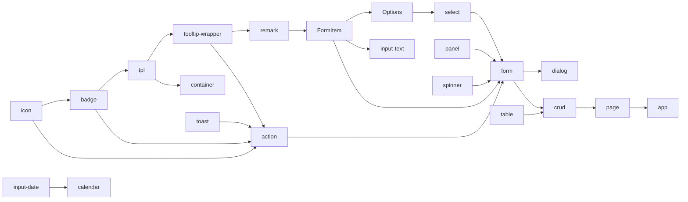

# Vamis 组件 P0 TODO（amis 文档对齐）

- 日期：2026-10-21（进度核对：2026-11-24；Picker / CRUD 行树）
- 状态：对照清单（进度 + 依赖优先级；不改分类）
- 优先级：阶段 **P0**；实施顺序按依赖链拓扑 + 解锁分 U + 综合分；**全表**按构建依赖补边后重算（见文末「依赖与优先级」）；「全量顺序」与「实现复杂度评估」的「侧栏」列同步站点左侧导航 P0 / P1 / P2
- 设计口径：[运行时语义设计](./2026-10-20-vamis-runtime-semantics-design.md)
- 视觉口径：[样式系统（Amis 水标 × shadcn）](./2026-10-21-vamis-style-system.md) — 渲染器走 token / Button·Input·Table·Card variants；不搬 `cxd-` 前缀，能力尽量像素级转写
- 覆盖数字（只比 type 名）：[同步状态](./2026-10-20-amis-sync-status.md)
- 文档侧栏：`../amis/examples/components/Components.tsx`（布局 / 功能 / 数据输入 / 数据展示 / 反馈 / 其他）
- 文档正文：`../amis/docs/zh-CN/components`
- 注册核对：`packages/vamis/src/register.ts` 与 `extras/*.ts` 的 `registerRenderer`
- 最近核对：2026-11-24（汇总 **62%**、≥80% **49**、≥50% **111**；已完成 9；测试 **1435**、`typecheck` 0；InputTree 桌面 / 移动 **26/31**、TreeSelect **14/16**、Options **38/39**、Select **26/31**、Transfer **17/20**、Picker 桌面 / 移动 **8/9**、Spinner **7/7**；Alert **5/5**；Dialog **22/23**、CRUD **63/92**、Form 桌面 **40/58** / 移动 **41/58**、Json **8/9**，均 P0 0；Picker 余 1 条 `${selectedValue}` 对比器读数差）

## 怎么读

1. **一行一个侧栏条目**，不是一行一个内部别名。`button` 是 `action` 的别名，仍单列，因为文档有独立页。
2. **已注册 ≠ 语义完成**。进度看的是是否满足「实现标准」：组件能力与文档均对标或超越 amis 对等内容，不是 `registerRenderer` 有没有调用。
3. **状态**
   - `未开始`：未注册，且没有等价能力（属性级能力也算）。
   - `进行中`：已注册或有部分能力，但未达到「实现标准」：占位 / 精简 / 缺 amis 已有能力或文档章节 / 被 P0 kernel（D1–D8）挡住。
   - `已完成`：满足「实现标准」：组件与文档均对标或超越 amis 对等内容。当前 **9 项**（`container` / `hidden` / `toast` / `dialog` / `spinner` / `select` / `tree-select` / `input-tree` / `transfer`）；`page` 因 `pullRefresh` 未接降为进行中。
4. **进度**是渲染器深度，不是 type 覆盖率（覆盖率 97.9% 见同步状态）。档位：
   | 进度 | 含义 |
   |------|------|
   | 0% | 未开始 |
   | 10–15% | 占位（明确未接入、html 直通、空壳） |
   | 20–35% | 精简（能绑值渲染，缺真实能力：Monaco / 地图 / 城市库 / Excel 解析 / 实时日志等） |
   | 40–70% | 主路径可交互，缺文档高级项、对照未齐、或未逐章节两站核完 |
   | 80–90% | 接近实现标准：**必须**双站逐章节核过，剩余只是可数的差异 / 增强。禁止用「文档主路径已对齐 + 缺 themeCss」进这档 |
   | 100% | 满足实现标准（组件 + 文档对标或超越 amis） |
5. 本清单不另起分类。侧栏未收录但 `docs/zh-CN` 有独立页的，在对应类末尾用脚注标出。
6. **文档地址**：`vamis 文档` 是相对 `http://localhost:5173` 的路径，`amis 文档` 是相对 `http://localhost:8888` 的路径。例如 `table-view`：vamis `/components/table-view`（完整 `http://localhost:5173/components/table-view`），amis `/zh-CN/components/table-view`（完整 `http://localhost:8888/zh-CN/components/table-view`）。`—` 表示没有独立文档页。
7. **依赖与优先级**：全表按构建依赖进图（默认包裹 / 渲染器 import / 文档专章 / Amis 示例主路径），不是只改 Action。拓扑图只画主干；每个 type 看 [分 type 依赖图](./2026-10-20-vamis-component-deps.md) 的**开工前置闭包**（全部祖先，禁止只看直接依赖）；154 个 type 看文末「全量顺序」。拓扑约束下先比解锁分 U、再比综合分 S。chrome（`icon` / `badge` / `tooltip-wrapper` / `remark` / `spinner`）排在 FormItem / Action 前面。无人依赖叶子后置。完整顺序见文末「依赖与优先级」。
8. **深色浮层回归**：不往主表加列（155 行里大量占位没有浮层）。已推进过的项见下文「深色浮层回归」。对照不切 `.dark`、不探 hover，不能替代这份手核。

## 实现标准（强制，2026-10-28）

**总要求：vamis 每个组件及其文档，必须对标或超越 amis 同名组件的对等内容；只做到“能渲染”不算完成。**

### 对标范围

1. **组件能力**：amis 同名文档的「属性表 / 事件表 / 动作表 / 数据域 / API / 子节点或插槽 / 移动端行为」逐项有对应实现；不能只覆盖主路径示例。
2. **文档**：vamis 组件文档的章节必须覆盖 amis 对等文档（基本用法、属性、事件、动作、示例、注意事项、差异）；可以增补，不可删减。每个属性 / 事件 / 动作都要有说明。
3. **示例**：amis 文档主路径的每个场景至少有一份 vamis 活示例（可合并，但不能缺）；示例必须可运行。
4. **差异**：允许 vamis 新增字段 / 增强（超越）；但 amis 已有能力缺失时，必须逐条写入组件页「与 Amis 的差异」和 TODO 行「缺 …」。差异不得用“设计不同 / 非目标”掩盖。
5. **验证**：组件 / 示例改动按 `.cursor/rules/compare.mdc` 跑 `pnpm compare --page <type>`；文档改动至少通过 `pnpm docs:build` 或生成器校验；未验证不得标 100%。
6. **数据域名单**：type 在「具备数据域的组件」里（App / Page / Cards / Chart / CRUD / CRUD2 / Dialog / Drawer / List / Form / PaginationWrapper / Service / Wizard / Combo / InputArray / Table / Table2，以及 `card`）。接上独立 Scope 或行 / 浮层数据链后，当轮回写 [运行时语义 D1 实现表](./2026-10-20-vamis-runtime-semantics-design.md#d1-scope-table)，并按缺口重算概念页数据域 banner。

### 判定

- **对标**：amis 对等内容全部可用，且 vamis 文档覆盖对等章节。
- **超越**：在对标基础上增加 vamis 能力，且不破坏 amis 兼容；新增能力必须文档化。
- **未达标**：缺任一属性 / 事件 / 动作 / 文档章节 / 示例，或用增强替代缺失。

### 完成门槛（100% / 已完成）

- [ ] 属性表、事件表、动作表逐项核对，无 amis 已有能力缺失；
- [ ] 文档章节对标或更全，差异表已填写；
- [ ] 主路径活示例齐全；
- [ ] 对照 / 构建验证通过（纯文档任务至少生成器或构建通过）；
- [ ] 无该组件的回归。

以上缺一不得标 `100%` / `已完成`。已完成的项若复审不达标，必须降为 `进行中` 并写明缺口。

## 分类汇总

| 分类 | 已完成 / 总数 | 进行中 | 未开始 | 平均进度 | ≥50%（主路径可用） | ≥80%（接近标准） |
|------|---------------|--------|--------|----------|-------------------|------------------|
| 布局 | 2 / 15 | 13 | 0 | 73% | 15 | 4 |
| 功能 | 0 / 12 | 12 | 0 | 72% | 11 | 6 |
| 数据输入 | 4 / 72 | 68 | 0 | 58% | 44 | 19 |
| 数据展示 | 0 / 44 | 44 | 0 | 62% | 32 | 14 |
| 反馈 | 3 / 5 | 2 | 0 | 92% | 5 | 4 |
| 其他 | 0 / 7 | 7 | 0 | 58% | 4 | 2 |
| **合计** | **9 / 155** | **146** | **0** | **62%** | **111** | **49** |

侧栏已无未开始项。当前已完成 `container`、`hidden`、`toast`、`dialog`、`spinner`、`select`、`tree-select`、`input-tree`、`transfer`；`page` 因 `pullRefresh` 未接按标准降为进行中。2026-11-16 把「主路径 + 缺 themeCss」顶到 80%+ 的一批打回 40–70%（布局壳、包装器、对照大面积失败）。≥80 只留给双站核过、剩余缺口可数的项。

执行顺序见文末「依赖与优先级」：先解锁主干 #1–#10（`icon`、`badge`、`tpl`、`tooltip-wrapper`、`remark`、FormItem、`toast`、`action`…），`form` #27、`dialog` #44、`crud` #64、`page` #65，零被依赖从 #66 起，`app` #154 最后。`spinner` 已齐；继续补 badge / tooltip-wrapper / remark，避免把剩余选择器依赖当成已解锁。

## 深色浮层回归（已推进组件）

口径：Playground 切「深色」，打开该页 tooltip / 下拉 / PopOver / Dialog / Toast。过了对照 ≠ 已核。`themeCss` 余项不挡打勾。收工把「未核」改成「已核」并写日期。

范围：主表进度 **≥80%**（主路径对齐过），外加对照跑过、带浮层但不足 80% 的（`form` / `table2` / `card` / `cards` / `image` / Options）。占位 / 精简（&lt;50%）不进。

### 有独立浮层（优先）

| type | 浮层 | 深色 | 备注 |
|------|------|------|------|
| `select` | 下拉 + tag tooltip + `+N` 溢出 | 已核 | 2026-11-07。溢出走 `--select-menu-*`，tooltip 走 `--tooltip-*` |
| `tooltip-wrapper` | Tooltip | 已核 | 2026-11-16。基本配置 hover 浮层：升高面 / 文字 / 边框都走深色 token，Teleport 正常 |
| `remark` | Tooltip | 未核 | 浮层已复用 `--tooltip-*`，仍需深色手核 |
| `action` / `button` | tooltip / disabledTip；confirm Dialog | 未核 | |
| `dropdown-button` | 下拉菜单 | 未核 | 贴触发器 `VamisOverlay`（窄屏也是），深色菜单 / tooltip 仍要手开 |
| `input-text` | 选择器建议下拉 | 未核 | 贴输入框 `VamisOverlay`（窄屏也是），深色建议仍要手开 |
| `input-password` | 同 input-text | 未核 | |
| `input-date` / `input-datetime` / `calendar` | 日期 PopOver | 已核 2026-11-07 | `--cal-*` alias `--select-menu-*`，`.dark` 覆盖格子 hover / 非本月 |
| `dialog` | Modal | 已核 | 2026-11-20。盒模型、0.7 遮罩、Spinner overlay、拖拽与 375px 均分按钮已复核 |
| `drawer` | 抽屉 | 未核 | |
| `toast` | 轻提示 | 未核 | 桌面浮层已走 token，仍需深色手核 |
| `popOver` | 字段弹出 | 已核 | 2026-11-10。浅 320 白底 / 深 `--popover-layer-bg: #182230`，表格列 `center` 盖整格 td，`--z-popover` 1400 |
| `breadcrumb` | 文档记缺 tooltip 浮层 | 未核 | 有下拉项时核 |
| `page` | remark / spinner overlay | 未核 | |
| `form` / FormItem / Options | labelRemark；Options 下拉 | 未核 | form 75%，对照过 |
| `table2` | 表头/筛选等浮层 | 未核 | 70%，对照过 |
| `card` / `cards` | 卡片操作/弹出 | 未核 | 对照过 |
| `image` | 预览 | 已核 | 2026-11-10。放大层永远黑底白字，不跟 `.dark` 换肤 |
| `alert` | 关闭等 | 未核 | |
| `spinner` | overlay | 已核 | 2026-11-21。桌面 / 移动、深色和 375px 已核 |
| `badge` | 角标宿主 | 未核 | |
| `avatar` | badge | 未核 | |
| `nav` | overflow / itemBadge | 未核 | |
| `wizard` | 步骤里的 form/dialog | 未核 | |
| `picker` | 弹层多选 | 默认弹框 / drawer / 收纳浮层已核 | 99%，trigger 满宽、默认 CRUD list、modalMode、overflowConfig 全部主字段、已选栏、staticItemClick、strictMode、table `children` 行树已对齐；余非 table pickerSchema 与树表窄屏/深色专项核 |
| `input-number` | 单位下拉 | 已核 | 2026-11-10。复用 `--select-menu-*`（深 `#182230`），无独立 tooltip |

### 已推进、无独立浮层（切深色看默认皮）

| type | 进度 | 深色 | 备注 |
|------|------|------|------|
| `container` | 100% | 未核 | |
| `icon` `tpl` `html` | 90–92% | 未核 | |
| `checkbox` | 90% | 已核 | 2026-11-07。无独立浮层；浅+深默认皮（16 盒 / 按钮模式 / 禁用灰底） |
| `switch` | 88% | 已核 | 2026-11-11。无独立浮层；浅 `#d4d6d9` / 深 `#84878c`，滑块 16 白 / 深 `#f7f8fa`，选中走 `--primary`；`change` 示例的 toast 属全局 |
| `hidden` | 100% | 无需核 | 2026-11-12。`wrap: false` 不落 DOM，无可视默认皮与浮层 |
| `input-image` | 80% | 已核 | 2026-11-12。`--input-image-*` 走 `--card` / `--border` / `--primary`；无浮层（点击缩略图新窗口） |
| `textarea` | 85% | 已核 | 2026-11-12。textarea 走 `--card` / `--input` / `--foreground`；无浮层 |
| `editor` `code` `diff-editor` | 85% / 92% / 65% | 未核 | Monaco 有自己的 vs-dark |
| `collapse` / `tabs` / `portlet` | 70% / 95% / 65% | tabs 已核 | 2026-11-13。`showTip` 深色 tooltip 底 `#182230` / 字 `#f7f8fa`，不写死白盒。collapse / portlet 未核 |
| `panel` `wrapper` `flex` `grid` `grid-2d` `hbox` | 均为 65% | 未核 | |
| `divider` `pagination` `pagination-wrapper` `switch-container` | 65% / 98% / 65% / 65% | pagination 已核；其余未核 | |
| `button-group` | 92% | 已核 | 邻钮 1px 负缝打在 `.vamis-node`，hover 抬 wrapper；无独立浮层 |
| `table-view` | 65% | 未核 | |
| `app` `anchor-nav` `service` | 55% / 55% / 70% | 未核 | `service` 2026-11-13。接口联动用父域做 isApiOutdated；Spinner overlay 不改盒模型 |
| `audio` | 50% | 未核 | |

---

## 布局（1/15，均 73%）

侧栏 14 项 + 文档有页但未进侧栏的 `switch-container`。

| type | 文档 | vamis 文档 | amis 文档 | 状态 | 进度 | 原因 | P |
|------|------|------|------|------|------|------|------|
| `page` | Page 页面 | `/components/page` | `/zh-CN/components/page` | 进行中 | 95% | 主路径对齐：独立 Scope（子域写值不反冒泡）、URL 查询种子、initApi overlay（GET 不把数据域拼进 query）、根级 `ajax` Action 请求期间同一 Page overlay（feedback 打开前撤罩）、`silentPolling` 只隐藏轮询遮罩（首次/手动 reload 仍显示）、reload/setValue、完整事件对象；无标题时 toolbar 吃满上级；根/header/aside 用 div 组装。按实现标准：`pullRefresh` 未接（移动端），未达 100% | P0 |
| `container` | Container 容器 | `/components/container` | `/zh-CN/components/container` | 已完成 | 100% | 主路径对齐：`wrapperBody` 默认包一层（flex 也包，同级子项换行）、`style` / `wrapperComponent` / `bodyClassName`、click/mouseenter/mouseleave。沿用父 Scope。`draggable` 非运行时主路径 | P0 |
| `collapse` / `collapse-group` | Collapse 折叠器 | `/components/collapse` | `/zh-CN/components/collapse` | 进行中 | 70% | 主路径可交互（未逐章节两站核完，不进 80%）：`activeKey` / 手风琴 / 禁用 / `showArrow` / 图标位置 / `change` 事件。窄屏 &lt;768 去边框、底部分割线、箭头靠右（Amis `is-mobile` / `media-breakpoint-down(sm)`），默认箭头走 `VamisCaret` tree。缺 `mountOnEnter`、`expand`·`collapse` 动作、FieldSet 像素级 | P0 |
| `divider` | Divider 分割线 | `/components/divider` | `/zh-CN/components/divider` | 进行中 | 65% | 主路径可交互（未逐章节两站核完，不进 80%）：`lineStyle` / `direction` / `color` / `rotate` / `title` / `titlePosition`。缺 `themeCss`、窄屏 `scaleY(0.5)` | P0 |
| `flex` | Flex 布局 | `/components/flex` | `/zh-CN/components/flex` | 进行中 | 65% | 主路径可交互（未逐章节两站核完，不进 80%）：`justify` / `alignItems` / `alignContent` / `direction` / `items` / `mobile`。缺 `themeCss`、整树 `envOverwrite` | P0 |
| `grid` | Grid 水平分栏 | `/components/grid` | `/zh-CN/components/grid` | 进行中 | 65% | 主路径可交互（未逐章节两站核完，不进 80%）：均分列、`md`/`xs`/`sm`/`lg` 1–12 与 `auto`、`gap`、`align` / `valign`。缺 `themeCss`、列 `mode` / `horizontal` | P0 |
| `grid-2d` | Grid 2D 布局 | `/components/grid-2d` | `/zh-CN/components/grid-2d` | 进行中 | 65% | 主路径可交互（未逐章节两站核完，不进 80%）：`x/y/w/h`、`cols`、列宽/行高、`height: auto`、`gap` / `gapRow`、`align` / `valign`。缺格子 `themeCss` | P0 |
| `hbox` | HBox 布局 | `/components/hbox` | `/zh-CN/components/hbox` | 进行中 | 65% | 主路径可交互（未逐章节两站核完，不进 80%）：列均分、`width` / `auto`、默认 `gap: xs`、`align` / `valign`、`columnClassName`。缺 `themeCss`、列 `mode` / `horizontal` | P0 |
| `pagination` | Pagination 分页 | `/components/pagination` | `/zh-CN/components/pagination` | 进行中 | 98% | 主路径与双站已核：layout / mode / size / buttonType、total·perPage、省略号与跳页上限、change 的 setValue / reload 联动；mobileUI 使用箭头 + 输入，支持方向键 / 回车。perPage 复用 Vamis Select，盒模型 / 文字 / 色号已核；缺 `themeCss` | P0 |
| `pagination-wrapper` | PaginationWrapper 分页容器 | `/components/pagination-wrapper` | `/zh-CN/components/pagination-wrapper` | 进行中 | 65% | 主路径可交互（未逐章节两站核完，不进 80%）：`inputName` / `outputName` 客户端切片、`perPage`、`position`、内嵌 `pagination`。缺 `themeCss`；CRUD `loadDataOnce` 仍属 D10 | P0 |
| `panel` | Panel 面板 | `/components/panel` | `/zh-CN/components/panel` | 进行中 | 65% | 主路径可交互（未逐章节两站核完，不进 80%）：`title` / `header` / `body` / `footer` / `actions`、`affixFooter`、区域 `*ClassName`。缺 `themeCss`、色档、移动端 `Panel--form` | P0 |
| `tabs` | Tabs 选项卡 | `/components/tabs` | `/zh-CN/components/tabs` | 进行中 | 95% | 文档主路径已对齐：`tabs[].body` / `tab`、`source`、`activeKey` / `defaultKey`、`disabled`、九种 `tabsMode`（`mode` 别名）、工具栏、图标、`showTip`、表单及独立数据域 `name`（已有值选中标签、切换写回）、增删改拖（Sortable 250ms，拖完按对象重绑选中）、折叠「更多」/`collapseBtnLabel`、默认按容器溢出（不用写字段）、地址栏 `#hash` 来回同步、sidebar 内侧竖线、`change` / `delete`、`changeActiveKey` / `deleteTab`。line 未激活文字矮 1px；切页下划线滑动（优化，非 Amis）。缺 `swipeable`、chrome 耳朵 SVG、`themeCss`、单项 `unmountOnExit` | P0 |
| `wrapper` | Wrapper 包裹容器 | `/components/wrapper` | `/zh-CN/components/wrapper` | 进行中 | 65% | 主路径可交互（未逐章节两站核完，不进 80%）：`body`、默认 `size: md` 内边距、`xs`–`lg` / `none`、`style` 对象与 `${style}`、`wrap`。缺 `themeCss` | P0 |
| `portlet` | Portlet 门户栏目 | `/components/portlet` | `/zh-CN/components/portlet` | 进行中 | 65% | 主路径可交互（未逐章节两站核完，不进 80%）：`tabs[].body` / `tab`、`source`、`description`、`hideHeader`、默认分隔线 / `divider: false`、全局与 tab 级 `toolbar`、`mountOnEnter` 默认 false、`change`。缺 `themeCss`、icon 像素、`scrollable` | P0 |
| `switch-container` | switch-container 状态容器 | `/components/switch-container` | `/zh-CN/components/switch-container` | 进行中 | 65% | 主路径可交互（未逐章节两站核完，不进 80%）：`items[].body` / `visibleOn` 取首个命中、`style`、宿主 click/mouseenter/mouseleave。缺 `themeCss`、`switchTo` 动作。侧栏未收录，docs 有独立页 | P0 |

---

## 功能（0/12，均 72%）

| type | 文档 | vamis 文档 | amis 文档 | 状态 | 进度 | 原因 | P |
|------|------|------|------|------|------|------|------|
| `action` | Action 行为按钮 | `/components/action` | `/zh-CN/components/action` | 进行中 | 95% | 文档主路径已对齐：`actionType`、`level` / `primary`、`size`、`icon` / 空 label 正方形 `iconOnly`（默认 32×32，xs/sm/md/lg 跟档位，`level: link` 除外；`level: link` 无下划线、`--link-color`）、`confirmText` / `confirmTitle`（Amis `Alert.confirm` Modal：默认标题「系统消息」、无 X、Esc/点遮罩不关、确认 danger）、dialog / drawer / ajax（`redirect` / `feedback`）/ toast / copy（`copyFormat`）/ link / url（`blank`）/ email / download / saveAs、`countDown` / `hotKey`、Action 当容器（`tooltip` 走 `VamisOverlay` `--z-tooltip` 1600，不裁切）、`tooltip` / `disabledTip`（字符串或 TooltipObject：title/content/theme/arrow/delay/trigger/offset，不含 type/body/wrapperComponent/className/inline）/ `tooltipPlacement`、click / mouseenter / mouseleave 事件活示例、`loading` / `loadingOn`、`active` / `activeLevel`、`clear` / `clear-and-submit` / `reset-and-submit`。`secondary` 实心中灰白字、`dark` 实心炭灰、`light` 浅底深字；尺寸 xs/sm/md/lg = 22/30/32/38px（cxd）。主题/尺寸活示例并排。控制流 `switch` / `loop` / `parallel` 已接；仍缺按名字关祖先浮层、`nextCondition`、input-table 增行 | P0 |
| `app` | App 多页应用 | `/components/app` | `/zh-CN/components/app` | 进行中 | 55% | 主路径可交互（未逐章节两站核完，不进 80%）：`pages` 分组 / 相对 `url`、`schema` 内嵌、`link`、`visible: false`、`isDefaultPage` 当 404、`brandName` / 槽位。缺 hash 路由、`schemaApi` / `api`、`redirect` / `rewrite` | P0 |
| `button` | Button 按钮 | `/components/button` | `/zh-CN/components/button` | 进行中 | 96% | `action` 别名，同一渲染器。文档主路径已对齐 `level` / `size` / `block`、`loading` / `loadingOn`、`tooltip` / `disabledTip` / `tooltipPlacement`。`secondary` / `dark` / `light` 与尺寸阶梯按 cxd 转写；空 label + icon 默认 32×32。复杂行为见 Action | P0 |
| `button-group` | ButtonGroup 按钮组 | `/components/button-group` | `/zh-CN/components/button-group` | 进行中 | 92% | `buttons` / `body`、`vertical`、`tiled`、`btnLevel`；相邻 `.vamis-node` 1px 负缝 + 首尾圆角；hover/focus 抬 wrapper 避免缺边。`btnActiveLevel` 归 ButtonGroupSelect。对照桌面 **4/4**、移动 **4/4**（P0 0） | P0 |
| `breadcrumb` | Breadcrumb 面包屑 | `/components/breadcrumb` | `/zh-CN/components/breadcrumb` | 进行中 | 65% | 主路径可交互（未逐章节两站核完，不进 80%）：`items` / `source`、默认 `>`、`dropdown`、中间项 `labelMaxLength`。缺 tooltip 浮层 | P0 |
| `custom` | Custom 自定义组件 | `/components/custom` | `/zh-CN/components/custom` | 进行中 | 15% | **占位**：`html` 直通或渲染 `body`，不执行 onMount JS | P0 |
| `dropdown-button` | DropDownButton 下拉按钮 | `/components/dropdown-button` | `/zh-CN/components/dropdown-button` | 进行中 | 88% | 文档主路径已对齐：`buttons` 分组、`closeOnClick` / `closeOnOutside`、`trigger: hover`、`hideCaret`、`defaultIsOpened`、`tooltip` / `placement` / `disabledTip`。菜单 `ul>li` + Action `isMenuItem`（不是完整 Button），贴触发器 `VamisOverlay`。缺菜单进出动画 | P0 |
| `service` | Service 功能型容器 | `/components/service` | `/zh-CN/components/service` | 进行中 | 70% | 主路径已对齐：独立 Scope（私有值不写回 Page）、静态 `data`、`api` 拉数、`schemaApi` 子 schema（含 `controls` 表单项）、`initFetch` / `initFetchSchema`、`reload` / `rebuild` / `setValue`、接口联动（`isApiOutdated` 只比父域，请求 `{ ...store, ...props.data }` 父域后写）、`interval` 轮询 / `silentPolling` / `stopAutoRefreshWhen`、顶部错误 Alert、`init` / `fetchInited` / `fetchSchemaInited`。Spinner overlay 绝对定位，不改已渲染盒模型。文档章节对标 Amis（jsonp / js / ws / dataProvider 未接占位）。对照桌面 **8/14**、移动 **8/14**（P0 0）。缺 `dataProvider` / `ws` / jsonp / `js:` schemaApi | P0 |
| `nav` | Nav 导航 | `/components/nav` | `/zh-CN/components/nav` | 进行中 | 55% | 主路径可交互（未逐章节两站核完，不进 80%）：`links` / `source`、默认 stacked、横排、多级 `children`。缺 overflow / 缩起 / 搜索 | P0 |
| `anchor-nav` | AnchorNav 锚点导航 | `/components/anchor-nav` | `/zh-CN/components/anchor-nav` | 进行中 | 55% | 主路径可交互（未逐章节两站核完，不进 80%）：`links` / `children` 展平、`direction`、`active` href 或索引。缺滚动自动高亮 | P0 |
| `tooltip-wrapper` | TooltipWrapper 文字提示容器 | `/components/tooltip` | `/zh-CN/components/tooltip-wrapper` | 进行中 | 92% | 文档主路径已对齐：`content` / `title`、`trigger` hover/click/focus、`placement`、`tooltipTheme`、`offset`、`showArrow`、`inline`、`wrapperComponent`。活示例对标 Amis（图标十字布局 / trash / 长文本省略）。浮层 `VamisOverlay` Teleport、`--z-tooltip` 1600、盒 240 / 8×12 / 圆角 8 / 8×4 箭头。`placement` 主轴放不下翻对面（箭头跟边）。缺 `themeCss` | P0 |
| `popOver` | PopOver 弹出提示 | `/components/popover` | `/zh-CN/components/popover` | 进行中 | 90% | 不是独立 type。文档主路径已对齐 Amis 同名页。表格列浮层相对整格 `td` 居中；表单 static 默认 `position: right` 锚放大镜。CRUD 底栏 40px float+clearfix（item 30 + mt 10），statistics + Pagination（cxd `maxButtons: 9`，mock 1710 条）。缺 CRUD 默认 header 像素、list 其余皮肤 | P0 |

---

## 数据输入（3/72，均 58%）

Form / FormItem / Options 是契约页，不是业务 type，但挡住所有表单项（D6），必须进清单。

| type | 文档 | vamis 文档 | amis 文档 | 状态 | 进度 | 原因 | P |
|------|------|------|------|------|------|------|------|
| `form` | Form 表单 | `/components/form` | `/zh-CN/components/form` | 进行中 | 75% | 主路径已对齐：`initApi` / 提交 API / 校验 / 重置 / 调试、`initApiFinished` / `inited` / `change` / `validateSucc` / `validateError` / `submit` / `submitSucc` / `submitFail` / `formItemValidate*` 事件、`rules` 组合校验（`data.x` 表达式 + `name` 高亮）、`submitOnInit` / `submitOnChange`、`resetAfterSubmit`、`redirect`、`messages`、`trimValues`、`persistData` / `persistDataKeys` / `clearPersistDataAfterSubmit`、`preventEnterSubmit`、`autoFocus`、`static` 切换、`target` / `reload`、`debug`（顶部 `type: json`、`debugConfig`、轻量 JSON 树语法着色）、`canAccessSuperData`（默认 true，只映射同名表单项，父域其它字段不进本域）、`clearValueOnHidden` 同步清理 store / Scope 并记 `hide`、Definitions `$ref` 默认值收集、`horizontal` 比例 / `leftFixed` / `justify` / `labelAlign` / 表单项 `labelWidth`。文档按 Amis `form/index` 全章节改写。成功提示按非空 `msg` → `messages.saveSuccess` → `defaultMsg`，空 msg 保持静默，避免 feedback 外层 `initData` 多弹 toast。`submitText: ""` 去默认提交；body 已有 `submit`/`button`/`reset`/`toolbar` 也不注入底栏；`type: submit` 无 `primary` 是描边。`wrapWithPanel: false` 时 title/actions 失效。桌面 heading **35px**（12/400/1.5 + 8×12 / text-3）/ footerWrap > toolbar 8×12 右对齐，对齐 Amis Panel。水平必填星贴文案（内层 relative span）。对照桌面 **40/58**（`components-form-index-0` Amis rendered 探针偶发 false）、移动 **41/58**（P0 0）。缺 `interval` / `silentPolling` / `asyncApi` / `initAsyncApi`、`promptPageLeave`、`columnCount`、`inheritData`、`validate` / `validateFormItem` / `clearError` 动作、combo 独立域 | P0 |
| （契约） | FormItem 表单项通用 | `/components/form/formitem` | `/zh-CN/components/form/formitem` | 进行中 | 90% | 路径值 `a.b`、`requiredOn`、`validateOnChange`、`submitOnChange`、`clearValueOnHidden`、labelRemark、`static`/`staticOn`/`staticSchema`（选择器 `limit` → `tags`/`words`；脱离 Form 也读当前数据链）、事件动作 `static`/`nonstatic`（status-store 按 id/name）、禁用/显隐、默认间距 24px、`mode: inline`（项并排、项内左右）、默认 `normal` 标签在上（窄屏 ≤767 改 28% 同行）、未写 label 仍占标签列、`button-toolbar` 包 FormItem、`validateApi`、提交 `errors`、`autoFill`（映射/`api`+`fillMapping`，无弹层）、form `debug`、label HTML、description HTML、`validations`/`validationErrors`（对象/字符串/`$1`/`isUrl.schemes`/默认 `validate.*` key）。属性表四列 +「支持静态展示的表单项」。缺 combo/table 路径级报错、`autoFill.showSuggestion` 族、`autoFill.silent`、`staticClassName` 三件 | P0 |
| `control` | Control 表单项包裹 | `/components/form/control` | `/zh-CN/components/form/control` | 进行中 | 40% | 已注册；只做包裹 | P0 |
| （契约） | Options 选择器表单项 | `/components/form/options` | `/zh-CN/components/form/options` | 进行中 | 92% | 统一 Options 契约：规范化、source 数据域/远程、joinValues/extractValue/delimiter、multiple/checkAll/selectFirst、labelField/valueField、clearable/searchable/creatable、editable/editControls/editApi/editDialog、removable/deleteApi/deleteConfirmText、选项 autoFill、`itemActions`、树节点路径值。Select 新增 / 编辑按 Amis 打开 Dialog；`addConfirm` / `editConfirm` / `deleteConfirm` 已接，先于本地变更与 CUD API；InputTree 已接相同确认顺序及 deferApi/deferField 懒加载、子树合并与 deferLoadFinished。`itemActions` 由共享 TreeBranch 覆盖 InputTree / TreeSelect / Select tree，节点 option 作为 extraData 且操作点击不选行。`enableNodePath` / `pathSeparator` 由 core 路径值工具覆盖 InputTree / TreeSelect，输入拆叶子、输出按父链回写，defer 只加载路径父链。虚拟列表已接 Select 桌面平铺选项、InputTree / TreeSelect 共享树窗口、Transfer list/table 双栏窗口；分组菜单、Picker、Transfer tree 仍整表渲染，远程缓存未接 | P0 |
| `input-array` | InputArray 数组输入框 | `/components/form/input-array` | `/zh-CN/components/form/input-array` | 进行中 | 50% | 能增删行；子域/校验未齐 | P0 |
| `button-toolbar` | ButtonToolbar 按钮工具栏 | `/components/form/button-toolbar` | `/zh-CN/components/form/button-toolbar` | 进行中 | 60% | 能排按钮 | P0 |
| `button-group-select` | ButtonGroupSelect 按钮点选 | `/components/form/button-group-select` | `/zh-CN/components/form/button-group-select` | 进行中 | 55% | 能选值；多选/自适应未齐 | P0 |
| `chained-select` | ChainedSelect 链式下拉框 | `/components/form/chain-select` | `/zh-CN/components/form/chain-select` | 进行中 | 50% | 能链式选；api 级联精简 | P0 |
| `checkbox` | Checkbox 勾选框 | `/components/form/checkbox` | `/zh-CN/components/form/checkbox` | 进行中 | 90% | `trueValue`/`falseValue`、`option` 与 `label` 分工、`optionType: button`、禁用/只读/静态、`change`、`clear`/`reset`/`setValue`、`badge` 已接。盒模型 `--checkbox-*`（16×16 / 圆角 2）。缺 themeCss 皮肤变量 | P0 |
| `checkboxes` | Checkboxes 复选框 | `/components/form/checkboxes` | `/zh-CN/components/form/checkboxes` | 进行中 | 55% | 能多选；列数/全选未齐 | P0 |
| `input-city` | InputCity 城市选择器 | `/components/form/input-city` | `/zh-CN/components/form/input-city` | 进行中 | 25% | **精简**：内置 3 省示例，非全国数据 | P0 |
| `input-color` | InputColor 颜色选择器 | `/components/form/input-color` | `/zh-CN/components/form/input-color` | 进行中 | 50% | 能选色；预设/格式未齐 | P0 |
| `combo` | Combo 组合 | `/components/form/combo` | `/zh-CN/components/form/combo` | 进行中 | 55% | 默认 `multiple: false`、内嵌 `mode: row` 横排（对齐 Amis Combo）；每行应用 items 默认值，支持 Definitions 条件递归展开。缺 multiLine / 拖拽 / 子项 api / 扁平模式、独立 Scope | P0 |
| `condition-builder` | ConditionBuilder 条件组合 | `/components/form/condition-builder` | `/zh-CN/components/form/condition-builder` | 进行中 | 35% | **精简**：基础规则组；缺公式/嵌套组/日期控件 | P0 |
| `input-date` | InputDate 日期选择器 | `/components/form/input-date` | `/zh-CN/components/form/input-date` | 进行中 | 92% | 日历点选、format/inputFormat、相对值、minDate/maxDate（日 + 年/月面板都禁范围外）、shortcuts、utc/embed、change/focus/blur、clear/reset/setValue 已接。弹层 Teleport 到 body（z-index 1000 / popOverContainerSelector）；Amis auto 翻转（下左→下右→上左→上右）；日历层 240×290，popover padding 0。与 calendar 共用 DateCalendarPanel。弹层 `--cal-*`（深色 alias Select 菜单 `#182230`）。窄屏默认滚轮 PopUp（320px / 年/月/日 / 取消确认；PopUp height 进出动画）。缺 `mobileCalendarMode: calendar`、schedules | P0 |
| `input-datetime` | InputDatetime 日期时间 | `/components/form/input-datetime` | `/zh-CN/components/form/input-datetime` | 进行中 | 62% | `input-date` 别名，已接日期+时分秒与窄屏滚轮；时分秒约束与 `mobileCalendarMode: calendar` 未齐 | P0 |
| `input-month` | InputMonth 月份选择器 | `/components/form/input-month` | `/zh-CN/components/form/input-month` | 进行中 | 45% | DatePart 精简 | P0 |
| `input-date-range` | InputDateRange 日期范围 | `/components/form/input-date-range` | `/zh-CN/components/form/input-date-range` | 进行中 | 90% | 主路径已对齐：双输入框 + 左右双月历、区间高亮只打当月格子、快捷条居中、桌面取消/确认、点年/月标题进面板、左右不同月（内侧箭头隐藏 + `clampApart`）、`valueFormat` / `displayFormat` / `delimiter`、默认值 / 相对值 / 公式、`shortcuts`、`embed`、`extraName`、`minDuration` / `maxDuration`、`timeFormat` 对齐、`transform`（trusted）；`change` / `focus` / `blur`、`clear` / `reset` / `setValue`。文档按 Amis 章节改写。对照桌面 **11/13**、移动 **11/13**（P0 0；#4/#5 公式 value Amis 仍是模板串、Vamis 已求值）。余项：`animation` 游标、`popOverContainerSelector`、窄屏 CalendarMobile | P0 |
| `input-datetime-range` | InputDatetimeRange 日期时间范围 | `/components/form/input-datetime-range` | `/zh-CN/components/form/input-datetime-range` | 进行中 | 45% | `input-date-range` 别名 | P0 |
| `input-month-range` | InputMonthRange 月份范围 | `/components/form/input-month-range` | `/zh-CN/components/form/input-month-range` | 进行中 | 45% | DatePartRange 精简 | P0 |
| `input-kv` | InputKV 键值对 | `/components/form/input-kv` | `/zh-CN/components/form/input-kv` | 进行中 | 50% | 能增删 KV | P0 |
| `input-kvs` | InputKVS 键值对象 | `/components/form/input-kvs` | `/zh-CN/components/form/input-kvs` | 进行中 | 45% | 结构精简 | P0 |
| `input-formula` | InputFormula 公式编辑器 | `/components/form/input-formula` | `/zh-CN/components/form/input-formula` | 进行中 | 30% | **精简**：复用 Formula，无公式编辑器 UI | P0 |
| `diff-editor` | DiffEditor 对比编辑器 | `/components/form/diff-editor` | `/zh-CN/components/form/diff-editor` | 进行中 | 65% | Monaco Diff：左侧 `diffValue` 只读，右侧绑 `name`；`options` / 事件已接。动作仍缺 D7 | P0 |
| `editor` | Editor 代码编辑器 | `/components/form/editor` | `/zh-CN/components/form/editor` | 进行中 | 85% | Monaco 编辑器：`hideButtons`、`size: full`、`intellisense: schema`（`registerRenderer` 自述即感知；按组件树定位 type，JSON Schema `$defs`+`if/then`）。文档「编辑 Schema」只消费。`editorDidMount` 未接；动作仍缺 D7 | P0 |
| `fieldset` | FieldSet 表单项集合 | `/components/form/fieldset` | `/zh-CN/components/form/fieldset` | 进行中 | 55% | 能分组折叠 | P0 |
| `input-excel` | InputExcel Excel 解析 | `/components/form/input-excel` | `/zh-CN/components/form/input-excel` | 进行中 | 20% | **精简**：只记文件名/大小，不解析表格 | P0 |
| `input-file` | InputFile 文件上传 | `/components/form/input-file` | `/zh-CN/components/form/input-file` | 进行中 | 88% | 主路径已对齐：receiver POST form-data、默认 autoUpload、accept/maxSize、多选 joinValues、asBlob/asBase64、拖拽、分片 start/chunk/finish、change/success/fail/remove、clear。缺 themeCss、提交时未等 pending 传完 | P0 |
| `formula` | Formula 公式 | `/components/form/formula` | `/zh-CN/components/form/formula` | 进行中 | 65% | 基本用法对标 Amis 自动 A+B（隐藏 formula + 只读和），Formula 写值记 `__changeReason.type = formula`。对照桌面 **2/3**（P0 0；空值示例 Amis `rendered` 常假红）。缺 input-formula 编辑器与表达式层统一（D2） | P0 |
| `group` | Group 表单项组 | `/components/form/group` | `/zh-CN/components/form/group` | 进行中 | 75% | ≥768 横排 `Form-groupColumn` 均分，`mode` / `subFormMode` 传给未写 mode 的子项；`columnRatio` 按 12 等分控制宽度。缺 gap 档 / 组标签 | P0 |
| `hidden` | Hidden 隐藏字段 | `/components/form/hidden` | `/zh-CN/components/form/hidden` | 已完成 | 100% | 与 Amis 一致：渲染 null、`wrap: false`（SchemaRenderer 直接挂组件，不落 `.vamis-node`）、值随表单初始化/提交、`name` 支持 `a.b[0]` 路径、`value` 支持 `${}` 表达式；文档覆盖基本用法 / 属性 / 事件 / 动作表。对照桌面 **1/1**、移动 **1/1**（P0 0） | P0 |
| `input-image` | InputImage 图片 | `/components/form/input-image` | `/zh-CN/components/form/input-image` | 进行中 | 80% | 主路径已对齐：复用 InputFile 上传管线（receiver POST form-data、`data.value`/`data.url` 回填）、`autoUpload` / 手动上传 / `hideUploadButton`、`multiple` / `joinValues` / `extractValue` / `delimiter`、`accept` / `capture`、`maxSize` / `maxLength`、`limit` 尺寸校验、`frameImage` / `fixedSize`、`uploadBtnText`、`autoFill` / `initAutoFill`（源码默认 true）、`draggable` 排序、`change` / `remove` / `success` / `fail`、`clear`；缩略图 120 方块（`--input-image-*`）。文档按 Amis 章节改写，手动上传 / 隐藏上传按钮 / 多选 autoFill / 其他表单项填充 / initAutoFill / 拖拽排序示例均按 Amis 原例对齐。对照桌面 **12/12**、移动 **12/12**（P0 0）。缺 `crop` 系列 / `allowInput` / 图片预览画廊；`uploadBtnText` 只收字符串、`fixedSize` 只加类名 | P0 |
| `input-group` | InputGroup 输入框组合 | `/components/form/input-group` | `/zh-CN/components/form/input-group` | 进行中 | 55% | 能并排控件 | P0 |
| `list-select` | ListSelect 选择器 | `/components/form/list-select` | `/zh-CN/components/form/list-select` | 进行中 | 50% | 能点选列表 | P0 |
| `location-picker` | LocationPicker 地理位置 | `/components/form/location-picker` | `/zh-CN/components/form/location-picker` | 进行中 | 25% | **精简**：地址/经/纬三个输入框，无地图 | P0 |
| `uuid` | UUID 随机 ID | `/components/form/uuid` | `/zh-CN/components/form/uuid` | 进行中 | 70% | 能生成；仍走扁平 name | P0 |
| `matrix-checkboxes` | MatrixCheckboxes 矩阵勾选 | `/components/form/matrix-checkboxes` | `/zh-CN/components/form/matrix-checkboxes` | 进行中 | 40% | 已注册，行列数据精简 | P0 |
| `nested-select` | NestedSelect 级联选择器 | `/components/form/nestedselect` | `/zh-CN/components/form/nestedselect` | 进行中 | 45% | 能级联；`cascader-select` 别名未注册 | P0 |
| `input-number` | InputNumber 数字输入 | `/components/form/input-number` | `/zh-CN/components/form/input-number` | 进行中 | 88% | 主路径已对齐：步进/精度/min-max、前后缀与千分位、单位、enhance、大数、resetValue / clearValueOnEmpty、change/blur/focus、clear/reset/setValue。缺 themeCss | P0 |
| `input-password` | InputPassword 密码 | `/components/form/input-password` | `/zh-CN/components/form/input-password` | 进行中 | 90% | `input-text` 别名；默认 `revealPassword` 显隐钮，`false` 关掉。缺 `themeCss` | P0 |
| `picker` | Picker 列表选择器 | `/components/form/picker` | `/zh-CN/components/form/picker` | 进行中 | 99% | 默认 trigger 对齐 Amis 单输入框：tag 内嵌 × / label 点击 itemClick / picker icon，`size` 不锁宽，trigger 满值列。默认弹框按 Amis `Picker.buildSchema()` 生成 CRUD `mode: list`：500px 内容、42.5 行高、brand-10 / brand-4 选中行、15px 列表右缩；`value + primaryField` 回填已有选中，分页切换不覆盖完整 option，source 后到时会用完整 option pool 把 `{id}` 描述符 enrich 成 label；无 bulkActions 不显示普通计数，多选另显示 `Crud-selection`。`modalMode: drawer` 桌面 500px / header 54 / footer 57，375px 全宽；`overflowConfig.maxTagCount` / `displayPosition` / `overflowTagPopover` / `overflowTagPopoverInCRUD`、`itemClearable`、`strictMode`、`staticItemClick` 已接。`pickerSchema` 注入 checkOnItemClick / pickerMode / keepItemSelectionOnPageChange，完整 selectedItems 写回；`change` 写值前派发。`pickerSchema.mode: table` 的 `children` 行树按 CRUD/Table 默认折叠、单分支展开、多选级联；文档主 TOC、内嵌模式、visibleOn 与 maxTagCount 两节均已挂 live schema，mock `/api/mock2/crud/tree` 返回树行；sample 无 perPage 返回全量。对照桌面 / 移动 **8/9**（P0 0；余 1 为 Amis `${selectedValue}` 对比器读数差）。 | P0 |
| `input-quarter` | InputQuarter 季度 | `/components/form/input-quarter` | `/zh-CN/components/form/input-quarter` | 进行中 | 45% | DatePart 精简 | P0 |
| `input-quarter-range` | InputQuarterRange 季度范围 | `/components/form/input-quarter-range` | `/zh-CN/components/form/input-quarter-range` | 进行中 | 45% | DatePartRange 精简 | P0 |
| `radio` | Radio 单选框 | `/components/form/radio` | `/zh-CN/components/form/radio` | 进行中 | 88% | 主路径已对齐：Combo 互斥、trueValue/falseValue、option、change、clear/reset/setValue。圆点 18/内点 10。缺 themeCss；input-table 互斥未接 | P0 |
| `radios` | Radios 单选框 | `/components/form/radios` | `/zh-CN/components/radios` | 进行中 | 55% | 组单选 | P0 |
| `chart-radios` | ChartRadios 图表单选框 | `/components/form/chart-radios` | `/zh-CN/components/form/chart-radios` | 进行中 | 35% | **精简**：无真实图表点选 | P0 |
| `input-rating` | InputRating 评分 | `/components/form/input-rating` | `/zh-CN/components/form/input-rating` | 进行中 | 55% | 能打分；半星/自定义字符未齐 | P0 |
| `input-range` | InputRange 滑块 | `/components/form/input-range` | `/zh-CN/components/form/input-range` | 进行中 | 50% | 能滑；双滑块/刻度未齐 | P0 |
| `input-repeat` | InputRepeat 重复频率 | `/components/form/input-repeat` | `/zh-CN/components/form/input-repeat` | 进行中 | 40% | 已注册，选项精简 | P0 |
| `input-rich-text` | InputRichText 富文本 | `/components/form/input-rich-text` | `/zh-CN/components/form/input-rich-text` | 进行中 | 25% | **精简**：多行文本，未接 TinyMCE/Froala（设计非目标） | P0 |
| `select` | Select 下拉框 | `/components/form/select` | `/zh-CN/components/form/select` | 已完成 | 100% | 主路径已对齐：分组 Transfer 检索框 / 小复选框 / 多选 tag hover tooltip / 按宽度 `+ N ...`、溢出标签表格、`menuTpl`、`searchable` / `filterOption` / `searchApi`、`overlay`（含移动端 `height` 默认 320）、全选、`autoComplete` mock、focus/blur；`searchable` 或 `autoComplete` 时各模式及移动端统一延迟聚焦检索框，下拉仍打开时 blur 恢复，`searchApi` 单独存在不抢焦点。移动端 `VamisPopUp` 底部滑入（普通单选才滚轮 itemHeight 40 + `menuTpl` slot 居中；普通多选右侧勾不是左侧 Checkbox，行高 37px 内层 `content-box` 1px 以免 100% 缩放丢线；`searchable` 在上方；`selectMode: group` 组头 12 / 子项 24；确认才写入；箭头朝右不翻转）。桌面平铺选项虚拟列表已接（`virtualThreshold` 默认 100 / `itemHeight` 默认 32，视口 266；分组菜单仍整表渲染）；TransferDropDown 选择内容区统一 `350px` 上限。`creatable` 新增入口固定在 Popover 顶部，候选列表单独滚动（Vamis 有意差异）。各 mode multiple 复选框共用 14×14 / icon 12 / 2px 圆角；checkbox 到 label 的间距统一以级联多选为基准固定 8px；Amis 各结构原值不同，这是 Vamis 的显式一致性优化。`selectMode: tree` 通过共享 `useTreeState` + `SelectTreePane` 复用 `TreeBranch`，支持单选 / 多选 / 搜索 / 全选 / `onlyChildren` / 移动草稿 / 节点 `deferApi` 与 `deferLoadFinished`，不挂完整 TreeSelect。`selectMode: table` 使用独立 `SelectTablePane` 复用 Table / Checkbox 原语，支持 columns、单选、多选、禁用行、表头全选、移动草稿、单一滚动宿主和行窗口虚拟化；列 schema 可走 SchemaRenderer，已选行不受 `hideSelected` 裁掉。`selectMode: chained` 使用独立 `SelectChainedPane` 走三列索引路径，父节点只展开、叶子才写值，多选全选只取叶子，列窗口虚拟化已接；已补 `children: []` 分支、`subTitle` / 单列 placeholder、`option.className` / `optionClassName` 与 label + tip；deferred 父列、加载态与单节点 Spinner 已接，级联已知功能缺口清零；`showInvalidMatch`、`mobileClassName`、事件 / 动作、值序列化矩阵和关联 source lifecycle 已逐项验收；剩余对照差异均为已核实的 Amis 空渲染 / 探针项，P0 0。`defaultSelectedIndex` 属 TabsTransfer option，Amis Select 未透传，不计 Select 缺口。`selectMode: associated` 使用 `SelectAssociatedPane`，左栏 list/tree 本地值、`leftDefaultValue`、`options[].ref` 匹配、左右树 deferred 回写、人员 source + 右栏列表 deferred、右栏 table/tree/chained/list 分派、200px 栏高及两项空态、右根树回写父层、默认列表 multiple 复选框和重开恢复 `leftDefaultValue` / 默认树展开已接；总公司 / 部门 A/B/C / 子部门全部 `ref/dep` 路径已核。`searchResultMode` / `searchResultColumns` 已接搜索结果面板覆盖与恢复。Select 新增 / 编辑打开 Dialog；`addConfirm` / `editConfirm` / `deleteConfirm` 已接，payload 与 Amis 对齐，事件先于本地写入和 CUD API，`preventDefault()` 可完整阻断；source 无 `addApi` 保留临时选项，source 成功 CUD 后重载并同步值。 | P0 |
| `input-sub-form` | InputSubForm 子表单 | `/components/form/input-sub-form` | `/zh-CN/components/form/input-sub-form` | 进行中 | 45% | 能嵌表单；弹层/多选未齐 | P0 |
| `switch` | Switch 开关 | `/components/form/switch` | `/zh-CN/components/form/switch` | 进行中 | 88% | 主路径已对齐：`trueValue` / `falseValue`（宽松相等，默认 true/false）、`option` 右侧说明、`onText` / `offText`（字符串 / IconSchema / SchemaCollection）、`size` sm/md（44×20 / 28×16，滑块 16/12 + 2px 边、30 圆角，`--switch-*`）、`loading` / `loadingOn`（不可操作，转圈画在滑块位）、`change`、`clear` / `reset` / `setValue`（`componentId` 按 id 跨数据域，form 外按钮可点 form 内；`componentName` 沿父链）、静态态。文档按 Amis 章节改写（含 `id` + `componentId` 动作示例、`loadingOn` + ajax 异步链），属性 / 事件 / 动作表齐全。对照桌面 **14/14**、移动 **14/14**（P0 0）。缺 `themeCss` | P0 |
| `static` | Static 静态展示 | `/components/form/static` | `/zh-CN/components/form/static` | 进行中 | 85% | 主路径已对齐：`value` / `name` 数据域映射、`text` / `tpl`、`static-xxx` 泛型（`static-json` / `static-date` / `static-datetime` / `static-mapping` / `static-progress` / `static-images` 等经 test 兜底）、`copyable`（默认 `${name \| raw}`，content/tooltip）、`popOver` 右侧、`borderMode` full/half/none、空值 `-`、整表单 `static` 仍展示。文档按 Amis 章节改写。对照桌面 **5/5**、移动 **5/5**（P0 0）。缺 `quickEdit`（快速编辑 / saveImmediately / mode） | P0 |
| `input-table` | InputTable 表格 | `/components/form/input-table` | `/zh-CN/components/form/input-table` | 进行中 | 45% | 能行内编辑；子 api、增删校验未齐 | P0 |
| `input-tag` | InputTag 标签选择器 | `/components/form/input-tag` | `/zh-CN/components/form/input-tag` | 进行中 | 50% | 能回车加标签 | P0 |
| `input-text` | InputText 输入框 | `/components/form/input-text` | `/zh-CN/components/form/input-text` | 进行中 | 92% | 主路径已齐（addOn/清值/计数/边框/事件动作）；hover 走 `--primary`、half 保留圆角、addOn 1px 竖缝；focus 3px glow 包整组；选择器 CONTAINS 排序+高亮，贴输入框 `VamisOverlay`（窄屏也是）；`creatable: false` 选中 focus 仍显示 `TextControl-value`；多选 tag 小叉 `VamisClose`、label 60px 才省略；`revealPassword` 已接；`source` reload 时控件右侧 `Spinner icon=reload size=sm`。缺 `themeCss` | P0 |
| `textarea` | Textarea 多行输入框 | `/components/form/textarea` | `/zh-CN/components/form/textarea` | 进行中 | 85% | 主路径已对齐：`minRows` / `maxRows` 自适应高度（默认 3/20）、`trimContents` 失焦裁剪、`readOnly`、`showCounter` / `maxLength` 计数器、`clearable` / `resetValue`（清除钮回填 resetValue；动作 clear 写空串）、`borderMode`、静态 `multiline-text`；`change` / `focus` / `blur`、`clear` / `reset` / `focus` / `setValue`；清空时高度 0.2s 过渡，清空后 **Ctrl/⌘+Z** 撤销（Vamis 增强）。文档按 Amis 章节改写。对照桌面 **8/8**、移动 **8/8**（P0 0）。缺 `themeCss` | P0 |
| `input-time` | InputTime 时间 | `/components/form/input-time` | `/zh-CN/components/form/input-time` | 进行中 | 60% | `input-date` 别名，已接时间面板与窄屏滚轮；桌面仍是下拉，时间约束未齐 | P0 |
| `input-time-range` | InputTimeRange 时间范围 | `/components/form/input-time-range` | `/zh-CN/components/form/input-time-range` | 进行中 | 45% | 已注册 | P0 |
| `transfer` | Transfer 穿梭器 | `/components/form/transfer` | `/zh-CN/components/form/transfer` | 已完成 | 100% | `selectMode` 的 list/table/tree/chained/associated 已接，`mode` 为兼容别名；基础 list 按 Amis `GroupedSelection + ResultList` 对齐双栏、固定 300px / 上限 400px、统计、header checkbox、分组、option checkbox、checked 保留、清除和单项移除。table 复用 `SelectTablePane`，消费 `columns`、行 checkbox 与虚拟窗口；tree 复用 `SelectTreePane`，节点 checkbox、展开、query、虚拟窗口和 `initiallyOpen` / `autoCheckChildren` / `onlyChildren` 已接。`searchApi` 按 term debounce 请求并支持搜索分页；`searchResultMode` 覆盖 list/table/tree/chained，table 使用 `searchResultColumns`，远程搜索清空后恢复基础选项。`resultSearchable` 按 label / value 过滤；结果树只搜已选叶子、保留祖先并支持 clear。`resultListModeFollowSelect` 的 table 结果使用共享表格原语和 columns，tree 无 defer 时使用独立结果树并过滤未选分支。chained / associated 复用共享 pane，支持 source 信封；可选项统计与全选按 Amis 过滤 disabled / `valueField === undefined` 的组描述符，关联 defer 占位不再写 `undefined`。文档示例与 Amis 章节重排，编辑器补全与属性表列全 `AMISTransferSchemaBase`。`change` / `selectAll` 与五项动作已接。`showArrow`、`menuTpl` / `valueTpl`、`showInvalidMatch`、与 Cards / Tabs 共用的 SortableJS 结果拖拽、API / 数据域变量分页已接；`perpage` 通过受控 Select 显示和切换每页条数。未匹配已选值保留并可按配置标红，完整 option 值会还原 label。list / table / tree 实际滚动宿主在内容溢出时使用应用层 `VamisScrollbar`。375px 双栏换成堆叠、间距 0、pane 去固定最小高，搜索框对齐 Amis 无外框下划线。对照桌面 / 移动 **17/20**（P0 0；余 3 为 Amis `rendered:false` 探针） | P0 |
| `transfer-picker` | TransferPicker 穿梭选择器 | `/components/form/transfer-picker` | `/zh-CN/components/form/transfer-picker` | 进行中 | 45% | 已注册 | P0 |
| `tabs-transfer` | TabsTransfer 组合穿梭器 | `/components/form/tabs-transfer` | `/zh-CN/components/form/tabs-transfer` | 进行中 | 40% | 已注册，tabs 数据精简 | P0 |
| `tabs-transfer-picker` | TabsTransferPicker | `/components/form/tabs-transfer-picker` | `/zh-CN/components/form/tabs-transfer-picker` | 进行中 | 35% | `tabs-transfer` 别名 | P0 |
| `input-tree` | InputTree 树形选择框 | `/components/form/input-tree` | `/zh-CN/components/form/input-tree` | 已完成 | 100% | Amis InputTree 6.13 属性 / 事件 / 动作表逐项核完。多选 / 半选、SearchBox、内联与 Dialog CUD、勾选矩阵、defer、节点路径、itemActions、虚拟列表、`change` / `itemClick` / `staticItemClick` / CUD / `deferLoadFinished`、完整动作表、根节点、长度限制、空态、heightAuto / className / highlightTxt / collapsed / unfolded 已接；inline CUD 输入按 24px 控件 + 上下 4px 收进 32px 树行，focus glow 不外溢。Amis 源码未消费 `toolbar`，也未透传 `draggable` / `itemHeight`，不计缺口。对照桌面 / 移动 **26/31**（P0 0，余 Amis 空渲染探针） | P0 |
| `tree-select` | TreeSelect 树形选择器 | `/components/form/treeselect` | `/zh-CN/components/form/treeselect` | 已完成 | 100% | Amis TreeSelect 6.13 属性 / 事件 / 动作表逐项核完。下拉走 `VamisOverlay`，移动端 `VamisPopUp`；复用 InputTree 面板；`searchable` 在 ResultBox 触发器内；`source` / `autoComplete`、`menuTpl` / `iconField`、节点路径、`itemActions`、虚拟列表、`hideRoot` / `rootLabel` / `rootValue`、`minLength` / `maxLength`、`optionsPlaceholder` 已接；事件含 `change` / `focus` / `blur` / `itemClick` / `staticItemClick` / `addConfirm` / `editConfirm` / `deleteConfirm` / `deferLoadFinished`；动作 `clear` / `reset` / `reload` / `setValue` / `add` / `edit` / `delete` 已接。`reset` 按 Amis 源码优先 pristine，`clear` 使用 `resetValue`；`heightAuto` / `itemHeight` 在 6.13 未实际透传，不计缺口。对照桌面 / 移动 **14/16**（P0 0，余 Amis 空渲染探针） | P0 |
| `input-year` | InputYear 年输入 | `/components/form/input-year` | `/zh-CN/components/form/input-year` | 进行中 | 45% | DatePart 精简 | P0 |
| `input-year-range` | InputYearRange 年份范围 | `/components/form/input-year-range` | `/zh-CN/components/form/input-year-range` | 进行中 | 45% | DatePartRange 精简 | P0 |
| `json-schema` | JsonSchema | `/components/form/json-schema` | `/zh-CN/components/form/json-schema` | 进行中 | 30% | **精简**：只渲染 string/number/boolean 属性 | P0 |
| `json-schema-editor` | JsonSchema Editor | `/components/form/json-schema-editor` | `/zh-CN/components/form/json-schema-editor` | 进行中 | 30% | `json-schema` 别名，无 schema 编辑器 | P0 |
| `input-signature` | InputSignature 签名面板 | `/components/form/input-signature` | `/zh-CN/components/form/input-signature` | 进行中 | 35% | **精简**：canvas 涂鸦，无压感/导出配置 | P0 |
| `input-verification-code` | InputVerificationCode 验证码 | `/components/form/input-verification-code` | `/zh-CN/components/form/input-verification-code` | 进行中 | 50% | 能分格输入 | P0 |

---

## 数据展示（0/44，均 62%）

| type | 文档 | vamis 文档 | amis 文档 | 状态 | 进度 | 原因 | P |
|------|------|------|------|------|------|------|------|
| `crud` | CRUD 增删改查 | `/components/crud` | `/zh-CN/components/crud` | 进行中 | 73% | 文档基本用法对标 Amis：`api` + sample 列（engine/browser/…）+ operation 详情/删除。operation 按钮逐项进入 `SchemaRenderer`，共用 `visibleOn` / `hiddenOn` / `disabledOn` 与 `runAction`，不再由手写 `runColumnAction` 绕过动作传播；AJAX 默认刷新内部 `crudTarget`。桌面 / 移动对照 **63/92**（P0 0）。`mode: cards` 的 headerToolbar 注入 Cards-toolbar（默认 bulkActions）。补 `mode: list` 的 Amis ListItem 行盒模型、`pickerMode` single/multiple 整行选择、`value + primaryField` 选中回填、多选 `Crud-selection`（已选统计 / 标签删除 / 清空 / 收纳浮层）、`getData().selectedItems`、无 API 本地分页与远程 API 翻页都保留完整 selected option，不把旧标签退化为 id/value。`footerToolbar` 支持 statistics / pagination / 自定义节点，保留作者 `layout` 与 `showPageInput`。`mode: table` 的 `children` 行树按 Amis 默认折叠、单分支展开、父/子级联选择，并复用 core `tableBuildRows/tableFlattenRows`。`columns-toggler` 支持显式工具栏节点和 `columnsTogglable` auto 注入。底栏 40px float+clearfix；切页表格区 `Spinner overlay`。toolbar 高走 `--crud-toolbar-h`（紧凑 30 / 舒适 36）。补 `loadDataOnce` / `syncLocation` / quickEdit / 表达式 matchFunc；缺 Amis JS 函数匹配（D10）、列拖拽排序、table 模式 headerToolbar 关键字 | P0 |
| `table` | Table 表格 | `/components/table` | `/zh-CN/components/table` | 进行中 | 88% | 2026-11-17 修：`isHead` 列表头底边改回灰 `--border`（表头样式示例行线）、指定行 setValue 始终 merge、田图标列显隐、超级表头 resizer、`rowClassNameExpr` 高亮、总结行 `|sum`、无外边框、固定列 sticky、首行/空态无顶边。对照桌面 **65/65**（P0 0）。未接 `reUseRow`、`export-excel`；逐章节的深色双站核对没做完 | P0 |
| `table2` | Table2 表格 | `/components/table2` | `/zh-CN/components/table2` | 进行中 | 70% | 文档主路径已对齐：`source` 默认 `${items}`、`title` / `footer`、列 `title`/`name`/`type`、`rowSelection` 多选/单选/`rowClick`/`selectedRowKeys`/`disableOn`/选择菜单/`maxKeepItemSelectionLength`、`bordered`、`placeholder`、`size`、`columnsTogglable` auto。行高/padding/`size` small·large 走密度 token。多选行间 1px 100% 缩放已修（`separate` / td 底边 / `--table-checked-bg`）。缺展开行、树、固定列、表头分组、拖拽、总结栏、quickEdit | P0 |
| `table-view` | Table View 表格视图 | `/components/table-view` | `/zh-CN/components/table-view` | 进行中 | 65% | 对照 7 例盒模型已齐：边框/内边距 token、colspan/rowspan（缺省不再写成 0）、caption 居中。缺编辑器拖格子 | P0 |
| `calendar` | Calendar 日历日程 | `/components/calendar` | `/zh-CN/components/calendar` | 进行中 | 88% | 周一 7 列紧凑月历，与 input-date 共用 DateCalendarPanel。SVG 箭头；点年/月切换（窄屏 取消/确认）；点击日程点弹出内容（默认 dialog，可 scheduleAction）。largeMode 跨日连条；后一天透明占位可点，payload 是当天重叠日程。面板 `--cal-*`（深色跟 Select 菜单）。缺 change/click / setValue | P0 |
| `card` | Card 卡片 | `/components/card` | `/zh-CN/components/card` | 进行中 | 70% | 主路径可交互（未逐章节两站核完，不进 80%）：header/body/actions、href 优先于 itemAction、media、toolbar、标签/按钮/文本/单元格、配置工具栏、属性表四列。actions 走 Card-action `<a>`，dropdown 跟 `--primary`；副标题 text-6。缺 `themeCss`、Cards 拖拽排序 | P0 |
| `cards` | Cards 卡片组 | `/components/cards` | `/zh-CN/components/cards` | 进行中 | 70% | 主路径可交互（未逐章节两站核完，不进 80%）：基本用法、CRUD 勾选/Cards-toolbar 注入 bulkActions/顶栏+底栏全选/`checkOnItemClick`、瀑布流 `h-stretch`/`cover`、属性表、事件表 selectedChange/selected/rowClick/orderChange、动作表 select/selectAll/clearAll/initDrag/setValue（含指定行 `index`/`condition` 与「修改了内容」未保存条）。`title` / toolbar 全选左缘 / 选中 fieldLabel / 拖拽未保存条已跟 `_cards.scss`。拖动手柄 `stroke`。缺 `submitQuickEdit`、`itemClassName` 像素级栅格、`themeCss` | P0 |
| `carousel` | Carousel 轮播图 | `/components/carousel` | `/zh-CN/components/carousel` | 进行中 | 45% | 能轮播 | P0 |
| `chart` | Chart 图表 | `/components/chart` | `/zh-CN/components/chart` | 进行中 | 65% | 基本用法对标 Amis：`api: /api/mock2/chart/chart` + `interval: 5000`（拉完再 `setTimeout`，≥1000ms）。`config` / `source`、LazyComponent、`reload` / `setValue` / `reset`、click 事件与 `clickAction`（先 onEvent，未阻止再执行行为）、API `trackExpression` 已接。对照 SKIP_TYPES，双站手核。缺 `mapURL` / `dataFilter` / `initFetch` 与 mouseover / legendselectchanged / finished 事件 | P0 |
| `code` | Code 代码高亮 | `/components/code` | `/zh-CN/components/code` | 进行中 | 92% | 只读 monaco 展示（无编辑光标）；行号/折叠/感知默认关；wordWrap 按容器宽度折行。不收 `options`。customLang inherit 共享主题，滚动不丢高亮。YAML 多行 `value` 用 `\|` | P0 |
| `color` | Color 颜色 | `/components/color` | `/zh-CN/components/color` | 进行中 | 50% | StaticValue 展示 | P0 |
| `date` / `datetime` / `time` / `month` | Date 日期时间 | `/components/date` | `/zh-CN/components/date` | 进行中 | 60% | StaticValue 展示；date / datetime 过滤器已接，组件自身格式档未齐 | P0 |
| `each` | Each 循环渲染器 | `/components/each` | `/zh-CN/components/each` | 进行中 | 90% | 文档主路径已对标 Amis：基本 / 对象数组 / 嵌套 / Table 列 / Form 静态 / source 映射 / 动态表单项。取值 `value` > `source` > `name`；空数组占位「暂无数据」；`items` 数组拆开渲染。对照桌面 **7/7**、移动 **7/7**（P0 0）。缺 `themeCss` | P0 |
| `html` | Html | `/components/html` | `/zh-CN/components/html` | 进行中 | 90% | `tpl` 别名。文档主路径已对齐：渲染 HTML。`maxLine` / `showNativeTitle` / 事件同 Tpl。其余过滤器仍 P1 | P0 |
| `icon` | Icon 图标 | `/components/icon` | `/zh-CN/components/icon` | 进行中 | 90% | 文档主路径已对齐：FA v4 名称、颜色/字号、URL、FA v5/v6 `vendor: ""`、click / mouseenter / mouseleave。缺 Amis 自有 iconfont 字体、registerIcon 组件表、iconContent CSS 变量 | P0 |
| `iframe` | iFrame | `/components/iframe` | `/zh-CN/components/iframe` | 进行中 | 55% | 能嵌页 | P0 |
| `image` | Image 图片 | `/components/image` | `/zh-CN/components/image` | 进行中 | 90% | `src`/`name`、标题/说明、默认 110px 缩略图、`thumbMode`/`thumbRatio`、高宽、`imageMode: original`、`enlargeAble` 放大层、`originalSrc`、`href`、`clickAction`、click/mouseenter/mouseleave、`preview`/`zoom`、放大工具栏（白底 40px SVG + 关闭钮左滑 tooltip）。`h-stretch` 吃满父级（包装层不再 inline-block）。`static-image` 走 FormItem。缺 CRUD `enlargeWithGallary` 图集、`hoverMode`、`themeCss` | P0 |
| `images` | Images 图片集 | `/components/images` | `/zh-CN/components/images` | 进行中 | 50% | 能平铺 | P0 |
| `grid-nav` | GridNav 宫格导航 | `/components/grid-nav` | `/zh-CN/components/grid-nav` | 进行中 | 50% | 能宫格；仅此处读了 `badge` | P0 |
| `json` | Json | `/components/json` | `/zh-CN/components/json` | 进行中 | 50% | 轻量递归树：JSON.parse / levelExpand / displayDataTypes / sortKeys / enableClipboard / quotesOnKeys / ellipsisThreshold；折叠、`{ N items` 摘要、闭合括号和 key / string / integer / boolean / null 色号对齐 `react-json-view rjv-default`，使用方形 `+/-`。Form debug 复用本渲染器；缺编辑、搜索、路径复制、大对象虚拟化 | P0 |
| `link` | Link 链接 | `/components/link` | `/zh-CN/components/link` | 进行中 | 85% | 主路径已对齐：`href` 插值 / `body` 与 SchemaNode、`blank`（默认 true）/ `htmlTarget`、`title`、`disabled`（`--link-disabled-color` `#b8babf`，无下划线）、`icon` / `rightIcon`、`badge`、`className` / `style`、`static-link`；文档按 Amis 章节改写。对照桌面 **5/5**、移动 **5/5**（P0 0）。余项：`env.tracker` 埋点 | P0 |
| `list` | List 列表 | `/components/list` | `/zh-CN/components/list` | 进行中 | 90% | 文档主路径已对齐：Service `source`、选择 / `itemAction`、字母索引条、`itemClick`、`select` / `selectAll` / `clearAll` / `initDrag` / `setValue`。行 flex 垂直居中；勾选与 Table2 共用 Checkbox / `.vamis-radio-dot`；点行可选；索引条 sticky 随页面滚动并自动定位（不要 400px 内部滚动）；`initDrag` 整行可拖。对照桌面 **20/20**、移动 **20/20**（P0 0，含 typography list-style；字母索引条已收割）。缺 `submitQuickEdit`、CRUD list 模式联动 | P0 |
| `log` | Log 实时日志 | `/components/log` | `/zh-CN/components/log` | 进行中 | 25% | **精简**：静态分行，无轮询/ANSI | P0 |
| `mapping` | Mapping 映射 | `/components/mapping` | `/zh-CN/components/mapping` | 进行中 | 85% | 主路径已对齐：`map` 的 k-v / 单 key 对象数组 / 多 key 对象数组（`valueField` / `labelField`）、`source`（纯变量 / 远程字典）、字符串 / HTML 模板、schema 组件值、`itemSchema`（字符串 / SchemaNode）、数组多值、布尔 `1` / `0`、`placeholder`；文档按 Amis 章节改写。HTML `.label-*` 走 `--label-*`（success `#30bf13`，`line-height:1`，表格 `td` 内 90%）；`type: tag` 走 `.vamis-tag`（rounded `#4096ff` 描边）。对照桌面 **14/14**、移动 **14/14**（P0 0）。余项：30s source 缓存未单实现 | P0 |
| `number` | Number 展示 | `/components/number` | `/zh-CN/components/number` | 进行中 | 60% | StaticValue；number / percent 过滤器已接，组件自身精度档未齐 | P0 |
| `markdown` | Markdown 渲染 | `/components/markdown` | `/zh-CN/components/markdown` | 进行中 | 45% | 已注册；远程 `src` 按 `isApiOutdated` 拉。渲染库精简 | P0 |
| `office-viewer` | OfficeViewer Word 渲染 | `/components/office-viewer` | `/zh-CN/components/office-viewer` | 进行中 | 10% | **占位**：ViewerStub「未接入预览」（设计非目标） | P0 |
| `office-viewer` | OfficeViewer Excel 渲染 | `/components/office-viewer-excel` | `/zh-CN/components/office-viewer-excel` | 进行中 | 10% | **占位**：同一 type + `excelOptions`，同样未接入 | P0 |
| `pdf-viewer` | PDFViewer 渲染 | `/components/pdf-viewer` | `/zh-CN/components/pdf-viewer` | 进行中 | 10% | **占位**：ViewerStub | P0 |
| `progress` | Progress 进度条 | `/components/progress` | `/zh-CN/components/progress` | 进行中 | 85% | `mode` line/circle/dashboard、`value`、`map`（单色/数组/阈值对象，档位对齐 Amis `getLevelColor`；line `bg-*` 走 helper `$colors`）、`strokeWidth`、`gapDegree`、`showLabel`/`valueTpl`、`stripe`/`animate`、`reset`/`setValue`。Form `static-progress` 包装层拉满才画得出条。对照桌面 **10/11**（P0 0；#8 static-progress 探针）。补 line 模式 `threshold` / `showThresholdText`；缺圆/仪表盘刻度线与 gapPosition 精确弧线 | P0 |
| `steps` | Steps 步骤条 | `/components/steps` | `/zh-CN/components/steps` | 进行中 | 55% | 能展示步骤 | P0 |
| `property` | Property 属性表 | `/components/property` | `/zh-CN/components/property` | 进行中 | 50% | 能出 label/content | P0 |
| `qrcode` | QRCode 二维码 | `/components/qrcode` | `/zh-CN/components/qrcode` | 进行中 | 45% | 已注册 | P0 |
| `barcode` | BarCode 条形码 | `/components/barcode` | `/zh-CN/components/barcode` | 进行中 | 45% | 已注册 | P0 |
| `remark` | Remark 标记 | `/components/remark` | `/zh-CN/components/remark` | 进行中 | 92% | 文档主路径已对齐：content 文本 / `{ title, body }`、shape、变量、placement。浮层走 `VamisOverlay`（`--z-tooltip` 1600），徽标转写 `_remark.scss`（`--remark-*`）。自定义 icon / `mobileUI` Dialog 已接；fragment 宿主声明 disabled + inheritAttrs:false，不再产生 fallthrough 警告。缺 `themeCss` | P0 |
| `search-box` | SearchBox 搜索框 | `/components/search-box` | `/zh-CN/components/search-box` | 进行中 | 50% | 能输入搜索；历史/增强未齐 | P0 |
| `sparkline` | Sparkline 走势图 | `/components/sparkline` | `/zh-CN/components/sparkline` | 进行中 | 45% | svg 折线精简 | P0 |
| `status` | Status 状态 | `/components/status` | `/zh-CN/components/status` | 进行中 | 75% | 默认状态列表、`map` / `labelMap`、`source` 自定义、`placeholder`；文档按 Amis 章节重写。对照桌面 **5/5**、移动 **5/5**（P0 0）。余项：默认图标字体外的图标依赖宿主 | P0 |
| `tpl` | Tpl 模板 | `/components/tpl` | `/zh-CN/components/tpl` | 进行中 | 92% | 对齐 Amis：始终 HTML 插入，插值默认转义，raw 才插入变量 HTML。`showNativeTitle`、`maxLine`、click / mouseenter / mouseleave 已接。P0 过滤器可用。其余过滤器仍 P1 | P0 |
| `tag` | Tag 标签 | `/components/tag` | `/zh-CN/components/tag` | 进行中 | 90% | 文档主路径已对齐：三种 `displayMode`、预设 / 自定义 `color`、`icon` / `closeIcon`、`closable`、click / mouseenter / mouseleave / close。status 默认圆点 SVG；关闭不隐藏。预设色 alias `--colors-*`（云舍 / 仿 AntD / ang / dark）。对照桌面 **8/8**、移动 **8/8**（P0 0）。余项：Amis 源码有 `checkable` 但文档与 UI 未接（Vamis 保留为增强）；`themeCss` | P0 |
| `video` | Video 视频 | `/components/video` | `/zh-CN/components/video` | 进行中 | 45% | 能播；弹幕/直播未齐 | P0 |
| `timeline` | Timeline 时间轴 | `/components/timeline` | `/zh-CN/components/timeline` | 进行中 | 50% | 能列节点 | P0 |
| `shape` | Shape 形状 | `/components/shape` | `/zh-CN/components/shape` | 进行中 | 40% | 已注册，图形精简 | P0 |
| `slider` | Slider 滑动条 | `/components/slider` | `/zh-CN/components/slider` | 进行中 | 45% | 展示型滑条精简 | P0 |

---

## 反馈（3/5，均 92%）

| type | 文档 | vamis 文档 | amis 文档 | 状态 | 进度 | 原因 | P |
|------|------|------|------|------|------|------|------|
| `alert` | Alert 提示 | `/components/alert` | `/zh-CN/components/alert` | 进行中 | 70% | 主路径可交互：`level` info/success/warning/danger、`title` / `body`、`showIcon`（默认 false）、`showCloseButton`、`actions`、表达式 `level`。5 个活示例 schema 与 Amis 结构化对齐；属性表保持四列，不搬 Amis 版本列 / 产品版本号。字号 12/400、标题 14/500；无标题 title/desc 24px 行高，有标题 title 22px / desc 20px；`4×16` / 有标题 `16` padding、默认 bottom 16，示例 `mb-1` / `mb-3` 实际为 4 / 12，4px radius；图标槽 `16×24`、16px 图标垂直居中、右缝 8；icon 按内置 SVG → URL → Font Awesome class 解析，自定义图标文字色 neutral-text-2；四档 fill-10 背景和 neutral-text-2 文字已对齐 Amis；warning 不再白字。对照桌面 / 移动 **5/5**（P0 0）。缺关闭事件 | P0 |
| `dialog` | Dialog 对话框 | `/components/dialog` | `/zh-CN/components/dialog` | 已完成 | 100% | Amis 同名章节与示例已对齐：尺寸 xs–full/custom、数据映射、多级 30px 错位、close 当前层 / 指定 name 整栈、动作按钮、表单提交 / AJAX / `close: false`、feedback / skip、confirm / cancel 事件、confirm / cancel / setValue 动作、Esc / 外点。弹层表单确认先提交，失败不关；Dialog body 有 Form 时，AJAX / confirm 由 Form 宿主显示 body overlay，并同时保留 footer `Dialog-info` 小 Spinner；无 Form 时才只有 info。Form body Spinner 跟请求结束，Dialog-info 跟完整 action Promise，二级 feedback 未关闭前不撤第一层 info。遮罩按宿主而非 Action 数量生成，footer actions 在忙时禁用。盒模型对齐 flex column、24px 纵向 content padding、21px header/title、16/24 body margin、24px 横向 padding、6px 圆角、0.7 遮罩；关闭钮只有 1 枚且位于 header，16×22 / 16px 图标，无标题时保留空 header。保留 Vamis 3px focus glow。拖拽使用绝对视口坐标、10px 安全边距、resize 回夹，去掉 shadcn enter/zoom/transition 后 1:1 跟手。桌面 / 移动对照 22/23，P0 0；余 1 条 CRUD 列内 Action 的 schema-tree 定位假阴性 | P0 |
| `drawer` | Drawer 抽屉 | `/components/drawer` | `/zh-CN/components/drawer` | 进行中 | 88% | 文档主路径已对齐：`actionType: drawer`、`position` 默认 right、`size` xs–xl（空值 400px）、`width` / `height`、`overlay` 默认 true、默认取消+确认、嵌套压栈。body 是 form 时默认横排、无面板、无默认「提交」。关闭按钮 hover「关闭」提示。补动作后关闭 / 配置按钮 / resizable 未接说明；缺多级错位递减、像素级 cxd Drawer | P0 |
| `spinner` | Spinner 加载中 | `/components/spinner` | `/zh-CN/components/spinner` | 已完成 | 100% | 文档主路径已对齐：默认中心对称菱形 SVG（`--primary`，2.7s 无限循环，Amis 六边形是明确不采用的产品化差异）、`show` / `showOn`、`size` sm \| lg \| 空、`icon`（`reload` / fa / URL）、`tip` / `tipPlacement`、`delay`、`body` 容器、`overlay`（源码默认 false）、根 className / 16px / 24px 字体 / disabled / 深色背景识别、父子 loading 互斥、`loadingConfig.root`（非法 / 延迟 selector 安全回退与重定位）。Page / Service / CRUD 表格区、Form submit、Dialog AJAX / Form-info、Select trigger / 显式 overlay、InputText / InputTree / TreeSelect 已统一复用。桌面 / 移动 **7/7**（P0 0）；共享宿主无 Spinner P0 回归。对照报告剩余 page-body 字体盘是全局正文基线，不是 Spinner 结点 | P0 |
| （动作 `toast`） | Toast 轻提示 | `/components/toast` | `/zh-CN/components/toast` | 已完成 | 100% | 文档主路径已对齐：`toast.items` / `body` / `title`（字符串或 SchemaNode）、`level`、`position`（含 `center`）、`timeout`、`closeButton` / `showIcon`、`allowHtml`。桌面 400px 白底 bounce、状态色图标、可叠多条、点击关闭、hover 暂停。`isMobile()` = `max-width: 768px` 暗底居中、40px 图标、一次一条、3000ms。有 `type` 的 `title`/`body` 走 `SchemaRenderer`，点击当时 data 快照 | P0 |

---

## 其他（0/7，均 58%）

| type | 文档 | vamis 文档 | amis 文档 | 状态 | 进度 | 原因 | P |
|------|------|------|------|------|------|------|------|
| `avatar` | Avatar 头像 | `/components/avatar` | `/zh-CN/components/avatar` | 进行中 | 90% | 文档主路径已对齐：src 真图 > text > icon（默认 fa fa-user）、$var 降级、shape/size/fit、gap 像素缩放、onError（trusted）、draggable、badge 含 ribbon。对照 **13/13**。其它 fa-* 需宿主字体 | P0 |
| `audio` | Audio 音频 | `/components/audio` | `/zh-CN/components/audio` | 进行中 | 50% | 主路径可交互（未逐章节两站核完，不进 80%）：inline 默认 true、loop/autoPlay 默认 false、controls、rates 显示 x1.0。缺皮肤像素、直播流 | P0 |
| `tasks` | Tasks 任务操作集合 | `/components/tasks` | `/zh-CN/components/tasks` | 进行中 | 45% | 主路径可交互（未逐章节两站核完，不进 80%）：items 的 status 0–5、列名、就绪上线 / 可重试。缺 checkApi 轮询、submitApi | P0 |
| `badge` | Badge 角标 | `/components/badge` | `/zh-CN/components/badge` | 进行中 | 95% | 不是独立 type。文档主路径已对齐：dot/text/ribbon、position、offset、overflowCount、visibleOn、size、level、animation、style。盒模型转写 `_badge.scss`（`--badge-*`）。缺 `themeCss` | P0 |
| `wizard` | Wizard 向导 | `/components/wizard` | `/zh-CN/components/wizard` | 进行中 | 50% | 主路径可交互（未逐章节两站核完，不进 80%）：steps title/body、上一步/下一步/完成、startStep 字符串、mode。缺 initApi/api 提交、自定义 actions 接线 | P0 |
| `web-component` | Web Component | `/components/web-component` | `/zh-CN/components/web-component` | 进行中 | 35% | 主路径可交互（未逐章节两站核完，不进 80%）：`tag` 默认 div、`props` 字符串走 `${}`、`body` 子节点。缺宿主 customElements.define 生命周期、自定义事件回写 | P0 |
| `amis` | amis 渲染器 | `/components/amis` | `/zh-CN/components/amis` | 进行中 | 40% | 主路径可交互（未逐章节两站核完，不进 80%）：`schema` / `value` / `name`（对象或 JSON 字符串）、`props` 盖到内层。缺 editor 同 name 实时编辑、非法 JSON 诊断 | P0 |

---

## 依赖与优先级（基于 amis）

- 口径：边 `A → B` 表示 A 的**构建依赖**——默认包裹、渲染器 import、文档专章、或 Amis 示例主路径把 B 当契约。任意 `body` / `scheduleAction` 嵌套仍不统计。不要把默认包裹当成「可选装饰」。全表按此补边，不是只改 Action。
- **示例核对**：`scripts/audit-amis-examples.mjs` 收割 `../amis/docs/zh-CN` ```schema` 与 `examples/` export default（JSON + 对象字面量）。只把「专章或主路径示例反复出现」的 chrome / 契约写成边；page 壳包着 `spinner.md` 示例不算 `page → spinner`（那条边来自 Page 渲染器 import Spinner）。
- **已计入的构建依赖**：`withBadge` 宿主以 badge.md 首例为准（`action` / `tpl` / `link` / `avatar` / `icon`）；`nav.itemBadge`；`FormItem.labelRemark` → `remark` → `tooltip-wrapper`；Page 属性表 `remark`；Form `wrapWithPanel` → `panel`；`Spinner` 宿主（`page` / `service` / `dialog` / `drawer` / `crud` / `select` / `form`）；Table / Table2 `itemBadge`（勾选是 `selectable` UI，不是 `type: checkbox`）；popover.md 的 list 列 / cards 字段；timeline 卡片展示；`input-text` 选择器 + `addOn`；transfer / input-tree 的 `options`；`calendar` extends `input-date`；`dropdown-button` 的 icon / TooltipWrapper。
- **示例删掉的边**：checkbox / radio 的 `withBadge`（HOC 有，badge.md 与示例主路径没有）；`table → checkbox`。
- **互开不成环**：`actionType: dialog|drawer` 与弹层页脚 `action`；`icon` 的 `withBadge` 与 `badge → icon`；`popOver` mode dialog。Kahn 只留一边。`calendar.scheduleAction` 当任意嵌套，不写 dialog。
- **依赖链**：Kahn 拓扑——B 未排完则 A 不能开工（先做被依赖的节点）。
- **树深度**：叶子高度 `H = 0`，沿依赖向上递增；`深度 = maxH − H`（当前 maxH = 12）。深度大 = 更靠近叶子、更基础。
- **被依赖**：有多少个本表节点的构建依赖直接列出该 type。
- **综合分** `S = 被依赖 × 13 + 深度`（13 = max深度 + 1）。多 1 次被依赖就超过整段深度差，避免 `pdf-viewer` 这类无人依赖的叶子排在 `action` / `form` 前面。
- **解锁分** `U(n) = max(S(n), max U(依赖 n 的节点))`。就绪集先比 U 再比 S，避免 `tooltip-wrapper`（被依赖少、S 低）堵住 `action`（被依赖多、S 高）。同分再按深度降序、原文档序。
- 优先级 `#1` 最先做，`#154` 最后做。分类表 `P` 列仍是项目阶段（全表 P0）。侧栏把速览四段收成 **P0 / P1 / P2**（解锁主干 / 主路径容器 / 零被依赖+`app`）；全量顺序的「侧栏」列与站点左侧导航同口径（`playground/src/docs/component-priority.ts` 的 `STAGE_RANK_MAX`）；**执行顺序看全量顺序**。
- `FormItem` / `Options` 是契约节点；`toast` 是动作；`badge` / `popOver` 是属性型节点，均按组件计入。
- `office-viewer` 的 Word/Excel 两行共用一个 type，只列一次；主表 155 行对应 154 个 type 节点。
- 跳过 Custom 与 office/pdf；「下一批」跳过已完成和进度 ≥90% 的主干余项。当前建议下一批：Options（#10，92%）、`panel`（#18，65%）、`input-file`（#19，88%）、`input-number`（#20，88%）、`radio`（#21，88%）、`switch`（#22，88%）、`input-image`（#24，80%）、`textarea`（#25，85%）。
- 示例：`icon → badge → tpl → tooltip-wrapper → remark → FormItem`；`action → {icon, tpl, tooltip-wrapper, badge, toast}`；`form → panel / spinner / FormItem / Options + input-*`；`calendar → input-date`。
- 重算：`node scripts/component-priority.mjs`（读本表依赖列，回写本节 + [分 type 依赖图](./2026-10-20-vamis-component-deps.md)）。拓扑图只画主干；分 type 图是开工前置闭包（全部祖先，不是只有直接依赖）；全表看「全量顺序」。

### 速览

| 段 | 序号 | 侧栏 | 代表 |
|----|------|------|------|
| 解锁主干 | #1–#10 | **P0** | `icon`、`badge`、`tpl`、`tooltip-wrapper`、`remark`、FormItem、`toast`、`action`、`container`、Options |
| 主路径容器 | #11–#65 | **P1** | #16 `image`、#31 `service`、#37 `table`、#33 `list`、#27 `form`、#44 `dialog`、#64 `crud`、#65 `page` |
| 零被依赖 | #66–#153 | **P2** | 展示叶子与其余组合件（含 Custom / office / pdf，实施时跳过） |
| 最后 | #154 | **P2** | `app` |

`#` 是**拓扑就绪后**按解锁分 U 再按 S 的序，不是全局 S 序：例如 `action` 的 S 高于 `tooltip-wrapper`，但必须等 tooltip chrome 做完才能开工。



每个 type 的开工前置闭包（全部祖先，不是只有直接依赖）：[分 type 依赖图](./2026-10-20-vamis-component-deps.md)。

### 分层

高度仍描述依赖树形状；序号不再按层切成连续区间（同层里被依赖多的会插到更浅、但已就绪的节点之前）。

| 依赖高度 H | 深度 | 数量 | 最早 / 最晚 | 代表 |
|-----------|------|------|-------------|------|
| 0 | 12 | 29 | #1–#87 | 叶子：无组件依赖 |
| 1 | 11 | 3 | #2–#88 | badge、status、images |
| 2 | 10 | 3 | #3–#38 | tpl、link、avatar |
| 3 | 9 | 12 | #4–#94 | tooltip-wrapper、toast、container、spinner |
| 4 | 8 | 9 | #5–#99 | remark、action、flex、grid |
| 5 | 7 | 15 | #6–#104 | FormItem、panel、service、list |
| 6 | 6 | 27 | #10–#118 | Options、checkbox、input-date、input-file |
| 7 | 5 | 18 | #11–#125 | input-text、select、input-date-range、transfer |
| 8 | 4 | 24 | #27–#144 | form、picker、input-kv、json-schema |
| 9 | 3 | 11 | #44–#153 | dialog、drawer、input-kvs、input-array |
| 10 | 2 | 1 | #64–#64 | CRUD / 组合容器 |
| 11 | 1 | 1 | #65–#65 | 页面 |
| 12 | 0 | 1 | #154–#154 | 应用 |

### 全量顺序

| # | type | 依赖 | 深度 | 被依赖 | S | U | 侧栏 | 状态 | 进度 |
|---|------|------|------|--------|---|---|------|------|------|
| 1 | `icon` | — | 12 | 17 | 233 | 501 | P0 | 进行中 | 90% |
| 2 | `badge` | `icon` | 11 | 7 | 102 | 501 | P0 | 进行中 | 95% |
| 3 | `tpl` | `badge` | 10 | 29 | 387 | 501 | P0 | 进行中 | 92% |
| 4 | `tooltip-wrapper` | `tpl` | 9 | 3 | 48 | 501 | P0 | 进行中 | 92% |
| 5 | `remark` | `tooltip-wrapper`、`icon`、`tpl` | 8 | 2 | 34 | 501 | P0 | 进行中 | 92% |
| 6 | FormItem（契约） | `remark` | 7 | 38 | 501 | 501 | P0 | 进行中 | 90% |
| 7 | `toast`（动作） | `icon`、`tpl` | 9 | 1 | 22 | 437 | P0 | 已完成 | 100% |
| 8 | `action` | `icon`、`tpl`、`tooltip-wrapper`、`badge`、`toast` | 8 | 33 | 437 | 437 | P0 | 进行中 | 95% |
| 9 | `container` | `tpl` | 9 | 23 | 308 | 308 | P0 | 已完成 | 100% |
| 10 | Options（契约） | FormItem | 6 | 9 | 123 | 161 | P0 | 进行中 | 92% |
| 11 | `input-text` | FormItem、Options、`action` | 5 | 12 | 161 | 161 | P1 | 进行中 | 92% |
| 12 | `spinner` | `tpl` | 9 | 7 | 100 | 148 | P1 | 已完成 | 100% |
| 13 | `select` | FormItem、Options、`spinner` | 5 | 11 | 148 | 148 | P1 | 已完成 | 100% |
| 14 | `checkbox` | FormItem | 6 | 8 | 110 | 134 | P1 | 进行中 | 90% |
| 15 | `input-date` | FormItem | 6 | 8 | 110 | 134 | P1 | 进行中 | 92% |
| 16 | `image` | — | 12 | 5 | 77 | 134 | P1 | 进行中 | 90% |
| 17 | `popOver` | `tpl` | 9 | 5 | 74 | 134 | P1 | 进行中 | 90% |
| 18 | `panel` | `container`、`action`、`tpl` | 7 | 3 | 46 | 134 | P1 | 进行中 | 65% |
| 19 | `input-file` | FormItem | 6 | 2 | 32 | 134 | P1 | 进行中 | 88% |
| 20 | `input-number` | FormItem | 6 | 2 | 32 | 134 | P1 | 进行中 | 88% |
| 21 | `radio` | FormItem | 6 | 2 | 32 | 134 | P1 | 进行中 | 88% |
| 22 | `switch` | FormItem | 6 | 2 | 32 | 134 | P1 | 进行中 | 88% |
| 23 | `hidden` | FormItem | 6 | 1 | 19 | 134 | P1 | 已完成 | 100% |
| 24 | `input-image` | FormItem、`image` | 6 | 1 | 19 | 134 | P1 | 进行中 | 80% |
| 25 | `textarea` | FormItem | 6 | 1 | 19 | 134 | P1 | 进行中 | 85% |
| 26 | `static` | FormItem、`popOver`、`tpl` | 6 | 1 | 19 | 134 | P1 | 进行中 | 85% |
| 27 | `form` | FormItem、Options、`action`、`container`、`input-text`、`textarea`、`input-number`、`select`、`checkbox`、`radio`、`switch`、`hidden`、`static`、`input-date`、`input-file`、`input-image`、`panel`、`spinner` | 4 | 10 | 134 | 134 | P1 | 进行中 | 75% |
| 28 | `mapping` | — | 12 | 5 | 77 | 77 | P1 | 进行中 | 85% |
| 29 | `input-date-range` | `input-date`、FormItem | 5 | 5 | 70 | 70 | P1 | 进行中 | 90% |
| 30 | `link` | `icon`、`badge` | 10 | 4 | 62 | 62 | P1 | 进行中 | 85% |
| 31 | `service` | `container`、`action`、`tpl`、`spinner` | 7 | 4 | 59 | 59 | P1 | 进行中 | 70% |
| 32 | `each` | `tpl` | 9 | 1 | 22 | 59 | P1 | 进行中 | 90% |
| 33 | `list` | `each`、`tpl`、`action`、`popOver` | 7 | 4 | 59 | 59 | P1 | 进行中 | 90% |
| 34 | `tag` | — | 12 | 3 | 51 | 51 | P1 | 进行中 | 90% |
| 35 | `tabs` | `container`、`action`、`tpl` | 7 | 3 | 46 | 46 | P1 | 进行中 | 95% |
| 36 | `pagination` | `action` | 7 | 2 | 33 | 33 | P1 | 进行中 | 98% |
| 37 | `table` | `tpl`、`mapping`、`action`、`popOver`、`badge` | 7 | 2 | 33 | 33 | P1 | 进行中 | 88% |
| 38 | `avatar` | `image`、`icon`、`badge` | 10 | 1 | 23 | 33 | P1 | 进行中 | 90% |
| 39 | `card` | `image`、`avatar`、`action`、`tag`、`tpl` | 7 | 2 | 33 | 33 | P1 | 进行中 | 70% |
| 40 | `button` | `action` | 7 | 1 | 20 | 32 | P1 | 进行中 | 96% |
| 41 | `button-group` | `action`、`button` | 6 | 2 | 32 | 32 | P1 | 进行中 | 92% |
| 42 | `transfer` | `list`、`checkbox`、Options | 5 | 2 | 31 | 31 | P1 | 进行中 | 70% |
| 43 | `picker` | `crud`、`list` | 4 | 2 | 30 | 30 | P1 | 进行中 | 99% |
| 44 | `dialog` | `action`、`form`、`container`、`tpl`、`spinner` | 3 | 2 | 29 | 29 | P1 | 已完成 | 100% |
| 45 | `drawer` | `action`、`form`、`container`、`tpl`、`spinner` | 3 | 2 | 29 | 29 | P1 | 进行中 | 88% |
| 46 | `formula` | — | 12 | 1 | 25 | 25 | P1 | 进行中 | 65% |
| 47 | `chart` | — | 12 | 1 | 25 | 25 | P1 | 进行中 | 65% |
| 48 | `progress` | — | 12 | 1 | 25 | 25 | P1 | 进行中 | 85% |
| 49 | `status` | `icon` | 11 | 1 | 24 | 24 | P1 | 进行中 | 75% |
| 50 | `flex` | `container` | 8 | 1 | 21 | 21 | P1 | 进行中 | 65% |
| 51 | `grid` | `container` | 8 | 1 | 21 | 21 | P1 | 进行中 | 65% |
| 52 | `nav` | `icon`、`action`、`tpl`、`link`、`badge` | 7 | 1 | 20 | 20 | P1 | 进行中 | 55% |
| 53 | `cards` | `card`、`list`、`popOver` | 6 | 1 | 19 | 19 | P1 | 进行中 | 70% |
| 54 | `input-datetime` | `input-date` | 5 | 1 | 18 | 18 | P1 | 进行中 | 62% |
| 55 | `input-month` | `input-date` | 5 | 1 | 18 | 18 | P1 | 进行中 | 45% |
| 56 | `input-quarter` | `input-date` | 5 | 1 | 18 | 18 | P1 | 进行中 | 45% |
| 57 | `radios` | `radio`、Options | 5 | 1 | 18 | 18 | P1 | 进行中 | 55% |
| 58 | `input-time` | `input-date` | 5 | 1 | 18 | 18 | P1 | 进行中 | 60% |
| 59 | `input-tree` | FormItem、`checkbox`、Options | 5 | 1 | 18 | 18 | P1 | 已完成 | 100% |
| 60 | `input-year` | `input-date` | 5 | 1 | 18 | 18 | P1 | 进行中 | 45% |
| 61 | `input-kv` | FormItem、`input-text`、`action` | 4 | 1 | 17 | 17 | P1 | 进行中 | 50% |
| 62 | `json-schema` | FormItem、`input-text`、`input-number`、`checkbox`、`switch`、`select` | 4 | 1 | 17 | 17 | P1 | 进行中 | 30% |
| 63 | `tabs-transfer` | `transfer`、`tabs` | 4 | 1 | 17 | 17 | P1 | 进行中 | 40% |
| 64 | `crud` | `form`、`table`、`pagination`、`action`、`dialog`、`drawer`、`service`、`mapping`、`tpl`、`cards`、`spinner` | 2 | 1 | 15 | 15 | P1 | 进行中 | 73% |
| 65 | `page` | `container`、`panel`、`flex`、`grid`、`tabs`、`action`、`service`、`dialog`、`drawer`、`crud`、`form`、`tpl`、`spinner`、`remark` | 1 | 1 | 14 | 14 | P1 | 进行中 | 95% |
| 66 | `divider` | — | 12 | 0 | 12 | 12 | P2 | 进行中 | 65% |
| 67 | `custom` | — | 12 | 0 | 12 | 12 | P2 | 进行中 | 15% |
| 68 | `code` | — | 12 | 0 | 12 | 12 | P2 | 进行中 | 92% |
| 69 | `color` | — | 12 | 0 | 12 | 12 | P2 | 进行中 | 50% |
| 70 | `date` / `datetime` / `time` / `month` | — | 12 | 0 | 12 | 12 | P2 | 进行中 | 60% |
| 71 | `html` | — | 12 | 0 | 12 | 12 | P2 | 进行中 | 90% |
| 72 | `iframe` | — | 12 | 0 | 12 | 12 | P2 | 进行中 | 55% |
| 73 | `json` | — | 12 | 0 | 12 | 12 | P2 | 进行中 | 50% |
| 74 | `log` | — | 12 | 0 | 12 | 12 | P2 | 进行中 | 25% |
| 75 | `number` | — | 12 | 0 | 12 | 12 | P2 | 进行中 | 60% |
| 76 | `markdown` | — | 12 | 0 | 12 | 12 | P2 | 进行中 | 45% |
| 77 | `office-viewer`（Word/Excel） | — | 12 | 0 | 12 | 12 | P2 | 进行中 | 10% |
| 78 | `pdf-viewer` | — | 12 | 0 | 12 | 12 | P2 | 进行中 | 10% |
| 79 | `qrcode` | — | 12 | 0 | 12 | 12 | P2 | 进行中 | 45% |
| 80 | `barcode` | — | 12 | 0 | 12 | 12 | P2 | 进行中 | 45% |
| 81 | `sparkline` | — | 12 | 0 | 12 | 12 | P2 | 进行中 | 45% |
| 82 | `video` | — | 12 | 0 | 12 | 12 | P2 | 进行中 | 45% |
| 83 | `shape` | — | 12 | 0 | 12 | 12 | P2 | 进行中 | 40% |
| 84 | `slider` | — | 12 | 0 | 12 | 12 | P2 | 进行中 | 45% |
| 85 | `audio` | — | 12 | 0 | 12 | 12 | P2 | 进行中 | 50% |
| 86 | `web-component` | — | 12 | 0 | 12 | 12 | P2 | 进行中 | 35% |
| 87 | `amis` | — | 12 | 0 | 12 | 12 | P2 | 进行中 | 40% |
| 88 | `images` | `image` | 11 | 0 | 11 | 11 | P2 | 进行中 | 50% |
| 89 | `table-view` | `tpl`、`mapping`、`tag` | 9 | 0 | 9 | 9 | P2 | 进行中 | 65% |
| 90 | `steps` | `icon`、`tpl` | 9 | 0 | 9 | 9 | P2 | 进行中 | 55% |
| 91 | `property` | `tpl`、`mapping` | 9 | 0 | 9 | 9 | P2 | 进行中 | 50% |
| 92 | `breadcrumb` | `link`、`icon` | 9 | 0 | 9 | 9 | P2 | 进行中 | 65% |
| 93 | `anchor-nav` | `link`、`icon` | 9 | 0 | 9 | 9 | P2 | 进行中 | 55% |
| 94 | `grid-nav` | `icon`、`link`、`tpl` | 9 | 0 | 9 | 9 | P2 | 进行中 | 50% |
| 95 | `collapse` / `collapse-group` | `container`、`tpl` | 8 | 0 | 8 | 8 | P2 | 进行中 | 70% |
| 96 | `grid-2d` | `container` | 8 | 0 | 8 | 8 | P2 | 进行中 | 65% |
| 97 | `hbox` | `container` | 8 | 0 | 8 | 8 | P2 | 进行中 | 65% |
| 98 | `wrapper` | `container` | 8 | 0 | 8 | 8 | P2 | 进行中 | 65% |
| 99 | `switch-container` | `container` | 8 | 0 | 8 | 8 | P2 | 进行中 | 65% |
| 100 | `button-toolbar` | `action`、`container` | 7 | 0 | 7 | 7 | P2 | 进行中 | 60% |
| 101 | `carousel` | `image`、`tpl`、`action` | 7 | 0 | 7 | 7 | P2 | 进行中 | 45% |
| 102 | `search-box` | `action`、`icon` | 7 | 0 | 7 | 7 | P2 | 进行中 | 50% |
| 103 | `alert` | `action`、`icon` | 7 | 0 | 7 | 7 | P2 | 进行中 | 70% |
| 104 | `tasks` | `action`、`progress`、`status` | 7 | 0 | 7 | 7 | P2 | 进行中 | 45% |
| 105 | `timeline` | `icon`、`tpl`、`card` | 6 | 0 | 6 | 6 | P2 | 进行中 | 50% |
| 106 | `control` | FormItem | 6 | 0 | 6 | 6 | P2 | 进行中 | 40% |
| 107 | `input-color` | FormItem | 6 | 0 | 6 | 6 | P2 | 进行中 | 50% |
| 108 | `input-formula` | `formula`、FormItem | 6 | 0 | 6 | 6 | P2 | 进行中 | 30% |
| 109 | `diff-editor` | FormItem | 6 | 0 | 6 | 6 | P2 | 进行中 | 65% |
| 110 | `editor` | FormItem | 6 | 0 | 6 | 6 | P2 | 进行中 | 85% |
| 111 | `input-rating` | FormItem、`icon` | 6 | 0 | 6 | 6 | P2 | 进行中 | 55% |
| 112 | `input-range` | FormItem | 6 | 0 | 6 | 6 | P2 | 进行中 | 50% |
| 113 | `input-rich-text` | FormItem | 6 | 0 | 6 | 6 | P2 | 进行中 | 25% |
| 114 | `input-signature` | FormItem | 6 | 0 | 6 | 6 | P2 | 进行中 | 35% |
| 115 | `fieldset` | FormItem、`container` | 6 | 0 | 6 | 6 | P2 | 进行中 | 55% |
| 116 | `group` | FormItem、`container` | 6 | 0 | 6 | 6 | P2 | 进行中 | 75% |
| 117 | `pagination-wrapper` | `pagination`、`container` | 6 | 0 | 6 | 6 | P2 | 进行中 | 65% |
| 118 | `portlet` | `tabs`、`action`、`container` | 6 | 0 | 6 | 6 | P2 | 进行中 | 65% |
| 119 | `checkboxes` | `checkbox`、Options、FormItem | 5 | 0 | 5 | 5 | P2 | 进行中 | 55% |
| 120 | `input-excel` | FormItem、`input-file` | 5 | 0 | 5 | 5 | P2 | 进行中 | 20% |
| 121 | `matrix-checkboxes` | `checkbox` | 5 | 0 | 5 | 5 | P2 | 进行中 | 40% |
| 122 | `table2` | `tpl`、`action`、`checkbox`、`popOver`、`badge`、`mapping` | 5 | 0 | 5 | 5 | P2 | 进行中 | 70% |
| 123 | `dropdown-button` | `action`、`button-group`、`tooltip-wrapper`、`icon` | 5 | 0 | 5 | 5 | P2 | 进行中 | 88% |
| 124 | `button-group-select` | Options、FormItem、`button-group` | 5 | 0 | 5 | 5 | P2 | 进行中 | 55% |
| 125 | `calendar` | `input-date`、`tpl` | 5 | 0 | 5 | 5 | P2 | 进行中 | 88% |
| 126 | `input-group` | `container`、`input-text` | 4 | 0 | 4 | 4 | P2 | 进行中 | 55% |
| 127 | `location-picker` | FormItem、`input-text` | 4 | 0 | 4 | 4 | P2 | 进行中 | 25% |
| 128 | `uuid` | FormItem、`input-text` | 4 | 0 | 4 | 4 | P2 | 进行中 | 70% |
| 129 | `input-password` | `input-text` | 4 | 0 | 4 | 4 | P2 | 进行中 | 90% |
| 130 | `input-repeat` | FormItem、`input-text` | 4 | 0 | 4 | 4 | P2 | 进行中 | 40% |
| 131 | `input-verification-code` | FormItem、`input-text` | 4 | 0 | 4 | 4 | P2 | 进行中 | 50% |
| 132 | `chained-select` | `select` | 4 | 0 | 4 | 4 | P2 | 进行中 | 50% |
| 133 | `input-city` | FormItem、`select` | 4 | 0 | 4 | 4 | P2 | 进行中 | 25% |
| 134 | `condition-builder` | FormItem、Options、`select`、`input-text`、`action` | 4 | 0 | 4 | 4 | P2 | 进行中 | 35% |
| 135 | `input-datetime-range` | `input-datetime`、`input-date-range` | 4 | 0 | 4 | 4 | P2 | 进行中 | 45% |
| 136 | `input-month-range` | `input-month`、`input-date-range` | 4 | 0 | 4 | 4 | P2 | 进行中 | 45% |
| 137 | `nested-select` | `select` | 4 | 0 | 4 | 4 | P2 | 进行中 | 45% |
| 138 | `input-quarter-range` | `input-quarter`、`input-date-range` | 4 | 0 | 4 | 4 | P2 | 进行中 | 45% |
| 139 | `chart-radios` | `radios`、`chart` | 4 | 0 | 4 | 4 | P2 | 进行中 | 35% |
| 140 | `input-tag` | `select`、`tag` | 4 | 0 | 4 | 4 | P2 | 进行中 | 50% |
| 141 | `input-time-range` | `input-time`、`input-date-range` | 4 | 0 | 4 | 4 | P2 | 进行中 | 45% |
| 142 | `tree-select` | `select`、`input-tree` | 4 | 0 | 4 | 4 | P2 | 已完成 | 100% |
| 143 | `input-year-range` | `input-year`、`input-date-range` | 4 | 0 | 4 | 4 | P2 | 进行中 | 45% |
| 144 | `list-select` | `select`、`list` | 4 | 0 | 4 | 4 | P2 | 进行中 | 50% |
| 145 | `input-kvs` | `input-kv`、`action` | 3 | 0 | 3 | 3 | P2 | 进行中 | 45% |
| 146 | `input-array` | `form`、`action`、`input-text`、`container` | 3 | 0 | 3 | 3 | P2 | 进行中 | 50% |
| 147 | `combo` | `form`、`action`、`container` | 3 | 0 | 3 | 3 | P2 | 进行中 | 55% |
| 148 | `input-sub-form` | `form`、`action`、`service`、`container` | 3 | 0 | 3 | 3 | P2 | 进行中 | 45% |
| 149 | `input-table` | `form`、`table`、`action`、`input-text`、`select`、`checkbox` | 3 | 0 | 3 | 3 | P2 | 进行中 | 45% |
| 150 | `json-schema-editor` | `json-schema`、`form`、`action` | 3 | 0 | 3 | 3 | P2 | 进行中 | 30% |
| 151 | `wizard` | `form`、`action`、`panel` | 3 | 0 | 3 | 3 | P2 | 进行中 | 50% |
| 152 | `transfer-picker` | `transfer`、`picker` | 3 | 0 | 3 | 3 | P2 | 进行中 | 45% |
| 153 | `tabs-transfer-picker` | `tabs-transfer`、`picker` | 3 | 0 | 3 | 3 | P2 | 进行中 | 35% |
| 154 | `app` | `page`、`nav`、`service` | 0 | 0 | 0 | 0 | P2 | 进行中 | 55% |


## 附录：侧栏没有、Vamis 已注册

不计入分类总数，避免和文档侧栏冲突。实现深度同样按「已注册 ≠ 完成」计。

| type | 归入 | 备注 | 进度 | vamis 文档 | amis 文档 |
|------|------|------|------|------|------|
| `vbox` | 布局 | 文档无独立页 | 50% | — | — |
| `crud2` | 数据展示 | 文档无独立页 | 35% | — | — |
| `card2` | 数据展示 | 文档无独立页 | 35% | — | — |
| `words` | 数据展示 | 文档无独立页；limit / 展开 / inTag 已接 | 65% | — | — |
| `operation` / `column-toggler` | 数据展示 | CRUD 配套 | 50% | `/components/table2` | `/zh-CN/components/table2` |
| `cell` / `table-cell` / `field` / `list-item-field` | 数据展示 | 缺 `card-item-field`/`cell-field` 别名 | 40% | `/components/table2` | `/zh-CN/components/table2` |
| `list-item` / `flex-item` | 布局/展示 | 子节点 type | 40% | `/components/list、/components/flex` | `/zh-CN/components/list、/zh-CN/components/flex` |
| `users-select` | 数据输入 | **精简**：内置 3 个用户 | 25% | — | — |
| `icon-picker` / `icon-select` | 数据输入 | **精简**：8 个字符图标 | 25% | — | — |
| `input-email` / `input-url` / `text` / `native-*` | 数据输入 | `input-text` 别名 | 92% | `/components/form/input-text` | `/zh-CN/components/form/input-text` |
| `multi-select` | 数据输入 | `select` 别名 | 100% | `/components/form/select` | `/zh-CN/components/form/select` |
| `qr-code` | 数据展示 | `qrcode` 别名 | 45% | `/components/qrcode` | `/zh-CN/components/qrcode` |
| `static-json` / `static-table` | 数据展示 | json/table 别名 | 50% | `/components/json、/components/table` | `/zh-CN/components/json、/zh-CN/components/table` |
| `password` / `multiline-text` / `date-range` | 数据展示 | StaticValue | 50% | `/components/form/input-password、/components/form/input-text、/components/date` | `/zh-CN/components/form/input-password、/zh-CN/components/form/input-text、/zh-CN/components/date` |
| `tooltip` | 功能 | `tooltip-wrapper` 别名 | 92% | `/components/tooltip` | `/zh-CN/components/tooltip-wrapper` |
| `fieldSet` | 数据输入 | `fieldset` 别名 | 55% | `/components/form/fieldset` | `/zh-CN/components/form/fieldset` |
| `tags` | 数据展示 | 已注册为 Words（`inTag`），不是 `tag` 别名 | 55% | `/components/tag` | `/zh-CN/components/tag` |
| editor 语言族（`javascript-editor` 等） | 数据输入 | 全部指向 Monaco Editor（含 `js-editor` / `ts-editor`）；`yaml-editor`/`json-editor` 可开 schema 感知 | 85% | `/components/form/editor` | `/zh-CN/components/form/editor` |

同步状态里尚未注册的遗漏（不在侧栏，但影响别名对齐）：`cascader-select`、`card-item-field`、`cell-field`、`navigation`→nav。`map` 已并入 `mapping`、`pager` 已并入 `pagination` 别名；`js-editor` / `ts-editor` 已并入 `editor` 别名。

---

## 进度核对（更新至 2026-11-19）

- 范围：本清单 155 个侧栏条目；附录 17 项只登记别名/子节点，不参与百分比。
- 核对内容：
  - 150 个有 type 的行均能在 `register.ts` / `extras/*` 解析到渲染器文件；5 个特殊行（FormItem / Options 契约、`toast` 动作、`badge` / `popOver` 属性）按文档页核对。
  - amis 文档主路径（`../amis/docs/zh-CN/components`）与 vamis 文档页（`website/src/components`）逐项对应；
  - 30 个在 TODO 行最后更新后有渲染器提交的组件，按行内「缺 …」抽查对应渲染器；未发现已实现但仍标缺失的项，百分比维持。
- 本轮修正：
  - 汇总表与分类标题未随逐项更新：数据输入 47% → 48%，数据展示 54% → 55%，反馈 82% → 84%，合计 55% → 59%，≥50% 106 → 108。
  - `form/static`（55% → 65%）、`table`（50% → 55%）生成页滞后，已按 TODO 重新生成。
  - 文档地址两列导致 `website/scripts/gen-component-pages.mjs` 的 `parseTodo` 失配；已改为按 8 列解析并跳过 `（契约）`/`（动作 …）` 行。
  - 新增「实现标准」后复审：`page` 的 `pullRefresh` 未接，状态由「已完成」降为「进行中」；已完成 2 → 1、进行中 153 → 154。
- 优先级重算（2026-10-28）：原「先按深度分层、层内再按被依赖」会把 `pdf-viewer` 等无人依赖叶子排在 `action` 前面。改为 Kahn 拓扑 + 综合分 `S = 被依赖 × 8 + 深度`（脚本 `scripts/component-priority.mjs`）。当时 `action` #5、`form` #49；依赖列仍把 tooltip/badge/toast 当装饰。
- 优先级重算（2026-11-04）：**全表**按构建依赖补边，不是只改 Action。补 `withBadge` 宿主、`FormItem.labelRemark`→`remark`→`tooltip-wrapper`、Form `wrapWithPanel`→`panel`、Spinner 宿主、Table `itemBadge`、`input-text` 选择器+`addOn`、`calendar` extends `input-date`。互开（action↔dialog、icon↔badge、popOver↔dialog）不写回边。就绪集先比解锁分 U。
- 优先级重算（2026-11-04 示例核对）：`scripts/audit-amis-examples.mjs` 收割 Amis 文档 ```schema **1882** 份（失败 2）+ examples 112。按专章/主路径示例修正：加 `nav.itemBadge`、`page.remark`、list/cards `popOver`、timeline→`card`、transfer/input-tree→Options、`dropdown-button`→icon；删 checkbox/radio `withBadge`（badge.md 未列）、`table → checkbox`（`selectable` 不是 `type: checkbox`）。主干序号未变：`icon` #1 → `badge` #2 → `tpl` #3 → `tooltip-wrapper` #4 → `remark` #5 → FormItem #6 → `action` #8；`spinner` #12、`form` #27、`dialog` #44、`crud` #64、`page` #65。百分比未改。
- 同步（2026-11-15）：按 155 行重算汇总为 **3 已完成 / 152 进行中 / 0 未开始，平均 67%，≥50% 114**；分类均：布局 91%、功能 82%、数据输入 58%、数据展示 64%、反馈 90%、其他 84%。同步优先级表 3 行（FormItem 88→90、select 90→92、chart 60→62）与 4 个页面 banner（input-datetime / group / input-time / chart）。
- 打回（2026-11-16）：禁止「主路径 + 缺 themeCss」进 80%。布局壳 / 包装器 / 对照大面积失败从 80–90 打回 40–70。汇总 **67% → 62%**，≥80% **47**，≥50% **111**。分类均：布局 73%、功能 72%、数据输入 57%、数据展示 62%、反馈 86%、其他 58%。
- 同步（2026-11-17）：优先级表 `form` 72→75、`collapse` 85→70；汇总维持 **62% / ≥80% 47 / ≥50% 111**。测试 **1030**、`typecheck` 0；type 覆盖 **185/189**。
- 推进（2026-11-17）：InputTree 50→55，Options 保持 88%；测试 **1031**、`typecheck` 0；汇总仍 **62% / ≥80% 47 / ≥50% 111**。
- 树盒模型对齐（2026-11-17）：InputTree 55→60；测试 **1032**、`typecheck` 0；汇总仍 **62% / ≥80% 47 / ≥50% 111**。
- 推进（2026-11-18）：InputTree / TreeSelect 70→75（sm 复选框 / SearchBox / 内联 CUD）；测试 **1047**、`typecheck` 0；汇总仍 **62% / ≥80% 47 / ≥50% 111**。
- 推进（2026-11-18）：InputTree / TreeSelect 75→78（`addControls` / `editControls` Dialog）；汇总仍 **62% / ≥80% 47 / ≥50% 111**。
- 勾选语义与文档复核（2026-11-18）：InputTree / TreeSelect 保持 78%；测试 **1052**、`typecheck` 0。修正数据输入分类标题、深色回归表与附录别名进度；主表 / 全量顺序 / 页面 banner 一致，依赖图由 `component-priority.mjs` 重生。
- 复杂度盘点与设计文档（2026-11-18）：155 项按 Amis 入口源码 LOC + 依赖 + 集成面分为 S 轻 7 / M 中 60 / L 重 40 / XL 特重 48，新增 155 篇 [组件设计文档](../../design/component/README.md) 与本文件「实现复杂度评估」表；汇总仍 **62% / ≥80% 47 / ≥50% 111**，测试 **1062**、`typecheck` 0。
- 概念章节收口（2026-11-18）：Action 控制流已接，进度保持 95%；Chart 接 click / `clickAction`，62→65。同步主表、全量顺序、组件设计文档与依赖图。
- 状态同步（2026-11-18）：重跑覆盖与测试，type **185/189**、测试 **1128**、`typecheck` 0。主表 / 全量顺序 / 组件页 banner 一致，未重生依赖图，百分比不改（155 行均值 62.6%，公布汇总仍 **62%** / ≥80% 47 / ≥50% 111）。
- 侧栏优先级同步（2026-11-19）：站点左侧导航栏的 P0 / P1 / P2 写入「全量顺序」新增「侧栏」列（`component-priority.mjs` 生成，与 `playground/src/docs/component-priority.ts` 的 `STAGE_RANK_MAX` 同口径）与「实现复杂度评估」新增「侧栏」列；155 行全部映射，优先级分档与百分比不变。依赖图随脚本重生（`pagination` 进度同步为 98%）。
- Options 虚拟列表（2026-11-19）：`optionsControlConfig` 新增 `virtualThreshold`（默认 100）/ `itemHeight`（默认 32）；Select 桌面平铺选项按 266 视口切片、固定行高滚动，搜索回落整表并回顶部。Amis 实测同为 32 行高 / 266 视口 / 200 项滚动高 6400。Options 保持 88%（分组菜单、Picker/Transfer/树未复用，远程缓存未接），Select 保持 92%；对照 Options 页 **38/39**（既有 `selectFirst` 值差，非本刀），测试 **1153**、`typecheck` 0。
- 状态同步（2026-11-19）：重跑覆盖、全量单测、typecheck 与构建；type **185/189**、测试 **1177**、`typecheck` 0、静态路由 **242**。155 行均值 **62.7%**，公布汇总仍 **62% / ≥80% 47 / ≥50% 111**，百分比不改。
- Dialog（2026-11-20）：事件、feedback、close:name、Spinner overlay、盒模型、连续拖拽 / resize 回夹和文档示例对齐。进度 88%→100%；测试 **1194**、`typecheck` 0；桌面 / 移动各 **22/23**（P0 0，余 1 条 schema-tree 定位假阴性）。
- 节点路径模式（2026-11-22）：InputTree / TreeSelect 79→80。core 对齐 Amis `normalizeNodePath` 与五档 `transform2NodePath` 值矩阵；路径输入按叶子勾选，输出按完整父链回写；defer 只串行加载路径父链，共享父节点 in-flight 去重，兄弟不请求。文档路径示例真实浏览器核过；InputTree 桌面 / 移动 **26/31**、TreeSelect **14/16**（均 P0 0）；测试 **1313**、`typecheck` 0。汇总 **62% / ≥80% 49 / ≥50% 111**。
- TreeSelect searchable / 浮层盒模型（2026-11-22）：Amis TreeSelect 的检索输入属于 ResultBox 触发器，不在 Popover。Vamis 把输入移回触发器并即时过滤；Popup / Popover 不再重复 SearchBox。根宽度 resize 与 Select 同规则，Overlay gap 4；外层 Popover 透明，内层 Tree 对齐 `1px` 边框、`4px 10px` padding、`-1px` 上移和 `400px` 最大高度。TreeSelect 保持 80%，对照 **14/16**（P0 0）；测试 **1315**、`typecheck` 0。
- TreeSelect 搜索选项 / 自定义节点（2026-11-22）：`source` 初始化树，`autoComplete` 按 `term` 远程替换并恢复 source；URL 内 `$term` 按 Amis tokenize 插值。共享 TreeBranch 支持 `menuTpl` 与 `iconField`，自定义图标走 `resolveIcon`。TreeSelect 80→82，搜索选项与自定义选项渲染示例浏览器核过；测试 **1318**、`typecheck` 0，对照桌面 / 移动 **14/16**（P0 0）。
- TreeSelect 事件与动作（2026-11-23）：`focus → change → blur` 顺序、change preventDefault、pristine reset、reload source 与 setValue 已接；TreeSelect 82→85。测试 **1320**、`typecheck` 0，对照桌面 / 移动 **14/16**（P0 0）。余 `add/edit/delete` 组件动作与虚拟列表。
- TreeSelect CUD 动作（2026-11-23）：`add/edit/delete` 复用 `*Confirm`、CUD API 和树更新，支持 parentValue / originValue 定位。TreeSelect 85→87；测试 **1321**、`typecheck` 0，对照桌面 / 移动 **14/16**（P0 0）。余虚拟列表、nodeBehavior、标签溢出与 heightAuto。
- TreeSelect 节点行为与标签溢出（2026-11-23）：`nodeBehavior` check/unfold 与空行为、`maxTagCount` / `overflowTagPopover` 已接；heightAuto 在 Amis TreeSelect 未透传，不计缺口。TreeSelect 87→89；测试 **1324**、`typecheck` 0，对照桌面 / 移动 **14/16**（P0 0）。余虚拟列表。
- 树虚拟列表（2026-11-23）：共享 `TreeBranch` 按 Amis Tree 的 `virtualThreshold` 对可见行窗口化；首行实测行高、实际滚动视口优先、上下 spacer 补总高，检索缩表回顶部，后部窗口仍按完整树绝对索引写值。InputTree 80→82、TreeSelect 89→92；测试 **1329**、`typecheck` 0，对照桌面 / 移动 InputTree **26/31**、TreeSelect **14/16**（均 P0 0）。真实浏览器核过 160px 视口 / 8 行窗口 / 416px 总高与滚动换窗。
- TreeSelect 100% 收口（2026-11-23）：补齐 `itemClick`、`staticItemClick`、`minLength` / `maxLength` 选中数量限制与 Amis 专用校验文案、`hideRoot` / `rootLabel` / `rootValue` 根节点、`optionsPlaceholder` 空态和 `deferLoadFinished` 回归；`reset` / `clear` 按 Amis 源码分别使用 pristine / resetValue。TreeSelect 92→100、InputTree 82→85；测试 **1339**、`typecheck` 0，对照桌面 / 移动 TreeSelect **14/16**、InputTree **26/31**（均 P0 0）。
- Options 默认删除确认（2026-11-23）：对齐 OptionsControl 默认 `deleteConfirmText = 'deleteConfirm'`，Select / InputTree / TreeSelect 未配置时也弹「确认要删除？」；显式 `false` / `null` / 空串关闭。修正旧回归“未配置不确认”。测试 **1341**、`typecheck` 0。
- Transfer list/table 虚拟化（2026-11-23）：左右栏各自按 `virtualThreshold`（默认 100）/ `itemHeight`（默认 38）切片，实际视口优先、上下 spacer 补总高；table 表头 sticky，搜索缩表回顶，后部行仍按完整值移除。Transfer 65→70；测试 **1346**、`typecheck` 0。
- InputTree 100% 收口（2026-11-23）：补齐 `change`（preventDefault）、完整 scoped 动作、heightAuto / className / highlightTxt、collapsed / unfolded、删除已选节点 change，并核 Amis 源码未消费 toolbar / draggable / itemHeight。InputTree 85→100；测试 **1356**、`typecheck` 0，对照桌面 / 移动 **26/31**（P0 0）。
- 结论：逐行状态与进度以本清单为准；旧汇总与生成页已按行值校正。


## 实现复杂度评估（2026-11-18）

口径：**Amis 源码复杂度优先**。入口 `@Renderer` / `@FormItem` / `OptionsControl` 源文件行数（不含 Amis UI 内部实现）+ TODO 全量顺序表的依赖数 + Vamis 源码实际出现的集成面（表单/数据域/浮层/API/动作/子 Schema）。Vamis 当前 LOC 只作实现现状参考，**不因为它已写得少而降级**。逐组件设计见 [docs/design/component](../../design/component/README.md)。「侧栏」列 = 站点左侧导航栏优先级（P0 / P1 / P2），口径与「全量顺序」及 `playground/src/docs/component-priority.ts` 一致，用于按导航档位筛复杂度；不参与分级。

汇总：**155** 项 · S 轻 **7** · M 中 **60** · L 重 **40** · XL 特重 **48**。

分级：S ≤120 行且无/单依赖且无数据域/浮层/API；M 120–399 行或 2–4 依赖或有单一集成；L 400–799 行或 ≥5 依赖或 Amis 250+ 且带数据域/浮层；XL ≥800 行或 ≥8 依赖或表单/表格/CRUD/页面/编辑器等枢纽。

| # | 分类 | 组件 | type | 侧栏 | 等级 | Amis LOC | Vamis LOC | 依赖 | 集成面 | 设计 |
|---:|---|---|---|---|---|---:|---:|---:|---|---|
| 1 | 布局 | Page 页面 | `page` | P1 | XL 特重 | 1329 | 355 | 14 | 数据域/浮层/API/动作/子 Schema | [设计](../../design/component/layout/page.md) |
| 2 | 布局 | Container 容器 | `container` | P0 | L 重 | 275 | 54 | 1 | 数据域/子 Schema | [设计](../../design/component/layout/container.md) |
| 3 | 布局 | Collapse 折叠器 | `collapse/collapse-group` | P2 | L 重 | 537 | 264 | 2 | 数据域/浮层/动作/子 Schema | [设计](../../design/component/layout/collapse.md) |
| 4 | 布局 | Divider 分割线 | `divider` | P2 | M 中 | 194 | 57 | 1 | 数据域/子 Schema | [设计](../../design/component/layout/divider.md) |
| 5 | 布局 | Flex 布局 | `flex` | P1 | M 中 | 252 | 45 | 1 | 子 Schema | [设计](../../design/component/layout/flex.md) |
| 6 | 布局 | Grid 水平分栏 | `grid` | P1 | L 重 | 333 | 58 | 1 | 数据域/子 Schema | [设计](../../design/component/layout/grid.md) |
| 7 | 布局 | Grid 2D 布局 | `grid-2d` | P2 | M 中 | 232 | 34 | 1 | 数据域/子 Schema | [设计](../../design/component/layout/grid-2d.md) |
| 8 | 布局 | HBox 布局 | `hbox` | P2 | M 中 | 226 | 79 | 1 | 数据域/子 Schema | [设计](../../design/component/layout/hbox.md) |
| 9 | 布局 | Pagination 分页 | `pagination` | P1 | M 中 | 143 | 235 | 1 | 数据域/浮层/动作 | [设计](../../design/component/layout/pagination.md) |
| 10 | 布局 | PaginationWrapper 分页容器 | `pagination-wrapper` | P2 | M 中 | 143 | 78 | 2 | 数据域/子 Schema | [设计](../../design/component/layout/pagination-wrapper.md) |
| 11 | 布局 | Panel 面板 | `panel` | P1 | L 重 | 435 | 99 | 3 | 数据域/子 Schema | [设计](../../design/component/layout/panel.md) |
| 12 | 布局 | Tabs 选项卡 | `tabs` | P1 | XL 特重 | 1182 | 780 | 3 | 数据域/浮层/动作/子 Schema | [设计](../../design/component/layout/tabs.md) |
| 13 | 布局 | Wrapper 包裹容器 | `wrapper` | P2 | M 中 | 84 | 35 | 1 | 数据域/子 Schema | [设计](../../design/component/layout/wrapper.md) |
| 14 | 布局 | Portlet 门户栏目 | `portlet` | P2 | L 重 | 424 | 180 | 3 | 数据域/浮层/动作/子 Schema | [设计](../../design/component/layout/portlet.md) |
| 15 | 布局 | switch-container 状态容器 | `switch-container` | P2 | M 中 | 200 | 25 | 1 | 数据域/子 Schema | [设计](../../design/component/layout/switch-container.md) |
| 16 | 功能 | Action 行为按钮 | `action` | P0 | XL 特重 | 781 | 391 | 5 | 数据域/浮层/动作/子 Schema | [设计](../../design/component/functional/action.md) |
| 17 | 功能 | App 多页应用 | `app` | P2 | L 重 | 582 | 95 | 3 | 数据域/子 Schema | [设计](../../design/component/functional/app.md) |
| 18 | 功能 | Button 按钮 | `button` | P1 | XL 特重 | 1005 | 391 | 1 | 数据域/浮层/动作/子 Schema | [设计](../../design/component/functional/button.md) |
| 19 | 功能 | ButtonGroup 按钮组 | `button-group` | P1 | M 中 | 94 | 29 | 2 | 子 Schema | [设计](../../design/component/functional/button-group.md) |
| 20 | 功能 | Breadcrumb 面包屑 | `breadcrumb` | P2 | M 中 | 168 | 93 | 2 | 数据域 | [设计](../../design/component/functional/breadcrumb.md) |
| 21 | 功能 | Custom 自定义组件 | `custom` | P2 | M 中 | 235 | 14 | 1 | 子 Schema | [设计](../../design/component/functional/custom.md) |
| 22 | 功能 | DropDownButton 下拉按钮 | `dropdown-button` | P2 | L 重 | 608 | 251 | 4 | 数据域/浮层/子 Schema | [设计](../../design/component/functional/dropdown-button.md) |
| 23 | 功能 | Service 功能型容器 | `service` | P1 | XL 特重 | 932 | 303 | 4 | 数据域/浮层/API/动作/子 Schema | [设计](../../design/component/functional/service.md) |
| 24 | 功能 | Nav 导航 | `nav` | P1 | XL 特重 | 1688 | 80 | 5 | 数据域 | [设计](../../design/component/functional/nav.md) |
| 25 | 功能 | AnchorNav 锚点导航 | `anchor-nav` | P2 | L 重 | 252 | 65 | 2 | 数据域/子 Schema | [设计](../../design/component/functional/anchor-nav.md) |
| 26 | 功能 | TooltipWrapper 文字提示容器 | `tooltip-wrapper` | P0 | L 重 | 338 | 146 | 1 | 数据域/浮层/子 Schema | [设计](../../design/component/functional/tooltip.md) |
| 27 | 功能 | PopOver 弹出提示 | `popOver` | P1 | L 重 | 356 | 448 | 1 | 数据域/浮层/子 Schema | [设计](../../design/component/functional/popover.md) |
| 28 | 数据输入 | Form 表单 | `form` | P1 | XL 特重 | 2657 | 761 | 18 | 数据域/浮层/API/动作/子 Schema | [设计](../../design/component/form/form.md) |
| 29 | 数据输入 | FormItem 表单项通用 | `formitem` | P0 | XL 特重 | 2438 | 196 | 0 | 表单/数据域/子 Schema | [设计](../../design/component/form/formitem.md) |
| 30 | 数据输入 | Control 表单项包裹 | `control` | P2 | S 轻 | 53 | 14 | 1 | 子 Schema | [设计](../../design/component/form/control.md) |
| 31 | 数据输入 | Options 选择器表单项 | `options` | P0 | XL 特重 | 1487 | 791 | 0 | 表单/数据域/浮层/API/动作/子 Schema | [设计](../../design/component/form/options.md) |
| 32 | 数据输入 | InputArray 数组输入框 | `input-array` | P2 | M 中 | 70 | 57 | 4 | 表单/子 Schema | [设计](../../design/component/form/input-array.md) |
| 33 | 数据输入 | ButtonToolbar 按钮工具栏 | `button-toolbar` | P2 | M 中 | 72 | 19 | 2 | 子 Schema | [设计](../../design/component/form/button-toolbar.md) |
| 34 | 数据输入 | ButtonGroupSelect 按钮点选 | `button-group-select` | P2 | M 中 | 219 | 46 | 3 | 表单 | [设计](../../design/component/form/button-group-select.md) |
| 35 | 数据输入 | ChainedSelect 链式下拉框 | `chained-select` | P2 | L 重 | 491 | 93 | 1 | 表单 | [设计](../../design/component/form/chain-select.md) |
| 36 | 数据输入 | Checkbox 勾选框 | `checkbox` | P1 | L 重 | 316 | 219 | 1 | 表单/数据域/浮层/动作/子 Schema | [设计](../../design/component/form/checkbox.md) |
| 37 | 数据输入 | Checkboxes 复选框 | `checkboxes` | P2 | L 重 | 544 | 52 | 3 | 表单 | [设计](../../design/component/form/checkboxes.md) |
| 38 | 数据输入 | InputCity 城市选择器 | `input-city` | P2 | L 重 | 633 | 50 | 2 | 表单 | [设计](../../design/component/form/input-city.md) |
| 39 | 数据输入 | InputColor 颜色选择器 | `input-color` | P2 | M 中 | 118 | 48 | 1 | 表单 | [设计](../../design/component/form/input-color.md) |
| 40 | 数据输入 | Combo 组合 | `combo` | P2 | XL 特重 | 2154 | 124 | 3 | 表单/子 Schema | [设计](../../design/component/form/combo.md) |
| 41 | 数据输入 | ConditionBuilder 条件组合 | `condition-builder` | P2 | XL 特重 | 257 | 121 | 5 | 表单 | [设计](../../design/component/form/condition-builder.md) |
| 42 | 数据输入 | InputDate 日期选择器 | `input-date` | P1 | XL 特重 | 824 | 552 | 1 | 表单/数据域/浮层/动作 | [设计](../../design/component/form/input-date.md) |
| 43 | 数据输入 | InputDatetime 日期时间 | `input-datetime` | P1 | XL 特重 | 824 | 552 | 1 | 表单/数据域/浮层/动作 | [设计](../../design/component/form/input-datetime.md) |
| 44 | 数据输入 | InputMonth 月份选择器 | `input-month` | P1 | XL 特重 | 824 | 77 | 1 | 表单 | [设计](../../design/component/form/input-month.md) |
| 45 | 数据输入 | InputDateRange 日期范围 | `input-date-range` | P1 | L 重 | 408 | 711 | 2 | 表单/数据域/浮层/动作 | [设计](../../design/component/form/input-date-range.md) |
| 46 | 数据输入 | InputDatetimeRange 日期时间范围 | `input-datetime-range` | P2 | L 重 | 408 | 711 | 2 | 表单/数据域/浮层/动作 | [设计](../../design/component/form/input-datetime-range.md) |
| 47 | 数据输入 | InputMonthRange 月份范围 | `input-month-range` | P2 | M 中 | 95 | 116 | 2 | 表单 | [设计](../../design/component/form/input-month-range.md) |
| 48 | 数据输入 | InputKV 键值对 | `input-kv` | P1 | XL 特重 | 2154 | 57 | 3 | 表单 | [设计](../../design/component/form/input-kv.md) |
| 49 | 数据输入 | InputKVS 键值对象 | `input-kvs` | P2 | XL 特重 | 2154 | 31 | 2 | 表单 | [设计](../../design/component/form/input-kvs.md) |
| 50 | 数据输入 | InputFormula 公式编辑器 | `input-formula` | P2 | L 重 | 257 | 79 | 2 | 表单/数据域/动作 | [设计](../../design/component/form/input-formula.md) |
| 51 | 数据输入 | DiffEditor 对比编辑器 | `diff-editor` | P2 | XL 特重 | 265 | 207 | 1 | 表单/数据域/浮层/动作 | [设计](../../design/component/form/diff-editor.md) |
| 52 | 数据输入 | Editor 代码编辑器 | `editor` | P2 | XL 特重 | 455 | 283 | 1 | 表单/数据域/浮层/动作 | [设计](../../design/component/form/editor.md) |
| 53 | 数据输入 | FieldSet 表单项集合 | `fieldset` | P2 | M 中 | 164 | 30 | 2 | 表单/子 Schema | [设计](../../design/component/form/fieldset.md) |
| 54 | 数据输入 | InputExcel Excel 解析 | `input-excel` | P2 | XL 特重 | 975 | 22 | 2 | 表单 | [设计](../../design/component/form/input-excel.md) |
| 55 | 数据输入 | InputFile 文件上传 | `input-file` | P1 | XL 特重 | 1657 | 938 | 1 | 表单/数据域/浮层/API/动作 | [设计](../../design/component/form/input-file.md) |
| 56 | 数据输入 | Formula 公式 | `formula` | P1 | M 中 | 181 | 79 | 1 | 表单/数据域/动作 | [设计](../../design/component/form/formula.md) |
| 57 | 数据输入 | Group 表单项组 | `group` | P2 | M 中 | 277 | 43 | 2 | 表单/子 Schema | [设计](../../design/component/form/group.md) |
| 58 | 数据输入 | Hidden 隐藏字段 | `hidden` | P1 | M 中 | 35 | 9 | 1 | 表单 | [设计](../../design/component/form/hidden.md) |
| 59 | 数据输入 | InputImage 图片 | `input-image` | P1 | XL 特重 | 2187 | 938 | 2 | 表单/数据域/浮层/API/动作 | [设计](../../design/component/form/input-image.md) |
| 60 | 数据输入 | InputGroup 输入框组合 | `input-group` | P2 | M 中 | 297 | 30 | 2 | 表单/子 Schema | [设计](../../design/component/form/input-group.md) |
| 61 | 数据输入 | ListSelect 选择器 | `list-select` | P2 | M 中 | 272 | 45 | 2 | 表单 | [设计](../../design/component/form/list-select.md) |
| 62 | 数据输入 | LocationPicker 地理位置 | `location-picker` | P2 | L 重 | 216 | 29 | 2 | 表单 | [设计](../../design/component/form/location-picker.md) |
| 63 | 数据输入 | UUID 随机 ID | `uuid` | P2 | M 中 | 54 | 24 | 2 | 表单 | [设计](../../design/component/form/uuid.md) |
| 64 | 数据输入 | MatrixCheckboxes 矩阵勾选 | `matrix-checkboxes` | P2 | L 重 | 587 | 54 | 1 | 表单 | [设计](../../design/component/form/matrix-checkboxes.md) |
| 65 | 数据输入 | NestedSelect 级联选择器 | `nested-select` | P2 | XL 特重 | 1120 | 71 | 1 | 表单 | [设计](../../design/component/form/nestedselect.md) |
| 66 | 数据输入 | InputNumber 数字输入 | `input-number` | P1 | L 重 | 703 | 549 | 1 | 表单/数据域/浮层/动作 | [设计](../../design/component/form/input-number.md) |
| 67 | 数据输入 | InputPassword 密码 | `input-password` | P2 | XL 特重 | 1387 | 656 | 1 | 表单/数据域/浮层/API/动作/子 Schema | [设计](../../design/component/form/input-password.md) |
| 68 | 数据输入 | Picker 列表选择器 | `picker` | P1 | XL 特重 | 911 | 280 | 2 | 表单/数据域/浮层/API/子 Schema | [设计](../../design/component/form/picker.md) |
| 69 | 数据输入 | InputQuarter 季度 | `input-quarter` | P1 | XL 特重 | 824 | 77 | 1 | 表单 | [设计](../../design/component/form/input-quarter.md) |
| 70 | 数据输入 | InputQuarterRange 季度范围 | `input-quarter-range` | P2 | M 中 | 93 | 116 | 2 | 表单 | [设计](../../design/component/form/input-quarter-range.md) |
| 71 | 数据输入 | Radio 单选框 | `radio` | P1 | M 中 | 186 | 219 | 1 | 表单/数据域/浮层/动作/子 Schema | [设计](../../design/component/form/radio.md) |
| 72 | 数据输入 | Radios 单选框 | `radios` | P1 | L 重 | 300 | 49 | 2 | 表单/数据域 | [设计](../../design/component/form/radios.md) |
| 73 | 数据输入 | ChartRadios 图表单选框 | `chart-radios` | P2 | L 重 | 183 | 10 | 2 | 表单 | [设计](../../design/component/form/chart-radios.md) |
| 74 | 数据输入 | InputRating 评分 | `input-rating` | P2 | M 中 | 240 | 36 | 2 | 表单 | [设计](../../design/component/form/input-rating.md) |
| 75 | 数据输入 | InputRange 滑块 | `input-range` | P2 | XL 特重 | 803 | 93 | 1 | 表单 | [设计](../../design/component/form/input-range.md) |
| 76 | 数据输入 | InputRepeat 重复频率 | `input-repeat` | P2 | M 中 | 252 | 32 | 2 | 表单 | [设计](../../design/component/form/input-repeat.md) |
| 77 | 数据输入 | InputRichText 富文本 | `input-rich-text` | P2 | XL 特重 | 464 | 27 | 1 | 表单 | [设计](../../design/component/form/input-rich-text.md) |
| 78 | 数据输入 | Select 下拉框 | `select` | P1 | XL 特重 | 812 | 832 | 3 | 表单/数据域/浮层/子 Schema | [设计](../../design/component/form/select.md) |
| 79 | 数据输入 | InputSubForm 子表单 | `input-sub-form` | P2 | L 重 | 648 | 71 | 4 | 表单/子 Schema | [设计](../../design/component/form/input-sub-form.md) |
| 80 | 数据输入 | Switch 开关 | `switch` | P1 | M 中 | 207 | 260 | 1 | 表单/数据域/浮层/动作/子 Schema | [设计](../../design/component/form/switch.md) |
| 81 | 数据输入 | Static 静态展示 | `static` | P1 | M 中 | 236 | 139 | 3 | 表单/数据域/浮层/子 Schema | [设计](../../design/component/form/static.md) |
| 82 | 数据输入 | InputTable 表格 | `input-table` | P2 | XL 特重 | 2412 | 68 | 6 | 表单/子 Schema | [设计](../../design/component/form/input-table.md) |
| 83 | 数据输入 | InputTag 标签选择器 | `input-tag` | P2 | L 重 | 786 | 91 | 2 | 表单 | [设计](../../design/component/form/input-tag.md) |
| 84 | 数据输入 | InputText 输入框 | `input-text` | P1 | XL 特重 | 1387 | 656 | 3 | 表单/数据域/浮层/API/动作/子 Schema | [设计](../../design/component/form/input-text.md) |
| 85 | 数据输入 | Textarea 多行输入框 | `textarea` | P1 | L 重 | 258 | 320 | 1 | 表单/数据域/浮层/动作 | [设计](../../design/component/form/textarea.md) |
| 86 | 数据输入 | InputTime 时间 | `input-time` | P1 | XL 特重 | 824 | 552 | 1 | 表单/数据域/浮层/动作 | [设计](../../design/component/form/input-time.md) |
| 87 | 数据输入 | InputTimeRange 时间范围 | `input-time-range` | P2 | L 重 | 408 | 25 | 2 | 表单 | [设计](../../design/component/form/input-time-range.md) |
| 88 | 数据输入 | Transfer 穿梭器 | `transfer` | P1 | XL 特重 | 773 | 204 | 3 | 表单/API | [设计](../../design/component/form/transfer.md) |
| 89 | 数据输入 | TransferPicker 穿梭选择器 | `transfer-picker` | P2 | L 重 | 230 | 26 | 2 | 表单/浮层 | [设计](../../design/component/form/transfer-picker.md) |
| 90 | 数据输入 | TabsTransfer 组合穿梭器 | `tabs-transfer` | P1 | L 重 | 377 | 30 | 2 | 表单 | [设计](../../design/component/form/tabs-transfer.md) |
| 91 | 数据输入 | TabsTransferPicker | `tabs-transfer-picker` | P2 | L 重 | 177 | 30 | 2 | 表单 | [设计](../../design/component/form/tabs-transfer-picker.md) |
| 92 | 数据输入 | InputTree 树形选择框 | `input-tree` | P1 | XL 特重 | 744 | 64 | 3 | 表单 | [设计](../../design/component/form/input-tree.md) |
| 93 | 数据输入 | TreeSelect 树形选择器 | `tree-select` | P2 | XL 特重 | 970 | 260 | 2 | 表单/浮层 | [设计](../../design/component/form/treeselect.md) |
| 94 | 数据输入 | InputYear 年输入 | `input-year` | P1 | XL 特重 | 824 | 77 | 1 | 表单 | [设计](../../design/component/form/input-year.md) |
| 95 | 数据输入 | InputYearRange 年份范围 | `input-year-range` | P2 | M 中 | 91 | 116 | 2 | 表单 | [设计](../../design/component/form/input-year-range.md) |
| 96 | 数据输入 | JsonSchema | `json-schema` | P1 | L 重 | 77 | 43 | 6 | 表单 | [设计](../../design/component/form/json-schema.md) |
| 97 | 数据输入 | JsonSchema Editor | `json-schema-editor` | P2 | M 中 | 156 | 43 | 3 | 表单 | [设计](../../design/component/form/json-schema-editor.md) |
| 98 | 数据输入 | InputSignature 签名面板 | `input-signature` | P2 | M 中 | 219 | 68 | 1 | 表单 | [设计](../../design/component/form/input-signature.md) |
| 99 | 数据输入 | InputVerificationCode 验证码 | `input-verification-code` | P2 | M 中 | 103 | 37 | 2 | 表单 | [设计](../../design/component/form/input-verification-code.md) |
| 100 | 数据展示 | CRUD 增删改查 | `crud` | P1 | XL 特重 | 3359 | 692 | 11 | 浮层/API/动作/子 Schema | [设计](../../design/component/display/crud.md) |
| 101 | 数据展示 | Table 表格 | `table` | P1 | XL 特重 | 3223 | 2074 | 5 | 浮层/API/动作/子 Schema | [设计](../../design/component/display/table.md) |
| 102 | 数据展示 | Table2 表格 | `table2` | P2 | XL 特重 | 2352 | 373 | 6 | 子 Schema | [设计](../../design/component/display/table2.md) |
| 103 | 数据展示 | Table View 表格视图 | `table-view` | P2 | M 中 | 352 | 59 | 3 | 子 Schema | [设计](../../design/component/display/table-view.md) |
| 104 | 数据展示 | Calendar 日历日程 | `calendar` | P2 | M 中 | 59 | 188 | 2 | 数据域/浮层 | [设计](../../design/component/display/calendar.md) |
| 105 | 数据展示 | Card 卡片 | `card` | P1 | XL 特重 | 940 | 319 | 5 | 浮层/子 Schema | [设计](../../design/component/display/card.md) |
| 106 | 数据展示 | Cards 卡片组 | `cards` | P1 | XL 特重 | 1318 | 500 | 3 | 动作/子 Schema | [设计](../../design/component/display/cards.md) |
| 107 | 数据展示 | Carousel 轮播图 | `carousel` | P2 | XL 特重 | 976 | 127 | 3 | 子 Schema | [设计](../../design/component/display/carousel.md) |
| 108 | 数据展示 | Chart 图表 | `chart` | P1 | XL 特重 | 935 | 164 | 1 | API/动作 | [设计](../../design/component/display/chart.md) |
| 109 | 数据展示 | Code 代码高亮 | `code` | P2 | M 中 | 377 | 159 | 1 | — | [设计](../../design/component/display/code.md) |
| 110 | 数据展示 | Color 颜色 | `color` | P2 | S 轻 | 71 | 51 | 1 | — | [设计](../../design/component/display/color.md) |
| 111 | 数据展示 | Date 日期时间 | `date/datetime/time/month` | P2 | M 中 | 250 | 51 | 1 | — | [设计](../../design/component/display/date.md) |
| 112 | 数据展示 | Each 循环渲染器 | `each` | P1 | M 中 | 193 | 43 | 1 | 子 Schema | [设计](../../design/component/display/each.md) |
| 113 | 数据展示 | Html | `html` | P2 | L 重 | 284 | 74 | 1 | 浮层 | [设计](../../design/component/display/html.md) |
| 114 | 数据展示 | Icon 图标 | `icon` | P0 | M 中 | 129 | 33 | 1 | 数据域 | [设计](../../design/component/display/icon.md) |
| 115 | 数据展示 | iFrame | `iframe` | P2 | M 中 | 329 | 40 | 1 | — | [设计](../../design/component/display/iframe.md) |
| 116 | 数据展示 | Image 图片 | `image` | P1 | L 重 | 798 | 212 | 1 | 数据域/浮层/动作 | [设计](../../design/component/display/image.md) |
| 117 | 数据展示 | Images 图片集 | `images` | P2 | XL 特重 | 998 | 32 | 1 | — | [设计](../../design/component/display/images.md) |
| 118 | 数据展示 | GridNav 宫格导航 | `grid-nav` | P2 | M 中 | 224 | 76 | 3 | — | [设计](../../design/component/display/grid-nav.md) |
| 119 | 数据展示 | Json | `json` | P2 | M 中 | 199 | 54 | 1 | — | [设计](../../design/component/display/json.md) |
| 120 | 数据展示 | Link 链接 | `link` | P1 | M 中 | 131 | 76 | 2 | 子 Schema | [设计](../../design/component/display/link.md) |
| 121 | 数据展示 | List 列表 | `list` | P1 | XL 特重 | 1882 | 504 | 4 | 浮层/动作/子 Schema | [设计](../../design/component/display/list.md) |
| 122 | 数据展示 | Log 实时日志 | `log` | P2 | L 重 | 555 | 20 | 1 | — | [设计](../../design/component/display/log.md) |
| 123 | 数据展示 | Mapping 映射 | `mapping` | P1 | M 中 | 362 | 195 | 1 | API/子 Schema | [设计](../../design/component/display/mapping.md) |
| 124 | 数据展示 | Number 展示 | `number` | P2 | M 中 | 163 | 51 | 1 | — | [设计](../../design/component/display/number.md) |
| 125 | 数据展示 | Markdown 渲染 | `markdown` | P2 | M 中 | 118 | 43 | 1 | API | [设计](../../design/component/display/markdown.md) |
| 126 | 数据展示 | OfficeViewer Word 渲染 | `office-viewer` | P2 | M 中 | 396 | 14 | 1 | — | [设计](../../design/component/display/office-viewer.md) |
| 127 | 数据展示 | OfficeViewer Excel 渲染 | `office-viewer` | P2 | M 中 | 396 | 14 | 1 | — | [设计](../../design/component/display/office-viewer-excel.md) |
| 128 | 数据展示 | PDFViewer 渲染 | `pdf-viewer` | P2 | M 中 | 315 | 14 | 1 | — | [设计](../../design/component/display/pdf-viewer.md) |
| 129 | 数据展示 | Progress 进度条 | `progress` | P1 | L 重 | 263 | 135 | 1 | 数据域/动作 | [设计](../../design/component/display/progress.md) |
| 130 | 数据展示 | Steps 步骤条 | `steps` | P2 | L 重 | 493 | 22 | 2 | — | [设计](../../design/component/display/steps.md) |
| 131 | 数据展示 | Property 属性表 | `property` | P2 | M 中 | 253 | 31 | 2 | — | [设计](../../design/component/display/property.md) |
| 132 | 数据展示 | QRCode 二维码 | `qrcode` | P2 | M 中 | 318 | 58 | 1 | — | [设计](../../design/component/display/qrcode.md) |
| 133 | 数据展示 | BarCode 条形码 | `barcode` | P2 | S 轻 | 73 | 29 | 1 | — | [设计](../../design/component/display/barcode.md) |
| 134 | 数据展示 | Remark 标记 | `remark` | P0 | M 中 | 182 | 179 | 3 | 数据域/浮层 | [设计](../../design/component/display/remark.md) |
| 135 | 数据展示 | SearchBox 搜索框 | `search-box` | P2 | M 中 | 255 | 47 | 2 | — | [设计](../../design/component/display/search-box.md) |
| 136 | 数据展示 | Sparkline 走势图 | `sparkline` | P2 | M 中 | 134 | 56 | 1 | — | [设计](../../design/component/display/sparkline.md) |
| 137 | 数据展示 | Status 状态 | `status` | P1 | M 中 | 239 | 85 | 1 | — | [设计](../../design/component/display/status.md) |
| 138 | 数据展示 | Tpl 模板 | `tpl` | P0 | L 重 | 284 | 74 | 1 | 浮层 | [设计](../../design/component/display/tpl.md) |
| 139 | 数据展示 | Tag 标签 | `tag` | P1 | M 中 | 205 | 152 | 1 | 动作 | [设计](../../design/component/display/tag.md) |
| 140 | 数据展示 | Video 视频 | `video` | P2 | XL 特重 | 863 | 25 | 1 | — | [设计](../../design/component/display/video.md) |
| 141 | 数据展示 | Timeline 时间轴 | `timeline` | P2 | M 中 | 312 | 68 | 3 | 子 Schema | [设计](../../design/component/display/timeline.md) |
| 142 | 数据展示 | Shape 形状 | `shape` | P2 | S 轻 | 92 | 15 | 1 | — | [设计](../../design/component/display/shape.md) |
| 143 | 数据展示 | Slider 滑动条 | `slider` | P2 | S 轻 | 106 | 35 | 1 | 子 Schema | [设计](../../design/component/display/slider.md) |
| 144 | 反馈 | Alert 提示 | `alert` | P2 | M 中 | 109 | 82 | 2 | 数据域/子 Schema | [设计](../../design/component/feedback/alert.md) |
| 145 | 反馈 | Dialog 对话框 | `dialog` | P1 | XL 特重 | 1226 | 34 | 5 | 浮层/子 Schema | [设计](../../design/component/feedback/dialog.md) |
| 146 | 反馈 | Drawer 抽屉 | `drawer` | P1 | XL 特重 | 1059 | 34 | 5 | 浮层/子 Schema | [设计](../../design/component/feedback/drawer.md) |
| 147 | 反馈 | Spinner 加载中 | `spinner` | P1 | M 中 | 96 | 190 | 1 | 数据域/浮层/子 Schema | [设计](../../design/component/feedback/spinner.md) |
| 148 | 反馈 | Toast 轻提示 | `toast` | P0 | L 重 | 433 | 133 | 2 | — | [设计](../../design/component/feedback/toast.md) |
| 149 | 其他 | Avatar 头像 | `avatar` | P1 | M 中 | 194 | 150 | 3 | 数据域 | [设计](../../design/component/other/avatar.md) |
| 150 | 其他 | Audio 音频 | `audio` | P2 | L 重 | 510 | 172 | 1 | 数据域 | [设计](../../design/component/other/audio.md) |
| 151 | 其他 | Tasks 任务操作集合 | `tasks` | P2 | L 重 | 480 | 82 | 3 | 数据域 | [设计](../../design/component/other/tasks.md) |
| 152 | 其他 | Badge 角标 | `badge` | P0 | L 重 | 253 | 100 | 1 | 数据域 | [设计](../../design/component/other/badge.md) |
| 153 | 其他 | Wizard 向导 | `wizard` | P2 | XL 特重 | 1369 | 120 | 3 | 数据域/子 Schema | [设计](../../design/component/other/wizard.md) |
| 154 | 其他 | Web Component | `web-component` | P2 | S 轻 | 71 | 34 | 1 | 子 Schema | [设计](../../design/component/other/web-component.md) |
| 155 | 其他 | amis 渲染器 | `amis` | P2 | S 轻 | 58 | 11 | 1 | 子 Schema | [设计](../../design/component/other/amis.md) |

> 自动盘点的局限：Amis 入口文件 LOC 会包含共享基类/变体；`office-viewer` 等 HOC/占位按注册与源码量评估，不等同于运行能力。逐项人工复核时请同步本表与设计文档。

---

## 与设计文档的关系

组件进度被 kernel P0 卡住的典型项（不要在组件里各写一套）：

| 组件 | 挡住它的决策 |
|------|----------------|
| `service` / `form` / `crud` / `wizard` / `combo` | D1：Service / Form / CRUD 独立 Scope 已接；Wizard 只下发当前步骤，Combo 独立域仍缺 |
| `tpl` / `html` / Date/Number 展示 | D2 P0 已接；其余过滤器仍 P1 |
| `service` / `form` / `crud` / `action` ajax | D3 API 管线 |
| `action` / `button` / `toast` / `dialog` | D4/D5 事件与目标 |
| 所有表单项 + FormItem/Options | D6 路径值与校验 |
| `crud` / `table` | D10（设计标 P1，本清单仍 P0）。`pagination-wrapper` 客户端切片已对齐，不挡文档主路径 |

逐组件设计文档见 [docs/design/component](../../design/component/README.md)；复杂度评估见「实现复杂度评估」。

更新规则：改渲染器深度时只改本文件的状态/进度/原因；不要改侧栏分类。覆盖率数字仍只写在 [同步状态](./2026-10-20-amis-sync-status.md)。任务结束还必须回写 [CONTEXT.md](../../../CONTEXT.md) 的进度与后续计划（见 `AGENTS.md` / `.cursor/rules/update-progress.mdc`）。组件约定见 `.cursor/rules/component.mdc`。
