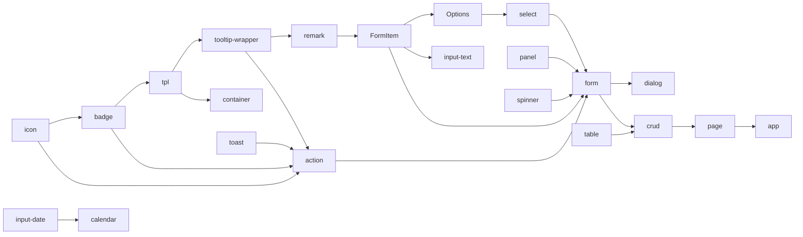

# Vamis 组件 P0 TODO（amis 文档对齐）

- 日期：2026-10-21（进度核对：2026-10-29）
- 状态：对照清单（进度 + 依赖优先级；不改分类）
- 优先级：阶段 **P0**；实施顺序按依赖链拓扑 + 解锁分 U + 综合分；**全表**按构建依赖补边后重算（见文末「依赖与优先级」）
- 设计口径：[运行时语义设计](./2026-10-20-vamis-runtime-semantics-design.md)
- 视觉口径：[样式系统（Amis 水标 × shadcn）](./2026-10-21-vamis-style-system.md) — 渲染器走 token / Button·Input·Table·Card variants；不搬 `cxd-` 前缀，能力尽量像素级转写
- 覆盖数字（只比 type 名）：[同步状态](./2026-10-20-amis-sync-status.md)
- 文档侧栏：`../amis/examples/components/Components.tsx`（布局 / 功能 / 数据输入 / 数据展示 / 反馈 / 其他）
- 文档正文：`../amis/docs/zh-CN/components`
- 注册核对：`packages/vamis/src/register.ts` 与 `extras/*.ts` 的 `registerRenderer`
- 最近核对：2026-11-04（Amis 全量示例核对后再算：docs ```schema 1882 份 + examples 112。主干仍 `icon` #1 → `badge` #2 → `tpl` #3 → `tooltip-wrapper` #4 → `remark` #5 → FormItem #6 → `action` #8；`form` #27、`dialog` #44、`crud` #64、`page` #65。汇总 59%、≥50% 111 项；已完成 1）

## 怎么读

1. **一行一个侧栏条目**，不是一行一个内部别名。`button` 是 `action` 的别名，仍单列，因为文档有独立页。
2. **已注册 ≠ 语义完成**。进度看的是是否满足「实现标准」：组件能力与文档均对标或超越 amis 对等内容，不是 `registerRenderer` 有没有调用。
3. **状态**
   - `未开始`：未注册，且没有等价能力（属性级能力也算）。
   - `进行中`：已注册或有部分能力，但未达到「实现标准」：占位 / 精简 / 缺 amis 已有能力或文档章节 / 被 P0 kernel（D1–D8）挡住。
   - `已完成`：满足「实现标准」：组件与文档均对标或超越 amis 对等内容。当前 **1 项**（`container`）；`page` 因 `pullRefresh` 未接降为进行中。
4. **进度**是渲染器深度，不是 type 覆盖率（覆盖率 95.8% 见同步状态）。档位：
   | 进度 | 含义 |
   |------|------|
   | 0% | 未开始 |
   | 10–15% | 占位（明确未接入、html 直通、空壳） |
   | 20–35% | 精简（能绑值渲染，缺真实能力：Monaco / 地图 / 城市库 / Excel 解析 / 实时日志等） |
   | 40–70% | 主路径可交互，缺文档高级项或 P0 契约（Scope / 表达式过滤器 / API 管线 / 事件对象 / 表单路径） |
   | 80–90% | 接近实现标准，仅剩差异记录 / 增强或少量高级项 |
   | 100% | 满足实现标准（组件 + 文档对标或超越 amis） |
5. 本清单不另起分类。侧栏未收录但 `docs/zh-CN` 有独立页的，在对应类末尾用脚注标出。
6. **文档地址**：`vamis 文档` 是相对 `http://localhost:5173` 的路径，`amis 文档` 是相对 `http://localhost:8888` 的路径。例如 `table-view`：vamis `/components/table-view`（完整 `http://localhost:5173/components/table-view`），amis `/zh-CN/components/table-view`（完整 `http://localhost:8888/zh-CN/components/table-view`）。`—` 表示没有独立文档页。
7. **依赖与优先级**：全表按构建依赖进图（默认包裹 / 渲染器 import / 文档专章 / Amis 示例主路径），不是只改 Action。拓扑图只画主干；每个 type 看 [分 type 依赖图](./2026-10-20-vamis-component-deps.md) 的**开工前置闭包**（全部祖先，禁止只看直接依赖）；154 个 type 看文末「全量顺序」。拓扑约束下先比解锁分 U、再比综合分 S。chrome（`icon` / `badge` / `tooltip-wrapper` / `remark` / `spinner`）排在 FormItem / Action 前面。无人依赖叶子后置。完整顺序见文末「依赖与优先级」。
8. **深色浮层回归**：不往主表加列（155 行里大量占位没有浮层）。已推进过的项见下文「深色浮层回归」。对照不切 `.dark`、不探 hover，不能替代这份手核。

## 实现标准（强制，2026-10-28）

**总要求：vamis 每个组件及其文档，必须对标或超越 amis 同名组件的对等内容；只做到“能渲染”不算完成。**

### 对标范围

1. **组件能力**：amis 同名文档的「属性表 / 事件表 / 动作表 / 数据域 / API / 子节点或插槽 / 移动端行为」逐项有对应实现；不能只覆盖主路径示例。
2. **文档**：vamis 组件文档的章节必须覆盖 amis 对等文档（基本用法、属性、事件、动作、示例、注意事项、差异）；可以增补，不可删减。每个属性 / 事件 / 动作都要有说明。
3. **示例**：amis 文档主路径的每个场景至少有一份 vamis 活示例（可合并，但不能缺）；示例必须可运行。
4. **差异**：允许 vamis 新增字段 / 增强（超越）；但 amis 已有能力缺失时，必须逐条写入组件页「与 Amis 的差异」和 TODO 行「缺 …」。差异不得用“设计不同 / 非目标”掩盖。
5. **验证**：组件 / 示例改动按 `.cursor/rules/compare.mdc` 跑 `pnpm compare --page <type>`；文档改动至少通过 `pnpm docs:build` 或生成器校验；未验证不得标 100%。

### 判定

- **对标**：amis 对等内容全部可用，且 vamis 文档覆盖对等章节。
- **超越**：在对标基础上增加 vamis 能力，且不破坏 amis 兼容；新增能力必须文档化。
- **未达标**：缺任一属性 / 事件 / 动作 / 文档章节 / 示例，或用增强替代缺失。

### 完成门槛（100% / 已完成）

- [ ] 属性表、事件表、动作表逐项核对，无 amis 已有能力缺失；
- [ ] 文档章节对标或更全，差异表已填写；
- [ ] 主路径活示例齐全；
- [ ] 对照 / 构建验证通过（纯文档任务至少生成器或构建通过）；
- [ ] 无该组件的回归。

以上缺一不得标 `100%` / `已完成`。已完成的项若复审不达标，必须降为 `进行中` 并写明缺口。

## 分类汇总

| 分类 | 已完成 / 总数 | 进行中 | 未开始 | 平均进度 | ≥50%（主路径可用） |
|------|---------------|--------|--------|----------|-------------------|
| 布局 | 1 / 15 | 14 | 0 | 90% | 15 |
| 功能 | 0 / 12 | 12 | 0 | 80% | 11 |
| 数据输入 | 0 / 72 | 72 | 0 | 51% | 42 |
| 数据展示 | 0 / 44 | 44 | 0 | 56% | 31 |
| 反馈 | 1 / 5 | 4 | 0 | 89% | 5 |
| 其他 | 0 / 7 | 7 | 0 | 84% | 7 |
| **合计** | **2 / 155** | **153** | **0** | **59%** | **111** |

侧栏已无未开始项。当前已完成 `container`、`toast`；`page` 因 `pullRefresh` 未接按标准降为进行中。反馈五件均 ≥80%（`toast` 100%）；其他类均 ≥80%（`avatar` 90%）；`popOver` 属性 90%。

执行顺序见文末「依赖与优先级」：先解锁主干 #1–#10（`icon`、`badge`、`tpl`、`tooltip-wrapper`、`remark`、FormItem、`toast`、`action`…），`form` #27、`dialog` #44、`crud` #64、`page` #65，零被依赖从 #66 起，`app` #154 最后。chrome（badge / tooltip / remark / spinner）未齐不要切 `select`。

## 深色浮层回归（已推进组件）

口径：Playground 切「深色」，打开该页 tooltip / 下拉 / PopOver / Dialog / Toast。过了对照 ≠ 已核。`themeCss` 余项不挡打勾。收工把「未核」改成「已核」并写日期。

范围：主表进度 **≥80%**（主路径对齐过），外加对照跑过、带浮层但不足 80% 的（`form` / `table2` / `card` / `cards` / `image` / Options）。占位 / 精简（&lt;50%）不进。

### 有独立浮层（优先）

| type | 浮层 | 深色 | 备注 |
|------|------|------|------|
| `select` | 下拉 + tag tooltip + `+N` 溢出 | 已核 | 2026-11-07。溢出走 `--select-menu-*`，tooltip 走 `--tooltip-*` |
| `tooltip-wrapper` | Tooltip | 未核 | `.dark` 已覆盖 `--tooltip-*`，文档十字示例仍要手开 |
| `remark` | Tooltip | 未核 | `--remark-bg` 仍 `#fff` |
| `action` / `button` | tooltip / disabledTip；confirm Dialog | 未核 | |
| `dropdown-button` | 下拉菜单 | 未核 | 贴触发器 `VamisOverlay`（窄屏也是），深色菜单 / tooltip 仍要手开 |
| `input-text` | 选择器建议下拉 | 未核 | 贴输入框 `VamisOverlay`（窄屏也是），深色建议仍要手开 |
| `input-password` | 同 input-text | 未核 | |
| `input-date` / `input-datetime` / `calendar` | 日期 PopOver | 已核 2026-11-07 | `--cal-*` alias `--select-menu-*`，`.dark` 覆盖格子 hover / 非本月 |
| `dialog` | Modal | 未核 | |
| `drawer` | 抽屉 | 未核 | |
| `toast` | 轻提示 | 未核 | 桌面写死 `#fff` / `#151b26` |
| `popOver` | 字段弹出 | 已核 | 2026-11-10。浅 320 白底 / 深 `--popover-layer-bg: #17202d`，表格列 `center` 盖整格 td，`--z-popover` 1400 |
| `breadcrumb` | 文档记缺 tooltip 浮层 | 未核 | 有下拉项时核 |
| `page` | remark / spinner overlay | 未核 | |
| `form` / FormItem / Options | labelRemark；Options 下拉 | 未核 | form 75%，对照过 |
| `table2` | 表头/筛选等浮层 | 未核 | 70%，对照过 |
| `card` / `cards` | 卡片操作/弹出 | 未核 | 对照过 |
| `image` | 预览 | 已核 | 2026-11-10。放大层永远黑底白字，不跟 `.dark` 换肤 |
| `alert` | 关闭等 | 未核 | |
| `spinner` | overlay | 未核 | |
| `badge` | 角标宿主 | 未核 | |
| `avatar` | badge | 未核 | |
| `nav` | overflow / itemBadge | 未核 | |
| `wizard` | 步骤里的 form/dialog | 未核 | |
| `picker` | 弹层多选 | 未核 | 50%，有浮层但主路径未齐，可后置 |

### 已推进、无独立浮层（切深色看默认皮）

| type | 进度 | 深色 | 备注 |
|------|------|------|------|
| `container` | 100% | 未核 | |
| `icon` `tpl` `html` | 90–92% | 未核 | |
| `checkbox` | 90% | 已核 | 2026-11-07。无独立浮层；浅+深默认皮（16 盒 / 按钮模式 / 禁用灰底） |
| `editor` `code` `diff-editor` | 65–92% | 未核 | Monaco 有自己的 vs-dark |
| `collapse` / `tabs` / `portlet` | 85% | 未核 | |
| `panel` `wrapper` `flex` `grid` `grid-2d` `hbox` | 90% | 未核 | |
| `divider` `pagination` `pagination-wrapper` `switch-container` | 90% | 未核 | |
| `button-group` | 85% | 未核 | |
| `table-view` | 85% | 未核 | |
| `app` `anchor-nav` `service` | 75–80% | 未核 | |
| `audio` `tasks` `web-component` `amis` | 80% | 未核 | |

---

## 布局（1/15，均 90%）

侧栏 14 项 + 文档有页但未进侧栏的 `switch-container`。

| type | 文档 | vamis 文档 | amis 文档 | 状态 | 进度 | 原因 | P |
|------|------|------|------|------|------|------|------|
| `page` | Page 页面 | `/components/page` | `/zh-CN/components/page` | 进行中 | 95% | 主路径对齐：独立 Scope、URL 查询种子、initApi overlay（GET 不把数据域拼进 query）、reload/setValue、完整事件对象；无标题时 toolbar 吃满上级；根/header/aside 用 div 组装。按实现标准：`pullRefresh` 未接（移动端），未达 100% | P0 |
| `container` | Container 容器 | `/components/container` | `/zh-CN/components/container` | 已完成 | 100% | 主路径对齐：`wrapperBody` 默认包一层（flex 也包，同级子项换行）、`style` / `wrapperComponent` / `bodyClassName`、click/mouseenter/mouseleave。沿用父 Scope。`draggable` 非运行时主路径 | P0 |
| `collapse` / `collapse-group` | Collapse 折叠器 | `/components/collapse` | `/zh-CN/components/collapse` | 进行中 | 85% | 文档主路径已对齐：`activeKey` / 手风琴 / 禁用 / `showArrow` / 图标位置 / `change` 事件。窄屏 &lt;768 去边框、底部分割线、箭头靠右（Amis `is-mobile` / `media-breakpoint-down(sm)`），默认箭头走 `VamisCaret` tree。缺 `mountOnEnter`、`expand`·`collapse` 动作、FieldSet 像素级 | P0 |
| `divider` | Divider 分割线 | `/components/divider` | `/zh-CN/components/divider` | 进行中 | 90% | 文档主路径已对齐：`lineStyle` / `direction` / `color` / `rotate` / `title` / `titlePosition`。缺 `themeCss`、窄屏 `scaleY(0.5)` | P0 |
| `flex` | Flex 布局 | `/components/flex` | `/zh-CN/components/flex` | 进行中 | 90% | 文档主路径已对齐：`justify` / `alignItems` / `alignContent` / `direction` / `items` / `mobile`。缺 `themeCss`、整树 `envOverwrite` | P0 |
| `grid` | Grid 水平分栏 | `/components/grid` | `/zh-CN/components/grid` | 进行中 | 90% | 文档主路径已对齐：均分列、`md`/`xs`/`sm`/`lg` 1–12 与 `auto`、`gap`、`align` / `valign`。缺 `themeCss`、列 `mode` / `horizontal` | P0 |
| `grid-2d` | Grid 2D 布局 | `/components/grid-2d` | `/zh-CN/components/grid-2d` | 进行中 | 90% | 文档主路径已对齐：`x/y/w/h`、`cols`、列宽/行高、`height: auto`、`gap` / `gapRow`、`align` / `valign`。缺格子 `themeCss` | P0 |
| `hbox` | HBox 布局 | `/components/hbox` | `/zh-CN/components/hbox` | 进行中 | 90% | 文档主路径已对齐：列均分、`width` / `auto`、默认 `gap: xs`、`align` / `valign`、`columnClassName`。缺 `themeCss`、列 `mode` / `horizontal` | P0 |
| `pagination` | Pagination 分页 | `/components/pagination` | `/zh-CN/components/pagination` | 进行中 | 90% | 文档主路径已对齐：`layout` / `mode` / `size` / `maxButtons` / `total`·`perPage` / 省略号跳页 / `change`。缺 `themeCss`、移动端 `mobileUI` | P0 |
| `pagination-wrapper` | PaginationWrapper 分页容器 | `/components/pagination-wrapper` | `/zh-CN/components/pagination-wrapper` | 进行中 | 90% | 文档主路径已对齐：`inputName` / `outputName` 客户端切片、`perPage`、`position`、内嵌 `pagination`。缺 `themeCss`；CRUD `loadDataOnce` 仍属 D10 | P0 |
| `panel` | Panel 面板 | `/components/panel` | `/zh-CN/components/panel` | 进行中 | 90% | 文档主路径已对齐：`title` / `header` / `body` / `footer` / `actions`、`affixFooter`、区域 `*ClassName`。缺 `themeCss`、色档、移动端 `Panel--form` | P0 |
| `tabs` | Tabs 选项卡 | `/components/tabs` | `/zh-CN/components/tabs` | 进行中 | 85% | 文档主路径已对齐：`tabs[].body` / `tab`、`source` 动态、`activeKey` / `hash`、`disabled`、`mountOnEnter`、`change`。line 模式链接条 `width: 100%`，下划线拉满槽宽。缺 `addable` / `draggable` / `editable`、其余 `tabsMode` 像素级、`themeCss`、`swipeable` | P0 |
| `wrapper` | Wrapper 包裹容器 | `/components/wrapper` | `/zh-CN/components/wrapper` | 进行中 | 90% | 文档主路径已对齐：`body`、默认 `size: md` 内边距、`xs`–`lg` / `none`、`style` 对象与 `${style}`、`wrap`。缺 `themeCss` | P0 |
| `portlet` | Portlet 门户栏目 | `/components/portlet` | `/zh-CN/components/portlet` | 进行中 | 85% | 文档主路径已对齐：`tabs[].body` / `tab`、`source`、`description`、`hideHeader`、默认分隔线 / `divider: false`、全局与 tab 级 `toolbar`、`mountOnEnter` 默认 false、`change`。缺 `themeCss`、icon 像素、`scrollable` | P0 |
| `switch-container` | switch-container 状态容器 | `/components/switch-container` | `/zh-CN/components/switch-container` | 进行中 | 90% | 文档主路径已对齐：`items[].body` / `visibleOn` 取首个命中、`style`、宿主 click/mouseenter/mouseleave。缺 `themeCss`、`switchTo` 动作。侧栏未收录，docs 有独立页 | P0 |

---

## 功能（0/12，均 80%）

| type | 文档 | vamis 文档 | amis 文档 | 状态 | 进度 | 原因 | P |
|------|------|------|------|------|------|------|------|
| `action` | Action 行为按钮 | `/components/action` | `/zh-CN/components/action` | 进行中 | 95% | 文档主路径已对齐：`actionType`、`level` / `primary`、`size`、`icon` / 空 label 正方形 `iconOnly`（默认 32×32，xs/sm/md/lg 跟档位，`level: link` 除外；`level: link` 无下划线、`--link-color`）、`confirmText` / `confirmTitle`（Amis `Alert.confirm` Modal：默认标题「系统消息」、无 X、Esc/点遮罩不关、确认 danger）、dialog / drawer / ajax（`redirect` / `feedback`）/ toast / copy（`copyFormat`）/ link / url（`blank`）/ email / download / saveAs、`countDown` / `hotKey`、Action 当容器（`tooltip` 走 `VamisOverlay` `--z-tooltip` 1600，不裁切）、`tooltip` / `disabledTip`（字符串或 TooltipObject：title/content/theme/arrow/delay/trigger/offset，不含 type/body/wrapperComponent/className/inline）/ `tooltipPlacement`、click / mouseenter / mouseleave 事件活示例、`loading` / `loadingOn`、`active` / `activeLevel`、`clear` / `clear-and-submit` / `reset-and-submit`。`secondary` 实心中灰白字、`dark` 实心炭灰、`light` 浅底深字；尺寸 xs/sm/md/lg = 22/30/32/38px（cxd）。主题/尺寸活示例并排。缺控制流 `switch` / `loop` / `parallel`（D4 P1）、按名字关祖先浮层、`nextCondition`、input-table 增行 | P0 |
| `app` | App 多页应用 | `/components/app` | `/zh-CN/components/app` | 进行中 | 80% | 文档主路径已对齐：`pages` 分组 / 相对 `url`、`schema` 内嵌、`link`、`visible: false`、`isDefaultPage` 当 404、`brandName` / 槽位。缺 hash 路由、`schemaApi` / `api`、`redirect` / `rewrite` | P0 |
| `button` | Button 按钮 | `/components/button` | `/zh-CN/components/button` | 进行中 | 95% | `action` 别名，同一渲染器。文档主路径已对齐 `level` / `size` / `block`、`loading` / `loadingOn`、`tooltip` / `disabledTip` / `tooltipPlacement`。`secondary` / `dark` / `light` 与尺寸阶梯按 cxd 转写；空 label + icon 默认 32×32。复杂行为见 Action | P0 |
| `button-group` | ButtonGroup 按钮组 | `/components/button-group` | `/zh-CN/components/button-group` | 进行中 | 85% | 文档主路径已对齐：`buttons` / `body`、`vertical`、`tiled`、`btnLevel`。缺 `btnActiveLevel`、圆角拼缝 | P0 |
| `breadcrumb` | Breadcrumb 面包屑 | `/components/breadcrumb` | `/zh-CN/components/breadcrumb` | 进行中 | 85% | 文档主路径已对齐：`items` / `source`、默认 `>`、`dropdown`、中间项 `labelMaxLength`。缺 tooltip 浮层 | P0 |
| `custom` | Custom 自定义组件 | `/components/custom` | `/zh-CN/components/custom` | 进行中 | 15% | **占位**：`html` 直通或渲染 `body`，不执行 onMount JS | P0 |
| `dropdown-button` | DropDownButton 下拉按钮 | `/components/dropdown-button` | `/zh-CN/components/dropdown-button` | 进行中 | 88% | 文档主路径已对齐：`buttons` 分组、`closeOnClick` / `closeOnOutside`、`trigger: hover`、`hideCaret`、`defaultIsOpened`、`tooltip` / `placement` / `disabledTip`。菜单 `ul>li` + Action `isMenuItem`（不是完整 Button），贴触发器 `VamisOverlay`。缺菜单进出动画 | P0 |
| `service` | Service 功能型容器 | `/components/service` | `/zh-CN/components/service` | 进行中 | 75% | 文档主路径已对齐：独立 Scope、静态 `data`、`api` 刷新、`schemaApi` 当子 schema、`initFetch: false`、`reload`。缺 `dataProvider` / 轮询 | P0 |
| `nav` | Nav 导航 | `/components/nav` | `/zh-CN/components/nav` | 进行中 | 80% | 文档主路径已对齐：`links` / `source`、默认 stacked、横排、多级 `children`。缺 overflow / 缩起 / 搜索 | P0 |
| `anchor-nav` | AnchorNav 锚点导航 | `/components/anchor-nav` | `/zh-CN/components/anchor-nav` | 进行中 | 80% | 文档主路径已对齐：`links` / `children` 展平、`direction`、`active` href 或索引。缺滚动自动高亮 | P0 |
| `tooltip-wrapper` | TooltipWrapper 文字提示容器 | `/components/tooltip` | `/zh-CN/components/tooltip-wrapper` | 进行中 | 92% | 文档主路径已对齐：`content` / `title`、`trigger` hover/click/focus、`placement`、`tooltipTheme`、`offset`、`showArrow`、`inline`、`wrapperComponent`。活示例对标 Amis（图标十字布局 / trash / 长文本省略）。浮层 `VamisOverlay` Teleport、`--z-tooltip` 1600、盒 240 / 8×12 / 圆角 8 / 8×4 箭头。`placement` 主轴放不下翻对面（箭头跟边）。缺 `themeCss` | P0 |
| `popOver` | PopOver 弹出提示 | `/components/popover` | `/zh-CN/components/popover` | 进行中 | 90% | 不是独立 type。文档主路径已对齐 Amis 同名页。表格列浮层相对整格 `td` 居中；表单 static 默认 `position: right` 锚放大镜。CRUD 底栏已接 statistics + Pagination。缺 CRUD 默认 header 像素、list 其余皮肤 | P0 |

---

## 数据输入（0/72，均 50%）

Form / FormItem / Options 是契约页，不是业务 type，但挡住所有表单项（D6），必须进清单。

| type | 文档 | vamis 文档 | amis 文档 | 状态 | 进度 | 原因 | P |
|------|------|------|------|------|------|------|------|
| `form` | Form 表单 | `/components/form` | `/zh-CN/components/form` | 进行中 | 80% | 默认标题「表单」、只画提交。窄屏 ≤767 对齐 Amis Form：项 flex、标签 28% 同行、label 14/`#5c5f66`（桌面同色号）、底栏按钮打穿 `[data-vamis-action]` / `shrink-0` 均分、面板去灰底描边、`Panel--form` `width:auto; margin:0 -12px 10px` 吃到 343。路径值 `a.b`、`requiredOn`、`validateOnChange`、`clearValueOnHidden`、`validateApi`、提交 `errors`、`debug` 已接。缺 combo 独立域 | P0 |
| （契约） | FormItem 表单项通用 | `/components/form/formitem` | `/zh-CN/components/form/formitem` | 进行中 | 90% | 路径值 `a.b`、`requiredOn`、`validateOnChange`、`submitOnChange`、`clearValueOnHidden`、labelRemark、`static`/`staticOn`/`staticSchema`（选择器 `limit` → `tags`/`words`）、事件动作 `static`/`nonstatic`（status-store 按 id/name）、禁用/显隐、默认间距 24px、`mode: inline`（项并排、项内左右）、默认 `normal` 标签在上（窄屏 ≤767 改 28% 同行）、未写 label 仍占标签列、`button-toolbar` 包 FormItem、`validateApi`、提交 `errors`、`autoFill`（映射/`api`+`fillMapping`，无弹层）、form `debug`、label HTML、`validations`/`validationErrors`（对象/字符串/`$1`/`isUrl.schemes`/默认 `validate.*` key）。属性表四列 +「支持静态展示的表单项」。缺 combo/table 路径级报错、`autoFill.showSuggestion` 族、`autoFill.silent`、`staticClassName` 三件、`labelAlign` | P0 |
| `control` | Control 表单项包裹 | `/components/form/control` | `/zh-CN/components/form/control` | 进行中 | 40% | 已注册；只做包裹 | P0 |
| （契约） | Options 选择器表单项 | `/components/form/options` | `/zh-CN/components/form/options` | 进行中 | 88% | 统一 Options 契约：规范化、source 数据域/远程、joinValues/extractValue/delimiter、multiple/checkAll/selectFirst、labelField/valueField、clearable/searchable/creatable、editable/editControls/editApi/editDialog、removable/deleteApi/deleteConfirmText、选项 autoFill。缺 deferApi、虚拟列表。select 已接入 | P0 |
| `input-array` | InputArray 数组输入框 | `/components/form/input-array` | `/zh-CN/components/form/input-array` | 进行中 | 50% | 能增删行；子域/校验未齐 | P0 |
| `button-toolbar` | ButtonToolbar 按钮工具栏 | `/components/form/button-toolbar` | `/zh-CN/components/form/button-toolbar` | 进行中 | 60% | 能排按钮 | P0 |
| `button-group-select` | ButtonGroupSelect 按钮点选 | `/components/form/button-group-select` | `/zh-CN/components/form/button-group-select` | 进行中 | 55% | 能选值；多选/自适应未齐 | P0 |
| `chained-select` | ChainedSelect 链式下拉框 | `/components/form/chain-select` | `/zh-CN/components/form/chain-select` | 进行中 | 50% | 能链式选；api 级联精简 | P0 |
| `checkbox` | Checkbox 勾选框 | `/components/form/checkbox` | `/zh-CN/components/form/checkbox` | 进行中 | 90% | `trueValue`/`falseValue`、`option` 与 `label` 分工、`optionType: button`、禁用/只读/静态、`change`、`clear`/`reset`/`setValue`、`badge` 已接。盒模型 `--checkbox-*`（16×16 / 圆角 2）。缺 themeCss 皮肤变量 | P0 |
| `checkboxes` | Checkboxes 复选框 | `/components/form/checkboxes` | `/zh-CN/components/form/checkboxes` | 进行中 | 55% | 能多选；列数/全选未齐 | P0 |
| `input-city` | InputCity 城市选择器 | `/components/form/input-city` | `/zh-CN/components/form/input-city` | 进行中 | 25% | **精简**：内置 3 省示例，非全国数据 | P0 |
| `input-color` | InputColor 颜色选择器 | `/components/form/input-color` | `/zh-CN/components/form/input-color` | 进行中 | 50% | 能选色；预设/格式未齐 | P0 |
| `combo` | Combo 组合 | `/components/form/combo` | `/zh-CN/components/form/combo` | 进行中 | 50% | 能多行子表单；子项 api、扁平模式未齐 | P0 |
| `condition-builder` | ConditionBuilder 条件组合 | `/components/form/condition-builder` | `/zh-CN/components/form/condition-builder` | 进行中 | 35% | **精简**：基础规则组；缺公式/嵌套组/日期控件 | P0 |
| `input-date` | InputDate 日期选择器 | `/components/form/input-date` | `/zh-CN/components/form/input-date` | 进行中 | 92% | 日历点选、format/inputFormat、相对值、minDate/maxDate（日 + 年/月面板都禁范围外）、shortcuts、utc/embed、change/focus/blur、clear/reset/setValue 已接。弹层 Teleport 到 body（z-index 1000 / popOverContainerSelector）；Amis auto 翻转（下左→下右→上左→上右）；日历层 240×290，popover padding 0。与 calendar 共用 DateCalendarPanel。弹层 `--cal-*`（深色 alias Select 菜单 `#17202d`）。窄屏默认滚轮 PopUp（320px / 年/月/日 / 取消确认；PopUp height 进出动画）。缺 `mobileCalendarMode: calendar`、schedules | P0 |
| `input-datetime` | InputDatetime 日期时间 | `/components/form/input-datetime` | `/zh-CN/components/form/input-datetime` | 进行中 | 62% | `input-date` 别名，已接日期+时分秒与窄屏滚轮；时分秒约束与 `mobileCalendarMode: calendar` 未齐 | P0 |
| `input-month` | InputMonth 月份选择器 | `/components/form/input-month` | `/zh-CN/components/form/input-month` | 进行中 | 45% | DatePart 精简 | P0 |
| `input-date-range` | InputDateRange 日期范围 | `/components/form/input-date-range` | `/zh-CN/components/form/input-date-range` | 进行中 | 50% | 能选区间 | P0 |
| `input-datetime-range` | InputDatetimeRange 日期时间范围 | `/components/form/input-datetime-range` | `/zh-CN/components/form/input-datetime-range` | 进行中 | 45% | `input-date-range` 别名 | P0 |
| `input-month-range` | InputMonthRange 月份范围 | `/components/form/input-month-range` | `/zh-CN/components/form/input-month-range` | 进行中 | 45% | DatePartRange 精简 | P0 |
| `input-kv` | InputKV 键值对 | `/components/form/input-kv` | `/zh-CN/components/form/input-kv` | 进行中 | 50% | 能增删 KV | P0 |
| `input-kvs` | InputKVS 键值对象 | `/components/form/input-kvs` | `/zh-CN/components/form/input-kvs` | 进行中 | 45% | 结构精简 | P0 |
| `input-formula` | InputFormula 公式编辑器 | `/components/form/input-formula` | `/zh-CN/components/form/input-formula` | 进行中 | 30% | **精简**：复用 Formula，无公式编辑器 UI | P0 |
| `diff-editor` | DiffEditor 对比编辑器 | `/components/form/diff-editor` | `/zh-CN/components/form/diff-editor` | 进行中 | 65% | Monaco Diff：左侧 `diffValue` 只读，右侧绑 `name`；`options` / 事件已接。动作仍缺 D7 | P0 |
| `editor` | Editor 代码编辑器 | `/components/form/editor` | `/zh-CN/components/form/editor` | 进行中 | 85% | Monaco 编辑器：`hideButtons`、`size: full`、`intellisense: schema`（`registerRenderer` 自述即感知；按组件树定位 type，JSON Schema `$defs`+`if/then`）。文档「编辑 Schema」只消费。`editorDidMount` 未接；动作仍缺 D7 | P0 |
| `fieldset` | FieldSet 表单项集合 | `/components/form/fieldset` | `/zh-CN/components/form/fieldset` | 进行中 | 55% | 能分组折叠 | P0 |
| `input-excel` | InputExcel Excel 解析 | `/components/form/input-excel` | `/zh-CN/components/form/input-excel` | 进行中 | 20% | **精简**：只记文件名/大小，不解析表格 | P0 |
| `input-file` | InputFile 文件上传 | `/components/form/input-file` | `/zh-CN/components/form/input-file` | 进行中 | 40% | 能选文件；receiver/分片/自动上传未齐 | P0 |
| `formula` | Formula 公式 | `/components/form/formula` | `/zh-CN/components/form/formula` | 进行中 | 50% | 能按公式写值；与 expr 层未统一（D2） | P0 |
| `group` | Group 表单项组 | `/components/form/group` | `/zh-CN/components/form/group` | 进行中 | 60% | 横排 flex，`mode` / `subFormMode` 传给未写 mode 的子项。缺 `columnRatio` / gap 档 / 组标签 | P0 |
| `hidden` | Hidden 隐藏字段 | `/components/form/hidden` | `/zh-CN/components/form/hidden` | 进行中 | 70% | 能存值；仍走扁平 name | P0 |
| `input-image` | InputImage 图片 | `/components/form/input-image` | `/zh-CN/components/form/input-image` | 进行中 | 40% | 能选图；裁剪/多图/上传 api 未齐 | P0 |
| `input-group` | InputGroup 输入框组合 | `/components/form/input-group` | `/zh-CN/components/form/input-group` | 进行中 | 55% | 能并排控件 | P0 |
| `list-select` | ListSelect 选择器 | `/components/form/list-select` | `/zh-CN/components/form/list-select` | 进行中 | 50% | 能点选列表 | P0 |
| `location-picker` | LocationPicker 地理位置 | `/components/form/location-picker` | `/zh-CN/components/form/location-picker` | 进行中 | 25% | **精简**：地址/经/纬三个输入框，无地图 | P0 |
| `uuid` | UUID 随机 ID | `/components/form/uuid` | `/zh-CN/components/form/uuid` | 进行中 | 70% | 能生成；仍走扁平 name | P0 |
| `matrix-checkboxes` | MatrixCheckboxes 矩阵勾选 | `/components/form/matrix-checkboxes` | `/zh-CN/components/form/matrix-checkboxes` | 进行中 | 40% | 已注册，行列数据精简 | P0 |
| `nested-select` | NestedSelect 级联选择器 | `/components/form/nestedselect` | `/zh-CN/components/form/nestedselect` | 进行中 | 45% | 能级联；`cascader-select` 别名未注册 | P0 |
| `input-number` | InputNumber 数字输入 | `/components/form/input-number` | `/zh-CN/components/form/input-number` | 进行中 | 55% | native number；步进/精度/大数未齐 | P0 |
| `input-password` | InputPassword 密码 | `/components/form/input-password` | `/zh-CN/components/form/input-password` | 进行中 | 90% | `input-text` 别名；默认 `revealPassword` 显隐钮，`false` 关掉。缺 `themeCss` | P0 |
| `picker` | Picker 列表选择器 | `/components/form/picker` | `/zh-CN/components/form/picker` | 进行中 | 50% | 能弹层多选 | P0 |
| `input-quarter` | InputQuarter 季度 | `/components/form/input-quarter` | `/zh-CN/components/form/input-quarter` | 进行中 | 45% | DatePart 精简 | P0 |
| `input-quarter-range` | InputQuarterRange 季度范围 | `/components/form/input-quarter-range` | `/zh-CN/components/form/input-quarter-range` | 进行中 | 45% | DatePartRange 精简 | P0 |
| `radio` | Radio 单选框 | `/components/form/radio` | `/zh-CN/components/form/radio` | 进行中 | 60% | 单个 radio | P0 |
| `radios` | Radios 单选框 | `/components/form/radios` | `/zh-CN/components/radios` | 进行中 | 55% | 组单选 | P0 |
| `chart-radios` | ChartRadios 图表单选框 | `/components/form/chart-radios` | `/zh-CN/components/form/chart-radios` | 进行中 | 35% | **精简**：无真实图表点选 | P0 |
| `input-rating` | InputRating 评分 | `/components/form/input-rating` | `/zh-CN/components/form/input-rating` | 进行中 | 55% | 能打分；半星/自定义字符未齐 | P0 |
| `input-range` | InputRange 滑块 | `/components/form/input-range` | `/zh-CN/components/form/input-range` | 进行中 | 50% | 能滑；双滑块/刻度未齐 | P0 |
| `input-repeat` | InputRepeat 重复频率 | `/components/form/input-repeat` | `/zh-CN/components/form/input-repeat` | 进行中 | 40% | 已注册，选项精简 | P0 |
| `input-rich-text` | InputRichText 富文本 | `/components/form/input-rich-text` | `/zh-CN/components/form/input-rich-text` | 进行中 | 25% | **精简**：多行文本，未接 TinyMCE/Froala（设计非目标） | P0 |
| `select` | Select 下拉框 | `/components/form/select` | `/zh-CN/components/form/select` | 进行中 | 92% | 主路径已对齐：分组 Transfer 检索框 / 小复选框 / 多选 tag hover tooltip / 按宽度 `+ N ...`、溢出标签表格、`menuTpl`、`searchable` / `filterOption` / `searchApi`、`overlay`（含移动端 `height` 默认 320）、全选、`autoComplete` mock、focus/blur。移动端 `VamisPopUp` 底部滑入（普通单选才滚轮 itemHeight 40 + `menuTpl` slot 居中；普通多选右侧勾不是左侧 Checkbox，行高 37px 内层 `content-box` 1px 以免 100% 缩放丢线；`searchable` 在上方；`selectMode: group` 组头 12 / 子项 24；确认才写入；箭头朝右不翻转）。`selectMode` table/tree/chained/associated、`deferApi`、人员点选未接 | P0 |
| `input-sub-form` | InputSubForm 子表单 | `/components/form/input-sub-form` | `/zh-CN/components/form/input-sub-form` | 进行中 | 45% | 能嵌表单；弹层/多选未齐 | P0 |
| `switch` | Switch 开关 | `/components/form/switch` | `/zh-CN/components/form/switch` | 进行中 | 65% | 能切换；`trueValue` 未齐 | P0 |
| `static` | Static 静态展示 | `/components/form/static` | `/zh-CN/components/form/static` | 进行中 | 68% | 能展示；`popOver` 已接（字符串 / 对象 / 放大镜，默认 `position: right` 贴图标）。`quickEdit` 无 | P0 |
| `input-table` | InputTable 表格 | `/components/form/input-table` | `/zh-CN/components/form/input-table` | 进行中 | 45% | 能行内编辑；子 api、增删校验未齐 | P0 |
| `input-tag` | InputTag 标签选择器 | `/components/form/input-tag` | `/zh-CN/components/form/input-tag` | 进行中 | 50% | 能回车加标签 | P0 |
| `input-text` | InputText 输入框 | `/components/form/input-text` | `/zh-CN/components/form/input-text` | 进行中 | 92% | 主路径已齐（addOn/清值/计数/边框/事件动作）；hover 走 `--primary`、half 保留圆角、addOn 1px 竖缝；focus 3px glow 包整组；选择器 CONTAINS 排序+高亮，贴输入框 `VamisOverlay`（窄屏也是）；`creatable: false` 选中 focus 仍显示 `TextControl-value`；多选 tag 小叉 `VamisClose`、label 60px 才省略；`revealPassword` 已接；`source` reload 时控件右侧 `Spinner icon=reload size=sm`。缺 `themeCss` | P0 |
| `textarea` | Textarea 多行输入框 | `/components/form/textarea` | `/zh-CN/components/form/textarea` | 进行中 | 60% | 主路径可用 | P0 |
| `input-time` | InputTime 时间 | `/components/form/input-time` | `/zh-CN/components/form/input-time` | 进行中 | 60% | `input-date` 别名，已接时间面板与窄屏滚轮；桌面仍是下拉，时间约束未齐 | P0 |
| `input-time-range` | InputTimeRange 时间范围 | `/components/form/input-time-range` | `/zh-CN/components/form/input-time-range` | 进行中 | 45% | 已注册 | P0 |
| `transfer` | Transfer 穿梭器 | `/components/form/transfer` | `/zh-CN/components/form/transfer` | 进行中 | 50% | 能左右移动；树/搜索未齐 | P0 |
| `transfer-picker` | TransferPicker 穿梭选择器 | `/components/form/transfer-picker` | `/zh-CN/components/form/transfer-picker` | 进行中 | 45% | 已注册 | P0 |
| `tabs-transfer` | TabsTransfer 组合穿梭器 | `/components/form/tabs-transfer` | `/zh-CN/components/form/tabs-transfer` | 进行中 | 40% | 已注册，tabs 数据精简 | P0 |
| `tabs-transfer-picker` | TabsTransferPicker | `/components/form/tabs-transfer-picker` | `/zh-CN/components/form/tabs-transfer-picker` | 进行中 | 35% | `tabs-transfer` 别名 | P0 |
| `input-tree` | InputTree 树形选择框 | `/components/form/input-tree` | `/zh-CN/components/form/input-tree` | 进行中 | 50% | 能勾树；懒加载/检索未齐 | P0 |
| `tree-select` | TreeSelect 树形选择器 | `/components/form/treeselect` | `/zh-CN/components/form/treeselect` | 进行中 | 50% | 能下拉树 | P0 |
| `input-year` | InputYear 年输入 | `/components/form/input-year` | `/zh-CN/components/form/input-year` | 进行中 | 45% | DatePart 精简 | P0 |
| `input-year-range` | InputYearRange 年份范围 | `/components/form/input-year-range` | `/zh-CN/components/form/input-year-range` | 进行中 | 45% | DatePartRange 精简 | P0 |
| `json-schema` | JsonSchema | `/components/form/json-schema` | `/zh-CN/components/form/json-schema` | 进行中 | 30% | **精简**：只渲染 string/number/boolean 属性 | P0 |
| `json-schema-editor` | JsonSchema Editor | `/components/form/json-schema-editor` | `/zh-CN/components/form/json-schema-editor` | 进行中 | 30% | `json-schema` 别名，无 schema 编辑器 | P0 |
| `input-signature` | InputSignature 签名面板 | `/components/form/input-signature` | `/zh-CN/components/form/input-signature` | 进行中 | 35% | **精简**：canvas 涂鸦，无压感/导出配置 | P0 |
| `input-verification-code` | InputVerificationCode 验证码 | `/components/form/input-verification-code` | `/zh-CN/components/form/input-verification-code` | 进行中 | 50% | 能分格输入 | P0 |

---

## 数据展示（0/44，均 55%）

| type | 文档 | vamis 文档 | amis 文档 | 状态 | 进度 | 原因 | P |
|------|------|------|------|------|------|------|------|
| `crud` | CRUD 增删改查 | `/components/crud` | `/zh-CN/components/crud` | 进行中 | 62% | 文档介绍页用 `/api/mock2/sample` 真跑；底栏默认 `statistics` + `Pagination`（对齐 Amis footerToolbar）。无 `loadDataOnce`/`syncLocation`/`quickEdit`/`matchFunc`（D10）；header 导出/新增仍要写进 `headerToolbar` | P0 |
| `table` | Table 表格 | `/components/table` | `/zh-CN/components/table` | 进行中 | 55% | 能渲染列；列 `popOver` / `popOverEnableOn` 已接。无独立数据域、无 `quickEdit`。多选行间 1px 已按 Amis `separate` + td 底边修（CRUD 勾选走同一套原语） | P0 |
| `table2` | Table2 表格 | `/components/table2` | `/zh-CN/components/table2` | 进行中 | 70% | 文档主路径已对齐：`source` 默认 `${items}`、`title` / `footer`、列 `title`/`name`/`type`、`rowSelection` 多选/单选/`rowClick`/`selectedRowKeys`/`disableOn`/选择菜单/`maxKeepItemSelectionLength`、`bordered`、`placeholder`、`size`、`columnsTogglable` auto。多选行间 1px 100% 缩放已修（`separate` / td 底边 / `--table-checked-bg`）。缺展开行、树、固定列、表头分组、拖拽、总结栏、quickEdit | P0 |
| `table-view` | Table View 表格视图 | `/components/table-view` | `/zh-CN/components/table-view` | 进行中 | 85% | 对照 7 例盒模型已齐：边框/内边距 token、colspan/rowspan（缺省不再写成 0）、caption 居中。缺编辑器拖格子 | P0 |
| `calendar` | Calendar 日历日程 | `/components/calendar` | `/zh-CN/components/calendar` | 进行中 | 88% | 周一 7 列紧凑月历，与 input-date 共用 DateCalendarPanel。SVG 箭头；点年/月切换（窄屏 取消/确认）；点击日程点弹出内容（默认 dialog，可 scheduleAction）。largeMode 跨日连条；后一天透明占位可点，payload 是当天重叠日程。面板 `--cal-*`（深色跟 Select 菜单）。缺 change/click / setValue | P0 |
| `card` | Card 卡片 | `/components/card` | `/zh-CN/components/card` | 进行中 | 70% | 文档主路径已对齐：header 标题/副标题/描述/头像/avatarText 与背景色、body 字段或字符串、useCardLabel 默认 true、actions（含 icon: fa fa-*）、href 优先于 itemAction、media 默认 left、secondary / toolbar。缺勾选/拖拽、themeCss | P0 |
| `cards` | Cards 卡片组 | `/components/cards` | `/zh-CN/components/cards` | 进行中 | 75% | 文档示例对标 Amis：基本用法、CRUD `mode: cards` 勾选/全选/`checkOnItemClick`、瀑布流一张 image 用表达式切 `h-stretch` / `cover`。缺拖拽、动作表、itemClassName 像素级栅格 | P0 |
| `carousel` | Carousel 轮播图 | `/components/carousel` | `/zh-CN/components/carousel` | 进行中 | 45% | 能轮播 | P0 |
| `chart` | Chart 图表 | `/components/chart` | `/zh-CN/components/chart` | 进行中 | 45% | 文档已补属性表 / 事件表 / 动作表。画布走 LazyComponent（`unMountOnHidden` 默认 false）。事件与 `reload`/`setValue` 未接；无 `mapURL` / `source` | P0 |
| `code` | Code 代码高亮 | `/components/code` | `/zh-CN/components/code` | 进行中 | 92% | 只读 monaco 展示（无编辑光标）；行号/折叠/感知默认关；wordWrap 按容器宽度折行。不收 `options`。customLang inherit 共享主题，滚动不丢高亮。YAML 多行 `value` 用 `\|` | P0 |
| `color` | Color 颜色 | `/components/color` | `/zh-CN/components/color` | 进行中 | 50% | StaticValue 展示 | P0 |
| `date` / `datetime` / `time` / `month` | Date 日期时间 | `/components/date` | `/zh-CN/components/date` | 进行中 | 60% | StaticValue 展示；date / datetime 过滤器已接，组件自身格式档未齐 | P0 |
| `each` | Each 循环渲染器 | `/components/each` | `/zh-CN/components/each` | 进行中 | 70% | 不再给 item 套竖排壳；tpl item 默认 inline。placeholder / itemKeyName / indexKeyName 已接。缺 maxLength | P0 |
| `html` | Html | `/components/html` | `/zh-CN/components/html` | 进行中 | 90% | `tpl` 别名。文档主路径已对齐：渲染 HTML。`maxLine` / `showNativeTitle` / 事件同 Tpl。其余过滤器仍 P1 | P0 |
| `icon` | Icon 图标 | `/components/icon` | `/zh-CN/components/icon` | 进行中 | 90% | 文档主路径已对齐：FA v4 名称、颜色/字号、URL、FA v5/v6 `vendor: ""`、click / mouseenter / mouseleave。缺 Amis 自有 iconfont 字体、registerIcon 组件表、iconContent CSS 变量 | P0 |
| `iframe` | iFrame | `/components/iframe` | `/zh-CN/components/iframe` | 进行中 | 55% | 能嵌页 | P0 |
| `image` | Image 图片 | `/components/image` | `/zh-CN/components/image` | 进行中 | 90% | `src`/`name`、标题/说明、默认 110px 缩略图、`thumbMode`/`thumbRatio`、高宽、`imageMode: original`、`enlargeAble` 放大层、`originalSrc`、`href`、`clickAction`、click/mouseenter/mouseleave、`preview`/`zoom`、放大工具栏（白底 40px SVG + 关闭钮左滑 tooltip）。`static-image` 走 FormItem。缺 CRUD `enlargeWithGallary` 图集、`hoverMode`、`themeCss` | P0 |
| `images` | Images 图片集 | `/components/images` | `/zh-CN/components/images` | 进行中 | 50% | 能平铺 | P0 |
| `grid-nav` | GridNav 宫格导航 | `/components/grid-nav` | `/zh-CN/components/grid-nav` | 进行中 | 50% | 能宫格；仅此处读了 `badge` | P0 |
| `json` | Json | `/components/json` | `/zh-CN/components/json` | 进行中 | 50% | 能展开 JSON | P0 |
| `link` | Link 链接 | `/components/link` | `/zh-CN/components/link` | 进行中 | 60% | 能出链 | P0 |
| `list` | List 列表 | `/components/list` | `/zh-CN/components/list` | 进行中 | 62% | 未写 title 不再补「列表项」；hbox 列走 `ListItem-field`。`List-items` 盒模型对齐 Amis（`margin-right: 15px`、行 padding 8×12、斑马纹打在包装层；字段 popOver 宿主 block + `svg.icon` 行盒）。其余勾选 / 拖拽未接 | P0 |
| `log` | Log 实时日志 | `/components/log` | `/zh-CN/components/log` | 进行中 | 25% | **精简**：静态分行，无轮询/ANSI | P0 |
| `mapping` | Mapping 映射 | `/components/mapping` | `/zh-CN/components/mapping` | 进行中 | 55% | 能 map 取值 | P0 |
| `number` | Number 展示 | `/components/number` | `/zh-CN/components/number` | 进行中 | 60% | StaticValue；number / percent 过滤器已接，组件自身精度档未齐 | P0 |
| `markdown` | Markdown 渲染 | `/components/markdown` | `/zh-CN/components/markdown` | 进行中 | 45% | 已注册；远程 `src` 按 `isApiOutdated` 拉。渲染库精简 | P0 |
| `office-viewer` | OfficeViewer Word 渲染 | `/components/office-viewer` | `/zh-CN/components/office-viewer` | 进行中 | 10% | **占位**：ViewerStub「未接入预览」（设计非目标） | P0 |
| `office-viewer` | OfficeViewer Excel 渲染 | `/components/office-viewer-excel` | `/zh-CN/components/office-viewer-excel` | 进行中 | 10% | **占位**：同一 type + `excelOptions`，同样未接入 | P0 |
| `pdf-viewer` | PDFViewer 渲染 | `/components/pdf-viewer` | `/zh-CN/components/pdf-viewer` | 进行中 | 10% | **占位**：ViewerStub | P0 |
| `progress` | Progress 进度条 | `/components/progress` | `/zh-CN/components/progress` | 进行中 | 60% | 线性条；缺圆/仪表盘 | P0 |
| `steps` | Steps 步骤条 | `/components/steps` | `/zh-CN/components/steps` | 进行中 | 55% | 能展示步骤 | P0 |
| `property` | Property 属性表 | `/components/property` | `/zh-CN/components/property` | 进行中 | 50% | 能出 label/content | P0 |
| `qrcode` | QRCode 二维码 | `/components/qrcode` | `/zh-CN/components/qrcode` | 进行中 | 45% | 已注册 | P0 |
| `barcode` | BarCode 条形码 | `/components/barcode` | `/zh-CN/components/barcode` | 进行中 | 45% | 已注册 | P0 |
| `remark` | Remark 标记 | `/components/remark` | `/zh-CN/components/remark` | 进行中 | 92% | 文档主路径已对齐：content 文本 / `{ title, body }`、shape、变量、placement。浮层走 `VamisOverlay`（`--z-tooltip` 1600），徽标转写 `_remark.scss`（`--remark-*`）。自定义 icon / `mobileUI` Dialog 已接。缺 `themeCss` | P0 |
| `search-box` | SearchBox 搜索框 | `/components/search-box` | `/zh-CN/components/search-box` | 进行中 | 50% | 能输入搜索；历史/增强未齐 | P0 |
| `sparkline` | Sparkline 走势图 | `/components/sparkline` | `/zh-CN/components/sparkline` | 进行中 | 45% | svg 折线精简 | P0 |
| `status` | Status 状态 | `/components/status` | `/zh-CN/components/status` | 进行中 | 55% | 能映射状态 | P0 |
| `tpl` | Tpl 模板 | `/components/tpl` | `/zh-CN/components/tpl` | 进行中 | 92% | 对齐 Amis：始终 HTML 插入，插值默认转义，raw 才插入变量 HTML。`showNativeTitle`、`maxLine`、click / mouseenter / mouseleave 已接。P0 过滤器可用。其余过滤器仍 P1 | P0 |
| `tag` | Tag 标签 | `/components/tag` | `/zh-CN/components/tag` | 进行中 | 55% | 能展示标签 | P0 |
| `video` | Video 视频 | `/components/video` | `/zh-CN/components/video` | 进行中 | 45% | 能播；弹幕/直播未齐 | P0 |
| `timeline` | Timeline 时间轴 | `/components/timeline` | `/zh-CN/components/timeline` | 进行中 | 50% | 能列节点 | P0 |
| `shape` | Shape 形状 | `/components/shape` | `/zh-CN/components/shape` | 进行中 | 40% | 已注册，图形精简 | P0 |
| `slider` | Slider 滑动条 | `/components/slider` | `/zh-CN/components/slider` | 进行中 | 45% | 展示型滑条精简 | P0 |

---

## 反馈（1/5，均 89%）

| type | 文档 | vamis 文档 | amis 文档 | 状态 | 进度 | 原因 | P |
|------|------|------|------|------|------|------|------|
| `alert` | Alert 提示 | `/components/alert` | `/zh-CN/components/alert` | 进行中 | 80% | 文档主路径已对齐：`level` info/success/warning/danger、`title` / `body`、`showIcon`（默认 false）、`showCloseButton`、`actions`、表达式 `level`。缺 fa / 内置 icon 名、关闭事件、像素级 cxd Alert | P0 |
| `dialog` | Dialog 对话框 | `/components/dialog` | `/zh-CN/components/dialog` | 进行中 | 85% | 文档主路径已对齐：`actionType: dialog` 打开 overlay、`size` xs–full（默认 500px，仅 ≥576）、`showCloseButton` 默认 true、`closeOnEsc` / `closeOnOutside` 默认 false、未写 `actions` 则取消+确认、嵌套压栈。body 是 form 时默认 `mode: horizontal`、`wrapWithPanel: false`、无默认「提交」。窄屏 &lt;576 弹层拉满、底栏横排均分（对照「移动」/ `m:`；均分要打穿 Action 的 `span.inline-block`，不能只给 `.vamis-node` 设 flex:1）。浮层 data 按层压栈。默认弹层 `top: 60px`。关闭按钮 hover「关闭」提示。缺拖拽、`feedback`、弹层内表单提交回写、多级同时错位可见、像素级 cxd Modal | P0 |
| `drawer` | Drawer 抽屉 | `/components/drawer` | `/zh-CN/components/drawer` | 进行中 | 85% | 文档主路径已对齐：`actionType: drawer`、`position` 默认 right、`size` xs–xl（空值 400px）、`width` / `height`、`overlay` 默认 true、默认取消+确认、嵌套压栈。body 是 form 时默认横排、无面板、无默认「提交」。关闭按钮 hover「关闭」提示。缺 `resizable`、多级错位递减、像素级 cxd Drawer | P0 |
| `spinner` | Spinner 加载中 | `/components/spinner` | `/zh-CN/components/spinner` | 进行中 | 95% | 文档主路径已对齐：默认中心对称菱形 SVG（`--primary`，2.7s 无限循环，不是 Amis hex）、`show` / `showOn`、`size` sm \| lg \| 空、`icon`（`reload` / fa / URL）、`tip` / `tipPlacement`、`delay`、`body` 容器、`overlay`（源码默认 false）、父子 loading 互斥、`loadingConfig.root`。Page / Service 已挂同一套。缺 Dialog / Form / Select 宿主细项 | P0 |
| （动作 `toast`） | Toast 轻提示 | `/components/toast` | `/zh-CN/components/toast` | 已完成 | 100% | 文档主路径已对齐：`toast.items` / `body` / `title`（字符串或 SchemaNode）、`level`、`position`（含 `center`）、`timeout`、`closeButton` / `showIcon`、`allowHtml`。桌面 400px 白底 bounce、状态色图标、可叠多条、点击关闭、hover 暂停。`isMobile()` = `max-width: 768px` 暗底居中、40px 图标、一次一条、3000ms。有 `type` 的 `title`/`body` 走 `SchemaRenderer`，点击当时 data 快照 | P0 |

---

## 其他（0/7，均 84%）

| type | 文档 | vamis 文档 | amis 文档 | 状态 | 进度 | 原因 | P |
|------|------|------|------|------|------|------|------|
| `avatar` | Avatar 头像 | `/components/avatar` | `/zh-CN/components/avatar` | 进行中 | 90% | 文档主路径已对齐：src 真图 > text > icon（默认 fa fa-user）、$var 降级、shape/size/fit、gap 像素缩放、onError（trusted）、draggable、badge 含 ribbon。对照 **13/13**。其它 fa-* 需宿主字体 | P0 |
| `audio` | Audio 音频 | `/components/audio` | `/zh-CN/components/audio` | 进行中 | 80% | 文档主路径已对齐：inline 默认 true、loop/autoPlay 默认 false、controls、rates 显示 x1.0。缺皮肤像素、直播流 | P0 |
| `tasks` | Tasks 任务操作集合 | `/components/tasks` | `/zh-CN/components/tasks` | 进行中 | 80% | 文档主路径已对齐：items 的 status 0–5、列名、就绪上线 / 可重试。缺 checkApi 轮询、submitApi | P0 |
| `badge` | Badge 角标 | `/components/badge` | `/zh-CN/components/badge` | 进行中 | 95% | 不是独立 type。文档主路径已对齐：dot/text/ribbon、position、offset、overflowCount、visibleOn、size、level、animation、style。盒模型转写 `_badge.scss`（`--badge-*`）。缺 `themeCss` | P0 |
| `wizard` | Wizard 向导 | `/components/wizard` | `/zh-CN/components/wizard` | 进行中 | 80% | 文档主路径已对齐：steps title/body、上一步/下一步/完成、startStep 字符串、mode。缺 initApi/api 提交、自定义 actions 接线 | P0 |
| `web-component` | Web Component | `/components/web-component` | `/zh-CN/components/web-component` | 进行中 | 80% | 文档主路径已对齐：`tag` 默认 div、`props` 字符串走 `${}`、`body` 子节点。缺宿主 customElements.define 生命周期、自定义事件回写 | P0 |
| `amis` | amis 渲染器 | `/components/amis` | `/zh-CN/components/amis` | 进行中 | 80% | 文档主路径已对齐：`schema` / `value` / `name`（对象或 JSON 字符串）、`props` 盖到内层。缺 editor 同 name 实时编辑、非法 JSON 诊断 | P0 |

---

## 依赖与优先级（基于 amis）

- 口径：边 `A → B` 表示 A 的**构建依赖**——默认包裹、渲染器 import、文档专章、或 Amis 示例主路径把 B 当契约。任意 `body` / `scheduleAction` 嵌套仍不统计。不要把默认包裹当成「可选装饰」。全表按此补边，不是只改 Action。
- **示例核对**：`scripts/audit-amis-examples.mjs` 收割 `../amis/docs/zh-CN` ```schema` 与 `examples/` export default（JSON + 对象字面量）。只把「专章或主路径示例反复出现」的 chrome / 契约写成边；page 壳包着 `spinner.md` 示例不算 `page → spinner`（那条边来自 Page 渲染器 import Spinner）。
- **已计入的构建依赖**：`withBadge` 宿主以 badge.md 首例为准（`action` / `tpl` / `link` / `avatar` / `icon`）；`nav.itemBadge`；`FormItem.labelRemark` → `remark` → `tooltip-wrapper`；Page 属性表 `remark`；Form `wrapWithPanel` → `panel`；`Spinner` 宿主（`page` / `service` / `dialog` / `drawer` / `crud` / `select` / `form`）；Table / Table2 `itemBadge`（勾选是 `selectable` UI，不是 `type: checkbox`）；popover.md 的 list 列 / cards 字段；timeline 卡片展示；`input-text` 选择器 + `addOn`；transfer / input-tree 的 `options`；`calendar` extends `input-date`；`dropdown-button` 的 icon / TooltipWrapper。
- **示例删掉的边**：checkbox / radio 的 `withBadge`（HOC 有，badge.md 与示例主路径没有）；`table → checkbox`。
- **互开不成环**：`actionType: dialog|drawer` 与弹层页脚 `action`；`icon` 的 `withBadge` 与 `badge → icon`；`popOver` mode dialog。Kahn 只留一边。`calendar.scheduleAction` 当任意嵌套，不写 dialog。
- **依赖链**：Kahn 拓扑——B 未排完则 A 不能开工（先做被依赖的节点）。
- **树深度**：叶子高度 `H = 0`，沿依赖向上递增；`深度 = maxH − H`（当前 maxH = 12）。深度大 = 更靠近叶子、更基础。
- **被依赖**：有多少个本表节点的构建依赖直接列出该 type。
- **综合分** `S = 被依赖 × 13 + 深度`（13 = max深度 + 1）。多 1 次被依赖就超过整段深度差，避免 `pdf-viewer` 这类无人依赖的叶子排在 `action` / `form` 前面。
- **解锁分** `U(n) = max(S(n), max U(依赖 n 的节点))`。就绪集先比 U 再比 S，避免 `tooltip-wrapper`（被依赖少、S 低）堵住 `action`（被依赖多、S 高）。同分再按深度降序、原文档序。
- 优先级 `#1` 最先做，`#154` 最后做。`P` 列仍是阶段 P0；**执行顺序看本表**。
- `FormItem` / `Options` 是契约节点；`toast` 是动作；`badge` / `popOver` 是属性型节点，均按组件计入。
- `office-viewer` 的 Word/Excel 两行共用一个 type，只列一次；主表 155 行对应 154 个 type 节点。
- 跳过 Custom 与 office/pdf；「下一批」跳过已完成和进度 ≥90% 的主干余项。`checkbox` #14 已到 90%（缺 themeCss，不挡）。`input-date` #15 已到 92%（窄屏默认滚轮 PopUp 已接；缺 `mobileCalendarMode: calendar`、schedules，CalendarMobile 不挡）。`image` #16 已到 90%（缺 CRUD 图集 / hoverMode / themeCss）。`popOver` #17 已到 90%（缺 crud 远程列）。当前建议下一批：`input-file` #19。`select` #13 已到 90%（缺 table/tree/chained/associated / deferApi，不挡）。`spinner` #12 已到 95%。`input-text` #11 已到 92%（缺 `themeCss`，不挡）。Options #10 已到 88%（缺 deferApi / 虚拟列表，不挡）。FormItem 90% 余项是 `showSuggestion` / combo 路径报错。`remark` 92% / `badge` 95% 余项是 `themeCss`。
- 示例：`icon → badge → tpl → tooltip-wrapper → remark → FormItem`；`action → {icon, tpl, tooltip-wrapper, badge, toast}`；`form → panel / spinner / FormItem / Options + input-*`；`calendar → input-date`。
- 重算：`node scripts/component-priority.mjs`（读本表依赖列，回写本节 + [分 type 依赖图](./2026-10-20-vamis-component-deps.md)）。拓扑图只画主干；分 type 图是开工前置闭包（全部祖先，不是只有直接依赖）；全表看「全量顺序」。

### 速览

| 段 | 序号 | 代表 |
|----|------|------|
| 解锁主干 | #1–#10 | `icon`、`badge`、`tpl`、`tooltip-wrapper`、`remark`、FormItem、`toast`、`action`、`container`、Options |
| 主路径容器 | #11–#65 | #16 `image`、#31 `service`、#37 `table`、#33 `list`、#27 `form`、#44 `dialog`、#64 `crud`、#65 `page` |
| 零被依赖 | #66–#153 | 展示叶子与其余组合件（含 Custom / office / pdf，实施时跳过） |
| 最后 | #154 | `app` |

`#` 是**拓扑就绪后**按解锁分 U 再按 S 的序，不是全局 S 序：例如 `action` 的 S 高于 `tooltip-wrapper`，但必须等 tooltip chrome 做完才能开工。



每个 type 的开工前置闭包（全部祖先，不是只有直接依赖）：[分 type 依赖图](./2026-10-20-vamis-component-deps.md)。

### 分层

高度仍描述依赖树形状；序号不再按层切成连续区间（同层里被依赖多的会插到更浅、但已就绪的节点之前）。

| 依赖高度 H | 深度 | 数量 | 最早 / 最晚 | 代表 |
|-----------|------|------|-------------|------|
| 0 | 12 | 29 | #1–#87 | 叶子：无组件依赖 |
| 1 | 11 | 3 | #2–#88 | badge、status、images |
| 2 | 10 | 3 | #3–#38 | tpl、link、avatar |
| 3 | 9 | 12 | #4–#94 | tooltip-wrapper、toast、container、spinner |
| 4 | 8 | 9 | #5–#99 | remark、action、flex、grid |
| 5 | 7 | 15 | #6–#104 | FormItem、panel、service、list |
| 6 | 6 | 27 | #10–#118 | Options、checkbox、input-date、input-file |
| 7 | 5 | 18 | #11–#125 | input-text、select、input-date-range、transfer |
| 8 | 4 | 24 | #27–#144 | form、picker、input-kv、json-schema |
| 9 | 3 | 11 | #44–#153 | dialog、drawer、input-kvs、input-array |
| 10 | 2 | 1 | #64–#64 | CRUD / 组合容器 |
| 11 | 1 | 1 | #65–#65 | 页面 |
| 12 | 0 | 1 | #154–#154 | 应用 |

### 全量顺序

| # | type | 依赖 | 深度 | 被依赖 | S | U | 状态 | 进度 |
|---|------|------|------|--------|---|---|------|------|
| 1 | `icon` | — | 12 | 17 | 233 | 501 | 进行中 | 90% |
| 2 | `badge` | `icon` | 11 | 7 | 102 | 501 | 进行中 | 95% |
| 3 | `tpl` | `badge` | 10 | 29 | 387 | 501 | 进行中 | 92% |
| 4 | `tooltip-wrapper` | `tpl` | 9 | 3 | 48 | 501 | 进行中 | 92% |
| 5 | `remark` | `tooltip-wrapper`、`icon`、`tpl` | 8 | 2 | 34 | 501 | 进行中 | 92% |
| 6 | FormItem（契约） | `remark` | 7 | 38 | 501 | 501 | 进行中 | 88% |
| 7 | `toast`（动作） | `icon`、`tpl` | 9 | 1 | 22 | 437 | 已完成 | 100% |
| 8 | `action` | `icon`、`tpl`、`tooltip-wrapper`、`badge`、`toast` | 8 | 33 | 437 | 437 | 进行中 | 95% |
| 9 | `container` | `tpl` | 9 | 23 | 308 | 308 | 已完成 | 100% |
| 10 | Options（契约） | FormItem | 6 | 9 | 123 | 161 | 进行中 | 88% |
| 11 | `input-text` | FormItem、Options、`action` | 5 | 12 | 161 | 161 | 进行中 | 92% |
| 12 | `spinner` | `tpl` | 9 | 7 | 100 | 148 | 进行中 | 95% |
| 13 | `select` | FormItem、Options、`spinner` | 5 | 11 | 148 | 148 | 进行中 | 90% |
| 14 | `checkbox` | FormItem | 6 | 8 | 110 | 134 | 进行中 | 90% |
| 15 | `input-date` | FormItem | 6 | 8 | 110 | 134 | 进行中 | 92% |
| 16 | `image` | — | 12 | 5 | 77 | 134 | 进行中 | 90% |
| 17 | `popOver` | `tpl` | 9 | 5 | 74 | 134 | 进行中 | 90% |
| 18 | `panel` | `container`、`action`、`tpl` | 7 | 3 | 46 | 134 | 进行中 | 90% |
| 19 | `input-file` | FormItem | 6 | 2 | 32 | 134 | 进行中 | 40% |
| 20 | `input-number` | FormItem | 6 | 2 | 32 | 134 | 进行中 | 55% |
| 21 | `radio` | FormItem | 6 | 2 | 32 | 134 | 进行中 | 60% |
| 22 | `switch` | FormItem | 6 | 2 | 32 | 134 | 进行中 | 65% |
| 23 | `hidden` | FormItem | 6 | 1 | 19 | 134 | 进行中 | 70% |
| 24 | `input-image` | FormItem、`image` | 6 | 1 | 19 | 134 | 进行中 | 40% |
| 25 | `textarea` | FormItem | 6 | 1 | 19 | 134 | 进行中 | 60% |
| 26 | `static` | FormItem、`popOver`、`tpl` | 6 | 1 | 19 | 134 | 进行中 | 65% |
| 27 | `form` | FormItem、Options、`action`、`container`、`input-text`、`textarea`、`input-number`、`select`、`checkbox`、`radio`、`switch`、`hidden`、`static`、`input-date`、`input-file`、`input-image`、`panel`、`spinner` | 4 | 10 | 134 | 134 | 进行中 | 80% |
| 28 | `mapping` | — | 12 | 5 | 77 | 77 | 进行中 | 55% |
| 29 | `input-date-range` | `input-date`、FormItem | 5 | 5 | 70 | 70 | 进行中 | 50% |
| 30 | `link` | `icon`、`badge` | 10 | 4 | 62 | 62 | 进行中 | 60% |
| 31 | `service` | `container`、`action`、`tpl`、`spinner` | 7 | 4 | 59 | 59 | 进行中 | 75% |
| 32 | `each` | `tpl` | 9 | 1 | 22 | 59 | 进行中 | 70% |
| 33 | `list` | `each`、`tpl`、`action`、`popOver` | 7 | 4 | 59 | 59 | 进行中 | 50% |
| 34 | `tag` | — | 12 | 3 | 51 | 51 | 进行中 | 55% |
| 35 | `tabs` | `container`、`action`、`tpl` | 7 | 3 | 46 | 46 | 进行中 | 85% |
| 36 | `pagination` | `action` | 7 | 2 | 33 | 33 | 进行中 | 90% |
| 37 | `table` | `tpl`、`mapping`、`action`、`popOver`、`badge` | 7 | 2 | 33 | 33 | 进行中 | 55% |
| 38 | `avatar` | `image`、`icon`、`badge` | 10 | 1 | 23 | 33 | 进行中 | 90% |
| 39 | `card` | `image`、`avatar`、`action`、`tag`、`tpl` | 7 | 2 | 33 | 33 | 进行中 | 70% |
| 40 | `button` | `action` | 7 | 1 | 20 | 32 | 进行中 | 95% |
| 41 | `button-group` | `action`、`button` | 6 | 2 | 32 | 32 | 进行中 | 85% |
| 42 | `transfer` | `list`、`checkbox`、Options | 5 | 2 | 31 | 31 | 进行中 | 50% |
| 43 | `picker` | `select`、`list` | 4 | 2 | 30 | 30 | 进行中 | 50% |
| 44 | `dialog` | `action`、`form`、`container`、`tpl`、`spinner` | 3 | 2 | 29 | 29 | 进行中 | 85% |
| 45 | `drawer` | `action`、`form`、`container`、`tpl`、`spinner` | 3 | 2 | 29 | 29 | 进行中 | 85% |
| 46 | `formula` | — | 12 | 1 | 25 | 25 | 进行中 | 50% |
| 47 | `chart` | — | 12 | 1 | 25 | 25 | 进行中 | 45% |
| 48 | `progress` | — | 12 | 1 | 25 | 25 | 进行中 | 60% |
| 49 | `status` | `icon` | 11 | 1 | 24 | 24 | 进行中 | 55% |
| 50 | `flex` | `container` | 8 | 1 | 21 | 21 | 进行中 | 90% |
| 51 | `grid` | `container` | 8 | 1 | 21 | 21 | 进行中 | 90% |
| 52 | `nav` | `icon`、`action`、`tpl`、`link`、`badge` | 7 | 1 | 20 | 20 | 进行中 | 80% |
| 53 | `cards` | `card`、`list`、`popOver` | 6 | 1 | 19 | 19 | 进行中 | 75% |
| 54 | `input-datetime` | `input-date` | 5 | 1 | 18 | 18 | 进行中 | 62% |
| 55 | `input-month` | `input-date` | 5 | 1 | 18 | 18 | 进行中 | 45% |
| 56 | `input-quarter` | `input-date` | 5 | 1 | 18 | 18 | 进行中 | 45% |
| 57 | `radios` | `radio`、Options | 5 | 1 | 18 | 18 | 进行中 | 55% |
| 58 | `input-time` | `input-date` | 5 | 1 | 18 | 18 | 进行中 | 60% |
| 59 | `input-tree` | FormItem、`checkbox`、Options | 5 | 1 | 18 | 18 | 进行中 | 50% |
| 60 | `input-year` | `input-date` | 5 | 1 | 18 | 18 | 进行中 | 45% |
| 61 | `input-kv` | FormItem、`input-text`、`action` | 4 | 1 | 17 | 17 | 进行中 | 50% |
| 62 | `json-schema` | FormItem、`input-text`、`input-number`、`checkbox`、`switch`、`select` | 4 | 1 | 17 | 17 | 进行中 | 30% |
| 63 | `tabs-transfer` | `transfer`、`tabs` | 4 | 1 | 17 | 17 | 进行中 | 40% |
| 64 | `crud` | `form`、`table`、`pagination`、`action`、`dialog`、`drawer`、`service`、`mapping`、`tpl`、`cards`、`spinner` | 2 | 1 | 15 | 15 | 进行中 | 58% |
| 65 | `page` | `container`、`panel`、`flex`、`grid`、`tabs`、`action`、`service`、`dialog`、`drawer`、`crud`、`form`、`tpl`、`spinner`、`remark` | 1 | 1 | 14 | 14 | 进行中 | 95% |
| 66 | `divider` | — | 12 | 0 | 12 | 12 | 进行中 | 90% |
| 67 | `custom` | — | 12 | 0 | 12 | 12 | 进行中 | 15% |
| 68 | `code` | — | 12 | 0 | 12 | 12 | 进行中 | 92% |
| 69 | `color` | — | 12 | 0 | 12 | 12 | 进行中 | 50% |
| 70 | `date` / `datetime` / `time` / `month` | — | 12 | 0 | 12 | 12 | 进行中 | 60% |
| 71 | `html` | — | 12 | 0 | 12 | 12 | 进行中 | 90% |
| 72 | `iframe` | — | 12 | 0 | 12 | 12 | 进行中 | 55% |
| 73 | `json` | — | 12 | 0 | 12 | 12 | 进行中 | 50% |
| 74 | `log` | — | 12 | 0 | 12 | 12 | 进行中 | 25% |
| 75 | `number` | — | 12 | 0 | 12 | 12 | 进行中 | 60% |
| 76 | `markdown` | — | 12 | 0 | 12 | 12 | 进行中 | 45% |
| 77 | `office-viewer`（Word/Excel） | — | 12 | 0 | 12 | 12 | 进行中 | 10% |
| 78 | `pdf-viewer` | — | 12 | 0 | 12 | 12 | 进行中 | 10% |
| 79 | `qrcode` | — | 12 | 0 | 12 | 12 | 进行中 | 45% |
| 80 | `barcode` | — | 12 | 0 | 12 | 12 | 进行中 | 45% |
| 81 | `sparkline` | — | 12 | 0 | 12 | 12 | 进行中 | 45% |
| 82 | `video` | — | 12 | 0 | 12 | 12 | 进行中 | 45% |
| 83 | `shape` | — | 12 | 0 | 12 | 12 | 进行中 | 40% |
| 84 | `slider` | — | 12 | 0 | 12 | 12 | 进行中 | 45% |
| 85 | `audio` | — | 12 | 0 | 12 | 12 | 进行中 | 80% |
| 86 | `web-component` | — | 12 | 0 | 12 | 12 | 进行中 | 80% |
| 87 | `amis` | — | 12 | 0 | 12 | 12 | 进行中 | 80% |
| 88 | `images` | `image` | 11 | 0 | 11 | 11 | 进行中 | 50% |
| 89 | `table-view` | `tpl`、`mapping`、`tag` | 9 | 0 | 9 | 9 | 进行中 | 85% |
| 90 | `steps` | `icon`、`tpl` | 9 | 0 | 9 | 9 | 进行中 | 55% |
| 91 | `property` | `tpl`、`mapping` | 9 | 0 | 9 | 9 | 进行中 | 50% |
| 92 | `breadcrumb` | `link`、`icon` | 9 | 0 | 9 | 9 | 进行中 | 85% |
| 93 | `anchor-nav` | `link`、`icon` | 9 | 0 | 9 | 9 | 进行中 | 80% |
| 94 | `grid-nav` | `icon`、`link`、`tpl` | 9 | 0 | 9 | 9 | 进行中 | 50% |
| 95 | `collapse` / `collapse-group` | `container`、`tpl` | 8 | 0 | 8 | 8 | 进行中 | 85% |
| 96 | `grid-2d` | `container` | 8 | 0 | 8 | 8 | 进行中 | 90% |
| 97 | `hbox` | `container` | 8 | 0 | 8 | 8 | 进行中 | 90% |
| 98 | `wrapper` | `container` | 8 | 0 | 8 | 8 | 进行中 | 90% |
| 99 | `switch-container` | `container` | 8 | 0 | 8 | 8 | 进行中 | 90% |
| 100 | `button-toolbar` | `action`、`container` | 7 | 0 | 7 | 7 | 进行中 | 60% |
| 101 | `carousel` | `image`、`tpl`、`action` | 7 | 0 | 7 | 7 | 进行中 | 45% |
| 102 | `search-box` | `action`、`icon` | 7 | 0 | 7 | 7 | 进行中 | 50% |
| 103 | `alert` | `action`、`icon` | 7 | 0 | 7 | 7 | 进行中 | 80% |
| 104 | `tasks` | `action`、`progress`、`status` | 7 | 0 | 7 | 7 | 进行中 | 80% |
| 105 | `timeline` | `icon`、`tpl`、`card` | 6 | 0 | 6 | 6 | 进行中 | 50% |
| 106 | `control` | FormItem | 6 | 0 | 6 | 6 | 进行中 | 40% |
| 107 | `input-color` | FormItem | 6 | 0 | 6 | 6 | 进行中 | 50% |
| 108 | `input-formula` | `formula`、FormItem | 6 | 0 | 6 | 6 | 进行中 | 30% |
| 109 | `diff-editor` | FormItem | 6 | 0 | 6 | 6 | 进行中 | 65% |
| 110 | `editor` | FormItem | 6 | 0 | 6 | 6 | 进行中 | 85% |
| 111 | `input-rating` | FormItem、`icon` | 6 | 0 | 6 | 6 | 进行中 | 55% |
| 112 | `input-range` | FormItem | 6 | 0 | 6 | 6 | 进行中 | 50% |
| 113 | `input-rich-text` | FormItem | 6 | 0 | 6 | 6 | 进行中 | 25% |
| 114 | `input-signature` | FormItem | 6 | 0 | 6 | 6 | 进行中 | 35% |
| 115 | `fieldset` | FormItem、`container` | 6 | 0 | 6 | 6 | 进行中 | 55% |
| 116 | `group` | FormItem、`container` | 6 | 0 | 6 | 6 | 进行中 | 55% |
| 117 | `pagination-wrapper` | `pagination`、`container` | 6 | 0 | 6 | 6 | 进行中 | 90% |
| 118 | `portlet` | `tabs`、`action`、`container` | 6 | 0 | 6 | 6 | 进行中 | 85% |
| 119 | `checkboxes` | `checkbox`、Options、FormItem | 5 | 0 | 5 | 5 | 进行中 | 55% |
| 120 | `input-excel` | FormItem、`input-file` | 5 | 0 | 5 | 5 | 进行中 | 20% |
| 121 | `matrix-checkboxes` | `checkbox` | 5 | 0 | 5 | 5 | 进行中 | 40% |
| 122 | `table2` | `tpl`、`action`、`checkbox`、`popOver`、`badge`、`mapping` | 5 | 0 | 5 | 5 | 进行中 | 70% |
| 123 | `dropdown-button` | `action`、`button-group`、`tooltip-wrapper`、`icon` | 5 | 0 | 5 | 5 | 进行中 | 88% |
| 124 | `button-group-select` | Options、FormItem、`button-group` | 5 | 0 | 5 | 5 | 进行中 | 55% |
| 125 | `calendar` | `input-date`、`tpl` | 5 | 0 | 5 | 5 | 进行中 | 88% |
| 126 | `input-group` | `container`、`input-text` | 4 | 0 | 4 | 4 | 进行中 | 55% |
| 127 | `location-picker` | FormItem、`input-text` | 4 | 0 | 4 | 4 | 进行中 | 25% |
| 128 | `uuid` | FormItem、`input-text` | 4 | 0 | 4 | 4 | 进行中 | 70% |
| 129 | `input-password` | `input-text` | 4 | 0 | 4 | 4 | 进行中 | 90% |
| 130 | `input-repeat` | FormItem、`input-text` | 4 | 0 | 4 | 4 | 进行中 | 40% |
| 131 | `input-verification-code` | FormItem、`input-text` | 4 | 0 | 4 | 4 | 进行中 | 50% |
| 132 | `chained-select` | `select` | 4 | 0 | 4 | 4 | 进行中 | 50% |
| 133 | `input-city` | FormItem、`select` | 4 | 0 | 4 | 4 | 进行中 | 25% |
| 134 | `condition-builder` | FormItem、Options、`select`、`input-text`、`action` | 4 | 0 | 4 | 4 | 进行中 | 35% |
| 135 | `input-datetime-range` | `input-datetime`、`input-date-range` | 4 | 0 | 4 | 4 | 进行中 | 45% |
| 136 | `input-month-range` | `input-month`、`input-date-range` | 4 | 0 | 4 | 4 | 进行中 | 45% |
| 137 | `nested-select` | `select` | 4 | 0 | 4 | 4 | 进行中 | 45% |
| 138 | `input-quarter-range` | `input-quarter`、`input-date-range` | 4 | 0 | 4 | 4 | 进行中 | 45% |
| 139 | `chart-radios` | `radios`、`chart` | 4 | 0 | 4 | 4 | 进行中 | 35% |
| 140 | `input-tag` | `select`、`tag` | 4 | 0 | 4 | 4 | 进行中 | 50% |
| 141 | `input-time-range` | `input-time`、`input-date-range` | 4 | 0 | 4 | 4 | 进行中 | 45% |
| 142 | `tree-select` | `select`、`input-tree` | 4 | 0 | 4 | 4 | 进行中 | 50% |
| 143 | `input-year-range` | `input-year`、`input-date-range` | 4 | 0 | 4 | 4 | 进行中 | 45% |
| 144 | `list-select` | `select`、`list` | 4 | 0 | 4 | 4 | 进行中 | 50% |
| 145 | `input-kvs` | `input-kv`、`action` | 3 | 0 | 3 | 3 | 进行中 | 45% |
| 146 | `input-array` | `form`、`action`、`input-text`、`container` | 3 | 0 | 3 | 3 | 进行中 | 50% |
| 147 | `combo` | `form`、`action`、`container` | 3 | 0 | 3 | 3 | 进行中 | 50% |
| 148 | `input-sub-form` | `form`、`action`、`service`、`container` | 3 | 0 | 3 | 3 | 进行中 | 45% |
| 149 | `input-table` | `form`、`table`、`action`、`input-text`、`select`、`checkbox` | 3 | 0 | 3 | 3 | 进行中 | 45% |
| 150 | `json-schema-editor` | `json-schema`、`form`、`action` | 3 | 0 | 3 | 3 | 进行中 | 30% |
| 151 | `wizard` | `form`、`action`、`panel` | 3 | 0 | 3 | 3 | 进行中 | 80% |
| 152 | `transfer-picker` | `transfer`、`picker` | 3 | 0 | 3 | 3 | 进行中 | 45% |
| 153 | `tabs-transfer-picker` | `tabs-transfer`、`picker` | 3 | 0 | 3 | 3 | 进行中 | 35% |
| 154 | `app` | `page`、`nav`、`service` | 0 | 0 | 0 | 0 | 进行中 | 80% |


## 附录：侧栏没有、Vamis 已注册

不计入分类总数，避免和文档侧栏冲突。实现深度同样按「已注册 ≠ 完成」计。

| type | 归入 | 备注 | 进度 | vamis 文档 | amis 文档 |
|------|------|------|------|------|------|
| `vbox` | 布局 | 文档无独立页 | 50% | — | — |
| `crud2` | 数据展示 | 文档无独立页 | 35% | — | — |
| `card2` | 数据展示 | 文档无独立页 | 35% | — | — |
| `words` | 数据展示 | 文档无独立页；limit / 展开 / inTag 已接 | 65% | — | — |
| `operation` / `column-toggler` | 数据展示 | CRUD 配套 | 50% | `/components/table2` | `/zh-CN/components/table2` |
| `cell` / `table-cell` / `field` / `list-item-field` | 数据展示 | 缺 `card-item-field`/`cell-field` 别名 | 40% | `/components/table2` | `/zh-CN/components/table2` |
| `list-item` / `flex-item` | 布局/展示 | 子节点 type | 40% | `/components/list、/components/flex` | `/zh-CN/components/list、/zh-CN/components/flex` |
| `users-select` | 数据输入 | **精简**：内置 3 个用户 | 25% | — | — |
| `icon-picker` / `icon-select` | 数据输入 | **精简**：8 个字符图标 | 25% | — | — |
| `input-email` / `input-url` / `text` / `native-*` | 数据输入 | `input-text` 别名 | 92% | `/components/form/input-text` | `/zh-CN/components/form/input-text` |
| `multi-select` | 数据输入 | `select` 别名 | 55% | `/components/form/select` | `/zh-CN/components/form/select` |
| `qr-code` | 数据展示 | `qrcode` 别名 | 45% | `/components/qrcode` | `/zh-CN/components/qrcode` |
| `static-json` / `static-table` | 数据展示 | json/table 别名 | 50% | `/components/json、/components/table` | `/zh-CN/components/json、/zh-CN/components/table` |
| `password` / `multiline-text` / `date-range` | 数据展示 | StaticValue | 50% | `/components/form/input-password、/components/form/input-text、/components/date` | `/zh-CN/components/form/input-password、/zh-CN/components/form/input-text、/zh-CN/components/date` |
| `tooltip` | 功能 | `tooltip-wrapper` 别名 | 50% | `/components/tooltip` | `/zh-CN/components/tooltip-wrapper` |
| `fieldSet` | 数据输入 | `fieldset` 别名 | 55% | `/components/form/fieldset` | `/zh-CN/components/form/fieldset` |
| `tags` | 数据展示 | 已注册为 Words（`inTag`），不是 `tag` 别名 | 55% | `/components/tag` | `/zh-CN/components/tag` |
| editor 语言族（`javascript-editor` 等） | 数据输入 | 全部指向 Monaco Editor（含 `js-editor` / `ts-editor`）；`yaml-editor`/`json-editor` 可开 schema 感知 | 78% | `/components/form/editor` | `/zh-CN/components/form/editor` |

同步状态里尚未注册的遗漏（不在侧栏，但影响别名对齐）：`cascader-select`、`card-item-field`、`cell-field`、`map`→mapping、`navigation`→nav。`pager` 已并入 `pagination` 别名；`js-editor` / `ts-editor` 已并入 `editor` 别名。

---

## 进度核对（2026-10-28）

- 范围：本清单 155 个侧栏条目；附录 17 项只登记别名/子节点，不参与百分比。
- 核对内容：
  - 150 个有 type 的行均能在 `register.ts` / `extras/*` 解析到渲染器文件；5 个特殊行（FormItem / Options 契约、`toast` 动作、`badge` / `popOver` 属性）按文档页核对。
  - amis 文档主路径（`../amis/docs/zh-CN/components`）与 vamis 文档页（`website/src/components`）逐项对应；
  - 30 个在 TODO 行最后更新后有渲染器提交的组件，按行内「缺 …」抽查对应渲染器；未发现已实现但仍标缺失的项，百分比维持。
- 本轮修正：
  - 汇总表与分类标题未随逐项更新：数据输入 47% → 48%，数据展示 54% → 55%，反馈 82% → 84%，合计 55% → 59%，≥50% 106 → 108。
  - `form/static`（55% → 65%）、`table`（50% → 55%）生成页滞后，已按 TODO 重新生成。
  - 文档地址两列导致 `website/scripts/gen-component-pages.mjs` 的 `parseTodo` 失配；已改为按 8 列解析并跳过 `（契约）`/`（动作 …）` 行。
  - 新增「实现标准」后复审：`page` 的 `pullRefresh` 未接，状态由「已完成」降为「进行中」；已完成 2 → 1、进行中 153 → 154。
- 优先级重算（2026-10-28）：原「先按深度分层、层内再按被依赖」会把 `pdf-viewer` 等无人依赖叶子排在 `action` 前面。改为 Kahn 拓扑 + 综合分 `S = 被依赖 × 8 + 深度`（脚本 `scripts/component-priority.mjs`）。当时 `action` #5、`form` #49；依赖列仍把 tooltip/badge/toast 当装饰。
- 优先级重算（2026-11-04）：**全表**按构建依赖补边，不是只改 Action。补 `withBadge` 宿主、`FormItem.labelRemark`→`remark`→`tooltip-wrapper`、Form `wrapWithPanel`→`panel`、Spinner 宿主、Table `itemBadge`、`input-text` 选择器+`addOn`、`calendar` extends `input-date`。互开（action↔dialog、icon↔badge、popOver↔dialog）不写回边。就绪集先比解锁分 U。
- 优先级重算（2026-11-04 示例核对）：`scripts/audit-amis-examples.mjs` 收割 Amis 文档 ```schema **1882** 份（失败 2）+ examples 112。按专章/主路径示例修正：加 `nav.itemBadge`、`page.remark`、list/cards `popOver`、timeline→`card`、transfer/input-tree→Options、`dropdown-button`→icon；删 checkbox/radio `withBadge`（badge.md 未列）、`table → checkbox`（`selectable` 不是 `type: checkbox`）。主干序号未变：`icon` #1 → `badge` #2 → `tpl` #3 → `tooltip-wrapper` #4 → `remark` #5 → FormItem #6 → `action` #8；`spinner` #12、`form` #27、`dialog` #44、`crud` #64、`page` #65。百分比未改。
- 结论：155 项逐行百分比无需改动（`page` 仅状态降级）；差异集中在汇总数字、两页生成产物、生成器解析和依赖综合分。

---

## 与设计文档的关系

组件进度被 kernel P0 卡住的典型项（不要在组件里各写一套）：

| 组件 | 挡住它的决策 |
|------|----------------|
| `service` / `form` / `crud` / `wizard` | D1 已有 Scope 内核；这些容器还要把 overlay 切到 Scope（page 已切） |
| `tpl` / `html` / Date/Number 展示 | D2 P0 已接；其余过滤器仍 P1 |
| `service` / `form` / `crud` / `action` ajax | D3 API 管线 |
| `action` / `button` / `toast` / `dialog` | D4/D5 事件与目标 |
| 所有表单项 + FormItem/Options | D6 路径值与校验 |
| `crud` / `table` | D10（设计标 P1，本清单仍 P0）。`pagination-wrapper` 客户端切片已对齐，不挡文档主路径 |

更新规则：改渲染器深度时只改本文件的状态/进度/原因；不要改侧栏分类。覆盖率数字仍只写在 [同步状态](./2026-10-20-amis-sync-status.md)。任务结束还必须回写 [CONTEXT.md](../../../CONTEXT.md) 的进度与后续计划（见 `AGENTS.md` / `.cursor/rules/update-progress.mdc`）。组件约定见 `.cursor/rules/component.mdc`。
