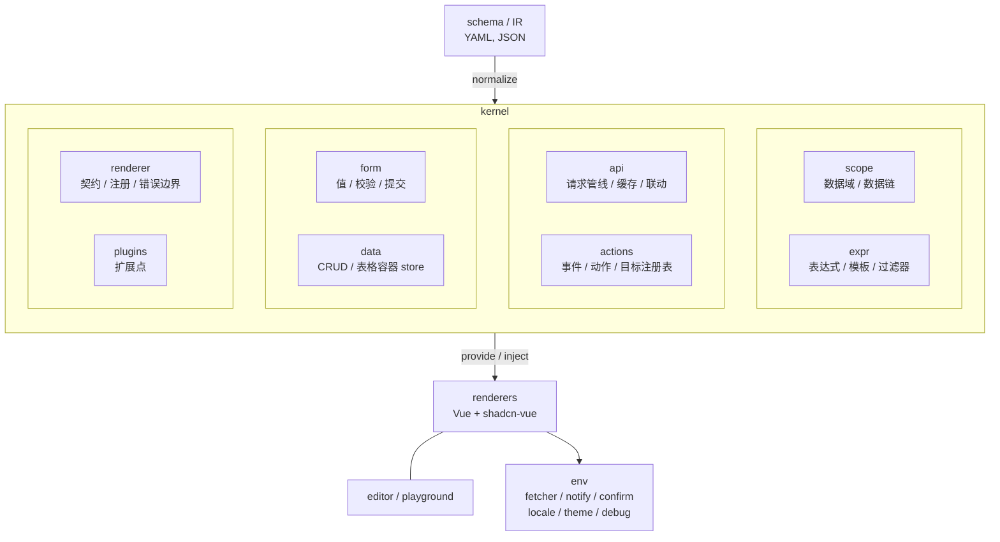

# Vamis 运行时语义设计（amis 文档对齐）

- 日期：2026-10-20
- 状态：部分落地（D1 Scope、D2 模板转义/P0 过滤器、D3 API 管线、D4 事件对象、D5 动态 target P0 已接；其余 D6–D8 见 [CONTEXT.md](../../../CONTEXT.md)）
- 范围：数据域、表达式/模板、API、事件动作、表单、CRUD、渲染器契约、扩展、主题/i18n、诊断、IR
- 参考：`/Users/maxid/Develop/IdeaProjects/github/amis/docs/zh-CN`（amis 6.13.0 / master `43a33ee06`）
- 关联：
  - 运行时与 IR 基础设计：`docs/superpowers/specs/2026-10-20-vamis-vue3-runtime-design.md`
  - 当前实现状态：`docs/superpowers/specs/2026-10-20-amis-sync-status.md`
  - 组件 P0 TODO（amis 文档侧栏分类）：`docs/superpowers/specs/2026-10-20-vamis-component-todo.md`
  - 主题映射（Amis 样式 → shadcn token）：`docs/superpowers/specs/2026-10-21-vamis-theme-shadcn.md`、`docs/superpowers/specs/2026-10-21-vamis-style-system.md`
  - JS SDK（任意 HTML 嵌入）：`docs/superpowers/specs/2026-10-21-vamis-js-sdk.md`

## 0. 摘要

amis 文档真正定义的不是“组件清单”，而是一套**运行时语义**：数据域与数据链、表达式、API 管线、事件动作、表单值模型、组件契约。Vamis 现在有 95.8% 的 type 覆盖，但这些语义大多是简化版。本设计把差距归纳为 12 条决策：

| # | 决策 | 优先级 |
|---|------|--------|
| D1 | 用显式 `Scope` 对象替代“每个节点复制父数据”，只让声明过的容器新建数据域，补 `__super` / URL 参数 / 动态取值 | P0 |
| D2 | 表达式、模板、过滤器统一到一个 `expr` 层；模板默认转义，`\|raw` 才输出 HTML | P0 已落地 |
| D3 | API 统一为可组合管线：normalize → adaptor → sendOn → cache → fetch → payload → responseData → merge/replace | P0 已落地 |
| D4 | 事件统一为 `dispatch(event, payload)` + 事件对象；动作走注册表与控制流，不再写死在 switch 里 | P0 |
| D5 | 组件间联动用组件注册表 + 动态 target，支持多目标、数据合并、reload/setValue/setState/doAction | P0 已落地 |
| D6 | 表单值支持路径（`a.b[0].c`），提交返回数据合并进表单域，校验走可注册规则 | P0 |
| D7 | 渲染器契约固定为 `schema/data/env/api`，注册信息包含 `scope/test/weight`，`isolateScope` 真正生效 | P0 部分落地 |
| D8 | 调试能力内建：`env.debug`、动作日志、未知 type 带 schema path 报告 | P0 |
| D9 | 接口联动与 `trackExpression` 用依赖收集实现自动刷新 | P1 |
| D10 | CRUD 语义补齐：filter 独立作用域、`loadDataOnce`、`syncLocation`、`quickEdit`、`matchFunc` | P1 |
| D11 | 插件化：renderer/action/filter/validator/locale/theme 都可注册；**JS SDK `embed` 是必须的产品入口** | P0（SDK 外壳）/ P1（注册表补齐） |
| D12 | YAML 保持纯数据：函数只以字符串/注册表进入，不引入 YAML tag，不默认执行任意 JS | 全局约束 |

## 1. amis 文档地图

| 文档 | 定义的语义 | 对 Vamis 的约束 |
|------|-----------|-----------------|
| `concepts/schema.md`、`types/schemanode.md` | `type` + 属性 + 树；`visible/hidden/visibleOn/hiddenOn` 对所有节点生效 | Schema 归一化必须是所有渲染器的公共前置 |
| `concepts/datascope-and-datachain.md` | 数据域、数据链、`__super`、URL 参数、`__prev/__changeReason`、`trackExpression` | 数据作用域不能是“每节点复制” |
| `concepts/template.md`、`concepts/expression.md` | `${}` 模板、表达式、公式、箭头函数、两种表达式语法 | 表达式与模板要同一套求值器 |
| `types/api.md` | 接口格式、`sendOn`、`cache`、`requestAdaptor`/`adaptor`、`responseData`、`replaceData`、`messages` | 所有数据请求必须走同一管线 |
| `concepts/event-action.md` | `onEvent`、事件上下文、动作分类、条件/循环/并行/广播、组件动作 | 动作系统需要上下文与注册表，不是 switch |
| `concepts/linkage.md` | 组件联动、动态 `target`、多目标、数据合并、接口自动刷新 | 组件注册表要支持动态名称与跨层查找 |
| `components/form/*`、`components/crud.md` | 表单值/校验/提交合并；CRUD filter/分页/loadDataOnce/syncLocation | 表单与数据容器是两套独立 store 契约 |
| `extend/i18n.md`、`style/*`、`types/classname.md` | locale、`replaceText`、语言覆盖、CSS 变量、`className` 表达式、`m:`/`pc:` | 主题与语言属于 env 能力，不是渲染器各自实现 |

## 2. 现状基线

| 模块 | 现在有什么 | 关键缺口 |
|------|-----------|----------|
| Scope | 显式 `Scope`：根吃 URL query；`page`/`form`/`service`/`crud` 建子域；inherit 节点不再复制；`__super` / `__prev` / `__changeReason` 已有 | `trackExpression` 仍 P1；form/service/crud 的 overlay 尚未全部改走 Scope.merge |
| Expression | `evalFormula` + `evalExpression` + `filterTpl` + `evalTemplate` + `resolveValue`，引擎是仓内 `@vamis/formula` | D2 P0：Tpl 默认文本节点，`\|raw` 才 `v-html`；过滤器 `raw/html/json/date/datetime/number/percent/default/truncate/first`。Amis 其余过滤器（`map`/`bytes` 等）仍 P1 |
| API | 字符串/对象、method/url/data/headers、GET 拼 query、`normalizePayload` | `requestApi` 已接 sendOn/cache/adaptor/`responseData`/`replaceData`/`messages`/`responseType`/`dataType`/GET `api.data`；page/form/service/select 已接 url 自动刷新。`qsOptions`、全局 adaptor、blob 附件头仍 P1 |
| Actions | `registerAction` + `VamisEvent`（`preventDefault`/`stopPropagation`/`setData`/`__rendererData`）；P0 动作在注册表；`expression`/`ignoreError` 已接 | 无循环/switch/parallel/`outputVar`/广播；无动作日志 |
| Linkage | `resolveTargets`：动态名 / 逗号多目标 / `name?a=${a}`；`reload`/`setValue` 已接；SDK `getComponentByName`/`doAction` 可调用 | 接口随变量自动刷新仍属 D9；表单路径值仍等 D6 |
| Form | 表单 store、`initApi`、`validate/submit/reset`、submit 事件 | 扁平 `name`；提交返回不合并；校验规则内嵌；无 `validateOnChange`/`requiredOn`/`clearValueOnHidden`；嵌套表单项不参与校验 |
| CRUD | api/分页/filter/sort/selection/bulkActions/headerToolbar/弹窗编辑 | 无 `loadDataOnce`/`syncLocation`/`quickEdit`/`matchFunc`/`autoGenerateFilter`；filter 只是提交到 query 的内嵌表单 |
| Renderer | `registerRenderer({type, alias, component, isFormItem, scope, test, weight, isolateScope})`；`isolateScope` 不再向上查 | 无 `dispatch/api/reload`、无错误边界；未知 type 仍占位 |
| Extension | `registerRenderer` | 无 action/filter/validator/locale/theme 注册；无插件生命周期 |
| Theme/i18n | Tailwind + shadcn token | `className` 对象/模板/`m-t-xs`/`m:`/`pc:` 已解析；`cssVars` + IR `metadata.style` 已接；无 locale/replaceText/`registerTheme` |
| Diagnostics | `Placeholder` | 无 debug 开关、无动作日志、无 schema path 报错 |
| IR/作者态 | `UiPage`/`FormDef`/`TableDef` 编译；未知 kind 占位 | `PageDef` 仅透传；YAML 与 JSON 都是一等输入 |

## 3. 设计原则

1. **Schema 兼容优先**：amis 字段名与语义不改写；Vamis 扩展只能以新字段/新 kind 形式出现。
2. **数据可序列化**：YAML/JSON 是唯一作者态。函数只能以“表达式字符串 / 函数体字符串 / 已注册名字”进入，禁止隐式 `eval`。
3. **安全默认**：模板默认转义；`|raw` 显式开启 HTML；`new Function` 只在受信任模式（`env.trusted`）可用。
4. **Vue 惯用法**：用 `provide/inject`、`computed`、`shallowReactive` 实现作用域；不模拟 MST，也不引入第二套响应式。
5. **契约先行**：先把 Scope/API/Action/Form 四个契约稳定下来，再补组件数量；组件只消费契约。
6. **可诊断**：每个失败都能回答“哪个 schema 路径、哪个动作、哪个接口”。

## 4. 目标架构



依赖规则：

- 渲染器不得直接 `fetch`、不得自己解析表达式、不得自己维护分页状态。
- kernel 不依赖具体渲染器；渲染器通过 `registerRenderer` 注入。
- `env` 是宿主边界：请求、提示、跳转、确认、i18n、主题、调试都从这里过。

建议在 `packages/vamis-core/src` 内新增目录：`scope/`、`expr/`、`api/`、`actions/`、`form/`、`data/`、`renderer/`、`plugins/`。

## 5. 数据域与数据链（D1）

amis 语义：

- 只有声明过的容器创建数据域（Page/Service/CRUD/Table/Form/Wizard/Combo/InputArray/Dialog/Drawer/List/Cards/Chart/PaginationWrapper/App）。
- 取值沿数据链向上查找；顶层再查 URL 参数。
- `data` 属性与 `initApi` 返回合并；表单提交/接口返回也会更新数据域。
- `trackExpression` 控制上层数据变化是否触发本层刷新。

设计：

```ts
export interface Scope {
  readonly parent?: Scope
  readonly data: PlainObject                    // 本层自有数据（响应式）
  get(path: string): unknown                    // 沿链查找
  set(path: string, value: unknown, reason?: ChangeReason): void
  merge(values: PlainObject, mode?: 'merge' | 'override'): void
  superData(): PlainObject                      // __super 的实体
  track(expression: string, fn: () => void): () => void
}

export type ChangeReason = 'init' | 'input' | 'api' | 'formula' | 'hide' | 'action'
```

- `Scope` 用 `shallowReactive` 存本层数据，`get` 先查本层再查 `parent`；不做对象拷贝。`set(path, ...)` 写回时重建本层顶层 key，保证浅响应式能触发刷新。
- `__super` 是派生值（`parent.data`），`__prev` 与 `__changeReason` 由 `set()` 维护，不参与序列化。
- 根 Scope 在 `VamisRoot` 创建：`props.data` + `location.search` + 路由参数；`env.initialData` 可覆盖。
- `SchemaRenderer` 不再默认新建作用域：读取 `rendererDefinition.scope`：
  - `inherit`（默认）：直接用父 Scope；
  - `self`：创建子 Scope 并在卸载时销毁；
  - `isolate`：子 Scope 不向上查找（`isolateScope: true` 的真正语义）。
- `data` 属性统一走 `scope.merge(schema.data)`。
- `trackExpression` P1：`"none"` 不追踪；`${a},${b}` 提取依赖，比较序列化值后决定是否刷新。

验收：`page > service > tpl` 的变量遮蔽、`__super` 读取、URL `?word=myquery`、`data` + `initApi` 合并、`trackExpression: none` 均与 amis 文档示例一致。

## 6. 表达式、模板与过滤器（D2）

amis 语义：

- `${...}` 是唯一推荐语法；纯 JS 表达式是历史遗留。
- 模板 `${name}` 默认按文本输出，`${name|raw}` 才输出 HTML；`|json`、`|date`、`|default:...` 等过滤器常用。
- 支持公式函数与单表达式箭头函数（`ARRAYMAP(arr, x => x.name)`）。

设计：

```ts
export interface ExprApi {
  eval(expression: string, data: PlainObject): unknown       // 纯表达式
  evalValue(value: unknown, data: PlainObject): unknown      // 整串 ${...} 返回原类型
  evalTemplate(tpl: string, data: PlainObject): TemplateResult
  evalCondition(expression: unknown, data: PlainObject): boolean
}

export interface TemplateResult {
  text: string
  html?: string        // 仅当包含 |raw 或 html 字段
  usedFilters: string[]
}
```

- 过滤器注册表：`raw`、`json`、`date`、`datetime`、`number`、`percent`、`default`、`truncate`、`html`（转义辅助）。
- 解析顺序：`${expr|filter:arg|filter2}` → 先求值 expr，再依次应用过滤器；不再把 `|` 交给公式解析器。
- 模板默认转义；`Tpl` 组件只有 `raw`/`html` 过滤器命中时才 `v-html`，否则用文本节点。
- 显式决策：**不实现 lodash template**（`<% %>`）。原因：需要 JS 执行、XSS 面大，且与“YAML 纯数据”冲突；需要逻辑时用公式与动作。
- 纯 JS 表达式（`data.xxx === 1`）保留兼容入口，但文档与示例统一用 `${}`；`this.xxx` 形式不作为长期契约。
- 错误策略：表达式异常 -> `env.debug` 时抛出带路径的错误；生产返回 `undefined` 并记一条诊断。

验收：文档里的 `${xxx == 1 ? 'One' : 'Others'}`、`ARRAYMAP`、`${name|raw}`、`${xxx|json}`、特殊字符变量 `${ xxx\.yyy }` 都能按 amis 语义工作。

## 7. API 管线（D3）

amis 语义要点：

- 返回格式 `{status, msg, data}`；兼容 `errorCode/errno/error` 等变体与裸数据。
- 配置项：`method/url/data/headers/dataType/responseType/sendOn/cache`，`requestAdaptor/adaptor`（字符串函数体），`responseData`（含 `&`/`$$` 展开），`replaceData`，`messages`，`mockResponse`。
- 初始化接口按 `${var}` 依赖自动刷新。

设计：

```ts
export interface ApiConfig {
  method?: 'get' | 'post' | 'put' | 'patch' | 'delete'
  url: string
  data?: PlainObject
  headers?: Record<string, string>
  dataType?: 'json' | 'form' | 'form-data'
  responseType?: 'json' | 'blob' | 'text'
  sendOn?: string
  cache?: number
  requestAdaptor?: string | RequestAdaptor
  adaptor?: string | ResponseAdaptor
  responseData?: PlainObject
  replaceData?: boolean
  messages?: { success?: string; failed?: string }
  mockResponse?: unknown
}

export interface ApiContext {
  scope: Scope
  env: RendererEnv
  reason: 'init' | 'submit' | 'reload' | 'action'
}

export async function requestApi(api: SchemaApi, ctx: ApiContext): Promise<Payload>
```

管线顺序：

1. `normalizeApi`：字符串 `[method:]url`、模板求值、`api.data` 合并、GET 进 query。
2. `sendOn` 不满足 -> 返回 skipped，不发请求。
3. `requestAdaptor`（仅 `env.trusted` 支持字符串函数体）。
4. 缓存键 = method + url + 序列化 body；命中且未过期直接返回。
5. `env.fetcher`。
6. `normalizePayload` 兼容 amis 返回格式；错误消息进 `msg`。
7. `adaptor`（响应适配）。
8. `responseData` 数据映射，支持 `{"&": "$$"}` 展开。
9. 返回 `{payload, data, replaceData}`，由调用方合并到 Scope 或 FormStore。
10. `messages` + `notify` 统一提示；`responseType: blob` 交给下载动作。

联动（P1）：

- 从 `api.url`、`api.data`、`sendOn` 中提取 `${...}` 依赖变量。
- `Scope.track(deps, refresh)`；同一接口去抖 100ms；`trackExpression` 可覆盖默认依赖。
- `sendOn` 表达式本身也应可触发重新求值。

显式决策：`requestAdaptor` / `adaptor` 的字符串函数体默认关闭，开启需 `env.trusted: true`；更推荐 `env.fetcher` 或注册函数。

## 8. 事件与动作（D4/D5）

amis 语义：

- `onEvent: { click: { actions: [...] } }`；动作上下文可读 `${event.data}`、`${__rendererData}`。
- 动作字段：`actionType/args/data/dataMergeMode/expression/preventDefault/stopPropagation/ignoreError/outputVar/componentId/target`。
- 动作分类：通用（ajax/dialog/drawer/confirm/alert/toast/url/link/copy/print/email/setData/wait）、浏览器（back/forward/refresh）、组件（setValue/reload/setState/doAction）、广播、自定义。
- 控制流：条件、循环（break/continue）、switch、parallel。

设计：

```ts
export interface VamisEvent {
  type: string
  data: PlainObject
  prevented: boolean
  stopped: boolean
  setData(patch: PlainObject): void
  preventDefault(): void
  stopPropagation(): void
}

export interface ActionContext {
  event: VamisEvent
  scope: Scope
  renderer: RendererApi
  env: RendererEnv
  args: PlainObject
}

export type ActionHandler = (action: ActionSchema, ctx: ActionContext) => Promise<void>
```

- `RendererApi.dispatch(type, payload)` 由渲染器调用；`SchemaRenderer` 负责把 `onEvent` 与 `dispatch` 接起来，渲染器不再各自判断 `onEvent.click`。
- 事件对象统一构造：`data = {...scope.data, ...payload}`，`__rendererData = scope.data`。
- 动作注册表：`registerAction(type, handler)`；内置动作按表拆文件，控制流动作（if/loop/switch/parallel）也走注册表。
- 目标解析：`target` 支持 name/id、逗号分隔多目标、`${...}` 动态名、`a?x=${x}` 数据携带；解析失败给诊断而不是静默。
- 组件动作通过 `ScopedComponent` 接口扩展：`reload/setData/setValue/setState/doAction`。
- 广播：`env.bus.emit(eventName, data)`；`onEvent` 可监听广播事件，权重排序。
- 自定义 JS（`actionType: custom`）：`env.trusted` 才允许字符串 `script`，并统一用 `compileFn` 缓存。
- 调试：每次动作打印 `actionType/args/event`，由 `env.debug` 控制。

P0 内置动作：ajax、toast、alert、confirm、dialog、drawer、close、setValue、setData、reload、submit、reset、link/url、copy、wait。
P1：循环/switch/parallel、broadcast、组件 setState、动态 target、outputVar。
P2：custom script、print、email、browser forward/back/refresh、tracker。

## 9. 表单（D6）

amis 语义：

- 表单项 `name` 可写路径；表单有独立数据域，与父域通过数据链相连。
- `initApi` 初始化并随依赖自动刷新；提交后返回 `data` 合并进表单域。
- 校验：`required/requiredOn/validations/validationErrors/validateOnChange`，支持服务端校验。
- 隐藏字段默认保留值，`clearValueOnHidden: true` 才删除。
- 事件：`inited/change/submitSucc/submitFail/formItemValidateSucc/formItemValidateError`。

设计：

```ts
export interface FormStore {
  readonly data: PlainObject
  readonly errors: Record<string, string>
  get(path: string): unknown
  set(path: string, value: unknown, reason?: ChangeReason): void
  merge(values: PlainObject): void
  validate(paths?: string[]): Promise<boolean>
  submit(): Promise<void>
  reset(): void
}
```

- 值路径用统一 `getByPath/setByPath`（支持 `a.b`、`a[0].b`），`name` 不再是平铺 key。
- `initApi`：挂载时请求，`initApi` 依赖变化时刷新（P1）；返回数据 merge 进 form data。
- 提交：校验 -> `api` -> 成功把 `payload.data` merge 进表单域 -> 触发 `submitSucc`；失败触发 `submitFail`，保留错误信息。
- 校验规则：`registerValidator(name, fn)`；内置 required/minLength/maxLength/minimum/maximum/matchRegexp/isEmail/isUrl/isNumeric/isInt/isAlphanumeric；异步规则返回 Promise（P1）。
- `validateOnChange`、`requiredOn`、`clearValueOnHidden` 作为 FormItem 通用属性（P1）。
- 校验函数签名为 `(value, values, schema) => boolean | string | {error: true, msg} | Promise<...>`，支持跨字段校验；`registerValidator` 注册后可在 `validations` 里按名引用。
- `pipeIn` / `pipeOut` 作为表单值适配器（同名字段多类型、日期字符串互转等）：YAML 里写函数体或已注册函数名，受 `env.trusted` 约束。
- 嵌套：Combo/InputArray/InputTable 创建子 Scope 与子 FormStore，校验递归收集。
- P2：`persistData`、离开页面提示、`resetAfterSubmit`、`redirect`/`reload` 提交后行为、服务端校验、`wrapperComponent` 换表单标签。

## 10. 数据容器：CRUD / Table（D10）

amis 语义：CRUD 是带独立数据域的列表容器；`filter` 是一个嵌套表单；`api` 拉数据，分页/排序/查询参数由容器维护；`loadDataOnce` 关闭服务端分页；`syncLocation` 与地址栏同步；`quickEdit` 行内编辑；`matchFunc` 自定义过滤。

设计：

```ts
export interface DataContainerState {
  query: PlainObject
  page: number
  perPage: number
  total: number
  items: PlainObject[]
  selected: PlainObject[]
  inited: boolean
  fetching: boolean
}
```

- 统一 `useDataContainer(schema)` 组合式函数：请求、分页、排序、选择、刷新；CRUD/Table2/List/Cards 复用。
- `filter` 渲染为独立 FormStore（父 Scope 为 CRUD），提交时把 values 合并进 `query` 并重置页码。
- `loadDataOnce`：一次拉全量，前端过滤/排序/分页；`matchFunc`/`filter` 参与前端匹配。
- `syncLocation`：抽 `RouterAdapter`（`readQuery/writeQuery`），不绑定 vue-router；默认关闭由宿主开启。
- `quickEdit`：行内编辑复用 FormStore，提交走行级 api（P1）。
- 工具栏/批量操作沿用现有 `headerToolbar/bulkActions`，补 `footerToolbar` 与 `columnsToggler`。
- 验收：amis CRUD 文档的“查询表单 + 分页 + 排序 + 批量操作 + loadDataOnce”示例可跑。

## 11. 渲染器契约与注册（D7）

```ts
export interface RendererProps {
  schema: SchemaObject
  data: PlainObject
  env: RendererEnv
}

export interface RendererApi {
  dispatch(event: string, payload?: unknown): Promise<void>
  reload(extra?: PlainObject): Promise<void>
  setData(values: PlainObject): void
  doAction(action: ActionSchema): Promise<void>
  component(name: string): ScopedComponent | undefined
}

export interface RendererDefinition {
  type: string
  alias?: string[]
  test?: RegExp
  weight?: number
  scope?: 'inherit' | 'self' | 'isolate'
  isFormItem?: boolean
  component: Component
}
```

- `SchemaRenderer` 负责：归一化、显隐、scope、事件绑定、错误边界、未知 type 诊断。
- 渲染器只拿到 `schema/data/env`，需要动作时从注入的 `RendererApi` 调 `dispatch`。
- `test` 用于兜底渲染（如 `static-*`），`weight` 决定匹配顺序。
- `isolateScope` 从“声明但没用”变为真实语义：子作用域不向上查找。
- 错误边界：渲染异常显示带 schema path 的错误块，不让整页白屏。

## 12. 扩展机制（D11）

```ts
export interface VamisPlugin {
  name: string
  setup(ctx: {
    registerRenderer(def: RendererDefinition): void
    registerAction(type: string, handler: ActionHandler): void
    registerFilter(name: string, fn: FilterFn): void
    registerValidator(name: string, fn: ValidatorFn): void
    registerLocale(locale: string, messages: Record<string, string>): void
    registerTheme(name: string, tokens: Record<string, string>): void
  }): void
}

export function usePlugin(plugin: VamisPlugin): void
```

- 内置能力也用插件注册，保证第三方扩展与内置同权。
- 自定义组件 = `registerRenderer` + Vue 组件。任意 HTML 宿主走 **JS SDK**（`vamis.embed`），内部仍是 `VamisRoot`，不是第二套渲染器。契约见 [JS SDK](./2026-10-21-vamis-js-sdk.md)。
- schema 仍然不能带 JS 函数（D12）；SDK 的 `env.fetcher` 等是宿主回调，允许。
- 函数注册表（filter/validator/formatter）是“可序列化 schema”的推荐扩展方式。
- 编辑器插件（P2）：渲染器定义同时供 runtime 与 editor 使用，编辑态插件通过 `onActive/onInsert/onUpdate/onMove/onDelete/onBuildPanels/onBuildContextMenus/onDndAccept` 扩展，不把编辑器逻辑写进渲染器。
- 版本化：`schema.version` 预留给未来不兼容字段迁移；当前不引入。

## 13. 主题、响应式与多语言（D12 相关）

- **默认自适应**：page / form / crud / 未写 `size` 的表单控件吃满布局槽，作者不必先写 `w-full` / `size: full`。`size` 与 `className` 只是收窄或覆盖。见 [样式系统](./2026-10-21-vamis-style-system.md) §0。
- `className` 解析：字符串 / 对象（`{ 'text-danger': "${status == 1}" }`）/ 模板字符串；统一 `resolveClassName(schema.className)`，由 `SchemaRenderer` 挂到节点根。gap 辅助类 `m-t-xs`、宽度 `w-*`、高度 `h-full` / `h-1/2` 与 `m:`/`pc:` 已接；`xxxClassName` 打子节点仍 P1。
- 主题：沿用 Tailwind/shadcn token；`page.cssVars` 与 IR `metadata.style.cssVars` 映射到根节点 CSS 变量；`registerTheme` 仍 P1。视觉基线见 [样式系统](./2026-10-21-vamis-style-system.md)。
- 响应式：`m:` / `pc:` 前缀走 CSS 媒体查询（&lt;768 / ≥768），作用在间距和宽度 helper；表单 `size` 档位断点是 576px（对齐 Amis form SCSS）。不引入 Tailwind 五档作为作者态。
- i18n：
  - `env.locale` + `registerLocale` 负责内置文案；
  - schema 级语言覆盖（`en-US: { label: 'Name' }`）在 normalize 时按 locale 合并；
  - `env.replaceText` 全局文本替换，默认跳过 `type/name/mode/target/reload`；
  - 默认 `zh-CN`，不内置英文包（P2 可补）。

## 14. 诊断与可观测性（D8）

- `env.debug`：动作执行日志（type/args/event）、接口请求日志（method/url/耗时/status）、表达式错误。
- 未知 type：`Placeholder` 显示 type 与 schema path，`env.onDiagnostic` 回调。
- 校验/请求/动作错误统一 `env.notify('error', ...)`，同时保留结构化错误。
- 预留 `env.tracker`：页面/组件曝光与动作埋点（P2，对齐 amis tracker）。

## 15. IR 与作者态

作者态同时支持 YAML 与 JSON，不强制 YAML。`parseSchemaText` 以 `{` / `[` 开头走 JSON，否则走 YAML；对象与 IR 信封直接进运行时。

- 保持 `UiPage` 信封；`spec` 原样承载 amis widget 树，不因语义增强改信封。
- `PageDef`：有 `spec.schema` 时透传；固定壳（LIST/TREE_LIST）继续占位，等 LCDP IR 侧 kind 稳定。
- 函数写法：
  - 公式：`"${ARRAYMAP(items, item => item.name)}"`；
  - 函数体：块标量 `dataFilter: |`；
  - 不引入 YAML `!js` tag（JSON 无法表达，破坏双态）。
- 模板/表达式含 `: `、`#` 或对象字面量时必须加引号；`stringifyYaml` 已自动处理。
- 保证 JSON ↔ YAML ↔ IR 往返不丢字段、不执行代码。

## 16. 差距矩阵

| 能力 | amis | Vamis 现状 | 决策 | 阶段 |
|------|------|-----------|------|------|
| 数据域/链 | 显式作用域 + `__super` + URL | 显式 Scope + URL 种子已接；`trackExpression` 未做 | D1 | P0 骨架完成 |
| 显隐/禁用联动 | `visibleOn` 等全节点 | 已有（core） | 保持 | 完成 |
| 模板过滤器 | `\|raw`/`\|json` 等 | P0 过滤器已接；`map`/`bytes` 等仍 P1 | D2 | P0 完成 |
| HTML 安全 | 默认转义 + raw | Tpl 默认文本节点；`\|raw` / `type: html` 才 `v-html` | D2 | P0 完成 |
| API 基础 | method/url/data/headers | 已有 | 补 GET data | P0 |
| API 高级 | sendOn/cache/adaptor/responseData | `requestApi` P0 已接；`qsOptions` / 全局 adaptor / blob 下载动作 P1 | D3 | P0 完成 |
| 接口自动刷新 | 依赖跟踪 | page/form `initApi`、service、select `source` 已按 url / `trackExpression` 刷新；未做 Scope.track 去抖 | D9 | P0 部分 |
| 事件上下文 | `event.data`/`__rendererData` | `VamisEvent` + `__rendererData` 已接 | D4 | P0 完成 |
| 动作控制流 | 条件/循环/并行/错误策略 | 无 | D4 | P1 |
| 组件联动 | 动态 target/多目标/数据合并 | `resolveTargets` 已接；SDK `getComponentByName`/`doAction` 可用 | D5 | P0 完成 |
| 广播/自定义动作 | 有 | 无 | D4 | P1 |
| 表单值路径 | `a.b[0]` | 平铺 key | D6 | P0 |
| 提交合并 | payload.data 入表单域 | 不合并 | D6 | P0 |
| 表单校验 | 规则注册/异步/服务端 | 内嵌规则 | D6 | P0/P1 |
| 隐藏清值 | clearValueOnHidden | 无 | D6 | P1 |
| CRUD 高级 | loadDataOnce/syncLocation/quickEdit | 无 | D10 | P1 |
| 渲染器 API | dispatch/reload/doAction | `test`/`weight`/`isolateScope` 已接；仍无注入 dispatch | D7 | P0 部分 |
| 扩展注册 | action/filter/validator/locale | 只有 renderer | D11 | P1 |
| JS SDK | `amis.embed` / `sdk.js` | P0 `vamis.embed` 已落地；`getComponentByName` / `doAction` 未实现 | D11 | P0 外壳完成 / P1 随 kernel |
| className/主题 | 对象 + 表达式 + CSS 变量 | `resolveClassName` + `cssVars` + IR `metadata.style` 已接；无 `registerTheme` / locale / `xxxClassName` | D12 | 进行中 |
| i18n | locale/replaceText/覆盖 | 无 | D12 | P1 |
| 诊断 | debug/日志/tracker | 无 | D8 | P0/P2 |

## 17. 路线图

### P0（语义骨架 + 嵌入入口）

0. **JS SDK**（P0 已落地）：`packages/vamis-sdk` 打出 `sdk.js` + `sdk.css`；`vamis.embed` 支持 JSON / YAML / IR；`updateSchema` / `updateProps` / `unmount`；默认 fetch。P1：`getComponentByName` / `doAction`。见 [JS SDK](./2026-10-21-vamis-js-sdk.md)。
1. `scope/`：Scope、`__super`、URL 种子、scope 配置、`__prev/__changeReason` 基础。
2. `expr/`：过滤器链、模板转义、`evalValue/evalTemplate/evalCondition` 统一入口。
3. `api/`：`requestApi` 管线、`sendOn`、`responseData`、`replaceData`、`messages`、返回格式兼容。
4. `actions/`：事件对象、动作注册表、P0 动作、`expression/preventDefault/stopPropagation/ignoreError`、target 注册表。
5. `form/`：路径值、校验注册表、提交合并、P0 事件。
6. `renderer/`：`RendererApi`、scope 配置、错误边界、未知 type 诊断。
7. `env.debug` 与动作/接口日志。

验收：10 个来自 amis 文档的 schema 全部渲染且行为正确（数据链、联动、提交、弹窗、动作、CRUD 查询、表单校验、模板过滤器、动态 target、隐藏清值）。

### P1（深度对齐）

- 自动刷新依赖收集 + `trackExpression`。
- 动作：循环/switch/parallel/broadcast/`outputVar`/组件 setState。
- 表单：异步校验、服务端校验、`validateOnChange`、`requiredOn`、`clearValueOnHidden`、嵌套表单校验。
- CRUD：`loadDataOnce`、`syncLocation`、`quickEdit`、`matchFunc`、`autoGenerateFilter`、`footerToolbar`。
- 扩展：插件 API、filter/validator/action 注册；SDK `getComponentByName` / `doAction`。
- 主题/i18n：`xxxClassName` 子节点、locale 覆盖、`replaceText`、`registerTheme`。
- 错误边界与诊断面板。

### P2（非核心）

- 自定义 JS 动作、GraphQL、tracker、移动端专用 UI、富文本/Monaco、office/pdf 真实预览、编辑器插件体系。

## 18. 文档歧义与取舍

| 文档点 | 歧义 / 冲突 | 取舍 |
|--------|-------------|------|
| 表达式两种语法 | 旧版纯 JS 与 `${}` 并存 | 以 `${}` 为唯一契约；纯 JS 仅兼容，不写入新示例 |
| JS 模板引擎 | `<% %>` 可执行任意 JS | 不实现；逻辑交给公式与动作 |
| `className` 对象/模板 | 值可为对象、布尔、模板字符串 | 统一 `resolveClassName`；对象 key 的布尔值走表达式 |
| 字符串函数 | adaptor/script 是“函数体字符串” | 默认禁用；`env.trusted` 开启；编译结果缓存 |
| `trackExpression` | 对象/数组会被字符串化成 `[object Object]` | 依赖值做 canonical JSON 比较；文档建议 `\|json` |
| 空值发送 | amis 历史行为是 `undefined` 也发空串 | 默认省略 `undefined`；提供 `sendUndefined: true` 兼容 |
| `clearValueOnHidden` | 默认保留隐藏字段值 | 保持 amis 默认（保留），显式配置才清理 |
| office/pdf 预览 | 依赖重型渲染库 | 继续占位，不做真实渲染 |

## 19. 兼容迁移

不能为了语义重构一次性改掉 159 个已注册 type，按下面顺序灰度：

1. **Scope 先行**：先以 `inherit` 语义接入，旧渲染器行为等价；`self/isolate` 只对 form/service/crud 生效。
2. **API 双轨**：保留旧 `defaultFetcher` 一个版本；新 `requestApi` 先接 form/crud，再推及其他容器。
3. **表单**：路径值与提交合并先覆盖 Form，Combo/InputTable 跟随；旧扁平 name 继续可用。
4. **动作**：先统一事件对象与注册表，再逐个把渲染器从“自己判断 onEvent”切到 `RendererApi.dispatch`。
5. **回归**：每个阶段用 amis 文档示例做黄金用例，type 覆盖与行为覆盖分开统计。

## 20. 非目标

- 像素级复刻 cxd，或复制 amis 的 React/MST 实现。
- 支持 lodash template（`<% %>`）或默认执行任意 JS。
- 与 amis 内部组件 API 一一对应（只保证 schema 语义与常用属性）。
- office/pdf 真实渲染、Monaco/TinyMCE 全家桶、完整编辑器生态。
- 在 P0/P1 阶段做移动端原生组件与埋点平台。

## 21. 风险与对策

| 风险 | 对策 |
|------|------|
| Vue 响应式在大页面上抖动 | 每层 Scope 用 `shallowReactive`；依赖收集精确到表达式；避免 deep watch |
| 字符串函数带来的 RCE/XSS | 默认关闭；`env.trusted` 白名单；模板默认转义；CSP 文档化 |
| Schema 语义漂移 | 用 amis 文档示例做黄金用例；差距矩阵随实现更新 |
| 组件团队各自实现请求/联动 | 渲染器禁止直接 fetch；统一 `requestApi` 与 `dispatch` |
| YAML 引号/块标量踩坑 | `stringifyYaml` 自动加引号；文档给出正反例；往返测试 |
| 兼容旧 schema | 归一化层保留未知字段；`test/weight` 兜底；未知 type 不崩 |

## 22. 验收样例（来自 amis 文档）

1. `datascope-and-datachain`：`page > service > tpl` 变量遮蔽 + `__super`。
2. `linkage`：`visibleOn/disabledOn` + `source` 接口依赖自动刷新。
3. `types/api`：`responseData` 映射 + `sendOn` + `replaceData`。
4. `event-action`：`onEvent` 上下文 + 弹窗 + 组件 setValue + 条件动作。
5. `form`：提交返回合并 + `clearValueOnHidden` + `validateOnChange`。
6. `crud`：filter 表单 + 分页/排序 + `loadDataOnce` + 批量操作。
7. `template/expression`：`${name|raw}`、`${obj|json}`、`ARRAYMAP` 箭头函数。
8. `classname`：对象 + 表达式 className。
9. `i18n`：locale 覆盖 + `replaceText`。
10. `dynamic target`：`target: "form2?name=${name}"` 数据合并刷新。

以上样例进入 `playground/src/examples/`，并作为回归用例保留。

## 23. 组件对齐 TODO

组件按 amis 中文文档侧栏分类（布局 / 功能 / 数据输入 / 数据展示 / 反馈 / 其他），不另起分类。

逐 type 的完成状态、进度和原因见 [组件 P0 TODO](./2026-10-20-vamis-component-todo.md)。

口径与本文一致：**已注册 ≠ 语义完成**；占位与精简实现单独标注；该清单内优先级全部 P0。当前 155 项已完成 0、进行中 153、未开始 2（`popOver` / `badge` 属性），平均进度 47%。type 名称覆盖率仍只记在同步状态里。
