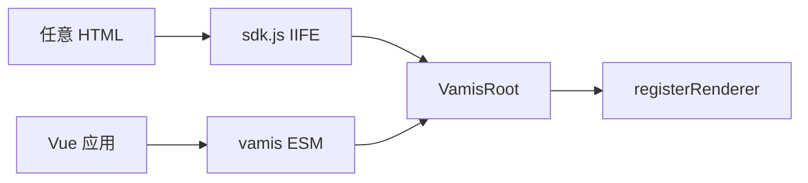

# Vamis JS SDK

- 日期：2026-10-21
- 状态：部分落地（P0：`sdk.js` / `embed` / `hello.html` / `getComponentByName` / `doAction`；P1：`registerTheme` / locale）
- 范围：任意 HTML 页面用 `<script>` 嵌入运行时，对齐 Amis `amis.embed` 的用法，不复制 React/AMD，不搬 `cxd-` 前缀（能力打进 `sdk.css` 的 token / Tailwind）
- 关联：
  - [运行时与 IR](./2026-10-20-vamis-vue3-runtime-design.md)
  - [运行时语义](./2026-10-20-vamis-runtime-semantics-design.md) D11 / D12
  - [样式系统](./2026-10-21-vamis-style-system.md)

Amis 有两条入口：**JS SDK**（任意页面）和 **React**。Vamis 对等为 **JS SDK** 与 **Vue 3 组件**。Vue 入口已有 `VamisRoot`；SDK 是必须交付的第二条入口，不是可选项。

## 1. 为什么必须有

商业页经常不是 Vue 工程：后台模板、jQuery、其它框架、甚至静态 HTML。Amis 能 `sdk.js` + `amis.embed('#root', schema)` 直接挂。Vamis 若只提供 npm + Vue，这些宿主嵌不进去。

SDK **不另做一套运行时**。它把 Vue 3 + Pinia + `vamis` 打进一份 IIFE，对外只暴露 `embed` / 注册表。内部仍是 `VamisRoot`。YAML / JSON / IR / shadcn token / 不搬 `cxd-` 前缀（能力转写） / D12（schema 不进函数）全部不变。

## 2. 产物

| 文件 | 作用 |
|------|------|
| `sdk.js` | IIFE。挂 `window.vamis`。内含 Vue、Pinia、渲染器、默认 env |
| `sdk.css` | `@vamis/ui` token + 辅助类。一文件即可跑，不拆 `helper.css` / `iconfont.css` |

包位置：`packages/vamis-sdk`（薄入口，依赖 workspace 的 `vamis` / `@vamis/core` / `@vamis/ui`）。构建脚本产出 `dist/sdk.js`、`dist/sdk.css`。npm 以后可从 `vamis/sdk` 或 `@vamis/sdk` 引用。

不引入 Amis 的 `amisRequire` AMD loader。不暴露 React。需要注册渲染器时用 `vamis.registerRenderer`。

## 3. 宿主用法（对齐 Amis 快速开始）

```html
<link rel="stylesheet" href="sdk.css" />
<div id="root"></div>
<script src="sdk.js"></script>
<script>
  const scoped = vamis.embed('#root', {
    type: 'page',
    title: '表单页面',
    body: {
      type: 'form',
      mode: 'horizontal',
      body: [
        { type: 'input-text', name: 'name', label: 'Name' },
      ],
    },
  })
</script>
```

`schema` 可以是：

- 裸 widget（`{ type: 'page', ... }`，与 Amis JSON 同形）
- JSON 字符串或 YAML 字符串（SDK 内 `parseSchemaText`）
- IR 信封（`apiVersion: lcdp.ir/v1` + `kind` + `metadata` + `spec`）

## 4. API

```ts
function embed(
  container: string | HTMLElement,
  schema: unknown,
  props?: EmbedProps,
  env?: Partial<RendererEnv> & EmbedEnvExtras,
): VamisScoped

interface EmbedProps {
  data?: Record<string, unknown>
  context?: Record<string, unknown>
  locale?: string
}

interface EmbedEnvExtras {
  theme?: string
  requestAdaptor?: (api: unknown) => unknown | Promise<unknown>
  responseAdaptor?: (...args: unknown[]) => unknown
  toastPosition?: string
}

interface VamisScoped {
  updateProps(props: EmbedProps, callback?: () => void): void
  updateSchema(schema: unknown, props?: EmbedProps): void
  unmount(): void
  /** 依赖 D5 组件注册表；未落地前可抛「尚未实现」 */
  getComponentByName(name: string): unknown
  /** 依赖 D4 动作注册表；未落地前可抛「尚未实现」 */
  doAction(actions: unknown, ctx?: Record<string, unknown>): Promise<void>
}
```

参数顺序对齐 Amis：`(container, schema, props, env)`。

| 能力 | 口径 |
|------|------|
| 容器 | CSS 选择器或 `HTMLElement`；找不到节点则打错误、不挂载。不要往 `document.body` 上直接 mount，必要时在 body 里建一层 div |
| 默认 fetcher | SDK **内置** `window.fetch`，按 Amis payload `{ status, msg, data }` 解析。宿主仍可传 `env.fetcher` 覆盖 |
| notify / alert / confirm / jumpTo | SDK 给默认实现（toast / `window.alert` / `window.confirm` / `location`）；宿主可覆盖 |
| 主题 | **不是** `cxd`/`antd` CSS 包。`env.theme` 映到 `data-accent` 或日后 `registerTheme`。皮肤仍是 shadcn token |
| 密度 | 默认 compact（cxd 盒子）。可用 `html[data-density]` 或 IR `metadata.style.density` |
| 多实例 | 同一页可 `embed` 多次；每实例独立 Pinia 根 store 与 env |
| 卸载 | `scoped.unmount()` 必须卸 Vue app，不留监听 |

全局辅助：

```ts
vamis.registerRenderer(def)
vamis.registerAction?.(type, handler)   // D11
vamis.parseSchemaText(text)
vamis.yamlFromUnknown(input)
```

## 5. 自定义组件

两条路，都不把函数写进 YAML：

1. **宿主 JS 注册**（SDK 页里）：`vamis.registerRenderer({ type: 'my-widget', component })`，`component` 是 Vue 组件。非 Vue 宿主可以用 `custom` 的 `onMount` 字符串（已有 type）往 DOM 里插节点。
2. **Vue 工程**：继续 `import { VamisRoot } from 'vamis'`，与 SDK 共用同一套渲染器表。

禁止：schema 里放 JS 函数、YAML tag、隐式 `eval`（D12）。`env.fetcher` 等回调是宿主代码，允许。

不实现 `amisRequire('react')` 那种把 React 组件挂进 SDK 的路径。

## 6. 和 Vue 入口的关系



两条入口同一内核。Playground / 文档站点继续走 ESM，不必改成 SDK。

## 7. 明确不搬

| Amis | Vamis |
|------|--------|
| `amisRequire` AMD | `window.vamis` 单一全局 |
| `sdk-ie11.css` | 不支持 IE |
| `cxd.css` / `antd.css` / `helper.css` 分文件 | 一份 `sdk.css` |
| `theme: 'cxd' \| 'antd'` 换 BEM 前缀 | token / `data-accent` |
| 把 React 打进 SDK 给自定义组件用 | 自定义走 Vue 组件或 `custom` DOM |

## 8. 分阶段验收

**P0（必须先有，SDK 才算存在）**

1. `pnpm` 能打出 `sdk.js` + `sdk.css`。
2. 一份无构建工具的 `hello.html`：外链两文件后 `vamis.embed('#root', schema)` 能渲染 page / form / 按钮。
3. schema 支持 JSON 对象、JSON 字符串、YAML 字符串、`UiPage` IR。
4. `updateSchema` / `updateProps` / `unmount` 可用。
5. 不传 `env.fetcher` 时，内置 fetch 能打 `/api/mock2` 同类接口（或宿主 CORS 允许的 URL）。
6. 文档「快速开始」同时写 Vue 与 JS SDK；SDK 示例必须是真 HTML，不是截图。

**P1（随 kernel）**

- `registerAction` / `registerFilter` / `registerTheme`（D11）
- `locale` / `replaceText`（D12 余项）

## 9. 当前缺口

P0 已落地：`packages/vamis-sdk` 打出 `sdk.js` + `sdk.css` + `hello.html`；`vamis.embed` 支持 JSON / YAML / IR；`updateSchema` / `updateProps` / `unmount`；文档 `/start/sdk` 用 iframe 跑真 HTML。Playground `/sdk/hello.html` 同源提供。对照页 `/sdk/compare.html` 用**同一份 schema** 左右挂 `amis.embed`（unpkg `amis@6.13.0`）和 `vamis.embed`。左右 iframe 按内容自适应高度，尽量不出滚动条。**组件**用例按 schema 树逐结点对：是否画出、运行时 value、`getComponentByName`、点过之后的 dialog / toast / setValue；不再用整页 smoke 当组件通过。`vamis.embed` 提供 `getComponents()`。用例按 Amis 侧栏分 **文档 / 组件 / 样式**；Vamis 可以比 Amis 多（尤其是样式），多出来的页标 extra。GitHub Pages 上是静态文件 `https://maxid.github.io/vamis/sdk/compare.html`（相对路径拉 `sdk.js` / `embed-case.html` / `compare-cases.js`）；文档里的对照链接必须带 `VITE_BASE` 并整页跳，不能走 Vue Router。`pnpm compare` 仍是本地 Playwright，不在 Pages 上跑。结果表按用例 `measure` 换列：盒模型（同一行 / 缝 / 盒子）、smoke（状态 / 摘要）、计算样式（props），并附字号 / 行高 / 字体；判定也跟当前用例走。字体量测读正文节点和实际 used face（含 body）；smoke 有差时页上判定「字体差」。不挡 Playwright 文档 smoke / P0 盒模型门禁。页内 **编辑 Schema** 为 YAML / JSON 两个 Tab；用例来自 P0 盒模型 + 文档 schema 收割。自动化：`pnpm compare:p0`（盒模型门禁，失败 exit 1）/ `pnpm compare`（全量；**全局修完必须重跑这个**）/ `--page button`（组件修完只重跑自身）/ `--bucket 样式 --section Spacing`（切一组）/ `--all`（再加 Amis 组件文档）。报告写到 [SDK 对照报告](2026-10-24-sdk-compare-report.md)，判定是 Vamis 对齐 Amis 实测。差异按 **全局 / 样式 helper / 组件** 分类并带整改建议。迭代：完成一侧栏项 → 跑该片对照 → 评审报告 → 下一页。本轮全量 793：785 过 / 8 败（失败全是 `m-l*` 阶）。默认两按钮缝 0 已对齐。`.vamis-sdk` 不涂 `--background`（略灰），画布由宿主 html/body 决定。

P0 续：`getComponentByName` / `doAction` 已接到根 ScopedContext。仍缺（P1）：`registerAction` / `registerTheme`、locale。`sdk.js` 体积偏大（含 echarts），后续可按需拆 chunk，但不改 `embed` 契约。
