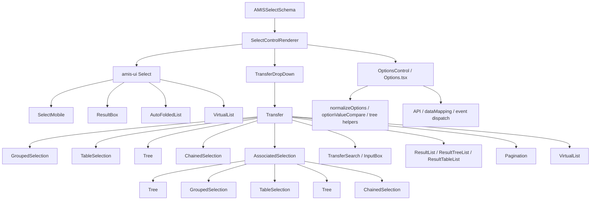

# Amis Select 关联组件与共享能力测绘

- 日期：2026-11-19
- 状态：分析稿
- Amis 基线：6.13.0
- 用途：给 Select 的 `table / tree / chained / associated`、`deferApi`、CUD 事件及相关组件研发提供公共依赖地图
- 关联文档：
  - [Select 剩余语义完成设计](2026-11-19-vamis-select-completion-design.md)
  - [Select 组件设计](../../../../design/component/form/select.md)
  - [Options 组件设计](../../../../design/component/form/options.md)

## 1. 结论

Amis Select 是三个层次叠加：

1. **OptionsControl 契约层**：选项规范化、值序列化、source、自动补全、搜索、CUD、懒加载事件。
2. **普通 Select 交互层**：桌面下拉、移动 PopUp、标签折叠、键盘、全选、虚拟列表、搜索高亮。
3. **TransferDropDown 模式层**：`table / tree / chained / associated / group` 共用结果框、搜索状态、分页、选择面板和模式分派。

后续 Vamis 组件不能只看 `Select.tsx` 单文件。真正可复用的核心在：

- `amis-core/renderers/Options.tsx`
- `amis-ui/components/Selection.tsx` 及各 Selection
- `amis-ui/components/Transfer.tsx`
- `amis-ui/components/ResultBox.tsx`
- `amis-core/utils/normalizeOptions.ts`
- `amis-core/utils/optionValueCompare.ts`
- `amis-core/utils/helper.ts` 的树工具族

## 2. Amis 调用链



## 3. 组件职责

| Amis 模块 | 职责 | 被谁共享 | Vamis 现状 | 建议归属 |
|---|---|---|---|---|
| `Options.tsx` | 值、options、source、autoComplete、searchApi、CUD、defer、事件 | Select、Checkboxes、Radios、InputTree、TreeSelect、Picker、Transfer 等 Options 族 | `useOptionsControl` + `utils/options.ts`，树逻辑另有 `useTreeField` | Options runtime 保持共享；抽出选项事件与 mutation helper |
| `AMISSelectSchema` | Select schema 契约 | Select / multi-select | `SchemaObject` + schema catalog | core 类型与 schema catalog |
| `amis-ui Select.tsx` | 普通桌面下拉、标签、CUD UI、键盘、虚拟列表 | Select / multi-select | `Select.vue` 主路径已实现 | 拆出结果框、普通列表 pane、搜索状态 |
| `SelectMobile.tsx` | 移动端滚轮/列表 PopUp | 普通 Select | `Select.vue` + `CalendarWheel` + `VamisPopUp` | 共享移动选择 pane |
| `TransferDropDown.tsx` | 非普通模式触发器、PopOver/PopUp、确认提交 | table/tree/chained/associated | `Select.vue` 共用外壳 + 模式 pane | `SelectTransferShell` |
| `Transfer.tsx` | 模式分派、搜索、结果区、分页、全选 | 所有 TransferDropDown 模式 | 部分能力散落在 Select / Transfer | `SelectModeController` / 共享 mode props |
| `Selection.tsx` | 选择值数组、itemRender、基础选择 API | 所有 Selection | 逻辑分散在 `options.ts` 和多个组件 | core selection helpers + renderer base props |
| `GroupedSelection` | 分组列表选择 | list/group/associated 右栏 | Select 分组 + Transfer/Picker 各自实现 | `SelectGroupedPane` |
| `TableSelection` | 表格候选与表头全选 | table/associated 右栏 | Table / Picker / Transfer 有局部实现 | `SelectTablePane` |
| `Tree` | 树候选、展开、勾选、搜索高亮、懒加载、虚拟化 | tree/searchResult/associated 左右栏 | `useTreeField` + `TreeBranch` + InputTree/TreeSelect | `SelectTreePane` + 共享 tree state |
| `ChainedSelection` | 无限极级联选择 | chained/associated 右栏 | `ChainedSelect.vue` 精简实现 | `SelectChainedPane` / `useChainedOptions` |
| `AssociatedSelection` | 左节点联动右栏 | associated | 主路径已实现 | `SelectAssociatedPane` |
| `ResultBox` | 单选显示、多选标签、清空、箭头 | 普通 Select / TransferDropDown | Select 与 TreeSelect 各写一份 | `@vamis/ui` 的 `SelectResultBox` 或 UI 等价原语 |
| `AutoFoldedList` | 标签按宽度折叠、`+N` Tooltip | ResultBox | `countVisibleTagsByWidth` + Select 模板 | 抽出可复用折叠列表 |
| `ResultList / ResultTreeList / ResultTableList` | 已选结果区、排序、搜索、结构模式 | Transfer / TransferDropDown | 仅 Select 内标签，Transfer 有局部结果区 | 后续 Transfer 组件共享 |
| `VirtualList` | 固定行高窗口化 | Select、Tree、TableSelection、ChainedSelection、GroupedSelection、ResultList | Select 平铺列表与 Table 有局部窗口化 | 抽出 `useVirtualWindow` / `VirtualOptionList` |
| `PopOverContainer / PopUp` | 桌面定位、移动底栏、确认提交 | Select / TransferDropDown / Picker | `VamisOverlay` / `VamisPopUp` | 保持共享 overlay，不复制 |
| `TooltipWrapper` | 标签、溢出、提示 | Select、ResultBox、Tree | `VamisTooltipLayer` | 保持共享 |
| `Spinner` | 加载态 | Options、Selection、Transfer | `Spinner.vue` | 保持共享 |
| `Checkbox` | 选择勾选盒 | Selection、Tree、TableSelection | checkbox token + 原生 input / mark | 保持共享 |
| `Pagination` | 搜索结果分页 | TransferDropDown | `Pagination.vue` | 复用现有分页 |

## 4. 共享能力矩阵

| 共享能力 | Amis 水标 | 当前 Vamis 落点 | 共享策略 |
|---|---|---|---|
| 选项规范化 | `normalizeOptions` | `@vamis/core/utils/options.ts` | 唯一入口，禁止各 mode 再 normalize |
| label/value 匹配 | `getOptionValue` / `optionValueCompare` | `matchOptionValue` / `optionValuesEqual` | 只保留 core 实现 |
| 值序列化 | `Select.value2array` / `BaseSelection.value2array` | `parseJoined` / `dumpJoined` / `getSelectedOptions` / `dumpOptionsValue` | 统一为 core value model |
| source / autoComplete | `WithRemoteConfig` + `Options.reloadOptions` | `useOptionsControl` | 普通与模式壳共用 |
| searchApi / debounce / cancel | `Options` + `Select.handleInputChange` + `Transfer.searchRequest` | `useOptionsControl` 的 keyword/seq/timer | 抽共享 search state，防竞态 |
| 树操作 | `helper.ts` 的 `findTree` / `flattenTree` / `mapTree` / `spliceTree` 等 | `utils/options.ts` + `useTreeField` | tree pane 共用，不复制树遍历 |
| 节点懒加载 | `Options.deferLoad` | `useTreeField.deferLoad` | 唯一 lazy state，树模式与关联左/右栏共用 |
| 选择勾选 | `BaseSelection` + `toggleOption` | `toggleOption` / `toggleTreeSelection` | core 纯函数 + pane 展示 |
| 全选 | `Transfer.toggleAll` / Selection | `toggleAllOptions` / `isAllSelected` | 保持纯函数 |
| 搜索高亮 | `highlight` + `matchSorter` | `filterOptionTree` + 高亮样式 | SearchBox/Tree/Table 共用 |
| CUD 事件 | `dispatchOptionEvent` | `useOptionsControl` / `useTreeField` 各写一份 | 抽 `emitOptionEvent` + mutation helper |
| 标签折叠 | `ResultBox` + `AutoFoldedList` | `countVisibleTagsByWidth` + Select 模板 | 抽 ResultBox / folding |
| 虚拟列表 | `VirtualList` | Select 平铺 + Table 局部 | 抽窗口化 composable |
| Overlay | `PopOverContainer` / `PopUp` | `VamisOverlay` / `VamisPopUp` | 唯一浮层与 z-index |
| 移动确认 | `TransferDropDown` tempValue | Select mobileDraft | 模式壳共用临时值 |
| 分页 | `Transfer.renderFooter` | `Pagination` | 搜索结果共用 |
| 键盘/a11y | Downshift / DOM role | Select 极简键盘 | 在共享列表 pane 中统一 |
| 主题 token | `_select.scss` / `_selection.scss` / `_result-box.scss` | `styles.css --select-*` / `--tree-*` / `--checkbox-*` | Result/Selection/Tree 只消费 token |
| 国际化 | `Select.*` / `Transfer.*` / `Tree.*` | locale keys | 模式壳与 pane 共用 key |

## 5. Vamis 建议模块边界

```text
packages/vamis-core/src/utils/options.ts
  选项规范化、值模型、树操作、选择匹配、懒加载合并

packages/vamis/src/optionsControl.ts
source / autoComplete / searchApi / CUD / 普通值状态

packages/vamis/src/renderers/form/tree/useTreeField.ts
展开、defer、树勾选、树搜索

packages/vamis/src/renderers/form/select/
  SelectControl.vue
  SelectListPane.vue
  SelectTransferShell.vue
  SelectResultBox.vue
  SelectGroupedPane.vue
  SelectTablePane.vue
  SelectTreePane.vue
  SelectChainedPane.vue
  SelectAssociatedPane.vue
```

边界原则：

- `@vamis/core` 只放可序列化、可单测的选值/树/匹配语义。
- `packages/vamis` 放 schema、env、overlay、事件、API 和渲染器组合。
- `@vamis/ui` 只放无 schema/env 的原语：结果框、标签折叠、虚拟窗口、Checkbox、Table 壳。
- `Select.vue` 最终只做 public schema 适配与模式分派，不直接维护四套选择面板细节。

## 6. 关联组件研发顺序

1. **Options runtime 公共层**：CUD 事件顺序、source/search、值模型测试。
2. **ResultBox / TransferShell**：普通 Select、table/tree/chained/associated 共用触发器和移动确认。
3. **Tree 公共 pane**：先完成 `useTreeField` 可嵌入边界，再接 `selectMode: tree` 与 associated 左栏。
4. **Table / Grouped pane**：服务 `selectMode: table` 与 associated 右栏。
5. **Chained pane**：抽 `ChainedSelect` 的路径状态，避免 Select 内复制。
6. **Associated pane**：只组合以上 pane，不新增第三套选择实现。
7. **SearchResultMode**：复用同一 pane 分派，只替换候选数据源。

## 7. 不应复用的部分

- 不直接挂完整 `TreeSelect.vue` 到 `selectMode: tree`：它会带入独立 FormItem、触发器与 CUD 外壳。
- 不直接挂完整 `InputTree.vue` 到 associated 左栏：它会写入外层表单字段并生成额外表单项。
- 不在 `Select.vue` 内复制 `useTreeField`、TreeBranch、ChainedSelect 或 Table 的数据域逻辑。
- 不把 `ResultBox` 继续分别写在 Select 和 TreeSelect 模板里；后续所有选择模式共用一个结果框。

## 8. 仍需源码核对的点

- `Transfer.resultListModeFollowSelect` 对 `selectMode: table` 的结果区是否有额外 DOM/列宽差异。
- `TransferDropDown` 的搜索分页与 `Pagination` 交互在移动 PopUp 下是否与桌面一致。
- `Tree` 的 `initiallyOpen` / `unfoldedLevel` / `autoCheckChildren` 在 Select 模式和独立 TreeSelect 下是否完全同义。
- `AssociatedSelection` 的 `leftDefaultValue` 与 source 首项 `leftOptions` 的组合顺序。
- `ResultBox` 的 `showInvalidMatch`、`sortable`、`overflowTagPopover` 在普通 Select 与 TransferDropDown 下是否一致。
